# 炬元控制台 · UI 分析报告

> 审计范围：`app/` 下全部 8 个业务页面、登录页、应用外壳与主题系统。
> 审计方式：代码走查 + 本地实机核验（桌面 1024×768、移动 375×812、浅色/深色两种主题，MySQL 8.4 + 演示数据）。
> 配套文档：[ui-design-spec.md](./ui-design-spec.md)（设计规范与改版方案）、[mockups/](./mockups/index.html)（高保真稿）。
> 2026-10-24 按财务、运营的用法又走查了一遍，结果在 [§7](#7-2026-10-24-体验体检财务运营用起来卡在哪)；同一天按新定的设计理念逐页过流程，结果在 [§8](#8-2026-10-24-按设计理念逐页过流程是不是连着的)。§1–§6 是第一次审计，保留备查。

## 1. 结论先行

控制台的功能覆盖已经很完整，问题集中在**表达层**：同一类信息在不同页面有不同的说法、不同的时间范围、不同的颜色，页面靠堆卡片承载信息，导致“一眼看懂今天赚没赚钱、哪个上游快没钱了”这件核心任务需要翻好几屏。

| 维度 | 评分 | 一句话 |
|---|---|---|
| 信息架构 | 2 / 5 | 自营业务一页 22 张卡、约 6 屏；总览与上游资源重复列表 |
| 视觉一致性 | 2 / 5 | 两套令牌手工同步，8 种圆角、约 10 种灰、无间距刻度 |
| 数据可视化 | 2 / 5 | 双轴图、文本色充当系列色、甜甜圈比较相近值、无图表色板 |
| 可访问性 | 2 / 5 | 次级文字、状态标签、深色主按钮、焦点环多处对比度不达标 |
| 响应式 | 3 / 5 | 移动端有专门适配，但品牌字白底白字、标题被裁切、首帧闪侧栏 |
| 状态反馈 | 2 / 5 | 四种加载形态并存；“未配置”显示成报错；轮询失败清空页面 |
| 表单体验 | 2 / 5 | 密钥明文输入、只用 toast 校验、数字用文本框、保存按钮远离字段 |

**最该先修的 10 件事**（P0）：

1. 移动端顶栏品牌字白底白字、页面标题被裁切（外壳）。
2. 桌面端没有顶栏，刷新和账户入口藏在侧栏底部（外壳）。
3. 上游资源表单的访问令牌、API 密钥用明文 `Input`；告警渠道的密钥同样明文（安全）。
4. 自营业务“未配置”状态显示为红色报错，而不是引导（自营业务）。
5. 数据不完整时利润仍以红色 “¥-7.29 / -517%” 呈现（自营业务）。
6. 成本与利润页的双轴图（分析）。
7. 深色主题主按钮白字对比度 2.59:1、浅色次级文字 3.49–3.78:1（可访问性）。
8. 页面标题在 1024 宽度下被截断为 “上游...”“自营业...”“成本与...”（外壳）。
9. 对账页切换预设后不立即生效，标签却已显示新窗口（对账）。
10. 各页时间范围选项各不相同（跨页）。

---

## 2. 已实机核验的缺陷

| # | 现象 | 位置 | 级别 |
|---|---|---|---|
| V1 | 桌面端无顶栏：头像与刷新按钮位于侧栏左下角，`headerTitleRender` 在 side 布局下从不渲染（死代码） | `app/(dashboard)/layout.tsx:153` `:173` `:185` | P0 |
| V2 | 1024px 下页面标题被截断：`.ant-page-header-heading-left` 为 `overflow:hidden`，而右侧工具栏过宽 | 各页 `PageContainer` + `globals.css` | P0 |
| V3 | 移动端顶栏品牌字为 `rgb(255,255,255)`，落在白色顶栏上不可见：`menuHeaderRender` 的 `props` 在移动端为 `undefined`，`showWordmark` 恒为真 | `layout.tsx:143-148` | P0 |
| V4 | 移动端标题左侧被裁：标题 left=34px，父级 padding 40px 且 `overflow:hidden` | `globals.css` 移动端 PageContainer 覆盖 | P0 |
| V5 | 移动端首帧闪现展开的侧栏；主题首帧固定为浅色（`useState(false)`），深色用户会闪白 | `providers.tsx:100` | P1 |
| V6 | 自营业务未配置时显示“无法加载自营业务数据”+ 红色感叹号 + “重新加载” | `my/page.tsx:360` | P0 |
| V7 | 自营业务一屏 1024×768 需滚动约 6 屏：22 张 ProCard、5 张图、6 张表、2 条长提示 | `my/page.tsx:490-930` | P0 |
| V8 | 数据标记为不完整时，利润仍为红色 “¥-7.29 / -517%” | `my/page.tsx:542-546` | P0 |
| V9 | 收支利润图为双轴：利润走右轴（黑线），收入为灰色 | `analytics/page.tsx:444-478` | P0 |
| V10 | 四种加载形态：骨架卡、整卡 AppState、Spin、与真实布局不符的骨架 | 总览 / 对账 / 告警 / 自营 | P1 |
| V11 | 今日消耗条形图站名被截断，数值标签压在条上 | `page.tsx:566-600` | P1 |
| V12 | 对账页 “已确认毛利 $0.00” 显示为绿色 | `reconciliation/page.tsx` | P1 |
| V13 | 深色主题侧栏 `#111827` 与页面 `#0F141B` 对比 1.04:1，边界消失 | `layout.tsx:115` | P1 |
| V14 | 控制台 antd 弃用告警：`Alert.message`→`title`、`Statistic.valueStyle`→`styles.content` | 自营 / 设置 / 上游资源 | P2 |
| V15 | 总览下方的站点列表与“上游资源”页重复 | `page.tsx:420-515` | P2 |

## 3. 设计系统问题

### 3.1 令牌与样式来源

- **两套令牌手工同步**：antd `ConfigProvider` 令牌（`providers.tsx:8-50`）与 `globals.css:5-51` 的 `--jy-*` 变量重复定义，深色块在 CSS 里还重复了两次（媒体查询 + `[data-theme]`）。任何改色都要改三处。
- **侧栏色硬编码**：`#111827` 写死在 `layout.tsx:115-128`，与 `--jy-sider`（`globals.css:18`，未被使用）各自为政。
- **主题色三处不一致**：`manifest` 的 `theme_color` 为 `#3157D5`，`viewport.themeColor` 为 `#F4F6F8 / #0F141B`，侧栏为 `#111827`。
- **样式散落**：324 处内联 `style={{}}`（自营 68、上游资源 65、总览 51、分析 34、告警 33、用量 28、设置 27）；78 个 `.ant-*` 覆盖块、22 处 `!important`；对账相关 CSS 约占 `globals.css` 的 35%。
- **状态修饰符不统一**：`ok/success`、`warn/warning`、`danger/error` 混用。
- **死代码**：`.app-header-context*`（`globals.css:154-180`）、`.mobile-filterbar .ant-select-selector`（`:823`）、`.reconciliation-transition`、`.reconciliation-updated`（`:1799-1810`）、`.mobile-station-card__error*` / `__plate`（`:974-1030`）、`--jy-sider`。

### 3.2 刻度

| 项 | 现状 | 问题 |
|---|---|---|
| 圆角 | 4 / 5 / 6 / 7 / 8 / 10 / 12 / 14 | 8 档，没有层级含义 |
| 灰阶 | 浅色约 10 种中性灰 | 相近灰无法区分用途 |
| 间距 | 无刻度；内联 `marginBottom: 12` 20 处、`16` 17 处 | 同类间距随手写 |
| 字号 | 12–30 共 9 档 + 5 处 `clamp()` | 无比例关系 |
| 字重 | 含 550 / 650 / 680 | 非标准字重，系统字体会回退，渲染不一致 |
| 字体 | 声明了 `Geist`（`globals.css:60`）但从未加载；antd `fontFamily` 未设置 | 实际渲染为系统字体，数字不等宽 |
| 断点 | CSS：360/480/767/900/991/1199；JS：md 768 / lg 992 | CSS 与 JS 断点不一致，中间宽度两套规则冲突 |

### 3.3 对比度（WCAG 2.2）

| 组合 | 比值 | 要求 | 结果 |
|---|---|---|---|
| 浅色次级文字 `#7A8494` / 白 | 3.78 | 4.5 | 不达标 |
| 浅色次级文字 `#7A8494` / `#F4F6F8` | 3.49 | 4.5 | 不达标 |
| 浅色状态标签（文字/浅底） | 3.9–4.5 | 4.5 | 部分不达标 |
| 深色主按钮 白 / `#7F9CFF` | 2.59 | 4.5 | 不达标 |
| 焦点环 | 1.53 / 2.07 | 3.0 | 不达标 |
| 深色侧栏 / 页面 | 1.04 | 3.0（边界） | 不达标 |

### 3.4 图表配色

图表没有独立色板，直接借用文本色当系列色：成本 = 主色、收入 = 次级文字灰、利润 = 正文黑（`analytics/page.tsx:452-457`）；预测线用三级文字灰（`my/page.tsx:794`、`:836`）；甜甜圈用 G2 默认色（`analytics/page.tsx:543`）；跑道图阈值 3/7 天写死（`analytics/page.tsx:580`）。

## 4. 跨页问题

**时间范围控件**每页都不一样：

| 页面 | 选项 |
|---|---|
| 运营总览 | 24 小时 / 3 天 / 7 天 / 30 天（`page.tsx:140-143`） |
| 自营业务 | 今天 / 近 7 天 / 近 30 天 |
| 用量分析 | 今天 / 近 24 小时 / 近 7 天 / 近 30 天 |
| 成本与利润 | 7 / 30 / 90 / 365 天 |
| 上游渠道对账 | 今天 / 昨天 / 近 7 天 / 自定义 |

**术语漂移**：同一对象被叫作“资源 / 站点 / 中转站 / 渠道 / 上游”；同一指标被叫作“收入 / 本站收费 / 期内收入”“利润 / 毛利 / 已确认毛利”“消耗 / 消费 / 成本”。

**反馈方式**：校验失败只弹 toast（上游资源 `stations/page.tsx:899-905`、登录页）；数字字段用文本框再 `Number()`（告警 `notifications/page.tsx:545-564`）；清空的数字框被存成 0（设置 `settings/page.tsx:183-184`）。

**刷新语义**：顶栏刷新不会重新拉取总览数据；`LastRefreshed` 显示的是前端拉取时间而非数据采集时间；总览固定 30 秒轮询（`page.tsx:218`），无视设置中的刷新间隔。

**路由**：`Button href`（如 `page.tsx:792`）触发整页刷新且不带深链参数；侧栏菜单项是没有 `href` 的 `<a>`，无法新标签打开。

**缺失的边界文件**：`(dashboard)` 下没有 `error.tsx` / `loading.tsx`。

## 5. 分页发现

级别说明：**P0** 影响正确理解或安全，**P1** 明显影响效率，**P2** 打磨项。

### 5.1 运营总览 `app/(dashboard)/page.tsx`

- P0 “总余额”只汇总查询成功的站点（`:247`），失败站点被静默排除，却没有标注“不含 N 个失败站点”。
- P1 顶部“余额偏低”计数（`:253`，按状态）与下方待处理卡片（含“不再续费”）口径不一致。
- P1 `rateOf` 在缺汇率时静默按 1:1 折算（`:245-250`），美元站会被当成人民币加总。
- P1 失败重试按钮使用 `primary + danger`，视觉权重高于真正的主操作。
- P1 预计耗尽天数直接显示原始值（如 “0.4166 天”）；tooltip 用字符串拼 HTML 且未转义站名（`:597`）。
- P1 页面加载时重复请求；固定 30 秒轮询。
- P2 今日消耗条形图：站名截断、数值标签压条、移动端无数值（`:576`）。

### 5.2 上游资源 `app/(dashboard)/stations/page.tsx`

- P0 访问令牌、API 密钥为明文 `Input`（`:1159`、`:1169`）；邮箱/密码字段未设置 `autoComplete="off" / "new-password"`，浏览器会自动填入控制台自己的登录凭据。
- P0 文案“凭证仅保存在本机”（`:1124`）与事实不符——凭证保存在服务端数据库，且 `server/`、`db/` 中没有任何加密逻辑，为明文存储。界面文案须如实描述；静态加密建议另立安全任务。
- P1 只改名称/阈值也要求重新测试连接（`:904-905`）；实际上仅 `CONNECTION_FIELDS`（`:81`）变化时才需要。
- P1 `role="button"` 的行（`:509`）内嵌刷新、编辑等按钮，形成嵌套交互元素，读屏与键盘焦点混乱。
- P1 校验只用 toast；金额、天数用文本 `Input`。
- P1 移动端不能新增资源；已归档资源无法在界面恢复（接口已支持 `archived:false`，见 `app/api/stations/[id]/route.js:13`）。
- P1 无搜索、筛选、排序；站点多时只能滚动找。
- P2 行操作默认 `opacity .66`，悬停才清晰，触屏不可发现。
- P2 错误文案重复“分类：消息”。

### 5.3 自营业务 `app/(dashboard)/my/page.tsx`

- P0 信息过载（V7）：建议拆成“概览 / 用户 / 模型与渠道”三个标签页，“管理员转售 Key”（`:553`）移到抽屉或设置。
- P0 未配置状态显示成报错（V6）；数据不完整时利润仍为红色（V8）。
- P1 轮询失败会把整页替换成错误态，已加载的数据丢失。
- P1 切换时间范围无加载反馈。
- P1 表格金额未右对齐、无排序、首列未固定。
- P1 预测线使用三级文字灰（`:794`、`:836`），与“实际”对比过弱；“80% 置信区间”（`:871`）实为经验区间，表述不准确。
- P2 说明文字藏在 `title` 属性中（`:473`、`:933`），触屏与读屏都拿不到。

### 5.4 用量分析 `app/(dashboard)/usage/page.tsx`

- P1 没有按站点拆分，无法回答“哪个上游用得多”。
- P1 出错时内容区被一行灰字替代，没有重试。
- P2 移动端条形图不显示数值；骨架与真实布局不一致。

### 5.5 成本与利润 `app/(dashboard)/analytics/page.tsx`

- P0 双轴图（V9）。
- P1 页面顶部没有利润汇总，只有成本汇总。
- P1 成本占比使用甜甜圈（`:543`），站点多时比较相近值很难，且使用 G2 默认配色。
- P1 跑道阈值写死 3/7 天（`:566-580`），与告警设置中的 `etaDays` 不联动。
- P2 365 天按日出柱，柱宽不足 1px；累计线使用平滑插值会伪造中间值；坐标轴金额未格式化；切换范围时骨架闪烁。

### 5.6 上游渠道对账 `app/(dashboard)/reconciliation/page.tsx`

> 该页有未提交的改动，以下仅作设计层面的记录，未改动代码。

- P0 切换预设（今天/昨天/近 7 天）后需再点“查询”才生效，但窗口标签已提前显示新范围，读数与标签不符。
- P1 `expandRowByClick` 与 [reconciliation-inline-history.md](./reconciliation-inline-history.md) 规范中“只由展开按钮触发”不一致。
- P1 分组历史表格 `scroll={{ x: 1040 }}`（`:145`）嵌在外层可横向滚动的表格里，形成嵌套滚动；操作列未固定。
- P1 所有正数一律绿色，包括 $0.00（V12）。颜色应表达状态（已确认/待确认/异常），金额本身用中性色。
- P2 极小金额出现指数表示法；AppState 渲染在 `PageContainer` 之外，出错时标题栏消失；时区为自由文本输入。

### 5.7 告警中心 `app/(dashboard)/notifications/page.tsx`

- P0 渠道密钥（Bot Token、Webhook、SMTP 密码等）为明文 `Input`。
- P1 阈值为文本框 + `Number()`（`:545-564`），输入 “3天” 会变成 `NaN`。
- P1 同一张卡片有两种保存方式（行内开关即时生效，阈值需点保存）。
- P1 规则关闭时，其渠道选择仍可操作。
- P1 渠道列表无“最近测试结果/时间”；空状态未列出 Resend、SMTP，也没有“添加渠道”按钮。
- P2 字段标签是 `
`，不是 `<label>`，点击标签不能聚焦输入框；对账异常没有告警规则可绑定。

### 5.8 系统设置 `app/(dashboard)/settings/page.tsx`

- P1 唯一的“保存”按钮（`:418-420`）与它保存的字段隔着两张卡片。
- P1 清空的数字框被存为 0（`:183-184`）。
- P1 修改密码不是 `<form>`，没有确认密码字段与 `autocomplete`，按钮只写“修改”（`:349`）。
- P1 余额告警阈值单位为美元（`lowBalanceUsd`），而全站余额以人民币展示。
- P2 `me` 加载前卡片先渲染再跳变。

### 5.9 登录与外壳

- P1 登录错误只用 toast，输入框不标红。
- P1 移动端页面没有 `h1`。
- P2 菜单项为无 `href` 的 `<a>`。

## 6. 附：核验环境

- Node 24.9（项目 Next 16 需要，系统 Node 14 无法运行）。
- MySQL 8.4（Homebrew 默认的最新版 `mysql` 已移除迁移脚本用到的 `MD5()`，迁移报 `FUNCTION relay_monitor.MD5 does not exist`）。
- 演示数据：7 天、15 分钟粒度共 3355 条快照，含一次 $100 充值。

---

## 7. 2026-10-24 体验体检：财务、运营用起来卡在哪

> 走查方式：在自己的工作区（main `abf8894`）开预览，用空库自带的 5 个演示上游，补了 7 天余额历史。先看第一次打开的样子，再照用户的路径走：新增自营站点、绑 2 条渠道（一条回答了「只给这些渠道用」，一条保持默认）。桌面 1440、手机 390 各走一遍，以浅色为主，深色抽查。读者按财务、运营、客服算。
> 这次不看：日报的用词（PR #48 正在改）；演示上游读不到用量、测试读取失败（演示数据的限制，不是页面的问题）。
> 排序：按对「钱算得对不对、今天要做什么」的影响，从大到小。改动大小分两档：**只改字或样式**、**要改流程**。截图在 [ux/screens/](./ux/screens/)。
> 文中只写「§」不带文件名的，指 [ui-copy-spec.md](./ui-copy-spec.md) 的章节；设计规范写全名「ui-design-spec §」。

| # | 页面 | 问题 | 改动大小 | 放在哪做 |
|---|---|---|---|---|
| 1 | 运营总览、侧栏、每日利润、上游账单 | 需处理的条数不可信：同一件事列好几遍，侧栏数字随打开的页面变 | 要改流程 | E |
| 2 | 渠道绑定 | 「这把 Key 还给别处用吗？」默认选「不确定」，绑完显示「已绑定」，利润却不算 | 只改字或样式 | 单独小 PR |
| 3 | 每日利润 | 汇总加不起来：收入 − 上游成本 ≠ 毛利，没有说明 | 只改字或样式（服务端汇总口径） | F |
| 4 | 编辑上游（自营站点） | 页面说「没设置售价」，可编辑页里没有「售价」 | 只改字或样式 | 单独小 PR |
| 5 | 运营总览、成本估算、自营业务 vs 每日利润 | 同一类钱，这边写 ¥，那边写 $ | 要用户定 | 待定 |
| 6 | 每日利润、运营总览 › 去回答 | 回答一个问题要进整套「去绑定」抽屉 | 要改流程 | E |
| 7 | 渠道绑定 › 去绑定 | 「算利润」默认不勾；确认按钮在顶上，结果在底下 | 只改字或样式 | 单独小 PR |
| 8 | 运营总览、上游列表、上游账单 | 第一次打开，需处理里全是不影响钱的「还没确认这把 Key 属于哪个上游账号」 | 只改字或样式（归类规则） | E |
| 9 | 运营总览（手机） | 首屏全是利润等式，需处理在第二屏 | 只改字或样式 | 单独小 PR |
| 10 | 需处理 › 测试读取 | 点了还要再点；搜索框冒出内部编号；时区写成 Asia/Shanghai | 只改字或样式 | E |
| 11 | 每日利润（没设置自营站点） | 引导长得像报错；「去设置」只到上游列表 | 只改字或样式 | 单独小 PR |
| 12 | 每日利润 | 页上几句话互相打架：主按钮、说明、黄条、绿条 | 只改字或样式 | E |
| 13 | 系统设置 | 余额提醒线没有单位，说明难懂 | 只改字或样式 | 跟 5 一起 |
| 14 | 运营总览、成本估算（手机） | 上游名字被截成五六个字 | 只改字或样式 | 单独小 PR |
| 15 | 运营总览 vs 成本估算 | 同一个上游，一处标「余额偏低」，一处标「快用完」 | 只改字或样式 | 单独小 PR |

「单独小 PR」的几条互不相干，可以一起放进一个只改页面的 PR，也可以等 E、F 顺手做；由总指挥排。

### 7.1 需处理的条数不可信

- **页面**：运营总览「需处理」、侧栏「运营总览」旁的数字、每日利润、上游账单。
- **用户想做什么**：早上打开，看今天有几件事要处理；处理完，数字归零。
- **卡在哪**：
  1. **同一件事列好几遍。**3 个没绑定的渠道，在总览里成了「有 1 个渠道还没绑定」三条，加上「有 3 个渠道还没绑定」一条。原因是两份待办来源各报了一次：一份按渠道拆开，一份合在一起，两份都留下了。页面写「需处理 9」，实际要做的是 6 件。
  2. **侧栏数字随打开的页面变。**同一时刻，直接打开用量分析时是 2，打开运营总览是 9；走查中在渠道绑定里还见过 11。原因是只有总览和上游资源会去读账号和账单的待办，别的页面只算余额那几条。
  3. **几处说法不一样。**
     - 总览写「这把 Key 还给别处用吗？」，按钮「去回答」。
     - 上游账单写「需处理：去回答」，把按钮名当成了原因。
     - 每日利润选「今天」时，只数自己列表里的绑定，写「需处理 1」或「没有需要处理的事」；同一屏的黄条却在说有渠道没算进利润。
- **截图**：
  - 总览列表，后四条是同一件事：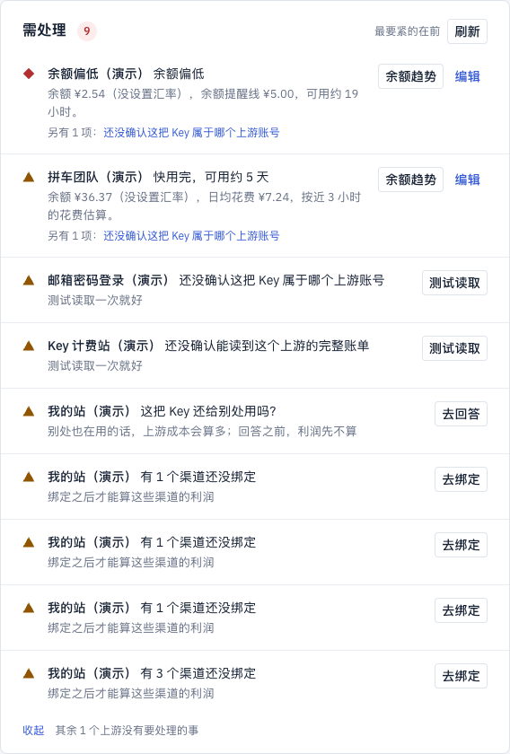
  - 同一时刻，侧栏在用量分析里是 2、在运营总览里是 9： 
  - 上游账单把按钮名当原因：
  - 同一时刻的每日利润只数自己的绑定，写「需处理 1」：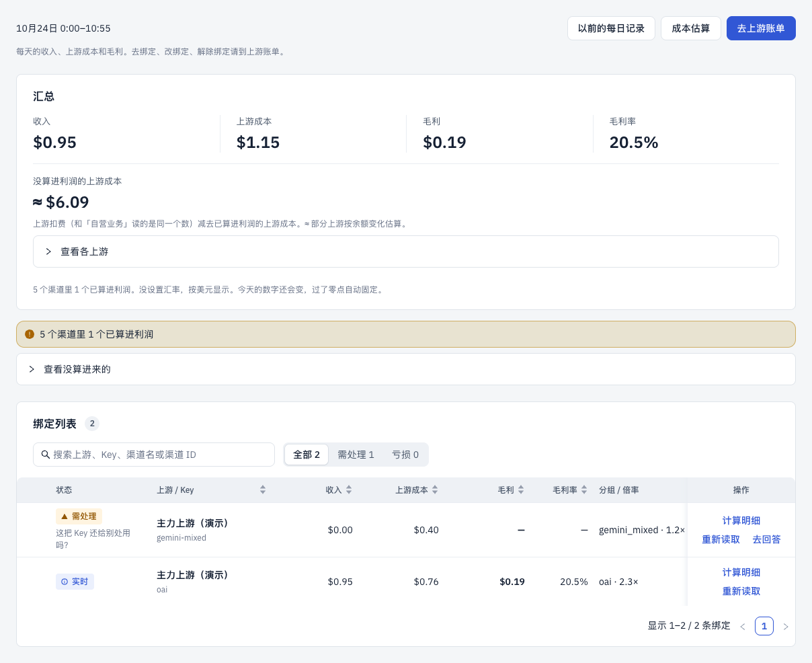
- **建议**：这就是计划里的 E。设计稿另交（`design/ux/e-attention.md`），要点：
  - 服务端出一份清单，四处都读它。
  - 一件事一条。同一个对象只露最要紧的一条，其余收起（§4、§5.1）。
  - 侧栏只读这份清单的条数，不在各页自己拼。
- **改动大小**：要改流程（E）。

### 7.2 「这把 Key 还给别处用吗？」默认选好了「不确定」

- **页面**：上游资源 › 渠道绑定 › 去绑定，勾上「同时算利润」以后。
- **用户想做什么**：把渠道和 Key 绑上，开始每天算利润。
- **卡在哪**：问题下面的下拉已经选好「不确定」，不改就点「确认绑定」，会出现三件互相矛盾的事：
  - 渠道列表显示「已绑定」，预览里还写「可以绑定」「从现在开始算利润，今天就能看到」；
  - 可规则是回答之前利润先不算：每日利润里这条是「需处理」，毛利「—」；
  - 总览多出一条「去回答」。

  用户以为做完了，其实没生效。
- **截图**：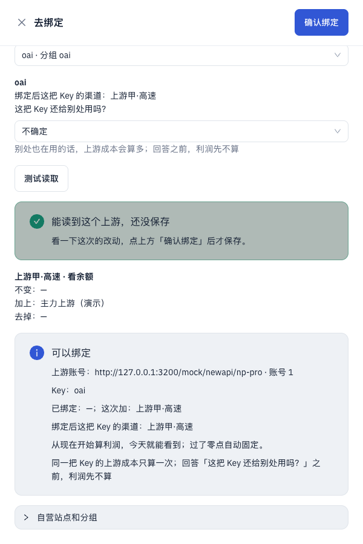
- **建议**：
  - 下拉不给默认值，没选不能确认。没选时的提示按 §8.2「漏填」那一行的格式写（新的一句，先进规范）。
  - 选了「不确定」或「别处也在用」时，确认按钮旁说清后果：这条先不算利润（新的一句，先进规范）。
  - 渠道绑定里这种渠道按 §5.6 显示「需处理」，不显示「已绑定」。
- **改动大小**：只改字或样式（去掉默认值、加一句话）。

### 7.3 每日利润的汇总加不起来

- **页面**：每日利润 › 汇总（有一条绑定需处理时）。
- **用户想做什么**：看今天赚了多少，顺手核对「收入 − 上游成本 = 毛利」。
- **卡在哪**：
  - 汇总写收入 $0.95、上游成本 $1.15、毛利 $0.19、毛利率 20.5%。
  - 需处理那条绑定的 $0.40 上游成本算进了「上游成本」，却没算进毛利（毛利只加了已经算出来的那条），页面上也没有说明。
  - 财务一减，对不上，就会怀疑整页的数。
- **截图**：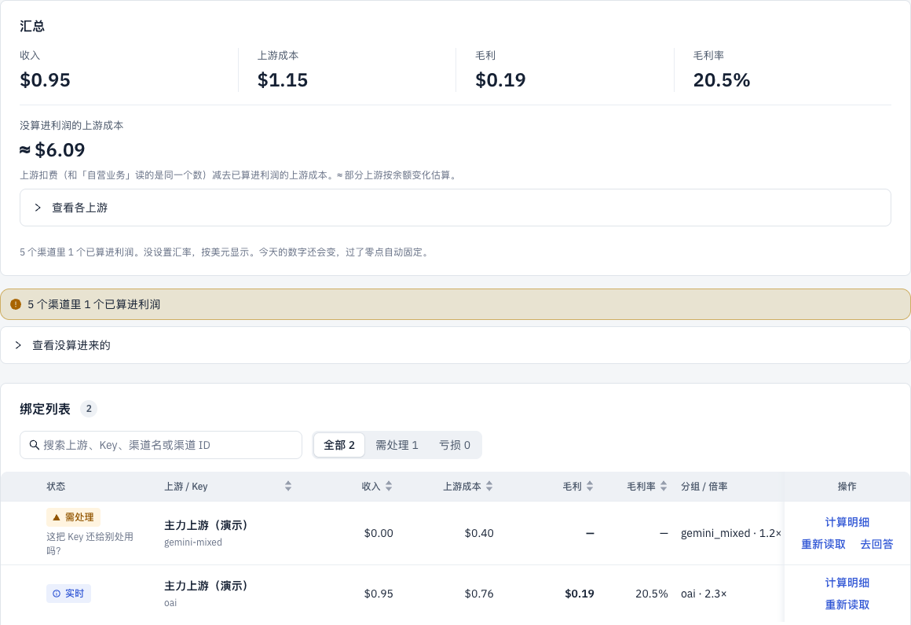
- **建议**：
  - 照 §4 多天合计的写法（「其中 2 天需处理，没算进来」）处理绑定：汇总的收入、上游成本、毛利都只加已经算出来的绑定。
  - 旁边写一句「其中 1 条绑定需处理，没算进来」（新说法，先进规范）。
  - 需处理那条的金额留在列表里它自己那一行。
  - 多天合计也按这一套写，放进 F 的设计稿。
- **改动大小**：只改汇总口径和一句话（服务端），不改流程。

### 7.4 自营站点的「售价」没地方填

- **页面**：上游资源 › 编辑上游，打开「这是我的自营站点」时；运营总览、自营业务的说明。
- **用户想做什么**：页面提示「我的站（演示）没设置售价，暂按 1 美元额度 = 1 元算」，想把售价填上，让收入按人民币算对。
- **卡在哪**：
  - 编辑页里没有叫「售价」的格子。打开自营站点的开关后，表单还是上游那一套：
    - 「汇率」：填的其实就是售价；
    - 「算进利润」：说的是上游成本，对自营站点不起作用；
    - 「余额提醒线」「不再续费」「渠道里用的其他地址」：都是上游才有的设置。
  - 标题写「编辑上游：我的站（演示）」。
  - 「没设置售价」那句话旁边，也没有能直接打开这里的按钮。
- **截图**：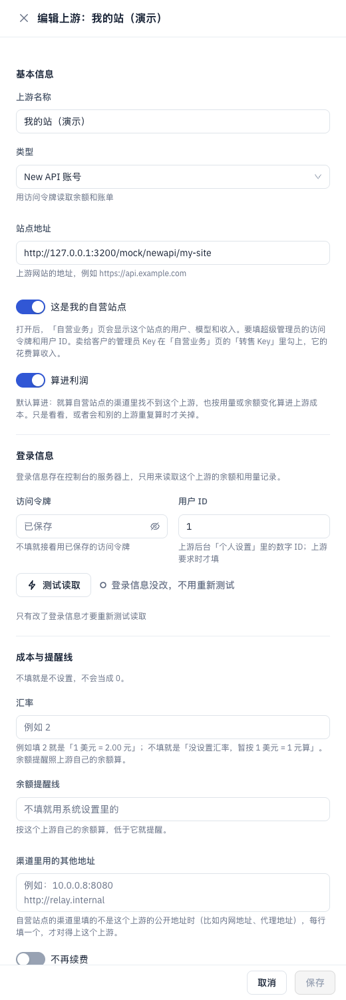
- **建议**：
  - 打开「这是我的自营站点」后，「汇率」一格改叫「售价」，说明按 §3.2、§7 写「1 美元额度 = 7.50 元」。
  - 藏起只对上游有用的「算进利润」「余额提醒线」「不再续费」「渠道里用的其他地址」。
  - 「没设置售价」那句后面加「去设置」，直接打开自营站点的编辑页，定位到售价。
- **改动大小**：只改字或样式（加一个跳转）。

### 7.5 同一类钱，这边写 ¥，那边写 $

- **页面**：运营总览、成本估算、自营业务、用量分析写 ¥；每日利润写 $。
- **用户想做什么**：财务把今天的上游成本记账。
- **卡在哪**：
  - 没设置汇率时，总览把美元按 1:1 写成「¥7.21」，每日利润把同一类钱写成「$1.15」。
  - 总览里的说明夹在一长句中间（「……没设置汇率，暂按 1 美元 = 1 元算……」），数字旁边没有。
  - 财务看到 ¥ 会当成人民币。
- **截图**：
  - 总览写 ¥：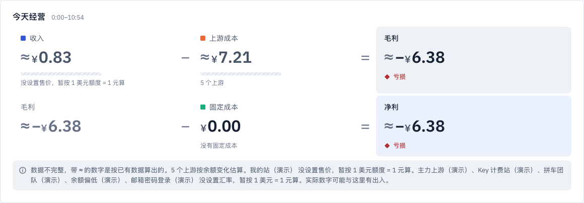
  - 每日利润写 $：
- **建议**：规范 §7 留了一句「要不要改成不折算，另外决定」，建议现在定下来：
  - 没设置汇率时，各页都按原币写（$），和每日利润一致；设置了汇率才写 ¥。
  - 如果暂时不改，至少在 ¥ 金额旁边直接标「按 1 美元 = 1 元」，不要只放在长句里。
- **改动大小**：要用户定。定下来以后只改显示。

### 7.6 「去回答」打开的是整套绑定抽屉

- **页面**：每日利润、运营总览 › 去回答。
- **用户想做什么**：回答一个问题：这把 Key 还给别处用吗？
- **卡在哪**：
  - 点了以后跳到上游资源 › 渠道绑定，打开一个标题叫「去绑定」的大抽屉。
  - 最上面先是「改绑定」「换 Key」两个按钮，问题的下拉在最底下。
  - 选好以后还要再点一次「测试读取」，再滚回顶部点「确认绑定」。
  - 按钮叫「去回答」，打开的东西却叫「去绑定」，违反 §2 第 7 条。
- **截图**：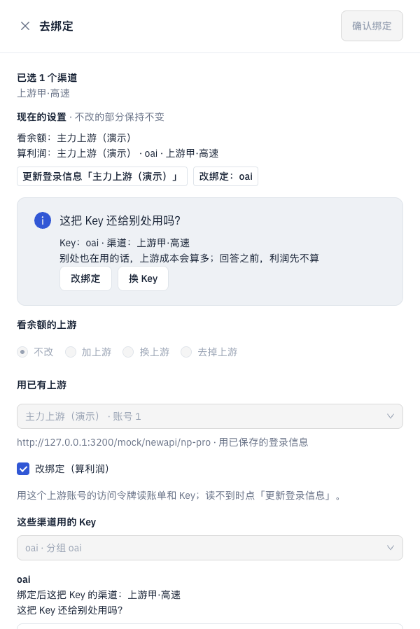
- **建议**：「去回答」就地弹一个小窗。
  - 标题「这把 Key 还给别处用吗？」，写清是哪把 Key、绑了哪些渠道。
  - 选项用 §5.2 那五个（`COVERAGE_ANSWERS`）。只有选「自营站点的其他渠道也在用」时，才多选渠道。
  - 按钮「保存」，完成提示「已保存」（§3.5）。
  - 不改 Key、不改上游，所以不用再测试读取。后端能不能直接存回答，要开发确认。
- **改动大小**：要改流程（新的小窗，复用同一张回答表）。

### 7.7 绑定抽屉：「算利润」默认不勾，确认按钮离结果太远

- **页面**：上游资源 › 渠道绑定 › 去绑定。
- **用户想做什么**：从每日利润点「去绑定」，绑上 Key，开始算利润。
- **卡在哪**：
  1. 「同时算利润（绑定 Key）」默认不勾，从每日利润进来也一样。不勾的话，这次只是看余额。
  2. 勾上以后，下面还写着「只看余额时，不用选 Key」，那是没勾时才该说的话。
  3. 测试读取的结果和改动预览都在抽屉底部，「确认绑定」却在顶部右上角，看完要滚回去。
  4. 预览里「不变：—」「去掉：—」这样的空行也列出来了。
- **截图**：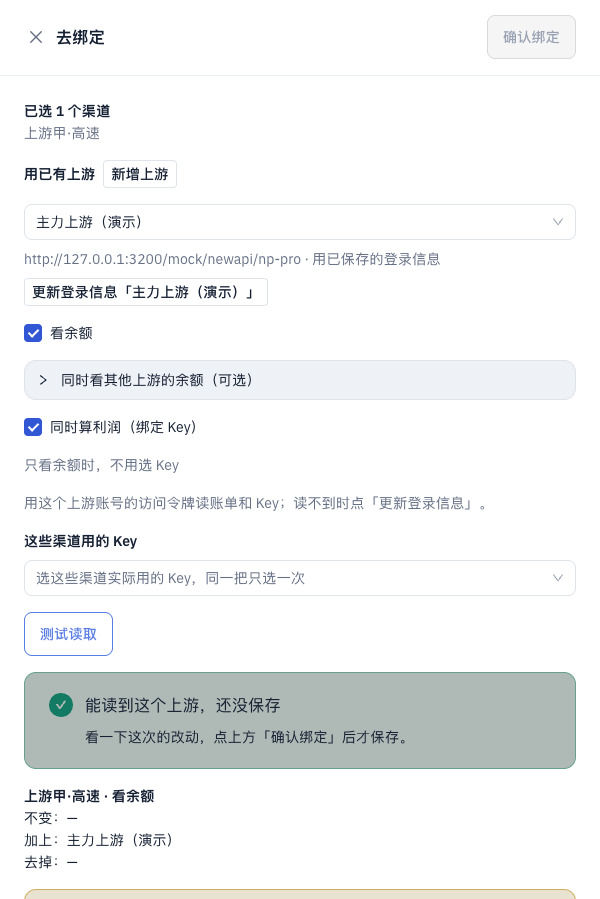
- **建议**：
  - 从每日利润、或从需处理的「有 N 个渠道还没绑定」进来时，「算利润」默认勾上。
  - 「只看余额时，不用选 Key」只在没勾时显示。
  - 确认按钮放到抽屉底部吸底，挨着预览（ui-design-spec §4.8）。
  - 预览里空的行不写。
- **改动大小**：只改字或样式（改默认值和按钮位置）。

### 7.8 第一次打开，需处理里全是不影响钱的待办

- **页面**：运营总览、上游列表「状态」一列、上游账单。
- **用户想做什么**：刚装好，加了几个上游看余额，还没绑任何 Key。
- **卡在哪**：
  - 5 个上游里，3 个报「还没确认这把 Key 属于哪个上游账号」，1 个报「还没确认能读到这个上游的完整账单」。
  - 总览写「需处理 5」，上游列表写「需处理 5、无需处理 0」。
  - 用户一把 Key 都没选过，却被问「这把 Key」。
  - 这几条只影响以后绑定时的核对，现在页面上没有一个数受它影响。
  - 演示上游的测试读取还会失败，这几条永远清不掉。
- **截图**：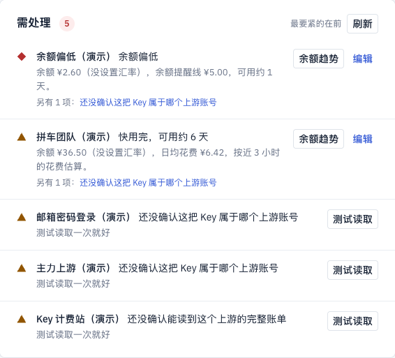
- **建议**：按 §4「需处理 = 不处理就算不准」重新归类，规则写进 E：
  - 没有绑定的上游，「还没确认上游账号」不进需处理，只在上游账单那个上游旁边标一句。
  - 有绑定时才进清单，标题按对象说，例如「还没确认「主力上游」是哪个上游账号」（新的一句，先进规范）。
- **改动大小**：只改字或样式（改归类规则，和 E 一起做）。

### 7.9 手机上，需处理在第二屏

- **页面**：运营总览（390 宽）。
- **用户想做什么**：在手机上看一眼有没有要处理的事。
- **卡在哪**：
  - 利润等式竖着排，占满第一屏；「需处理」的标题刚露在屏幕最底下。
  - 还没设置自营站点时，这一屏大半是「没设置」「—」。
  - ui-design-spec §0 说这页要在 5 秒内回答三件事，手机上第三件得往下滑才看到。
- **截图**：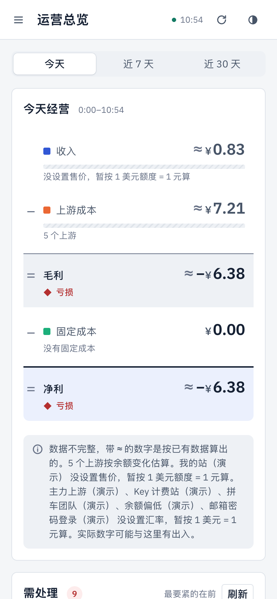
- **建议**：
  - 手机上把「需处理」放到等式前面，或者把等式收成一行「净利 ≈ −¥6.38 · 亏损」，点开再看全。
  - 还没设置自营站点时，等式只留一行提示。
  - 这条规则写进 ui-design-spec §5.1。
- **改动大小**：只改字或样式（手机布局）。

### 7.10 测试读取：点了还要再点，还露出内部编号和时区代码

- **页面**：运营总览 › 测试读取 → 上游资源 › 上游账单。
- **用户想做什么**：照需处理的提示点「测试读取」，读一下就完事。
- **卡在哪**：
  - 点了以后跳到上游账单，弹出一个抽屉，还得再点一次「测试读取」。
  - 后面列表的搜索框被填上了「st_qd845qcrdt」。这是内部编号，§3.6 规定不上界面；列表也因此显示「没有匹配的」。
  - 抽屉里有一个能改的「时区」框，写着「Asia/Shanghai」。§6 禁止出现时区代码，计划里也定了时区不在页面上改。
- **截图**：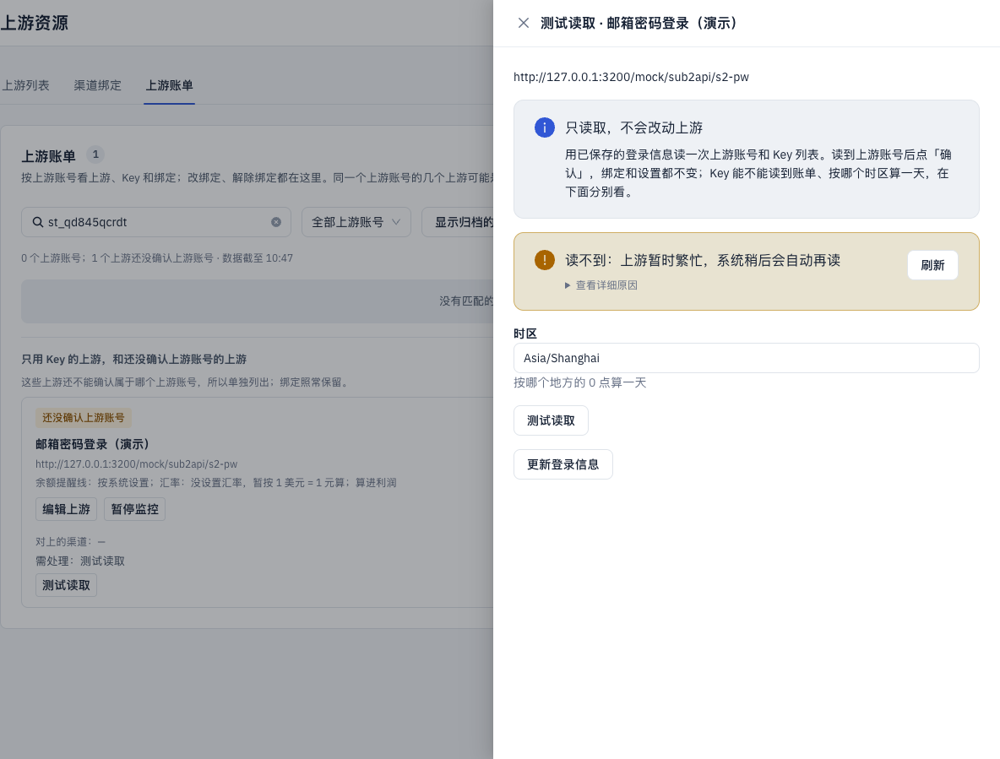
- **建议**：
  - 从需处理点进来就直接读一次，抽屉里显示结果。
  - 定位到那个上游时，不往搜索框里填编号，把那张卡片高亮就行。
  - 时区不让改。只在和业务时区不同时，按 §6 写一句「按 UTC 时间算一天」。
- **改动大小**：只改字或样式（加一次自动读取）。

### 7.11 每日利润没设置自营站点时，像是出错了

- **页面**：每日利润（还没设置自营站点）。
- **用户想做什么**：第一次进每日利润，照提示把自营站点设好。
- **卡在哪**：
  - 页面中间一张卡片，红框里一个「—」，上面一行蓝色小字「炬元控制台」，看起来是出错页。ui-design-spec §1.1 第 4 条说：没设置是引导，不是报错。
  - 自营业务页遇到同一件事，用的是分步引导，两页不一样。
  - 「去设置」只打开上游列表。用户还得自己找哪个是自己的站、点编辑、找开关；自己的站还没加进来时，更不知道该干什么。
- **截图**：
- **建议**：
  - 用自营业务那套分步引导（`data-state.tsx` 的 `Onboarding`）。
  - 「去设置」打开编辑页，不是列表：
    - 列表里有 New API 上游，就问一句「哪个是你的自营站点」；
    - 一个都没有，就直接打开「新增上游」，并预先打开「这是我的自营站点」。
- **改动大小**：只改字或样式（加一个跳转参数）。

### 7.12 每日利润页上几句话互相打架

- **页面**：每日利润。
- **卡在哪**：
  1. **主按钮指错地方。**页面最醒目的按钮是「去上游账单」，可没绑定时要做的是「去绑定」，它在「渠道绑定」标签里。页顶的说明又写「去绑定、改绑定、解除绑定请到上游账单」，也把人指错了地方。
  2. **一句话说两遍。**「5 个渠道里 1 个已算进利润」在汇总底下说一遍，紧接着的黄条又说一遍。
  3. **一屏里两个说法相反。**黄条提醒有渠道没算进利润，下面的绿条却写「没有需要处理的事」。
- **截图**：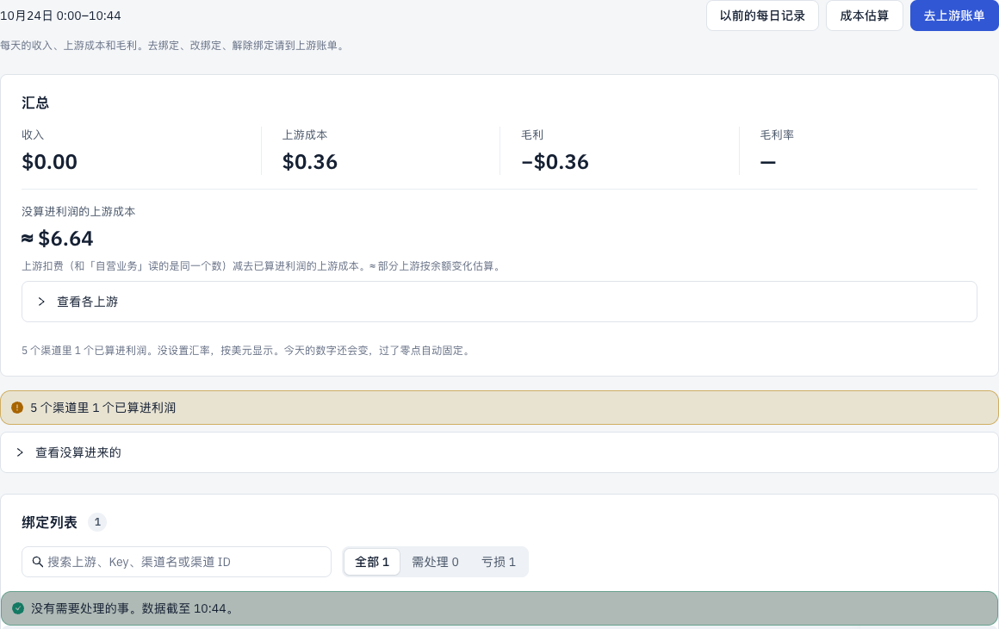
- **建议**：
  - 页顶的主按钮跟着情况变：有没绑定的渠道时是「去绑定」，否则不放主按钮。「以前的每日记录」「成本估算」照旧放次要按钮。
  - 页顶那句说明删掉，要做的事交给需处理清单去说。
  - 汇总和黄条里的那句只留一处。
  - 「没有需要处理的事」只在 E 的清单真为空时出现。
- **改动大小**：只改字或样式。

### 7.13 余额提醒线没有单位

- **页面**：系统设置 › 余额提醒线。
- **用户想做什么**：设「余额低于多少就提醒我」。
- **卡在哪**：
  - 输入框里只有一个「5」，没有 $ 也没有 ¥。
  - 说明写「按各上游自己的余额单位比（设了汇率的按美元额度），不换算」，不好懂。
  - 上游列表在没设置汇率时，把余额写成「¥2.60」，用户会以为这里的 5 是 5 元。
- **截图**：
- **建议**：
  - 框后面标上它和谁比：「按各上游自己的币种」。
  - 上游列表悬停时，写出这个上游实际用的提醒线，带上币种，例如「$5.00」。
  - 说法和第 5 条一起定，先进规范 §3.3。
- **改动大小**：只改字或样式。

### 7.14 手机上，上游名字被截掉了

- **页面**：运营总览的「上游余量」「今天上游成本」，成本估算的「可用天数」（390 宽）。
- **卡在哪**：
  - 名字只剩前几个字：「余额偏低（…」「Key 计费站…」「邮箱密码登…」。
  - 可用天数的条占了一大半宽度。
  - 真实上游常叫「OpenRouter 主账号」这类长名字，截完就分不清是哪个。
- **截图**：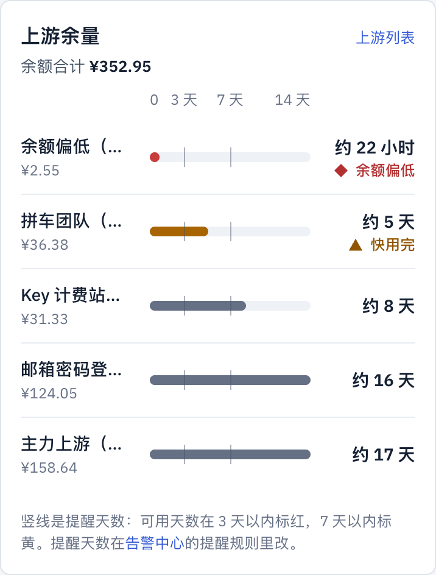
- **建议**：手机上一项占两行：
  - 第一行：全名，右边是天数和档位；
  - 第二行：余额和条。

  这条规则写进 ui-design-spec §4.4。
- **改动大小**：只改字或样式。

### 7.15 同一个上游，两页标的档不一样

- **页面**：运营总览「上游余量」、成本估算「可用天数」。
- **卡在哪**：
  - 「余额偏低（演示）」在总览标「余额偏低」，在成本估算标「快用完」。
  - 规范 §12 规定，余额在哪一档只由 `balanceViewOf` 判断；成本估算这块还在只看天数。
- **截图**：
  - 运营总览：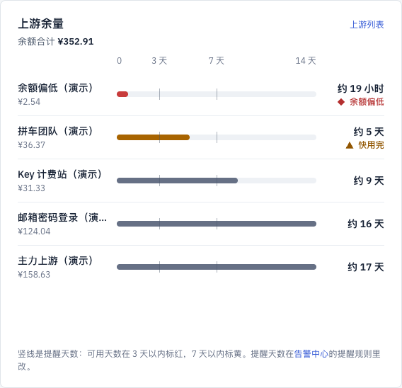
  - 成本估算：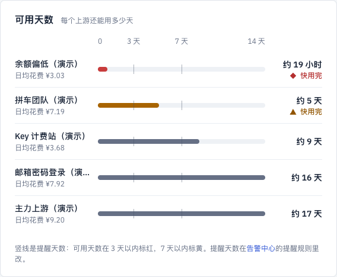
- **建议**：成本估算的可用天数也改用 `balanceViewOf`，和总览、上游列表同一个判断。
- **改动大小**：只改字或样式（换成共用函数）。

### 7.16 次要问题（这次没展开）

- **每日利润的时间范围不进地址栏。**刷新后回到「昨天」。E 的日报链接要能直接打开「近 7 天 · 需处理」，所以放进 E 一起补（ui-design-spec §2.3）。
- **提示条的底色发灰。**成功的看着像禁用，警告的发闷，例如每日利润的「没有需要处理的事」、绑定抽屉的「能读到这个上游」。原因是 Alert 只按令牌设了 info 的底色，成功和警告的没设。只改样式。
- **告警中心「快用完」的天数写成了「3.00 天」。**
- **成本估算顶上「数字怎么来的」是一大段字**，手机上占满首屏。可以默认收起。
- **总览等式下面的说明太长。**它把所有没设置汇率的上游名字连成一句，可以改成「5 个上游没设置汇率」，后面跟「去设置」。
- **渠道绑定在没设置自营站点时也摆着操作。**
  - 标题写「渠道绑定 · 0」，和标签页名重复。
  - 搜索框、筛选和「去绑定」按钮都在，但用不了。
- **上游账单没有批量测试读取。**每个没确认的上游一张大卡片，只能一个个点「测试读取」。
- **上游列表的「状态」一列放的是「测试读取」链接**，不是状态。
- **绑定预览用地址当名字**：「上游账号：http://…/np-pro · 账号 1」。
- **读屏软件把按钮读成「loading 确认绑定」。**（2026-10-24 补，界面测试 #52 时发现）
  - 原因：按钮转完圈以后，antd 的加载图标退场动画会卡在半路：宽 0、透明，看不见，但没有移走。图标上的 `aria-label="loading"` 还在，就被算进按钮的名字里。
  - 影响所有走过加载的按钮，例如「确认绑定」「接着做完」「测试读取」「刷新」。看着没问题，读屏用户和按名字找按钮的测试都会撞上。
  - 建议两种修法，开发挑一种：
    - 全站关掉按钮加载图标的退场动画，转完圈图标直接移走；
    - 或者让加载图标不算进按钮的名字（不带 `aria-label`，或标成 `aria-hidden`）。
  - 修好以后，界面测试里给「loading 」前缀开的口子（#52）可以收回。
- **日报**：用词由 PR #48 改，这次不看。

### 7.17 截图是怎么来的

- 环境：
  - 工作区的开发版，库是临时 MySQL 上的 `relay_monitor_design`，看完已删。
  - 演示上游补了 7 天、每 15 分钟一条的余额历史；其中「余额偏低」那个上游在 3 天前充过 $10。
- 截图时的数据状态：
  - 7.8、7.11、7.13：还没设置自营站点。
  - 其余各条：新增了自营站点「我的站（演示）」，绑了 2 条渠道。一条（oai）回答了「只给这些渠道用」，一条（gemini-mixed）保持默认「不确定」。
- 截图脚本放在工作区外面，没有进仓库。

## 8. 2026-10-24 按设计理念逐页过：流程是不是连着的

> 依据 [ui-design-spec](./ui-design-spec.md) §1.2 的七条交互和流程原则（用户 2026-10-24：「尽量减少不必要的操作」「把整个流程串起来」「化繁为简」）。§7 找的是一处一处的毛病，这一节看的是流程：用户为了一个目标要走几步、跳几次、哪些步本该系统自己做。
>
> 环境同 §7.17（开发版、临时库 `relay_monitor_design`，看完已删）。这次从全新的库开始走：先没有自营站点，再一步步设置。步数按「点击 + 填写 + 选择」数，换页签、换页面另数。
>
> 已经有设计稿的，只写一句指过去：需处理清单见 E（[e-attention.md](./ux/e-attention.md)），多天拼装见 F，改设置见 D，绑定跟着 Key 走见 K（[k-key-segments.md](./ux/k-key-segments.md)），金额币种见 G。

### 8.1 结论先行

现在的控制台是按「东西」分页的：上游一页、自营站点藏在上游里、绑定一页、利润三四页、告警两页。用户的目标却是一条线：**接上上游 → 设好自营站点 → 渠道开始算利润 → 每天看一眼、处理几件事**。这条线在页面上是断的：

- **没有起点。**第一次登录落在运营总览，需处理里是 5 条「测试读取」，没有一处告诉用户先做什么、再做什么。
- **「去设置」把人扔在门口。**自营业务、每日利润、渠道绑定的「去设置」都跳到上游列表，抽屉不打开、也不标出哪一个；用户要自己想到「编辑一个 New API 上游、打开这是我的自营站点」。
- **系统读得到的，还在让人选。**渠道用哪把 Key、上游叫什么名字、是什么类型、渠道里填的地址对应哪个上游，系统都读得到或推得出，表单还在问。
- **做完一步不说下一步。**新增上游、设好自营站点、绑好渠道，提示都只说「已新增」「已绑定」，不说下一步，也不带人去看结果。
- **同一件事分在两处。**余额提醒线在系统设置，提醒规则在告警中心；利润在运营总览、自营业务、成本估算、每日利润各算一遍。

按影响排的五件大事（细节在 8.2、8.3）：

| # | 改什么 | 大小 | 原则 |
|---|---|---|---|
| 1 | **一条「开始使用」流程**：没设置完时，运营总览顶上是三步清单（设好自营站点 → 加上游账号 → 加通知方式），每步就地打开对应的抽屉，做完打勾、自动给下一步 | 改结构 | 4 |
| 2 | **加上游账号就是开始算利润**（K）：加一个账号，系统自己找出自营站点里哪些渠道用它的 Key，问一次账号的问题，确认一次，这些渠道就开始算 | 改结构 | 1、2、3、4 |
| 3 | **自营站点单独设置**：从上游表单里拿出来，在自营业务（和清单第 1 步）就地设，只填地址、令牌、用户 ID、售价，做完留在自营业务看数字 | 改流程 | 1、4 |
| 4 | **新增上游只填登录信息**：名字、类型系统自己认；汇率、提醒线、其他地址收进「更多设置」，渠道里用的其他地址 K 之后不用填 | 改流程 | 1、2 |
| 5 | **告警一处设完**：余额提醒线挪进告警中心「余额偏低」那一行；没有通知方式时先引导加通知方式、发测试；保存方式统一 | 改流程 | 4、5 |

### 8.2 六条核心流程

#### 流程一：接入一个上游 → 看到余额

**现在**（11 步，2 次换页）：

1. 侧栏「上游资源」（换页）；
2. 「新增上游」；
3. 填上游名称；
4. 选类型（New API 账号 / 只用 Key / Sub2API / 邮箱密码 / 固定成本）；
5. 填站点地址；
6. 填访问令牌；
7. 填用户 ID（「上游要求时才填」，用户不知道要不要填）；
8. 「测试读取」；
9. 往下滚，看到汇率、余额提醒线、渠道里用的其他地址、不再续费、算进利润，不知道要不要填；
10. 「新增上游」；
11. 回到列表，提示「已新增「…」，正在读取余额」，余额要等读完才出来。

之后运营总览的需处理里多一条「还没确认这把 Key 属于哪个上游账号 · 测试读取」（体检 §7.8），刚测过又要再测。

**应该**（5 步，0 次换页）：

1. 「加上游」（运营总览的开始清单，或上游列表）；
2. 填站点地址；
3. 填访问令牌（用户 ID 只在读不到时才出来要）；
4. 「测试读取」：系统认出类型、读出账号名当上游名、读出余额，就地显示「能读到余额 $158.78 · 账号 演示·主力账号」；
5. 「加上游」：落到这个上游的那一行，余额已经有了。有自营站点时，紧接着给下一步：「这个账号的 Key 用在 3 个渠道里，开始算利润？」（流程三）。

省掉：选类型、填名字、看一堆可选项、刚测过又被要求测。

#### 流程二：设置自营站点

**现在**（12 步，3 次换页）：

1. 自营业务（或每日利润、渠道绑定）上「去设置」（换页到上游列表）；
2. 自己想到：自营站点要当成一个上游来加；
3. 「新增上游」，或在列表里找到自己的站点点「编辑」；
4.–8. 填名称、选 New API、填地址、打开「这是我的自营站点」、读说明（「要填超级管理员的访问令牌和用户 ID……转售 Key 在自营业务页里勾」）；
9. 填访问令牌、用户 ID；
10. 「测试读取」；
11. 保存；
12. 自己回到自营业务（换页），刷新。

**应该**（5 步，0 次换页）：

1. 自营业务（或开始清单第 1 步、任何「去设置」）就地打开「设置自营站点」抽屉；
2. 填站点地址；
3. 填超级管理员的访问令牌（用户 ID 读不到时才要）；
4. 「测试读取」：读出站点名、用户数、渠道数；
5. 「保存」：留在自营业务，数字直接出来；下面给下一步「站点里有 6 个渠道还没算利润，去加上游账号」。

售价不是必填，放在抽屉里「更多设置」，没填时按 G 的规则写 $。

#### 流程三：开始算一个渠道的利润（K）

**现在**（约 11 步，2 次换页）：

1. 上游资源 → 「渠道绑定」页签（换页）；
2. 勾渠道；
3. 「去绑定」；
4. 选用途（看余额 / 算利润）；
5. 「用已有上游」下拉选上游；
6. 选「这些渠道用的 Key」；
7. 回答「这把 Key 还给别处用吗？」；
8. 「测试读取」；
9. 看预览；
10. 「确认绑定」；
11. 自己去「每日利润」看（换页）。

一个上游账号下有几个渠道、各用一把 Key，就要按 Key 分组各选一遍；Key 一换，这条绑定就算不出利润，要再走一遍（K 设计稿第 1 节）。

**应该**（K，3 步）：

1. 加上游账号（流程一），或在上游账单的账号上点「找渠道」；
2. 系统列出「自营站点里这 3 个渠道用的是这个账号的 Key」，下面问一次「这个上游账号只给你自己的渠道用吗？」；
3. 「开始算利润」：落到每日利润，这 3 个渠道今天的数已经在了。

认不出的渠道单独列一行「没认出用的是哪把 Key」，旁边「指定 Key」，不挡其余渠道。Key 以后再换，系统自己跟上。

#### 流程四：每天处理需处理

**现在**：

- 侧栏数字跟着页面变（运营总览 5、别的页 1，体检 §7.1）。
- 运营总览的需处理里，按钮去的地方各不相同：
  - 「测试读取」跳到上游账单，还要再点一次（体检 §7.10）；
  - 「去回答」打开整套绑定抽屉（体检 §7.6）；
  - 做完回到总览，要自己刷新才少一条。

**应该**（E 设计稿）：

- 一份清单四处用，数字处处一样。
- 「测试读取」「去回答」「重新读取」「指定 Key」就地做完，这一条当场淡出。
- 清单空了写一句「没有要处理的事」，不留空白。

#### 流程五：看利润

**现在**：同一个「利润」在四页各算一遍，用户不知道看哪个。

| 页 | 现在回答什么 | 和别页重的地方 |
|---|---|---|
| 运营总览 | 今天 / 近 7 天 / 近 30 天赚了多少 | 利润等式 |
| 自营业务 | 一段时间赚了多少，钱从哪些用户、模型来 | 利润等式、预计花费 |
| 成本估算 | 一段时间花了多少，花在哪些上游 | 利润等式、可用天数（和总览重） |
| 每日利润 | 每天、每个渠道赚了多少，哪天定下来了 | 汇总 |

**应该**：每页只回答一个问题，利润等式只是入口，用同一份数（G 的目标）。

- **运营总览**：「今天怎么样」：等式 + 需处理 + 余量，点等式去每日利润。
- **每日利润**：「每天、每个渠道赚多少」：唯一按天、按渠道看利润的地方（F）。
- **自营业务**：「钱从哪来」：用户、模型、渠道的收入，不再放完整等式，只放一行「这段时间毛利 $X，去每日利润看」。
- **成本估算**：「钱花在哪」：上游成本、固定成本、可用天数，不再放完整等式。
- **用量分析**：「Token 用在哪」：和成本估算合成一页「成本和用量」的两个页签，或者放进上游的详情里（8.3 用量分析那一条）。

这一条牵涉面最大，标「要用户定」。

#### 流程六：设告警

**现在**（约 9 步，2 处设置、3 种保存方式）：

1. 告警中心；
2. 先看到「提醒规则」一大块，开关都开着，「发到」一列写「还没有通知方式」；
3. 往下找「通知方式」；
4. 「添加通知方式」，选类型、填地址；
5. 「发送测试」；
6. 保存；
7. 余额提醒线要去系统设置改（换页），那里另有一个「保存」；
8. 日报在告警中心最下面，又是一个「保存」；
9. 提醒规则「改了马上保存」，没有按钮。

**应该**（4 步，1 处）：

1. 告警中心没有通知方式时，顶上只有一件事：「先加一个通知方式，提醒和日报才发得出去」[添加通知方式]；
2. 选类型、填地址、「发送测试」；
3. 保存：提醒规则默认都开着，下面一句「余额偏低、用完、读不到、快用完会发到这里」；
4. 要调的再调：余额提醒线就在「余额偏低」那一行里填（同「快用完」那一行的天数）。

全页一种保存方式：改了马上保存，旁边写「已保存」。

### 8.3 逐页

每页写：回答什么问题、从哪来到哪去、手工的事（标出系统本可以自动做的）、来回跳的地方、建议（按影响排，标大小：只改字 / 改流程 / 改结构）。

#### 运营总览 `/`

- **回答**：今天怎么样，有什么要我处理。
- **从哪来**：登录后的落点、侧栏数字。**到哪去**：需处理的去处、每日利润、上游列表。
- **手工的事**：
  - 没设置自营站点时，「去设置」跳到上游列表。系统本可以就地打开设置抽屉。
  - 需处理一条条点。
- **来回跳**：每个需处理按钮去一个不同的页签（E 已设计就地做完）。
- **建议**：
  1. 没设置完时，顶上放「开始使用」三步清单，每步就地做（改结构，8.1 第 1 条）；
  2. 需处理照 E 就地做完（改流程，已有设计）；
  3. 利润等式点进去落到每日利润的同一时间范围（改流程）。

#### 上游资源 · 上游列表 `/stations`

- **回答**：每个上游还剩多少钱、能用几天。
- **从哪来**：侧栏、总览余量的「上游列表」。**到哪去**：余额趋势、编辑上游。
- **手工的事**：
  - 新增上游要选类型、填名字。系统本可以从地址和读到的账号认出来（流程一）。
  - 自营站点也在这个列表里，用上游的表单设，概念不对（流程二）。
- **来回跳**：「状态」一列放的是「测试读取」链接（体检 §7.16）。
- **建议**：
  1. 新增上游只要地址和令牌，其余自动认、可选项收起（改流程）；
  2. 自营站点不进上游列表，在自营业务里设（改结构）；
  3. 「状态」一列只放状态（只改字）。

#### 上游资源 · 渠道绑定 `?view=onboarding`

- **回答**：自营站点的每个渠道算没算利润。
- **从哪来**：需处理「有 N 个渠道还没绑定」。**到哪去**：每日利润（现在没有引导）。
- **手工的事**：
  - 选 Key：系统本可以从渠道里读到（K）；
  - 选上游：系统本可以按 Key 认出属于哪个账号；
  - 测试读取：可以在选好账号后自动做。
- **来回跳**：绑完不告诉去哪看结果。
- **建议**：
  1. 照 K 改成「加上游账号 → 系统找渠道 → 确认」，这个页签变成只读的「渠道算利润了没有」清单，没算的一行一个「找上游」或「指定 Key」（改结构）；
  2. 绑完落到每日利润（改流程）。

#### 上游资源 · 上游账单 `?view=bills`

- **回答**：每个上游账号下有哪些绑定、用的是哪把 Key。
- **从哪来**：需处理、改绑定、换 Key。**到哪去**：渠道绑定、每日利润。
- **手工的事**：「换 Key」现在要跳到渠道绑定先解除再重绑（K 第 1 节）。
- **建议**：照 K 改成「账号 → 绑定（渠道）→ 用过的 Key」，系统换 Key 自己跟上（改结构，已有设计）。

#### 用量分析 `/usage`

- **回答**：Token 用在哪些上游、模型上。
- **从哪来**：侧栏。**到哪去**：没有。
- **手工的事**：读不到时只写「地址或类型可能不对，请检查后再填」，没有按钮。系统本可以直接给「编辑上游」或「测试读取」。
- **重叠**：「上游成本」一格和成本估算重。
- **建议**：
  1. 读不到的每一行给去处按钮（只改字）；
  2. 和成本估算合成一页两个页签「成本」「用量」，或者把用量放进上游详情（改结构，要用户定，同流程五）。

#### 自营业务 `/my`

- **回答**：钱从哪些用户、模型、渠道来。
- **从哪来**：侧栏、总览收入块。**到哪去**：利润怎么算、转售 Key。
- **手工的事**：没设置时「去设置」扔到上游列表（流程二）。
- **重叠**：完整的利润等式和运营总览、成本估算重（流程五）。
- **建议**：
  1. 就地设置自营站点（改流程，8.1 第 3 条）；
  2. 等式缩成一行毛利，点去每日利润（改结构，要用户定）。

#### 成本估算 `/analytics`

- **回答**：钱花在哪些上游，还能用几天。
- **从哪来**：侧栏。**到哪去**：上游列表。
- **重叠**：利润等式（流程五）、可用天数（和总览余量同一个判断，#56 已对齐）。
- **先结论**：顶上「数字怎么来的」一大段字，手机上占满首屏（体检 §7.16）。
- **建议**：
  1. 「数字怎么来的」收起，默认只露一行（只改字）；
  2. 等式去掉，只留成本；和用量分析合页（改结构，要用户定）。

#### 每日利润 `/reconciliation`

- **回答**：每天、每个渠道赚了多少，哪天定下来了。
- **从哪来**：总览利润等式、日报链接、需处理。**到哪去**：上游账单（改设置）、以前的每日记录。
- **手工的事**：
  - 没设置自营站点时是一张像出错的卡片（体检 §7.11）；
  - 换 Key 后这条绑定算不出，要去上游账单处理（K 解决）。
- **建议**：
  1. 没设置时和自营业务同一个就地设置（改流程）；
  2. 多天照 F（已有设计）；
  3. 需处理区块照 E（已有设计）。

#### 告警中心 `/notifications`

- **回答**：出事时发给谁、什么事发。
- **从哪来**：侧栏、系统设置的链接。**到哪去**：没有。
- **顺序反了**：没有通知方式时，最先看到的是提醒规则，每行都写「还没有通知方式」（流程六）。
- **分两处**：余额提醒线在系统设置。
- **保存方式三种**：规则改了马上存、通知方式在自己的窗里存、日报要点底部「保存」。
- **建议**：
  1. 没有通知方式时只放「先加一个通知方式」（改流程）；
  2. 余额提醒线挪进「余额偏低」那一行（改流程）；
  3. 全页改了马上保存（改流程）。

#### 系统设置 `/settings`

- **回答**：控制台本身怎么运行（刷新间隔、数据保留、账户安全）。
- **手工的事**：四块各有一个「保存」。
- **放错地方**：余额提醒线（应该在告警中心）。
- **建议**：
  1. 提醒线挪走（改流程，同告警中心第 2 条）；
  2. 刷新间隔、保留多久改了马上保存（改流程）。

#### 登录和第一次使用

- **现在**：第一次登录要改密码，改完落到运营总览：需处理 5 条「测试读取」、等式写「没设置」。没有一处说先做什么。
- **建议**：改完密码落到运营总览的「开始使用」清单（改结构，8.1 第 1 条）。演示上游已经标了「演示」，清单第 2 步加上游时顺带问一句要不要把演示上游归档。

### 8.4 要用户定的

由总指挥去问。每条后面是推荐。

1. **「开始使用」三步清单放在运营总览顶上**，三步都做完就不再出现（8.1 第 1 条）。
   - 推荐：做。这是把几条流程串起来的起点。
2. **自营站点从上游列表里拿出来**，在自营业务里单独设置（8.1 第 3 条）。
   - 推荐：做。改的是入口和表单，数据可以照旧存在上游表里。
3. **利润只在两处完整地算**：运营总览（今天）、每日利润（按天按渠道）；自营业务、成本估算只放各自那一半，不再放完整等式（流程五）。
   - 推荐：做，排在 G 之后，先让数字一致再收页面。
4. **用量分析并进成本估算**，做成两个页签（8.3 用量分析）。
   - 推荐：并。两页都是「钱和量花在哪」，分开放用户要来回跳。
   - 另一种：放进上游详情。
5. **告警一处设完**：余额提醒线挪进告警中心，全页改了马上保存（流程六）。
   - 推荐：做，小改。

### 8.5 和现有计划的关系

| 建议 | 落在哪 |
|---|---|
| 需处理就地做完、数字处处一样 | E（已有设计） |
| 渠道绑定、上游账单、换 Key | K（已有设计稿，等摸底） |
| 利润各页一致 | G |
| 开始使用清单、自营站点单独设置、新增上游自动认 | 新的，建议在 K 之后单独排一个「第一次使用」的设计稿 |
| 告警一处设完、系统设置马上保存 | 小改，可以和 G 一起或单独一个小 PR |
| 合页（用量分析、等式只放两处） | 用户定了以后，单独的设计稿 |
