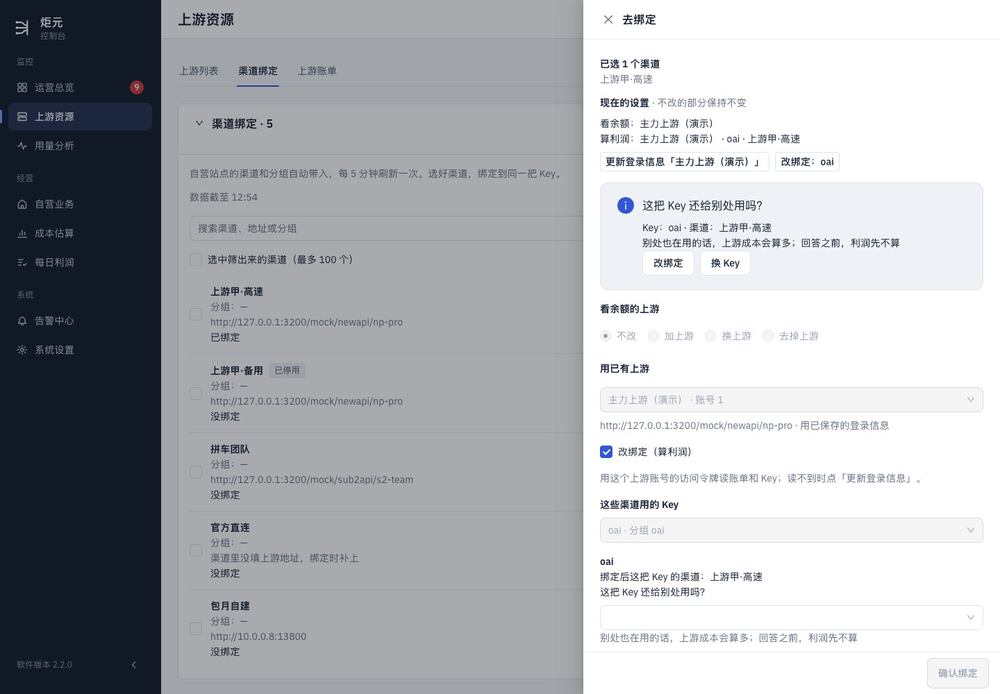
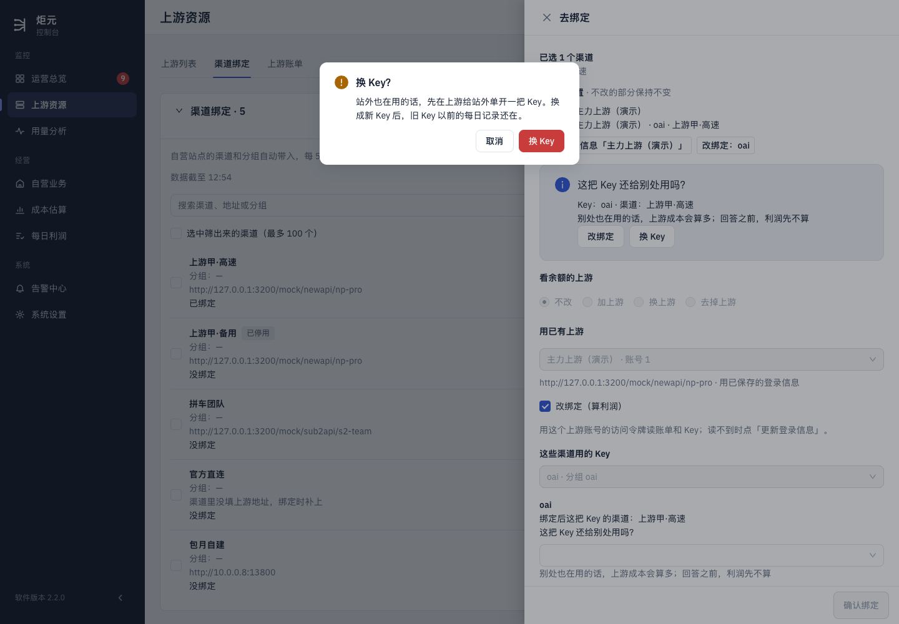
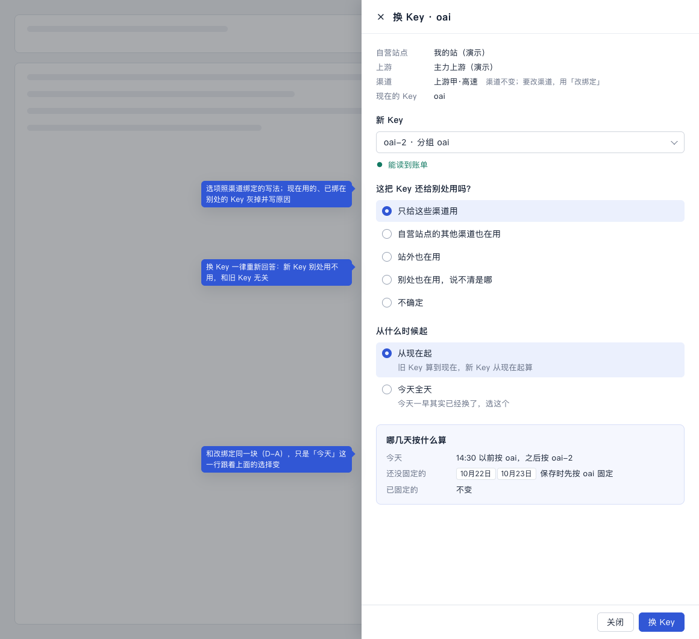
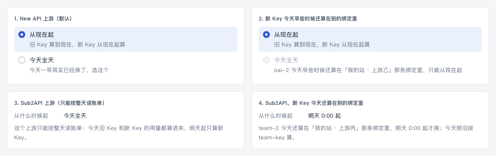
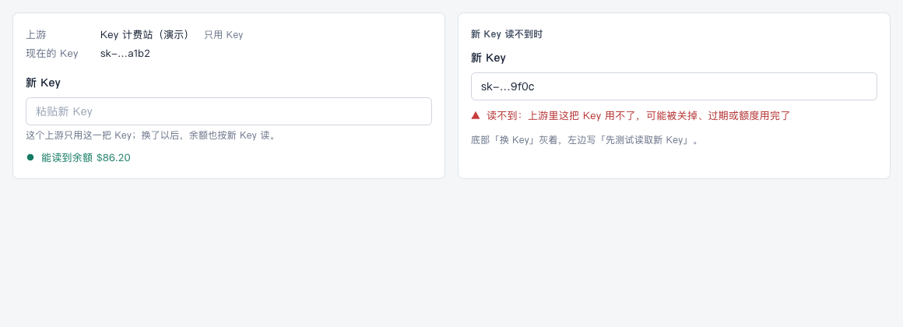
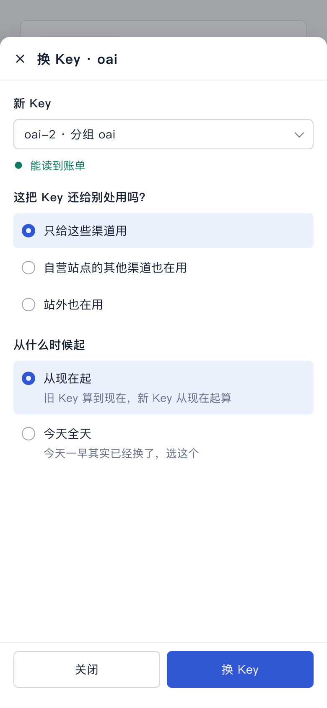

# 换 Key（计划 6b）设计稿

> 状态：草稿，等用户点头。2026-10-24，UI/UX 设计会话。
>
> 依据：
> - 计划 2026-10-12 第 6、9 条（换 Key 是同一条绑定的新版本；改了马上生效，可选今天全天，Sub2API 切换日按全天）；
> - 计划第 6 阶段 6a、6b 两段；
> - [用语规范](../ui-copy-spec.md) §3.5、§4、§5.2、§8.2、§9；
> - [D 设计稿](./d-config-change.md)（「哪几天按什么算」、保存、改动记录都沿用 D 的）。
>
> 本文只写流程、版面和状态。
> - 要新加的说法写在第 8 节「拟改条目」（编号「换1」起），先进规范，再写代码。
> - 视觉沿用现有组件，不另起新组件。
>
> 样稿：[d-6b.html](./d-6b.html) 的 6b-A 到 6b-F，截图在 `screens/swap-*.png`。

## 1. 用户要达到什么

上游的 Key 要换（旧的泄露了、额度满了、上游让换、要给站外单开一把）时：

- 在一个地方、一次做完。中途关掉的话，什么都不变。
- 换的那一刻前后，利润不断、不重算；以前的数不动。
- 换完以后，这组渠道的利润还在同一条绑定里，以前的每日记录接着往下记。

现在点「换 Key」（`screens/swap-now-*.png`，在自己的预览里截的）：

1. **跳到另一个页签**（上游账单 → 渠道绑定），打开的抽屉标题是「去绑定」，不是「换 Key」。
2. **抽屉顶上写「这把 Key 还给别处用吗？……回答之前，利润先不算」**。可这条绑定早就回答过「只给这些渠道用」，利润一直在算。
3. **要再点一次「换 Key」，确认框写「站外也在用的话，先在上游给站外单开一把 Key」。**不管为什么换，都说这一句。
4. **确认以后，旧绑定先被解除，再从头走一遍绑定**（选上游、测试读取、选 Key、回答问题）。
   - 中途关掉：旧的已经解除、新的还没建，这几个渠道就没人算利润了。
   - 解除到新绑定建好之间的用量，谁也不算。
   - Sub2API 上游解除那天不算（C③），换 Key 那天两边都不算。
5. **换完是两条绑定**：旧的那条变成「已解除」，新的从头「开始统计」。同一组渠道的利润拆在两处，以前的每日记录要翻两条。

## 2. 入口

都打开**同一个「换 Key」抽屉**，就在当前页面上，不跳页签：

| 入口 | 说明 |
|---|---|
| 上游账单 → 绑定 → 换 Key | 主入口 |
| 改绑定抽屉头部 Key 后面的「换 Key」 | D 设计稿第 3 节 |
| 需处理「这把 Key 别处也在用」→ 换 Key | E 的 N1 |
| 渠道绑定里那块「这把 Key 还给别处用吗？」提示上的「换 Key」 | 现在会先解除再重绑；改成打开同一个抽屉 |

## 3. 换 Key 抽屉（样稿 6b-A、6b-B）

从上到下：

1. **头部（只读）**：自营站点、上游、渠道、现在的 Key。渠道后面一句灰字「渠道不变；要改渠道，用「改绑定」」。
2. **新 Key**：
   - 下拉，写法同渠道绑定（`oai-2 · 分组 oai`）。
   - 灰掉不能选的，写原因：现在用的（「现在用的」）、已绑在别处的（照改绑定的 `occupied` 那句），以及渠道绑定里本来就不能选的。
   - 选了就**自动测试读取**，不用再点一下。结果一句，用 `testReadText`：「能读到账单」或「读不到：原因」。
   - 上游的 Key 列表读不到时，照渠道绑定现在的写法，带「刷新」。
3. **这把 Key 还给别处用吗？**：
   - 用 D 那个共用控件（D 的改9）。
   - **打开时一个都不选**（§5.2）。新 Key 别处用不用，和旧 Key 无关，所以每次都要重新回答。
4. **从什么时候起**：见 3.1。
5. **哪几天按什么算**：用 D 第 3.2 节同一块。「今天」那一行跟着第 4 项变（3.1 的表），「还没固定的」写「保存时先按 oai 固定」。
6. **底部（吸底）**：[关闭] [换 Key]。按钮灰着的时候，左边写还差什么：「先选新 Key」「先测试读取新 Key」「还没回答「这把 Key 还给别处用吗？」」。只写第一件没做的。

### 3.1 从什么时候起

| 情况 | 显示 | 「哪几天按什么算」的「今天」 |
|---|---|---|
| New API 上游（默认） | 单选：「从现在起」（默认）「旧 Key 算到现在，新 Key 从现在起算」；「今天全天」「今天一早其实已经换了，选这个」 | 14:30 以前按 oai，之后按 oai-2 / 全天按 oai-2 |
| New API，新 Key 今天早些时候还算在别的绑定里 | 「今天全天」灰掉，下面写「oai-2 今天早些时候还算在「我的站 · 上游乙」那条绑定里，只能从现在起」 | 14:30 以前按 oai，之后按 oai-2 |
| Sub2API 上游 | 不给选，一行「从什么时候起：今天全天」，下面写「这个上游只能按整天读账单：今天旧 Key 和新 Key 的用量都算进来，明天起只算新 Key。」 | 旧 Key 和新 Key 的用量都算 |
| Sub2API，新 Key 今天还算在别的绑定里 | 一行「从什么时候起：明天 0:00 起」，下面写「team-2 今天还算在「我的站 · 上游丙」那条绑定里，明天 0:00 起才换；今天照旧按 team-key 算。」 | 全天按 team-key |

- 「从现在起」的「现在」是点「换 Key」那一刻，不是打开抽屉那一刻；完成提示和改动记录里写的是保存时的时间。
- 6a 以后改绑定也用这一块（换6）：选项一样，说明里的「旧 Key / 新 Key」换成「原设置 / 新设置」。

## 4. 保存

和 D 第 4 节一样：

1. 先按旧 Key 固定还没固定的日子，最多 15 秒，左边写「正在按原设置固定 …」；
2. 再换。

结果：

| 情况 | 提示 | 之后 |
|---|---|---|
| 换好了 | 「已换成新 Key，旧 Key 以前的每日记录还在」（§3.5，现成的） | 抽屉关上；见第 5 节 |
| 换好了，有的日子没固定成 | 先出上一句，再出 D 的「有 1 天没能固定，已放进需处理」 | 同上 |
| 新 Key 刚被别的绑定占了、预览过期 | 照 §8.2「内容有变化，请重新预览」[刷新]，写在抽屉里 | 抽屉不关，什么都没变 |
| 这条绑定已经解除 | 「这条绑定已解除」（§8.2 找不到） | 抽屉不关，按钮灰掉 |

中途关掉抽屉：什么都没变，旧 Key 照常算。

## 5. 换完以后（样稿 6b-C、6b-D）

**上游账单：**

- 上游账单是按「账号 → Key → 绑定」排的，所以这条绑定挪到新 Key 下面。
  - 自动展开新 Key，滚到这条，高亮 2 秒。用户刚点了「换 Key」，绑定换了位置，不提示的话会以为没了。
- 「开始统计」不变，还是原来那一刻：是同一条绑定，不是新建的。
- 改动记录多一行「换成 Key oai-2（从现在起）」（D 的改5）。
- 旧 Key 下面没有绑定了，照现在没有绑定的 Key 那样显示。

**每日利润：**

- 换 Key 那天，这条绑定加一句提示「今天 14:30 换了 Key」，状态不变（§4「不影响结果的事」）。
  - Sub2API 写「今天换了 Key，两把 Key 的用量都算」。
- 上游 / Key 那一列写当天最后用的 Key。
- 计算明细的「上游成本」分开写：「Key oai（到 14:30）$3.20；Key oai-2（14:30 起）$1.10」。
- 「改过」那一行写「10月24日 14:30 换成 Key oai-2」。

**以前的每日记录：**

- 同一条绑定接着往下记。
- 换 Key 那天的明细同上；其他日子的明细里，「上游成本」写当天的那把 Key。

**需处理：**新 Key 回答了「只给这些渠道用」的，「这把 Key 别处也在用」那条消失。

## 6. 只用 Key 的上游（样稿 6b-E）

有的上游只填了一把 Key（上游列表里的「只用 Key」），这把 Key 同时用来读余额。换 Key 时：

- 「新 Key」是输入框，要粘贴，不是下拉。
- 下面写「这个上游只用这一把 Key；换了以后，余额也按新 Key 读。」
- 粘贴以后自动测试读取，结果写「能读到余额 $86.20」或「读不到：原因」。

这一条要用户定（第 9 节第 1 条）。

## 7. 手机（样稿 6b-F）

同 D 第 8 节：抽屉从底部升起占满，单选一行一个，底部两个按钮各占一半、44 高。

## 8. 拟改条目

写法照规范原来的格式，进规范以后编号作废。

**ui-copy-spec.md**

- **换1（§3.5「换 Key」那一行的「用在哪」）**：「一条绑定换成新 Key；渠道不变，以前的每日记录接着记在这条绑定上」。完成提示不变。
- **换2（§5.2「去回答」后面，或新的一小节「从什么时候起」）**：

  | 情况 | 写法 |
  |---|---|
  | 选项「从现在起」 | 旧 Key 算到现在，新 Key 从现在起算（改绑定：原设置算到现在，新设置从现在起算） |
  | 选项「今天全天」 | 今天一早其实已经换了，选这个 |
  | 今天全天不能选 | oai-2 今天早些时候还算在「我的站 · 上游乙」那条绑定里，只能从现在起 |
  | Sub2API | 这个上游只能按整天读账单：今天旧 Key 和新 Key 的用量都算进来，明天起只算新 Key。 |
  | Sub2API，新 Key 今天还算在别处 | team-2 今天还算在「我的站 · 上游丙」那条绑定里，明天 0:00 起才换；今天照旧按 team-key 算。 |

- **换3（§4「不影响结果的事」）**：换 Key 那天的提示「今天 14:30 换了 Key」；Sub2API 写「今天换了 Key，两把 Key 的用量都算」。
- **换4（§9 计算明细）**：「上游成本」一天用了两把 Key 时，分开写「Key oai（到 14:30）$3.20；Key oai-2（14:30 起）$1.10」。
- **换5（§8.2「能说清具体原因的」表）**：

  | 什么时候 | 界面上写 | 下一步按钮 |
  |---|---|---|
  | 换 Key 时还没选新 Key / 还没读到 / 还没回答 | 先选新 Key / 先测试读取新 Key / 还没回答「这把 Key 还给别处用吗？」（写在按钮左边） | —— |
  | 只用 Key 的上游换 Key | 新 Key 的输入框下写「这个上游只用这一把 Key；换了以后，余额也按新 Key 读。」 | —— |

- **换6（§4 最后一段，6a 以后）**：D 的改2 里「今天：全天按新设置算」改成按「从什么时候起」写：
  - 「14:30 以前按原设置，之后按新设置」或「全天按新设置算」；
  - D 的改7 提示改成「14:30 改过设置」。
- **换7（§12）**：删掉 `channel-onboarding.tsx` 的 `stopForNewKey` 和 `COPY.swapNotice`（「站外也在用的话，先在上游给站外单开一把 Key……」）。换 Key 只有这一个抽屉。

**ui-design-spec.md**

- **§5.2 上游资源**：
  - 换 Key 抽屉的样子同改绑定（吸底、「哪几天按什么算」同一块）；
  - 换完以后绑定挪到新 Key 下，自动展开、滚到、高亮 2 秒。

## 9. 要用户定的

由总指挥去问。每条后面是推荐。

1. **只用 Key 的上游，换 Key 就是换这个上游自己的 Key，余额也跟着按新 Key 读**（第 6 节）。
   - 推荐：这样做，一个抽屉做完。
   - 另一种做法：只用 Key 的上游不给「换 Key」，让用户去「编辑上游」改 Key。这样绑定这边不知道哪一刻换的，换的那天会算错。
2. **换 Key 时不能顺带改渠道**，渠道用「改绑定」。
   - 推荐：分开。
   - 理由：两样一起改，「哪几天按什么算」要同时说清 Key 和渠道两件事，用户看不过来；分两次做，改动记录也是两行，好查。

以下是计划里已经定了的，这里照做，不再问：

- 换 Key 是同一条绑定，不是解除再建（10-12 第 6 条）。
- 默认从现在起，可选今天全天（10-12 第 9 条）。
- Sub2API 换的那天两把 Key 都算全天（10-12 第 9 条）。
- 新 Key 当天还归别的绑定时只能明天起（6a）。

## 10. 给开发的几点（只说页面要什么，不定怎么做）

- **路由**：
  - `swap_key` 的去处从 `/stations?action=coverage&ruleId=…` 改成在上游账单就地打开换 Key 抽屉（`lib/workflow-actions.js` 的 ROUTES）。
  - 渠道绑定里那块提示的「换 Key」也打开它。
- **预览一次给全**（和 D 共用一个预览）：
  - 新 Key 的读取结果；
  - 「从什么时候起」哪几个选项能选，不能选的带原因（含占着的绑定名）；
  - 以前还没固定的日子（同 D）。
- **保存**走 6a 的新版本（`effective_from`），同 D：先按旧 Key 固定，最多 15 秒，再写版本和改动记录。
- **换完以后**：返回新 Key 的位置，给上游账单展开、滚动、高亮用。
- **每日利润的计算明细**：要拿到当天每把 Key 的时间段和成本（6a 的 `detail.versions`）。
- **删掉**：
  - `stopForNewKey` 和它的确认框；
  - `server/channel-onboarding.js` 里为「先解除再重绑」准备的批次分支（6b 原计划）。
- **界面测试要新的夹具**：
  - New API 两个选项、今天全天不能选、Sub2API 整天、Sub2API 明天起；
  - 只用 Key 的上游；
  - 新 Key 读不到；
  - 保存时预览过期。

## 11. 验收清单（给审核与测试）

1. 上游账单点「换 Key」：就地开「换 Key · oai」抽屉，不跳页签，旧绑定没被解除。
2. 头部写自营站点、上游、渠道、现在的 Key，渠道后有「渠道不变；要改渠道，用「改绑定」」。
3. 新 Key 下拉里，现在用的和已绑在别处的灰着并写原因；选了别的就自动测试读取，写「能读到账单」。
4. 「这把 Key 还给别处用吗？」打开时一个都没选；没回答时按钮灰，左边写「还没回答「这把 Key 还给别处用吗？」」。
5. New API：「从什么时候起」默认「从现在起」；「哪几天按什么算」的「今天」写「14:30 以前按 oai，之后按 oai-2」；选「今天全天」后变成「全天按 oai-2」。
6. 新 Key 今天早些时候还在别的绑定里：「今天全天」灰着，写出那条绑定的名字。
7. Sub2API：没有单选，写「今天全天」和「今天旧 Key 和新 Key 的用量都算进来」那句；新 Key 今天还在别处时写「明天 0:00 起」。
8. 有没固定的日子：「还没固定的」写「保存时先按 oai 固定」；保存时左边写「正在按原设置固定 …」。
9. 中途关掉抽屉：绑定和 Key 都没变。
10. 换好：提示「已换成新 Key，旧 Key 以前的每日记录还在」；绑定挪到新 Key 下面，展开、滚到、高亮；「开始统计」还是原来的时间。
11. 改动记录最上面一行「换成 Key oai-2（从现在起）」。
12. 每日利润换 Key 那天：提示「今天 14:30 换了 Key」，状态不变；计算明细的上游成本按两把 Key 分开写。
13. 以前的每日记录里还是一条绑定，换之前的日子都在。
14. 需处理里「这把 Key 别处也在用」点「换 Key」打开同一个抽屉；换好并回答「只给这些渠道用」后，这条消失。
15. 只用 Key 的上游：新 Key 是输入框，有「余额也按新 Key 读」那句，读到时写余额。
16. 手机 390 宽：抽屉占满，底部按钮 44 高且吸底。
17. 页面上没有「停止核算」「重新关联」「站外也在用的话，先在上游给站外单开一把 Key」，也没有版本号。
