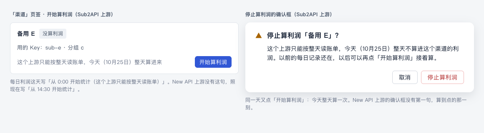
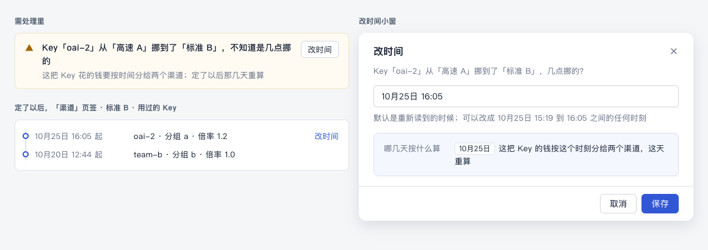
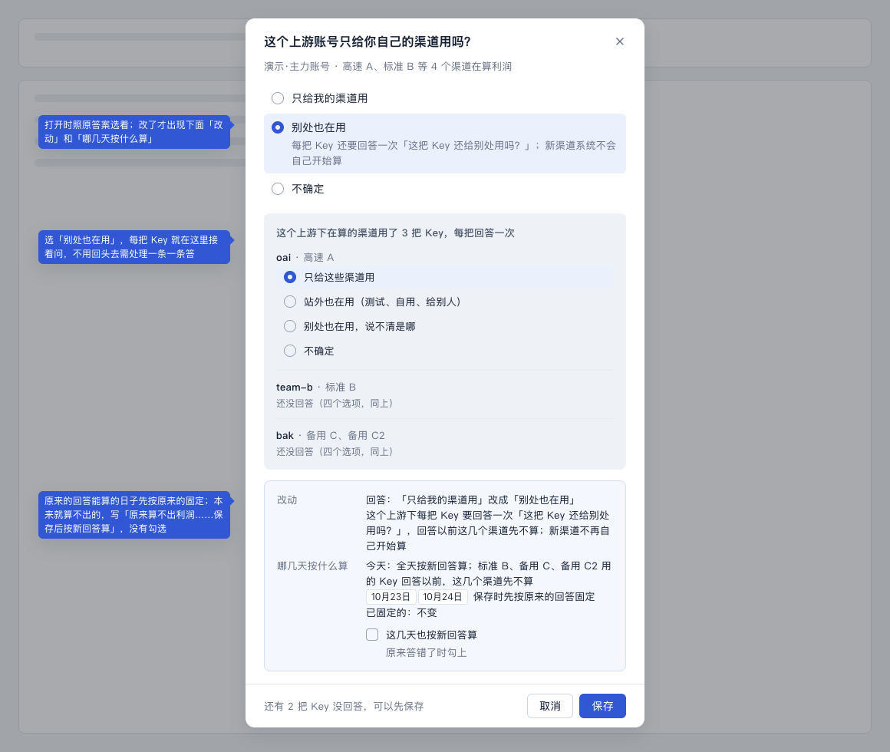
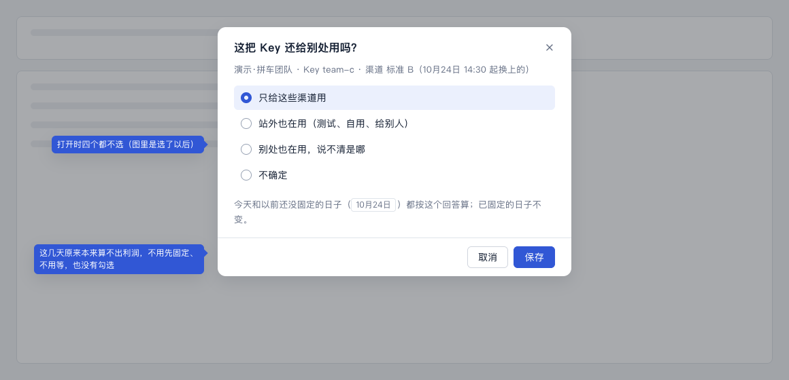

# 改设置（计划 D）设计稿

> 讲什么：改一个设置（账号的问题、某把 Key 的问题、开始或停止算利润、改时间）时，动手前就知道哪几天的数会变；改完以后查得到改过什么。改上游自己的设置（固定成本、汇率、算不算进利润）不在这里，在 [G 清单](./g-currency.md)。
>
> 现在：2026-10-25 按[流程梳理稿](./binding-flow.md)改稿，等用户看。10-24 那一版是按「按渠道绑 / 按 Key 绑、改绑定抽屉、指定 Key、上游账单页签」写的，这些在流程梳理稿里都没有了。10-24 用户定的 5 件（第 10 节）照旧，按新的单位重写。
>
> 单位：一个**渠道**（你站里的一个渠道；几个渠道填了同一把 Key 时并成一组，一起算）在一个**上游账号**下算利润，**用哪把 Key 按时间分段记**（流程梳理稿第 3 节「换 Key、换倍率时」）。下面说「渠道」都指这样一组。界面上不说「绑定」。
>
> 对应规范：用语规范 §3.5、§4、§5.2、§8.2、§9、§12，设计规范 §5.2；文中只写「§」的，指用语规范的章节。要新加的说法在第 9 节「拟改条目」（编号「改1」起），先进规范，再写代码；做到哪见[待改总表](../pending.md)。视觉沿用现有组件（antd Modal、Alert、Radio，`attention-list`、`panel`），不另起新组件。
>
> 样稿：[d-config.html](./d-config.html)，截图在 `screens/d-*.png`。

## 0. 这份设计的六项（ui-design-spec §1.3）和改动大小

| 项 | 写什么 |
|---|---|
| 用户目标 | 改一个会动到钱的设置时，动手前就知道今天、以前没固定的、已固定的日子各怎么算；以前定下来的数不被悄悄改掉；过几天回来，查得到这个上游下谁在什么时候改了什么 |
| 流程 | 改前（10-24 那一版和现在的代码）：改一条绑定要打开长抽屉、改、点「预览」、滚到底点「改绑定」，4 步；去回答也打开这整个抽屉；换 Key 要跳到渠道绑定页签解除再绑，约 11 步、2 次换页（流程梳理稿第 6 节）。改后只剩五件，前四件在原处一个小窗或一个确认框里做完，不换页签：① 账号的问题，「渠道」页签上游标题旁「改」或需处理「去回答」，1 个小窗、点 1 次保存；② 某把 Key 的问题（只在账号别处也在用的上游上），渠道那一行「改」或需处理「去回答」，同样 1 个小窗；③ 开始、停止算利润，渠道右上角 1 个按钮（停止要确认一次）；④ 改时间，需处理里「改时间」，1 个小窗。第五件少见：只填了一把 Key 的上游换了 Key，在上游列表的编辑上游里改（本来就在那里改），保存 1 次。换 Key 0 步 |
| 省掉了什么 | 改绑定抽屉整个去掉（渠道由系统读出来，不用手选）；单独的「预览」一步；「指定 Key」；换 Key 后再绑一遍；保存后自己去查哪几天被改了；答完问题后再处理一遍「改设置前没能固定」（原设置本来算不出的日子直接按新设置算） |
| 还要用户做的 | 确认（保存、停止算利润）；只有用户知道的两个问题（账号的、某把 Key 的），一次问清、不预先选好；更正：「改时间」（Key 挪过的时刻）、「这几天也按新回答算」（以前没固定的日子）；原来的设置怎么也算不出来的那天，选「按现在的设置算」。没有「指定 Key」 |
| 对照原则 | §1.2 第 1 条（渠道、Key、换 Key 的时刻系统读出来）、第 2 条（手工只确认和更正；认 Key 的更正只剩「改时间」，入口在结果旁边）、第 3 条（问题不预先选好）、第 4 条（去回答、改时间就地做完）、第 5 条（哪几天按什么算先给结论，改动记录收起）、第 6 条（换 Key 不打扰；保存成功不打扰，只有没固定成的才进需处理）；§1.4 第 2 条（「哪几天按什么算」一个小窗里只写一处） |
| 版式 | 不另起页面。小窗照 E 的「去回答」小窗（520 宽），从上到下：问题、选项、改动、哪几天按什么算，按钮吸底。改动记录在「渠道」页签右边那一栏，上游标题下面，默认收起。手机 390：小窗占满，按钮 44 高（第 8 节） |
| 改动大小 | 页面：中。去掉改绑定抽屉；两个问题的小窗、改时间小窗、编辑上游抽屉共用一块「哪几天按什么算」（改9）；改动记录挪到「渠道」页签。服务端：和 10-24 那一版一样（预览、先按原设置固定、改动记录只追加），只是按渠道和上游取，不按绑定取。排在 K2d（「渠道」页签）之后做，次序见总指挥的总览 |

## 1. 用户要达到什么

运营或财务改一个会动到钱的设置时：

- **动手前就知道**：今天怎么算、以前哪几天怎么算、利润算不算。
- **以前定下来的数不会被悄悄改掉**；没能定下来的，有地方接着处理。
- **过几天回来**，能查到这个上游下什么时候改过什么。财务问「这几天的数怎么变了」时要用。

改前，现在代码里的改绑定（`screens/d-now-edit.png`，在自己的预览里截的，10-24；「绑定」是旧说法）有五个问题：什么都没改也能预览和保存；「以前还没固定的日子先按原设置固定」不说是哪几天；预览最后一行看不出在说什么；要先点「预览」再点「改绑定」，按钮在长抽屉底部；改了什么、什么时候改的，哪里都查不到。新流程里改绑定抽屉整个没有了，这五个问题在下面各节的新做法里都不再有。

## 2. 哪些地方会改设置

| 改什么 | 在哪里改 | 走哪 |
|---|---|---|
| 账号的问题「这个上游账号只给你自己的渠道用吗？」 | 「渠道」页签右边上游标题旁「改」；需处理「去回答」（没回答、答了「不确定」） | 小窗（第 5.1 节） |
| 某把 Key 的问题「这把 Key 还给别处用吗？」（只在账号答了「别处也在用」的上游上） | 「渠道」页签渠道那一行「改」；需处理「去回答」（新换上的 Key 还没回答） | 小窗（第 5.2 节） |
| 开始、停止算利润 | 「渠道」页签渠道右上角；第 3 步的抽屉 | 开始：直接开始；停止：确认框（第 3.2 节） |
| 一把 Key 在两个在算的渠道之间挪过，几点挪的 | 需处理「改时间」；改过以后「用过的 Key」那一行也有「改时间」（第 3.4 节） | 小窗（C 的改时间小窗，不另起） |
| 只填了一把 Key 的上游换了 Key（流程梳理稿附录 1） | 上游列表 → 编辑上游 → Key | 编辑上游的抽屉，保存前多一行「哪几天按什么算」（第 3.5 节） |

**换 Key 不是改设置**：渠道里的 Key 换了，系统 1 分钟内读到，自己分段，不问人（流程梳理稿第 3 节）。它那天怎么算写在第 3.3 节，因为财务一样要知道那天的数是怎么来的。

**不再有的**（10-24 那一版里有）：

| 去掉 | 为什么 |
|---|---|
| 改绑定抽屉（加、去渠道） | 渠道用哪把 Key 系统读出来；几个渠道填了同一把 Key 就并成一组，一起算或一起不算。要不要算一个渠道，是「开始 / 停止算利润」 |
| 「这把 Key 还给别处用吗？」的「自营站点的其他渠道也在用」，以及原 3.3 节「渠道改了，原来的答案还对不对」 | 系统读得到你站所有渠道的 Key，同一把 Key 的渠道已经是一组（流程梳理稿附录 2）；答案不会因为加、去渠道过时 |
| 「指定 Key」小窗 | 渠道用哪把 Key 是精确读出来的，不会认错（用户 10-25 定，不要兜底）。认 Key 的更正只剩「改时间」 |
| 「换 Key」按钮 | 系统自己跟上。只填了一把 Key 的上游在编辑上游里改（附录 1） |

**不在 D 里：**

- 改倍率变化的时间：C 做（同一个改时间小窗，第 3.4 节只多一种用处）。
- 改上游自己的设置（固定成本、汇率、算不算进利润）：放 G。改上游设置时，还没固定的日子按原设置还是新设置算，在 G 的设计里定，见 [G 清单](./g-currency.md) 第 2 节；定的时候用本稿第 3 节同一块。
- 删上游时一起停掉它下面渠道的利润：K2c、K2d 做，说法已经在规范里（新）。

## 3. 哪几天按什么算

每个会动到钱的小窗里都有这一块，回答一个问题：**保存以后，哪些日子的数会变**。一个小窗里只写一处（§1.4 第 2 条），各小窗用同一个控件（改9）。

### 3.1 改回答（账号的问题、某把 Key 的问题；第 3.5 节同样）

三行，没有的那行不写：

| 行 | 写法 |
|---|---|
| 今天 | 全天按新回答算（今天才开始或停止算的渠道，是它在算的那一段） |
| 还没固定的 | 「10月22日、10月23日」保存时先按原来的回答固定 |
| 已固定的 | 不变 |

日期写法照 E 的 N4（连着的写成一段，多了写「等 5 天」）。用户 10-12 定「改了今天整天按新设置算」（决定记录第 8 条）。在改的那一刻切开要有按时间存的设置才做得到，随 6a（决定记录第 8 条，总指挥 10-25 改）。Sub2API 上游本来就只能按整天算。

「还没固定的」那一行有三种情况：

1. **原来的回答能算出来**（大多数情况：只是还没读到，或者在等 15 分钟）：
   - 写「保存时先按原来的回答固定」。
   - 下面一个勾选「这几天也按新回答算」，默认不勾，说明「原来答错了时勾上」。
   - 勾上以后这一行改成「也按新回答算」。
2. **原来本来就算不出利润**（这几天是需处理，原因要人处理：没回答、答了「不确定」、新换上的 Key 还没回答）：
   - 写「原来算不出利润（没回答「这个上游账号只给你自己的渠道用吗？」），保存后按新回答算」，括号里用 §5.2 的标题。
   - 没有勾选：按原来的回答固定不了。
3. **两种都有**：分两行写，各写各的日期。

为什么这样分：先按原来的回答固定，保护的是本来算得对的日子；本来就算不出来的日子，用户改回答往往正是为了让它们算出来（典型的就是去回答），这时还按原来的固定，只会把它们原样留在需处理里。

### 3.2 开始、停止算利润那天（样稿 d-sub2api）

不是改回答，没有上面那三行；只在动手的地方写清这一天怎么算。New API 和 Sub2API 不一样，因为 Sub2API 只能按整天读账单（C32）：

| | New API 上游 | Sub2API 上游 |
|---|---|---|
| 开始那天 | 从点的那一刻起算，今天写「从 14:30 开始统计」（和现在一样） | 整天都算。第 3 步的抽屉底部和「渠道」页签点「开始算利润」时，按钮左边一行灰字「这个上游只能按整天读账单，今天（10月25日）整天算进来」；每日利润那天写「从 0:00 开始统计（这个上游只能按整天读账单）」 |
| 停止那天 | 算到点的那一刻，计算明细「统计到 10月25日 14:30（停止算利润）」 | 整天不算。确认框在「以前的每日记录还在」前面写「这个上游只能按整天读账单，今天（10月25日）整天不算进这个渠道的利润。」 |
| 同一天停了又开始 | 两段都算，计算明细「统计的时段：0:00–11:20、14:30 起」 | 整天算一次 |
| 同一天开始又停了 | 只算中间那段 | 整天不算 |

Sub2API 那一列合起来就是一句：**一天结束时这个渠道在算，这一天就整天算；不在算，这一天整天不算。**开始那天按全天算是用户 10-12 定的（决定记录第 7 条），停止那天不算是 C 方案定的（C③）；同一天又停又开时照这一句，不会把一天算两次，也不会漏一天。

停止算利润的确认框（New API 上游没有中间那句）：

> **停止算利润「高速 A」？**
> 这个上游只能按整天读账单，今天（10月25日）整天不算进这个渠道的利润。以前的每日记录还在，以后可以再点「开始算利润」接着算。
> [取消] [停止算利润]

### 3.3 换 Key 那天（系统自己做，不问人）

| | New API 上游 | Sub2API 上游 |
|---|---|---|
| 钱怎么算 | 这一天 = 到 a 为止旧 Key 的钱 + a 到 b 那一段两把 Key 的钱 + b 以后新 Key 的钱（a 是最后一次读到旧 Key，b 是第一次读到新 Key，一般相隔 1 分钟） | 两把 Key 都按全天取，再相加 |
| 为什么不漏不重 | 两把 Key 这一天都只给这个渠道用：旧 Key 换掉以后没有用量，新 Key 换上以前没有用量 | 同左 |
| 「用过的 Key」写的时刻 | 新 Key 第一条用量的时刻，写「14:30 起 oai-2」；定不出时照流程梳理稿第 3 节写「b 起」或「a–b 之间」 | **一样**：Sub2API 的逐条用量也记到秒，时刻照样定得出 |
| 计算明细 | 「oai（到 14:30）$3.20；oai-2（14:30 起）$1.10」 | **一样**，每把 Key 的数就是它全天的数，正好是它那一段的 |
| 状态 | 不因为换 Key 而变 | 同左 |

**Sub2API 换 Key 那天显示带时刻，和 New API 一样，不另写一句**（10-25 定，文档整理 5 写进流程梳理稿第 3 节；用语规范 §9「上游成本（换了 Key 的那天）」那一行已经是这样）。钱和显示都对得上，多一句「这个上游只能按整天读账单」只会让财务以为这天的数有什么不同。K 设计稿第 9 节「两把 Key 的用量都算、明细不拆时间」那句不再用。

**一组里有一个换走了**（几个渠道原来填同一把 Key、并成一组，其中一个换了 Key，剩下的还用旧 Key）：不按上面的「换 Key」算，照 k-plan 3.3「组变了」：旧的那一组在这一刻停下，新的几组从这一刻开始。那一天每日利润里有两段：上午「高速 A、高速 B」一行，下午「高速 A」「高速 B」各一行。

- New API 上游：按这一刻切开，钱精确，不会算重。
- Sub2API 上游：照第 3.2 节那一句，旧的那一组这一天整天不算，新的几组这一天整天算。合计不错，但这一天两行之间分得不准：换走的那个渠道上午用旧 Key 的钱，落在留下的那一组里。很少见，k-plan 也说了不为它另做组内分段。所以只在留下那一组这天的计算明细里写一句，让财务对得上（改11）：「这个上游只能按整天读账单：高速 A 今天换 Key 以前用这把 Key 的钱，也算在这一行里」。

### 3.4 改时间（一把 Key 在两个在算的渠道之间挪过；样稿 d-move）

只有这一种情况要人定时刻：两个在算的渠道互换了 Key，或者一把 Key 从一个在算的渠道挪到另一个在算的渠道，靠用量分不清这把 Key 那段时间的钱该算给谁（流程梳理稿第 3 节）。

- 需处理里一条「Key「oai-2」从「高速 A」挪到了「标准 B」，不知道是几点挪的」[改时间]（§5.2，新）。
- 小窗就是 C 的改时间小窗。默认填 b（读到的那一刻；读不到渠道 Key 的那段时间里是「重新读到的时候」），可以改成 a 到 b 之间的任何时刻。
- 「哪几天按什么算」只一行：「10月25日 这把 Key 的钱按这个时刻分给两个渠道，这天重算」。跨零点时列两天。
- 没定之前，这一段落在的那几天两个渠道都是需处理，利润写「—」，不固定。定了以后：New API 上游马上重算；Sub2API 上游要先翻那一天的逐条用量（见下），翻的时候两个渠道那天写「实时 · 还在读取」，翻完照常算、照常固定。
- **改过以后，「用过的 Key」里那一行旁边留一个「改时间」**，打开同一个小窗。定错了能改回来，更正入口就在结果旁边（§1.2 第 2 条）；这几天已经固定的，照 C 重算，标「改过」。流程梳理稿说需处理里是「改时间」唯一出现的地方，这是新加的第二处，只出现在定过时刻的那一行，不多一种需处理（第 10 节第 7 条，拟改见第 9 节最后）。
- Sub2API 上游也一样：这一天、这一把 Key 翻逐条用量，按定的时刻切开，精确，不猜（总指挥 10-25 定，k-plan 3.5）。翻完以前这天不固定，写「实时 · 还在读取」。

### 3.5 只填了一把 Key 的上游换了 Key

渠道换了一把新 Key，这个上游只填了一把 Key，系统读不到它的账号和别的 Key，新 Key 对不上，走例外一（需处理「渠道「高速 A」用的 Key 不在已加的上游里」，说明里写「如果是这个上游换了 Key，在上游列表里改这个上游的 Key」）。在编辑上游里填上新 Key 保存时：

- 编辑上游抽屉底部，按钮左边一行：「从 10月25日 15:20 起按新 Key 算；这几天原来算不出上游成本，保存后重算」。15:20 是系统读到渠道换 Key 的时刻（照第 3.3 节的规则）。
- 这几天原来是需处理，属于第 3.1 节第 2 种，不先固定、没有勾选。
- 换之前的日子早就读过了，不变。
- Sub2API 上游一天中间切不开：15:20 那一天两把 Key 都按全天取再相加（同第 3.3 节），按钮左边那句写「从 10月25日 起按新 Key 算（这一天两把 Key 都算）；……」。

## 4. 保存

小窗、编辑上游抽屉、停止算利润的确认框，保存的路都一样（样稿 d-save）：

1. 点保存，按钮转圈。
   - 有要按原来的回答固定的日子时，按钮左边写「正在按原来的回答固定 10月22日、10月23日…」，下面一条细进度条。
   - 这时不能关小窗，Esc 也不关。
2. 最多等 15 秒，然后存新设置，写一行改动记录。
3. 结果：

| 情况 | 提示 | 小窗 |
|---|---|---|
| 都固定了，或者没有要固定的 | 「已保存」（§3.5）；停止算利润是「已停止算利润，以前的每日记录还在」 | 关上；「渠道」页签里改到的那一行高亮 2 秒 |
| 有没固定成的（15 秒到了还没完的也算） | 「有 1 天没能固定，已放进需处理」（§4），警示样子，停 6 秒 | 关上；侧栏、运营总览的数字同时加一（E：处理完立刻重读清单） |
| 保存没成（内容有变化、页面过期等，§8.2） | 照 §8.2 写在小窗里 | 不关；已经按原来的回答固定的日子留着，那本来就是对的，不另外提示 |

## 5. 两个问题的小窗

两个问题各一个小窗，样子一样：标题就是问题；下面一行写是哪个上游、哪几个渠道；选项（打开时都不选，§5.2）；选了以后，选项下面写后果；再下面「改动」「哪几天按什么算」；按钮吸底。**用户只点一次「保存」**：预览和保存在背后连着做（E 第 12 节）。

### 5.1 账号的问题（样稿 d-account）

- 第一次回答（没回答、答了「不确定」）：这个上游下的渠道本来算不出利润，属于第 3.1 节第 2 种。按这个回答算的，是从这些渠道点「开始算利润」那天起还没固定的日子（流程梳理稿附录 2：那段时间的账单一直照读）；之前的日子本来就不算。「哪几天按什么算」只写一行灰字：「今天和以前还没固定的日子（10月22日、10月23日）都按这个回答算；已固定的日子不变。」没有没固定的日子时写「今天按这个回答算；已固定的日子不变。」（改4）
- 改答案（已经回答过的）是真的改设置：「改动」写 §5.2 现成的那一行（「这个上游下每把 Key 要回答一次……」或反过来那句），「哪几天按什么算」照第 3.1 节三行写，还没固定的日子先按原来的回答固定。
- **改成「别处也在用」时，每把 Key 的问题就在同一个小窗里接着问**：选项下面展开「这个上游下在算的渠道用了 3 把 Key，每把回答一次」，一把 Key 一块（Key 名、用它的渠道、四个选项，同第 5.2 节的控件）。可以先不答完就保存：没答的那几把 Key 下的渠道从今天起是需处理，利润写「—」，需处理里各留一条「去回答」（同流程梳理稿附录 2 第 3 步）；答了以后按回答算。「哪几天按什么算」的「今天」那一行写成「全天按新回答算；标准 B、备用 C、备用 C2 用的 Key 回答以前，这几个渠道先不算」。这样改一次答案不用回头再去需处理里一条一条答（§1.2 第 4 条）。
- **改成「只给我的渠道用」时**，「改动」先写 §5.2 反过来那一句（「这个上游下的渠道，换 Key 时系统自己跟上，新渠道系统自己开始算」）。这个上游下「N 个新渠道还没算利润」那一条（附录 2）里的渠道，设计建议从保存的那一刻起自己开始算，「改动」里再写一行「「上游乙·标准」等 2 个新渠道从现在起开始算」；你在第 3 步取消过勾、点过「停止算利润」的渠道不在其中。流程梳理稿只定了答过「只给我的渠道用」以后新连上来的渠道，没说改答案时已经在等的那些，这一条要定（第 10 节第 9 条）。

### 5.2 某把 Key 的问题（样稿 d-key）

只在账号答了「别处也在用」的上游上有。四个选项照 §5.2（「只给这些渠道用」「站外也在用（测试、自用、给别人）」「别处也在用，说不清是哪」「不确定」）。

- 第一次回答（新换上的 Key、第 3 步时没答的 Key）：属于第 3.1 节第 2 种，那行灰字同上（改4），从换上这把 Key 的时刻起按这个回答算。
- 改答案：照第 3.1 节，「改动」写「回答：「不确定」改成「只给这些渠道用」」；利润从算变成不算或者反过来时，写选项下面那句；都算或都不算时不写。

## 6. 没能固定的那天（样稿 d-unsettled）

两步，每一步都只有一个按钮（§5.1）。

**第一步**（E 的 N3）：

- 标题「改设置前这天没能固定」，说明「这天先不算进汇总；重新读取会按原来的设置再固定一次」，按钮「重新读取」。
- 进需处理清单，挂 7 天（E 第 2.4 节）；每日利润里这天照样是需处理。
- 只是还没读到（读取类，§5.3）时，「重新读取」可以一直点。

**第二步**：重新读取以后，原来的设置还是算不出来，而且原因要人处理（例如上游拒绝读取旧 Key）：

- 标题换成「这天按原来的设置算不出来」。
- 说明写「原因一句。可以改按现在的设置算这天」。
- 按钮换成「按现在的设置算」。
- 点了先弹确认框：
  - 标题「按现在的设置算 10月23日？」
  - 内容：「这天会按现在的设置算，算好以后就固定了：」，下面列渠道、那天用的 Key、账号的回答（和那把 Key 的回答，有的话），再一行灰字说原来的设置有什么不同（例如「原来账号答的是「只给我的渠道用」」）。
  - 按钮「按现在的设置算」。
- 完成提示「已按现在的设置算」。
- 这天变成已固定。计算明细里多一行「设置：按 10月24日 改后的设置算」（改8）。

## 7. 改动记录（样稿 d-history）

**放在哪**：「渠道」页签右边那一栏，上游标题下面（账号的回答和「改」也在标题这一行），**默认收起**，一个上游一份。按钮名和区块名都叫「改动记录」，同「以前的每日记录」的做法。

为什么按上游放一份，不按渠道各放一份：账号的回答是整个上游的事，放进每个渠道会在同一栏里重复写好几遍（§1.4 第 2 条）；财务问「这几天的数怎么变了」时，先找的是哪个上游。每一行带上渠道名，按渠道也找得到。

**写什么**：点开以后新的在前，一行一件事：时间 + 一句话（写法见改5）。最多先露 10 条，再多写「再看 5 条」。

- 用户做的：开始算利润、停止算利润、账号的回答、某把 Key 的回答、改时间、按现在的设置算、只填了一把 Key 的上游改 Key。
- 系统做的、会改变算哪些渠道的：系统自动开始算一个新渠道；一个渠道换成了别的已加上游的 Key，从这个上游挪走（新上游那边写「挪过来」）。前面加「系统」两个字，和用户做的分得开。
- **同一个上游里换 Key 不写**：只写在那个渠道的「用过的 Key」里（流程梳理稿第 3 节），不重复（§1.2 第 6 条：系统自动做的事记在时间线里）。换成别的上游的 Key 要写（上一条），因为这个渠道从这个上游下挪走了，「用过的 Key」跟着渠道到了新上游，旧上游这边不写就查不到它去了哪。
- 不写版本号、系统码、操作人：现在只有一个管理员账号，写了也都是 admin；以后有多人再加。
- 6a 把底下的表换成版本表时，读法不变。

## 8. 手机（样稿 d-mobile）

- 小窗从底部升起，占满屏幕；底部两个按钮各占一半，44 高，吸底。
- 「改动」「哪几天按什么算」两列变一列：小标题在上，内容在下。
- 日期块照样一块一块排，排不下就换行。
- 改成「别处也在用」后展开的每把 Key 一块，块与块之间一条细线。

## 9. 拟改条目

写法照规范原来的格式，进规范以后编号作废。没写在这里的，都用规范里现成的说法（例如 §5.2 账号的问题改答案时那一行说明、§9 Sub2API 换 Key 那天的上游成本，都已经有了，标着「新」）。10-24 那一版的改6（改绑定时「还没有改动」）、改10（渠道改了答案过时）随改绑定抽屉一起去掉；这一版的改6、改10、改11 是新的。

**ui-copy-spec.md**

- **改1（§3.5 加两行）**：

  | 按钮 | 用在哪 | 完成提示 | 不再用 |
  |---|---|---|---|
  | 按现在的设置算 | 改设置前没能固定、按原来的设置又算不出来的那天，改按现在的设置算 | 已按现在的设置算 | 按当前配置补结、补结 |
  | 改动记录 | 打开一个上游的「改动记录」区块；按钮名和区块名同一个 | —— | 修改历史、版本历史、配置变更记录 |

  同时补两处：「改时间」那一行的「用在哪」补半句「改过以后，「用过的 Key」那一行旁边也有，定错了可以再改」；「去回答」那一行的「用在哪」改成「回答「这把 Key 还给别处用吗？」或「这个上游账号只给你自己的渠道用吗？」」。

- **改2（§4 最后一段，整段换掉）**：

  > 改回答（账号的问题、某把 Key 的问题）时，小窗里写清哪几天按什么算：
  > - 今天：全天按新回答算；
  > - 还没固定的：保存时先按原来的回答固定。原来本来算不出利润的（需处理里要人处理的那些），写「原来算不出利润（原因），保存后按新回答算」；勾了「这几天也按新回答算」的，写「也按新回答算」；
  > - 已固定的：不变。
  >
  > 保存时写「正在按原来的回答固定 10月22日、10月23日…」。有的日子没能固定时，保存后提示「有 2 天没能固定，已放进需处理」。
  >
  > 开始、停止算利润那天：New API 上游从点的那一刻起算、算到点的那一刻；Sub2API 上游只能按整天读账单，一天结束时这个渠道在算，这一天就整天算，不在算就整天不算。

- **改3（§5.2，接在 E 的 N3 后面）**：

  | 标题 | 说明 | 按钮 | 系统码（开发用） |
  |---|---|---|---|
  | 这天按原来的设置算不出来 | （原因一句）。可以改按现在的设置算这天 | 按现在的设置算 | （D 定） |

  确认框：标题「按现在的设置算 10月23日？」，内容「这天会按现在的设置算，算好以后就固定了：」加渠道、那天用的 Key、回答三行，最后一行灰字写原来的设置有什么不同。

- **改4（§5.2「去回答」那段后面）**：两个问题第一次回答时，选项下面写「今天和以前还没固定的日子（10月22日、10月23日）都按这个回答算；已固定的日子不变。」没有没固定的日子时写「今天按这个回答算；已固定的日子不变。」

- **改5（§9 下面加「改动记录」一小节）**：

  | 事 | 写法 |
  |---|---|
  | 开始算利润 | 开始算利润：高速 A、标准 B |
  | 系统自动开始算 | 系统：新渠道 海外 D 开始算利润 |
  | 停止算利润 | 停止算利润：高速 A |
  | 账号的回答 | 账号的回答改成「别处也在用」 |
  | 某把 Key 的回答 | Key oai-2 的回答改成「只给这些渠道用」 |
  | 改时间（Key 挪过） | Key oai-2 从 高速 A 挪到 标准 B 的时间定为 10月25日 15:42 |
  | 改时间（倍率，C） | 倍率变化时间改成 14:30 |
  | 按现在的设置算 | 按现在的设置算 10月23日（高速 A） |
  | 只填了一把 Key 的上游改 Key | Key 换成 oai-2（从 10月25日 15:20 起） |
  | 渠道换成了别的上游的 Key | 系统：高速 A 换成了「上游乙」的 Key，挪到那边接着算 / 系统：高速 A 从「上游甲」挪过来 |

  第一次回答也算一行（「账号的回答：只给我的渠道用」）。一次改了几样时，用「；」连起来。时间照 §6，写到分钟。

- **改6（§5.4 或开始算利润那几处，Sub2API 上游）**：
  - 开始算利润按钮左边：「这个上游只能按整天读账单，今天（10月25日）整天算进来」；
  - 每日利润开始那天：「从 0:00 开始统计（这个上游只能按整天读账单）」；
  - 停止算利润确认框：「这个上游只能按整天读账单，今天（10月25日）整天不算进这个渠道的利润。」放在「以前的每日记录还在」前面。
  - 这一条换掉 §9 下面「上游是 Sub2API、绑定已解除时（新）」那一段：「解除绑定」改成「停止算利润」；那段说的「以前的每日记录列表下面一行灰字」放到停止了的渠道「以前的每日记录」下面（K2d 定这块在哪）。

- **改7（§4「不影响结果的事」那一串）**：今天改过回答时，每日利润里这个上游下渠道的那几行加一句提示「今天改过设置，全天按新设置算」。6a 以后改成「14:30 改过设置」。

- **改8（§9 计算明细表加两行）**：

  | 项 | 写法示例 |
  |---|---|
  | 设置 | 按 10月24日 改后的设置算（只在这天没按当天的设置算时出现） |
  | 统计的时段（新） | 0:00–11:20、14:30 起（New API 上游同一天停了又开始时；只有一段时照现在写「开始统计」或「统计到」） |

- **改9（§12 加两行）**：

  | 内容 | 唯一位置 | 要合并掉的旧写法 |
  |---|---|---|
  | 两个问题（「这个上游账号只给你自己的渠道用吗？」「这把 Key 还给别处用吗？」）的选项、选了以后那句 | 一个前端控件，问题和选项作参数；加上游、第 3 步、两个问题的小窗都用它 | 渠道绑定的单选，改绑定的下拉 |
  | 「哪几天按什么算」那一块 | 一个前端控件；两个问题的小窗、编辑上游、改时间小窗都用它；第一次回答时用它的一行写法 | 改绑定 `COPY.recalc` |

- **改10（§9「统计到（新）」那一行）**：「10月24日 14:30（解除绑定）」改成「10月25日 14:30（停止算利润）」，说明改成「上游是 New API 时，停止算利润那一天只算到点的那一刻，和「开始统计」对称」。和改6 一起随 K2d 换。

- **改11（§9 计算明细，Sub2API 上游一组里有一个换走的那天）**：留下那一组这天的明细里，「上游成本」那一行下面加一句「这个上游只能按整天读账单：高速 A 今天换 Key 以前用这把 Key 的钱，也算在这一行里」。只在这一种情况出现，随 K2d。

**ui-design-spec.md**

- **§5.2 上游资源**：
  - 改设置都用小窗（520 宽），按钮吸底；改了自动算，没有单独的「预览」按钮；
  - 「改动」「哪几天按什么算」用 info 样子的 Alert，两列（小标题 104 宽），手机上一列；
  - 「渠道」页签右边那一栏，上游标题下面加「改动记录」，默认收起；
  - 保存后改到的那一行高亮 2 秒。

**别的文档（进规范时一起改）**

- [流程梳理稿](./binding-flow.md)第 2 节例外三最后一条、第 5.1 节「指定 Key」那一行：「改时间」除了需处理里，定过时刻以后「用过的 Key」那一行旁边也有（第 3.4 节）。

## 10. 已定的

**用户 10-24 定的 5 件（都照推荐），按新单位改写：**

1. **原来本来就算不出利润的日子，改了以后直接按新回答算**（第 3.1 节第 2 种，去回答就是这种）。不这样的话，这几天先按原来的「固定」不成，一律进需处理，用户回答完问题还得再处理一遍。这一条是对 D3 的补充。
2. **改回答时有一个勾选「这几天也按新回答算」**，默认不勾，给「原来答错了」的纠正用。和 10-12 定的「改的时候可以勾「今天全天按新配置」」是同一个意思，只是往前多管几天还没固定的。
3. **按原来的设置怎么也算不出来的那天，给「按现在的设置算」**，只在重新读取失败、原因要人处理以后出现（第 6 节）。
4. **改动记录在 D 就显示**：原来定在上游账单的绑定卡片上，上游账单页签没有了，改到「渠道」页签上游标题下面（第 7 节）。
5. **问题都必须回答，不再预先选好**。账号的问题每个上游一次；某把 Key 的问题只在账号别处也在用时、每把 Key 一次。没回答的一个都不选；回答过的照原答案显示，可以改。服务端不再替没回答的记「不确定」。

**这次改稿设计定的（总指挥 10-25 核过：第 6、8、10 条总指挥定了；第 7、9 条动了用户定过的流程，和整份稿子一起问用户，总指挥推荐照写）：**

6. **（总指挥定）Sub2API 开始、停止那天合成一句**：一天结束时在算就整天算，不在算就整天不算（第 3.2 节）。开始那天、停止那天是已经定的；同一天又停又开、又开又停，照这一句。
7. **（等用户定）改时间改过以后，「用过的 Key」那一行留「改时间」**（第 3.4 节）。流程梳理稿说需处理里是「改时间」唯一出现的地方；这条只在答过以后、在结果旁边多一个更正入口，不多一种需处理。不留的话，定错了没有办法改回来。
8. **（总指挥定）账号改成「别处也在用」时，每把 Key 的问题在同一个小窗里接着问**，可以不答完就保存（第 5.1 节）。
9. **（等用户定）账号改成「只给我的渠道用」时，已经在等的新渠道从现在起自己开始算**（第 5.1 节）。流程梳理稿第 8 节第 4 件（用户 10-25 定）只管答过以后新连上来的渠道，这是新的一条，建议照它：反正答了「只给我的渠道用」以后新渠道都自己开始算，已经在等的不开始反而要用户再点一次。取消过勾、点过「停止算利润」的照旧不开始。
10. **（总指挥定）改动记录按上游一份，不按渠道**（第 7 节）。

## 11. 给开发的几点（只说页面要什么，不定怎么做）

- **预览一次给全**（两个问题的小窗、编辑上游改 Key、改时间共用）：
  - 改了什么（回答前后、哪些渠道受影响）；
  - 每个受影响的渠道，利润前后算不算；
  - 以前还没固定的日子，以及每天按原来的设置能不能算：能、只是还没读到、要人处理（带原因码）。
- **保存时：**
  1. 要「按原来的回答固定」的那几天，直接调 C 的固定（`inspectRule(mode: "settle")`，C 方案第九节），总共最多 15 秒；
  2. 再存新设置，写改动记录（只追加，按上游取）；
  3. 返回没能固定的日期。
  - 「也按新回答算」的日子和原来算不出来的日子，不先固定。存完以后由 C 的回看按新设置固定，不用等。
- **没能固定的日子**放进 C 的状态表：要人处理，D 的新码，放在 `manual_reason`。E 的清单从状态表读（E 第 12 节）。
  - 「重新读取」要按**当时的设置**算，设置从改动记录取。做不到的话告诉设计：N3 的说明要改，第二步也要提前。
- **按现在的设置算**：只对一天，走同一个固定，带「用现在的设置」的标记；写一行改动记录。
- **Sub2API 开始、停止那天**：照第 3.2 节那一句判断一天算不算，不看点的时刻。
- **组变了照 k-plan 3.3 做**（第 3.3 节最后）：旧的那一组在这一刻停下、新的几组从这一刻开始；Sub2API 上游照第 3.2 节那一句按整天。留下那一组这天的计算明细多一句（改11）。
- **回答不再自动补**：服务端改回答的请求没带回答就拒绝，提示同新建：「请回答「这个上游账号只给你自己的渠道用吗？」」或「请回答「这把 Key 还给别处用吗？」」。不动回答的保存照旧。
- **回答控件**、**「哪几天按什么算」**各抽成一个前端控件（改9）。
- **改动记录**：按上游取，新的在前；6a 升级成版本表时，接口不变。
- **界面测试要新的夹具**：
  - 预览带以前没固定的日子（三种情况各一）；
  - 保存时部分没固定成、超过 15 秒；
  - Sub2API 上游的开始、停止（同一天又停又开）；
  - 账号改成「别处也在用」时每把 Key 接着问。

## 12. 验收清单（给审核与测试）

1. 账号没回答过的上游，需处理里「去回答」打开小窗：三个选项都没选，「保存」灰着；选了以后选项下面写后果，再下面一行「今天和以前还没固定的日子（…）都按这个回答算；已固定的日子不变。」；点一次「保存」就完成，不弹抽屉、不用预览。
2. 已经答了「只给我的渠道用」的上游，「渠道」页签上游标题旁点「改」：照原答案选着；改成「别处也在用」后，出现「改动」（§5.2 那一行说明）和「哪几天按什么算」三行，下面展开每把 Key 的问题，一个都没选。
3. 上一条里有两天原来能算：写「10月22日、10月23日 保存时先按原来的回答固定」，下面有不勾的「这几天也按新回答算」；勾上后改成「也按新回答算」。
4. 上一条只答了一把 Key 就保存：能保存；没答的 Key 下的渠道在需处理里各有一条「去回答」。
5. 改成「只给我的渠道用」：「改动」里写「「上游乙·标准」等 2 个新渠道从现在起开始算」；点过「停止算利润」的渠道不在其中。
6. 某把 Key 的问题改答案：「改动」写「回答：「不确定」改成「只给这些渠道用」」；利润从不算变成算时，没有多余的后果句。
7. 保存时按钮左边写「正在按原来的回答固定 …」，小窗关不掉；都固定了提示「已保存」，小窗关上，改到的那一行高亮。
8. 有一天没固定成：提示「有 1 天没能固定，已放进需处理」；侧栏数字同时加一；需处理里出现「改设置前这天没能固定」+「重新读取」。
9. 保存失败（预览过期）：小窗不关，照 §8.2 写；已经固定的日子不回退。
10. 重新读取后原来的设置还是算不出来（要人处理的原因）：那条变成「这天按原来的设置算不出来」+「按现在的设置算」；确认框列出渠道、那天用的 Key、回答和不同之处；完成后那天变成已固定，计算明细有「设置：按 … 改后的设置算」。
11. 只是还没读到时，按钮一直是「重新读取」，不出现「按现在的设置算」。
12. Sub2API 上游点「开始算利润」：按钮左边写「这个上游只能按整天读账单，今天（…）整天算进来」；每日利润那天写「从 0:00 开始统计（…）」，今天的数含 0:00 起的用量。
13. Sub2API 上游点「停止算利润」：确认框有「……今天（…）整天不算进这个渠道的利润。」；停了以后今天这个渠道不算进汇总。同一天再点「开始算利润」：今天整天算一次，不算两次。
14. New API 上游同一天停了又开始：计算明细「统计的时段：0:00–11:20、14:30 起」，中间那段不算。
15. Sub2API 上游换了 Key：「用过的 Key」写「14:30 起 oai-2」；计算明细「oai（到 14:30）…；oai-2（14:30 起）…」，两个数相加等于两把 Key 全天的花费；没有「两把 Key 的用量都算」那类多余的句子。
16. 一把 Key 在两个在算的渠道之间挪过：需处理「改时间」，小窗默认 b，「哪几天按什么算」一行；定了以后两个渠道那几天照常算；「用过的 Key」那一行旁边有「改时间」，再改一次那几天重算，已固定的标「改过」。
17. 只填了一把 Key 的上游，编辑上游里改 Key：按钮左边写「从 … 起按新 Key 算；这几天原来算不出上游成本，保存后重算」；保存后例外一那条需处理消失。
18. 「渠道」页签上游标题下有收起的「改动记录」，点开新的在前，写法同改5；有「系统：」开头的行；没有换 Key 的行、没有版本号、系统码。
19. 今天改过回答：每日利润里这个上游下的渠道有提示「今天改过设置，全天按新设置算」，状态不变。
20. 手机 390 宽：小窗占满，两块变一列，底部按钮 44 高且吸底。
21. 直接调接口改回答、不带回答：被拒，提示「请回答「……」」，不会记成「不确定」。
22. 页面上没有「改绑定」「指定 Key」「换 Key」「预览，还没保存」「原来的渠道 / 改后的渠道」这类旧写法，也没有「配置」「版本」「补结」「绑定」这些字。
