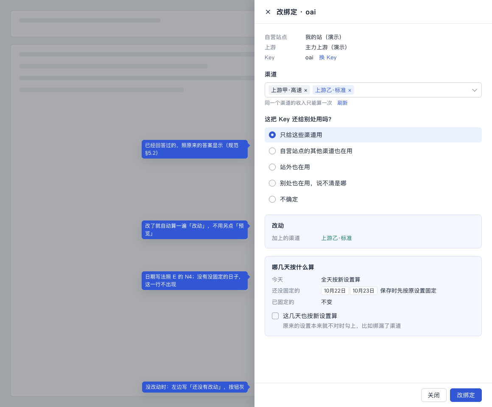
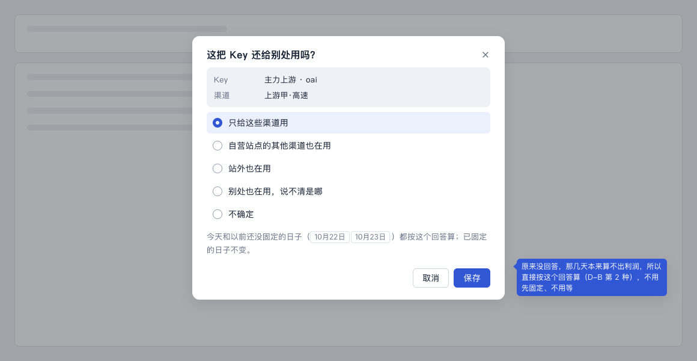
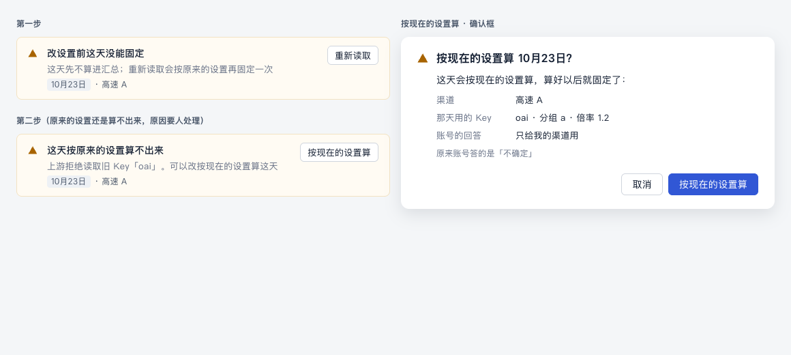
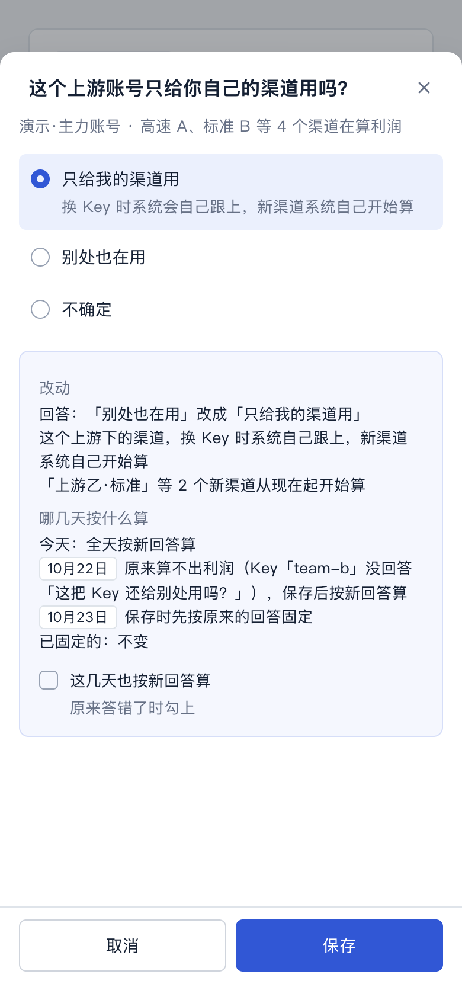

# 改设置（计划 D）设计稿

> 状态：用户已定（2026-10-24）：「D 和 6b 的设计按推荐定，7 件事都照推荐」，第 10 节 5 件都照推荐。2026-10-24，UI/UX 设计会话。
>
> 依据：
> - 计划「后续 PR 顺序与复用点」的 D 行、D3，2026-10-12 第 9 条（改了马上生效）；
> - C 方案草稿第九节「和 D 的分界」；
> - [用语规范](../ui-copy-spec.md) §3.5、§4 最后一段、§5.2、§8.2、§9；
> - [E 设计稿](./e-attention.md) N3、第 6 节「去回答」小窗。
>
> 本文只写流程、版面和状态。
> - 用语一律引用规范；要新加的说法写在第 9 节「拟改条目」（编号「改1」起），先进规范，再写代码。
> - 视觉沿用现有组件（antd Drawer、Alert、Radio，`attention-list`、`panel`），不另起新组件。
>
> 样稿：[d-6b.html](./d-6b.html) 的 D-A 到 D-G，截图在 `screens/d-*.png`。换 Key 的样稿在同一个文件里，见 [6b 设计稿](./6b-swap-key.md)。
>
> 文中只写「§」的，指用语规范的章节。

## 1. 用户要达到什么

运营或财务改一条绑定（加减渠道、改「这把 Key 还给别处用吗？」的回答）时：

- **保存前就知道**：今天怎么算、以前哪几天怎么算、利润算不算。
- **以前定下来的数不会被悄悄改掉**；没能定下来的，有地方接着处理。
- **过几天回来**，能查到这条绑定什么时候改过什么。财务问「这几天的数怎么变了」时要用。

现在的改绑定（`screens/d-now-edit.png`，在自己的预览里截的）：

1. 什么都没改也能预览、能保存。预览里写「原来的渠道：上游甲·高速」「改后的渠道：上游甲·高速」「去掉的渠道：—」。
2. 「以前还没固定的日子先按原设置固定」是空话：不说是哪几天，保存时也没有去固定（D3 还没做）。
3. 预览最后一行只写「只给这些渠道用」，看不出在说什么。
4. 要先点「预览」，再点「改绑定」；按钮在长抽屉底部，要滚下去找。
5. 改了什么、什么时候改的，哪里都查不到。

## 2. 哪些地方会改设置

| 入口 | 改什么 | 走哪 |
|---|---|---|
| 上游账单 → 绑定 → 改绑定 | 渠道、回答 | 改绑定抽屉（第 3 节） |
| 渠道绑定 → 已经绑了的渠道 → 改绑定 | 同上 | 同一个抽屉 |
| 需处理 → 改绑定（E 的 N1、N2） | 渠道 | 同一个抽屉，渠道已经选好 |
| 需处理 → 去回答（E 的小窗） | 回答 | 同一条保存路径（第 5 节） |
| 上游账单 → 绑定 → 换 Key | Key | 6b，见 [6b 设计稿](./6b-swap-key.md)；以前没固定的日子用同一块（第 3.2 节） |

**不在 D 里：**

- 改时间（倍率变化时间）：C 做。
- 解除绑定那天怎么算：C 做（C③、C④）。
- 改上游自己的设置（固定成本、汇率、算不算进利润）：放 G（总指挥定）。改上游设置时，还没固定的日子按原设置还是新设置算，在 G 的设计里定，见 [G 清单](./g-currency.md) 第 2 节。

## 3. 改绑定抽屉（样稿 D-A、D-B）

从上到下：

1. **头部（只读）**：自营站点、上游、Key。Key 后面跟一个「换 Key」链接，打开 6b 的抽屉。原来那两句「上游账号、Key 和时区不在这里改」「要换一把 Key，用「换 Key」」合成这个链接，不再单独占一块。
2. **渠道**：照现在。
3. **这把 Key 还给别处用吗？**：和渠道绑定、去回答小窗**用同一个控件**（单选，一行一个，选了以后下面写一句后果，规范 §5.2）。
   - **必须回答**，和渠道绑定一样（第 10 节第 5 条）。没回答时「改绑定」按钮灰着，左边写「还没回答「这把 Key 还给别处用吗？」」。
   - 已经回答过的，照原来的答案显示，可以改。
   - 没回答过的老绑定（建绑定时还没有这个问题），一个都不选。不再按成本算没算全去猜一个答案。
   - 从「去回答」进来时一个都不选（§5.2）。
   - 渠道改动让原来的答案过时的，在选项下面提醒，见 3.3。
4. **「怎么算的」**：照现在。
5. **改动**（只在改了以后出现）：只列有变化的行。
6. **哪几天按什么算**（只在改了以后出现）：见 3.2。
7. **底部（吸底）**：[关闭] [改绑定]。没改动时，按钮灰着，左边写「还没有改动」。

**不用另点「预览」。**改了以后停手半秒，自动算一遍，「改动」和「哪几天按什么算」随之出现。算的时候这两块显示加载，按钮灰着。

### 3.1 改动

| 改了什么 | 写法 |
|---|---|
| 加了渠道 | 加上的渠道：上游乙·标准 |
| 去了渠道 | 去掉的渠道：上游甲·高速；以前的每日记录还在 |
| 改了回答 | 回答：「不确定」改成「只给这些渠道用」 |
| 改了以后利润从算变成不算，或者反过来 | 照 §5.2 选项下面那句（例如「上游成本分不开，利润先不算；……」）；都算或都不算时不写 |

### 3.2 哪几天按什么算

这一块回答一个问题：保存以后，哪些日子的数会变。三行，没有的那行不写：

| 行 | 写法 |
|---|---|
| 今天 | 全天按新设置算 |
| 还没固定的 | 「10月22日、10月23日」保存时先按原设置固定 |
| 已固定的 | 不变 |

日期写法照 E 的 N4（连着的写成一段，多了写「等 5 天」）。

「还没固定的」那一行有三种情况（样稿 D-B）：

1. **原设置能算出来**（大多数情况：只是还没读到，或者在等 15 分钟）：
   - 写「保存时先按原设置固定」。
   - 下面一个勾选「这几天也按新设置算」，默认不勾，说明「原来的设置本来就不对时勾上，比如绑漏了渠道」。
   - 勾上以后这一行改成「也按新设置算」。
2. **原设置本来就算不出利润**（这几天是需处理，原因要人处理，例如没回答「这把 Key 还给别处用吗？」、这把 Key 绑了两次）：
   - 写「原来算不出利润（原因一句），保存后按新设置算」。
   - 原因用 §5.2 的标题。
   - 没有勾选，因为按原设置固定不了。
3. **两种都有**：分两行写，各写各的日期。

为什么这样分：

- D3 的「先按原设置固定」，保护的是本来算得对的日子。
- 本来就算不出来的日子，用户改设置往往正是为了让它们算出来（典型的就是去回答）。这时还按原设置固定，只会把它们原样留在需处理里。

### 3.3 渠道改了，原来的答案还对不对

只改渠道、Key 没变时，原来的答案一般沿用，不用重答。下面三种情况例外：

| 情况 | 怎么办 | 选项下面写 |
|---|---|---|
| 答的是「自营站点的其他渠道也在用」，这次绑上了名单里的一部分渠道 | 把绑上的渠道从名单里去掉，答案沿用 | 「上游乙·标准 这次绑上了，已经从「还在用这把 Key 但没绑定的渠道」里去掉。」 |
| 同上，名单里的渠道这次全绑上了 | 清掉答案，要重新回答 | 「原来名单里的渠道这次都绑上了，请重新回答。」 |
| 答的是「只给这些渠道用」，这次去掉了渠道 | 答案沿用 | 照现在的 `removedHint`：「去掉的渠道如果还在用这把 Key，请在上面选「自营站点的其他渠道也在用」，不然上游成本会算多。」 |

其他改动（加渠道、答案是站外或别处也在用、不确定）都沿用原答案，不提醒。换 Key 一律重新回答（6b 第 3 节）。

**上游账单的绑定卡片**：没回答过的写「这把 Key 还给别处用吗？ 还没回答」，不再写成「不确定」。答了「不确定」的才写「不确定」。

## 4. 保存（样稿 D-C）

1. 点「改绑定」，按钮转圈。
   - 有要按原设置固定的日子时，左边写「正在按原设置固定 10月22日、10月23日…」，下面一条细进度条。
   - 这时不能关抽屉，Esc 也不关。
2. 最多等 15 秒，然后存新设置。
3. 结果：

| 情况 | 提示 | 抽屉 |
|---|---|---|
| 都固定了，或者没有要固定的 | 「已保存」（§3.5） | 关上；上游账单里这条绑定高亮 2 秒 |
| 有没固定成的（15 秒到了还没完的也算） | 「有 1 天没能固定，已放进需处理」（§4），警示样子，停 6 秒 | 关上；侧栏、运营总览的数字同时加一（E：处理完立刻重读清单） |
| 保存没成（内容有变化、页面过期等，§8.2） | 照 §8.2 写在抽屉里 | 不关；已经按原设置固定的日子留着，那本来就是对的，不另外提示 |

## 5. 「去回答」小窗走同一条路（样稿 D-E）

- E 的小窗保存时，走和改绑定同一条预览加保存（总指挥意见，见 E 第 12 节）。
- 用户只点一次「保存」：预览和保存在背后连着做。
- 选项下面多一行灰字：「今天和以前还没固定的日子（10月22日、10月23日）都按这个回答算；已固定的日子不变。」没有没固定的日子时，写「今天按这个回答算；已固定的日子不变。」
- 理由：去回答只出现在没回答的绑定上（COST_COVERAGE_UNKNOWN），那几天原设置本来算不出利润，属于 3.2 的第 2 种。所以不用先固定、不用等，也没有勾选。
- 结果提示同第 4 节。

## 6. 没能固定的那天（样稿 D-D）

两步，每一步都只有一个按钮（§5.1）。

**第一步**（E 的 N3）：

- 标题「改设置前这天没能固定」，说明「这天先不算进汇总；重新读取会按原设置再固定一次」，按钮「重新读取」。
- 进需处理清单，挂 7 天（E 第 2.4 节）；每日利润里这天照样是需处理。
- 只是还没读到（读取类，§5.3）时，「重新读取」可以一直点。

**第二步**：重新读取以后，原设置还是算不出来，而且原因要人处理（例如上游拒绝读取旧 Key、旧渠道已经删了）：

- 标题换成「这天按原设置算不出来」。
- 说明写「原因一句。可以改按现在的设置算这天」。
- 按钮换成「按现在的设置算」。
- 点了先弹确认框：
  - 标题「按现在的设置算 10月23日？」
  - 内容：「这天会按现在的设置算，算好以后就固定了：」，下面列渠道、Key、回答，再一行灰字说原设置有什么不同。
  - 按钮「按现在的设置算」。
- 完成提示「已按现在的设置算」。
- 这天变成已固定。计算明细里多一行「设置：按 10月24日 改后的设置算」（改8）。

## 7. 改动记录（样稿 D-F）

- 放在上游账单的绑定卡片里，按钮下面，**默认收起**。按钮名和区块名都叫「改动记录」，同「以前的每日记录」的做法。
- 点开以后，新的在前，一行一件事：时间 + 一句话（写法见改5）。最多先露 10 条，再多写「再看 5 条」。
- 不写版本号、系统码、操作人。
  - 现在只有一个管理员账号，写了也都是 admin。
  - 以后有多人再加。
- 6b 只往里加「换成 Key …」这一种行；6a 把底下的表换成版本表时，读法不变。

## 8. 手机（样稿 D-G）

- 抽屉从底部升起，占满屏幕；底部两个按钮各占一半，44 高。
- 「改动」「哪几天按什么算」两列变一列：小标题在上，内容在下。
- 日期块照样一块一块排，排不下就换行。

## 9. 拟改条目

写法照规范原来的格式，进规范以后编号作废。没写在这里的，都用规范里现成的说法。

**ui-copy-spec.md**

- **改1（§3.5 加一行）**：

  | 按钮 | 用在哪 | 完成提示 | 不再用 |
  |---|---|---|---|
  | 按现在的设置算 | 改设置前没能固定、按原设置又算不出来的那天，改按现在的设置算 | 已按现在的设置算 | 按当前配置补结、补结 |
  | 改动记录 | 打开一条绑定的「改动记录」区块；按钮名和区块名同一个 | —— | 修改历史、版本历史、配置变更记录 |

- **改2（§4 最后一段，整段换掉）**：

  > 改设置时，抽屉里写清哪几天按什么算：
  > - 今天：全天按新设置算；
  > - 还没固定的：保存时先按原设置固定。原设置本来算不出利润的（需处理里要人处理的那些），写「原来算不出利润（原因），保存后按新设置算」；勾了「这几天也按新设置算」的，写「也按新设置算」；
  > - 已固定的：不变。
  >
  > 保存时写「正在按原设置固定 10月22日、10月23日…」。有的日子没能固定时，保存后提示「有 2 天没能固定，已放进需处理」。

- **改3（§5.2，接在 E 的 N3 后面）**：

  | 标题 | 说明 | 按钮 | 系统码（开发用） |
  |---|---|---|---|
  | 这天按原设置算不出来 | （原因一句）。可以改按现在的设置算这天 | 按现在的设置算 | （D 定） |

  确认框：标题「按现在的设置算 10月23日？」，内容「这天会按现在的设置算，算好以后就固定了：」加渠道、Key、回答三行，最后一行灰字「原设置下这天只有「上游甲·高速」」这类不同之处。

- **改4（§5.2「去回答」那段后面）**：小窗的选项下面写「今天和以前还没固定的日子（10月22日、10月23日）都按这个回答算；已固定的日子不变。」没有没固定的日子时写「今天按这个回答算；已固定的日子不变。」

- **改5（§9 下面加「改动记录」一小节）**：

  | 事 | 写法 |
  |---|---|
  | 建绑定 | 开始统计：渠道 上游甲·高速；Key oai |
  | 加、去渠道 | 加上渠道 上游乙·标准 / 去掉渠道 上游甲·高速 |
  | 改回答 | 回答改成「只给这些渠道用」 |
  | 换 Key（6b） | 换成 Key oai-2（从现在起 / 今天全天 / 明天 0:00 起） |
  | 按现在的设置算 | 按现在的设置算 10月23日 |
  | 改时间（C） | 倍率变化时间改成 14:30 |
  | 解除绑定 | 解除绑定 |

  一行同时改了几样时，用「；」连起来。时间照 §6，写到分钟。

- **改6（§8.2「能说清具体原因的」表）**：

  | 什么时候 | 界面上写 | 下一步按钮 |
  |---|---|---|
  | 改绑定时什么都没改 | 还没有改动（写在按钮左边，不弹报错） | —— |
  | 改绑定时还没回答 | 还没回答「这把 Key 还给别处用吗？」（写在按钮左边） | —— |

- **改7（§4「不影响结果的事」那一串）**：今天改过设置时，绑定那一行加一句提示「今天改过设置，全天按新设置算」。6a 以后改成「14:30 改过设置」（见 6b 设计稿的换6）。

- **改8（§9 计算明细表加一行）**：

  | 项 | 写法示例 |
  |---|---|
  | 设置 | 按 10月24日 改后的设置算（只在这天没按当天的设置算时出现） |

- **改10（§5.2「去回答」那段后面，3.3）**：
  - 改绑定时绑上了「还在用这把 Key 但没绑定的渠道」名单里的渠道：选项下面写「上游乙·标准 这次绑上了，已经从「还在用这把 Key 但没绑定的渠道」里去掉。」；名单里的都绑上了，写「原来名单里的渠道这次都绑上了，请重新回答。」
  - 没回答过的绑定，绑定卡片上「这把 Key 还给别处用吗？」后面写「还没回答」。

- **改9（§12 加两行）**：

  | 内容 | 唯一位置 | 要合并掉的旧写法 |
  |---|---|---|
  | 「这把 Key 还给别处用吗？」的选项、选了以后那句 | 一个前端控件，渠道绑定、改绑定、去回答小窗、换 Key 都用它 | 渠道绑定的单选，改绑定的下拉 |
  | 「哪几天按什么算」那一块 | 一个前端控件，改绑定、换 Key 都用它；去回答小窗用它的一行写法 | 改绑定 `COPY.recalc` |

**ui-design-spec.md**

- **§5.2 上游资源**：
  - 改绑定抽屉也吸底（同 #56 的绑定抽屉）；
  - 改了自动算，去掉单独的「预览」按钮；
  - 「改动」「哪几天按什么算」用 info 样子的 Alert，两列（小标题 104 宽），手机上一列；
  - 绑定卡片底部加「改动记录」，默认收起；
  - 保存后高亮 2 秒。

## 10. 要用户定的

由总指挥去问。每条后面是推荐。

1. **原设置本来就算不出利润的日子，改了以后直接按新设置算**（3.2 第 2 种，去回答就是这种）。
   - 推荐：这样做。
   - 不这样的话：这几天先按原设置「固定」不成，一律进需处理，用户回答完问题还得再处理一遍。
   - 这一条是对 D3 的补充：D3 只说了「先按原设置固定」，没说原设置固定不了的那些日子怎么办。
2. **改绑定加一个勾选「这几天也按新设置算」**，默认不勾，给「原来就绑错了」的纠正用。
   - 推荐：加。
   - 和 2026-10-12 第 9 条「今天全天按新配置」是同一个意思，只是往前多管几天还没固定的。
3. **按原设置怎么也算不出来的那天，给「按现在的设置算」**，只在重新读取失败、原因要人处理以后出现（第 6 节）。
   - 推荐：给。
   - 不给的话：这天永远是需处理，汇总里永远缺一天。
4. **改动记录在 D 就显示**在上游账单的绑定卡片上（第 7 节）。
   - 推荐：D 就显示，6b 只往里加换 Key 的行。
   - 另一种做法：D 只记不显示，等 6b 一起做。
5. **改绑定时，「这把 Key 还给别处用吗？」也必须回答，不再预先选好**（总指挥加，第 3 节第 3 点、3.3）。
   - 推荐：和渠道绑定一样必须回答。已经回答过的照原答案显示，可以改；没回答过的一个都不选，不选就保存不了。
   - 现在的做法：没回答过的老绑定，页面按成本算没算全替用户选上「只给这些渠道用」或「不确定」，没选时按「不确定」交；服务端改了渠道却没带回答时，自动记成「不确定」。用户不知道自己「答」了什么。

以上 5 件，用户 2026-10-24 都照推荐定了。

## 11. 给开发的几点（只说页面要什么，不定怎么做）

- **预览一次给全**（改绑定、去回答、换 Key 共用）：
  - 改了什么（渠道增减、回答前后）；
  - 利润前后算不算；
  - 以前还没固定的日子，以及每天按原设置能不能算：能、只是还没读到、要人处理（带原因码）。
- **保存时：**
  1. 要「按原设置固定」的那几天，直接调 C 的固定（`inspectRule(mode: "settle")`，C 方案第九节），总共最多 15 秒；
  2. 再存新设置，写改动记录（只追加）；
  3. 返回没能固定的日期。
  - 「也按新设置算」的日子和原设置算不出来的日子，不先固定。存完以后由 C 的回看按新设置固定，不用等。
- **没能固定的日子**放进 C 的状态表：要人处理，D 的新码，放在 `manual_reason`。E 的清单从状态表读（E 第 12 节）。
  - 「重新读取」要按**当时的设置**算，设置从改动记录取。
  - 做不到的话告诉设计：N3 的说明要改，第二步也要提前。
- **按现在的设置算**：只对一天，走同一个固定，带「用现在的设置」的标记；写一行改动记录。
- **去回答**：用同一个预览加保存，小窗里一次调完，不另开只存答案的接口（E 第 12 节）。
- **回答不再自动补**：
  - 服务端改绑定时，不再自动记「不确定」（`server/reconciliation.js` 改了渠道就记 unknown 那段）。改了渠道或回答的请求没带回答，就拒绝，提示同新建：「请回答「这把 Key 还给别处用吗？」」。
  - 只是「去确认」这类不动渠道和回答的保存，照旧沿用原来的。
  - 页面去掉 `association-editor.tsx` 的 `initialValues` 里按成本猜答案那段，以及没选时按「不确定」交的兜底；`account-center.tsx` 没回答的写「还没回答」。
  - 3.3 里「名单里的渠道这次绑上了」要预览告诉页面，或者页面自己比对名单和新渠道，二选一。
- **回答控件**、**「哪几天按什么算」**各抽成一个前端控件（改9）。
- **改动记录**：
  - D 的修改历史表按绑定取，新的在前，给上游账单用；
  - 6a 升级成版本表时，接口不变。
- **界面测试要新的夹具**：
  - 预览带以前没固定的日子（三种情况各一）；
  - 保存时部分没固定成、超过 15 秒；
  - 没改动；
  - 去回答连着预览和保存。

## 12. 验收清单（给审核与测试）

1. 改绑定打开时，什么都没改：底部「改绑定」灰着，左边写「还没有改动」；没有「预览」按钮。
2. 加一个渠道，停手半秒后出现「改动：加上的渠道 …」和「哪几天按什么算」，不用再点别的。
3. 去掉一个渠道：「去掉的渠道：…；以前的每日记录还在」。
4. 只改回答：「回答：「不确定」改成「只给这些渠道用」」；利润从不算变成算时，没有多余的后果句。
5. 以前的日子都固定了：「哪几天按什么算」只有「今天」「已固定的」两行。
6. 有两天原设置能算的：写「10月22日、10月23日 保存时先按原设置固定」，下面有不勾的「这几天也按新设置算」；勾上后改成「也按新设置算」。
7. 原来没回答的绑定改绑定：写「原来算不出利润（没回答「这把 Key 还给别处用吗？」），保存后按新设置算」，没有勾选。
8. 保存时左边写「正在按原设置固定 …」，抽屉关不掉；都固定了提示「已保存」，抽屉关上，这条绑定高亮。
9. 有一天没固定成：提示「有 1 天没能固定，已放进需处理」；侧栏数字同时加一；需处理里出现「改设置前这天没能固定」+「重新读取」。
10. 保存失败（预览过期）：抽屉不关，照 §8.2 写；已经固定的日子不回退。
11. 重新读取后原设置还是算不出来（要人处理的原因）：那条变成「这天按原设置算不出来」+「按现在的设置算」；确认框列出现在的渠道、Key、回答和不同之处；完成后那天变成已固定，计算明细有「设置：按 … 改后的设置算」。
12. 只是还没读到时，按钮一直是「重新读取」，不出现「按现在的设置算」。
13. 去回答小窗：选项下面有「今天和以前还没固定的日子（…）都按这个回答算；已固定的日子不变。」；点一次「保存」就完成，不弹抽屉、不用预览。
14. 绑定卡片有收起的「改动记录」，点开新的在前，写法同改5；没有版本号、系统码。
15. 今天改过设置：每日利润里这条绑定有提示「今天改过设置，全天按新设置算」，状态不变。
16. 手机 390 宽：抽屉占满，两块变一列，底部按钮 44 高且吸底。
17. 没回答过的老绑定打开改绑定：一个答案都没选，「改绑定」灰着，左边写「还没回答「这把 Key 还给别处用吗？」」；上游账单卡片写「还没回答」。
18. 答的是「自营站点的其他渠道也在用」，这次绑上了名单里的一个渠道：答案沿用，选项下面说它已从名单里去掉；名单里的都绑上了：答案清掉，要重新回答。
19. 直接调接口改渠道、不带回答：被拒，提示「请回答「这把 Key 还给别处用吗？」」，不会记成「不确定」。
20. 页面上没有「预览，还没保存」「原来的渠道 / 改后的渠道」这类旧写法，也没有「配置」「版本」「补结」这些字。
