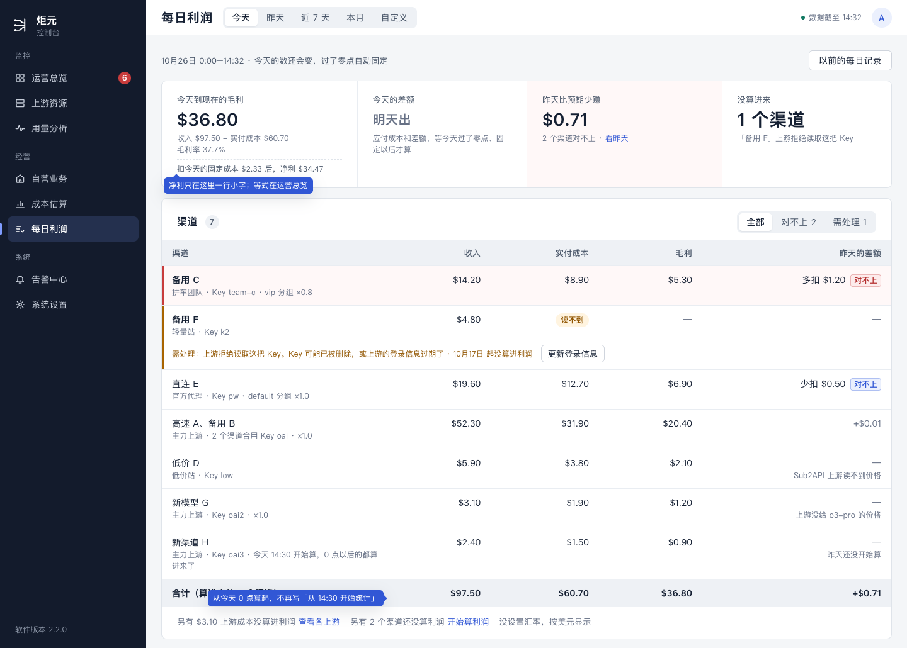
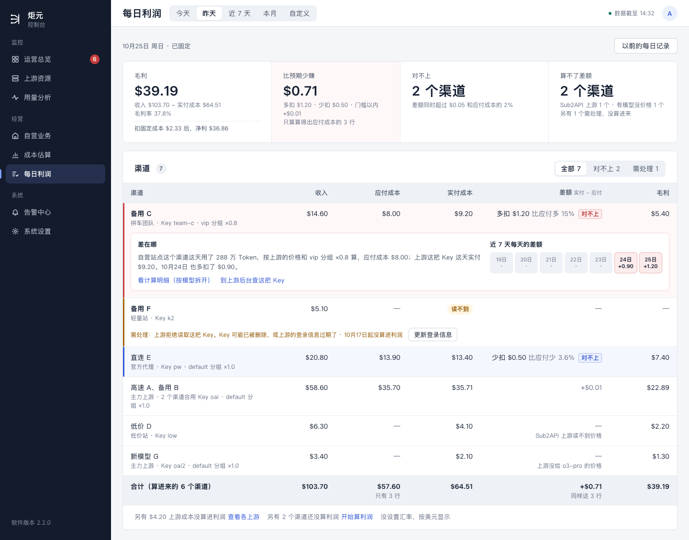
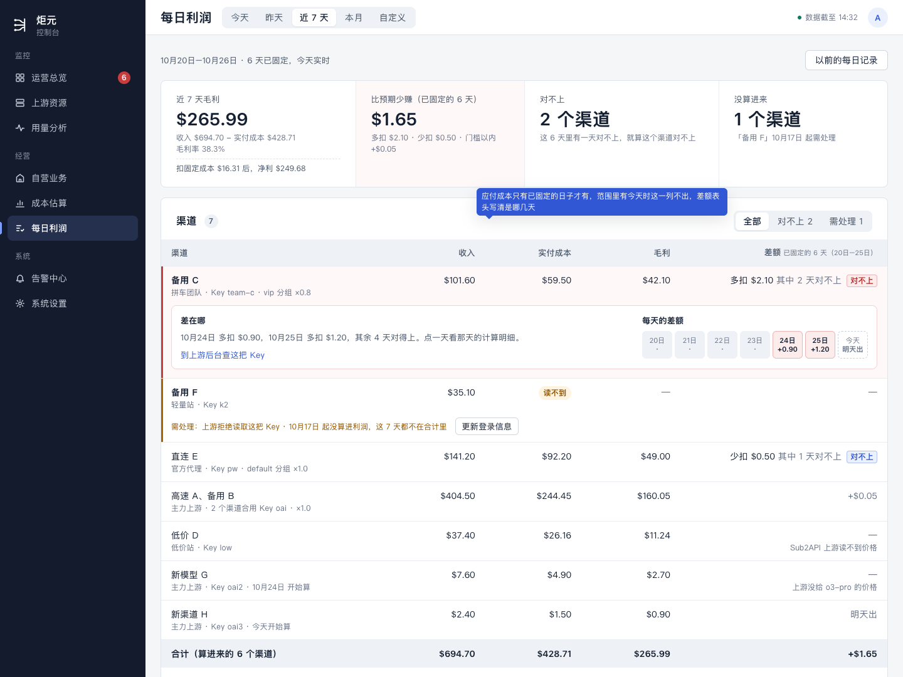
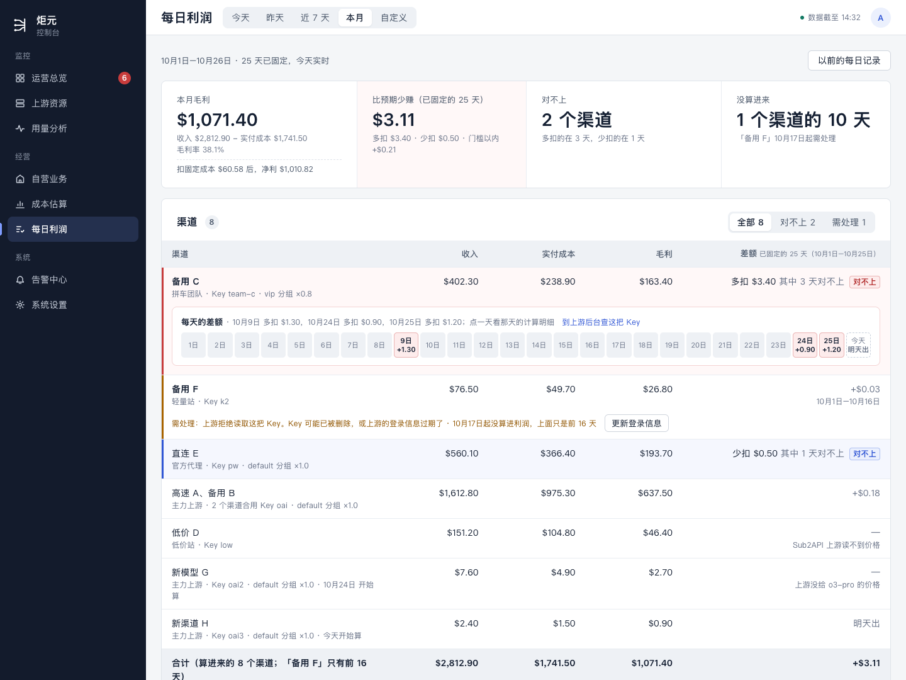
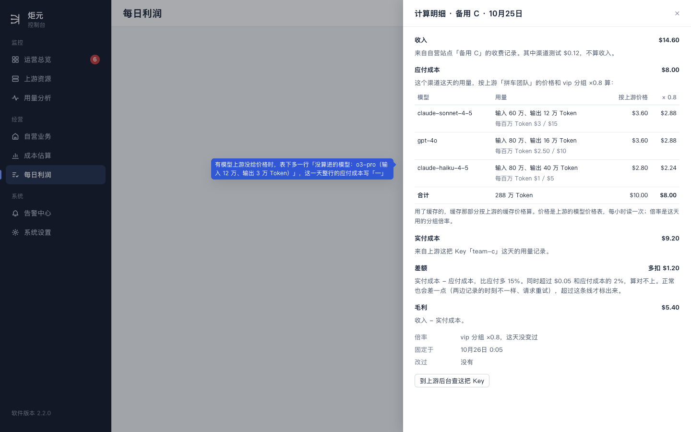
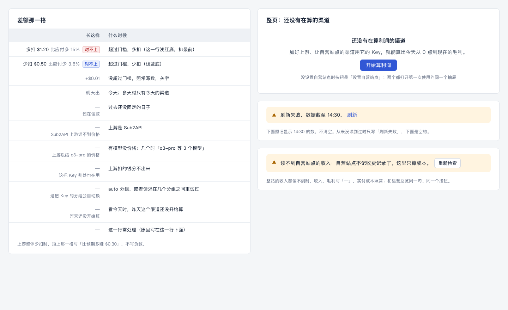
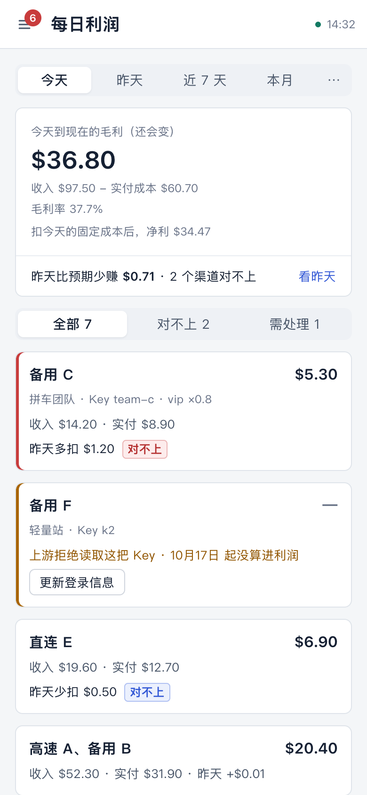
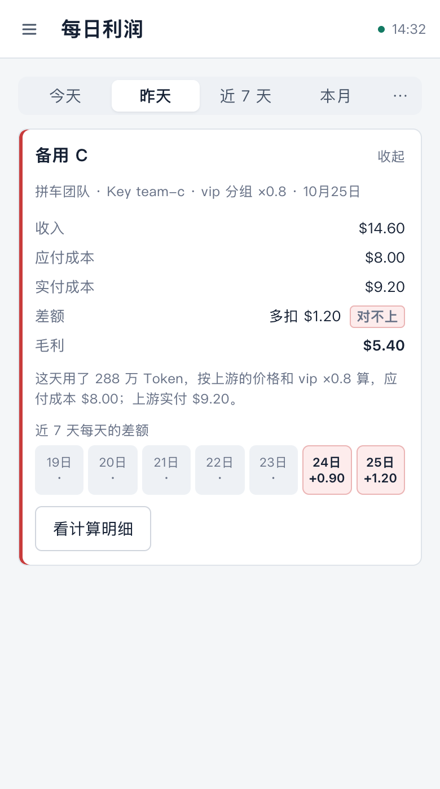

# 每日利润「一张对账表」细化稿（样子 A）

> 现在：已定（用户 10-26 看过细化稿），随每日利润重做做。2026-10-26，UI/UX 设计会话。
>
> - 用户 10-26 在[整页重做稿](./daily-profit-redesign.md)里选了 A，第 8 节那四件也定了。这份把 A 画全：四种范围、点开那一行、计算明细、各种「—」、空和刷新失败、手机。
> - 样稿：[daily-profit-a.html](./daily-profit-a.html)，截图在 `screens/dpa-*.png`。几张用同一份演示数据（今天是 10月26日，到 14:32）。数和整页重做稿的样稿不一样，以这份为准。
> - 新说法（应付成本、实付成本、差额、对不上……）在另一个只改文字的 PR 里进用语规范。这份里的字以规范为准。
> - 第 9 节是给开发的字段表，名字和开发 1 对齐。

## 0. 这份设计的六项（ui-design-spec §1.3）

| 项 | 写什么 |
|---|---|
| 用户目标 | 加好上游、绑好渠道以后，打开就知道：赚了多少；上游实际扣的钱和按价格、倍率该扣的差多少；差在哪个渠道、哪几天 |
| 流程 | 打开就是今天：顶上看今天到现在的毛利和昨天差多少，下面一行一个渠道。想查哪一行，点开看那几天每天的差额，再点「看计算明细」看按模型拆开的应付成本。一共点两下，不换页 |
| 省掉了什么 | 自己拿价格和倍率去算上游该扣多少；从「昨天」切到「今天」；在汇总、横条、需处理区块、绑定列表之间找哪个渠道有问题 |
| 还要用户做的 | 看。对不上时自己去上游那边问；需处理的那一行点它的按钮 |
| 对照原则 | §1.2 第 5 条（同一件事只在一处说）；§1.4 第 1 条（一页回答一个问题）。违反一处：顶上的数和表的合计行各出现一次（§1.4 第 2 条），留合计行是为了让财务一减就对得上 |
| 版式 | 桌面 1440 整宽单栏：页顶一句 + 四个数一行 + 一张表。手机 390：一张卡片 + 一个渠道一张卡片（第 7 节） |

## 1. 用户 10-26 定的

1. 选 A「一张对账表」。
2. 不放等式，等式只在运营总览；毛利下面一行小字写净利。
3. 拿掉右边的「需处理」区块：事写在那一行里，表头有「需处理」筛选；日报的「去处理」链到运营总览。
4. 拿掉日条和「按天看」：点开一个渠道，看它每天的差额。

还有两件前提（总指挥 10-26 转来）：

- 「今天到现在」从今天 0 点算起：绑上以前今天已经产生的用量也算。
- 应付成本第一版只给已经固定的整天算、只算 New API 上游；门槛初定 $0.05 和 2%，只显示，不进需处理。

## 2. 四种范围

### 2.1 今天（默认打开）

- **页顶一句：**「10月26日 0:00–14:32 · 今天的数还会变，过了零点自动固定」，右边「以前的每日记录」。
- **四个数：**
  1. 今天到现在的毛利，下面「收入 − 实付成本」、毛利率；虚线下面一行「扣今天的固定成本 $2.33 后，净利 $34.47」。
  2. 今天的差额：「明天出」，下面「应付成本和差额，等今天过了零点、固定以后才算」。
  3. 昨天比预期少赚（有对不上的时浅红底），下面「2 个渠道对不上 · 看昨天」。昨天还没固定时，往前找最近一个固定了的日子，标题跟着写那一天（「10月24日 比预期少赚」）。
  4. 没算进来几个渠道，下面写是哪个、为什么。都算进来了，这一格写「全部算进来了」。
- **表：**渠道、收入、实付成本、毛利、昨天的差额。今天没有应付成本，所以不出那一列；最后一列给最近一次算得出的那天，表头写「昨天的差额」或「10月24日的差额」。

### 2.2 昨天，或者任何全都固定了的范围

- **页顶一句：**「10月25日 周日 · 已固定」。几天时「10月18日–10月24日 · 已固定」。
- **四个数：**毛利（下面净利）；比预期少赚（下面多扣、少扣、门槛以内三项，加起来等于这个数，再写「只算算得出应付成本的 3 行」）；对不上几个渠道；算不了差额几个渠道（下面按原因数，另有几个需处理）。
- **表：**渠道、收入、应付成本、实付成本、差额、毛利，五个数都在一行里。合计行里应付成本和差额只加算得出的那几行，下面写「只有 3 行」「同样这 3 行」。

### 2.3 近 7 天、本月、自定义里有今天

- **页顶一句：**「10月20日–10月26日 · 6 天已固定，今天实时」；有还在读取的日子时写「4 天已固定，1 天还在读取，今天实时」（F 已有的写法）。
- **四个数：**近 7 天（本月）毛利，下面净利；「比预期少赚（已固定的 6 天）」；对不上几个渠道（这几天里有一天对不上，就算这个渠道对不上）；没算进来几个渠道（只有几天没算进来时写「1 个渠道的 10 天」）。
- **表：**渠道、收入、实付成本、毛利、差额。
  - 范围里有还没固定的日子，所以**不出应付成本那一列**：应付成本只有已固定的日子才有，放进去会和整段的实付成本对不上。
  - 差额只加已固定的日子，表头写「差额 已固定的 6 天（10月20日–10月25日）」；已固定的日子不连着时只写「已固定的 6 天」。后面写「其中 2 天对不上」。
  - 收入、实付成本、毛利是整段（含今天到现在）。
- 范围中间才开始算的渠道，名字下面写「10月24日 开始算」「今天开始算」；只有今天的渠道，差额写「明天出」。
- 本月里「备用 F」前 16 天算进来了、后 10 天需处理：合计行写「合计（算进来的 8 个渠道；「备用 F」只有前 16 天）」。
- 需处理的渠道：没算进来的日子不进合计，那一行写算进来的那几天的数，差额下面写那几天「10月1日–10月16日」，原因后面写「10月17日起没算进利润，上面只是前 16 天」。一天都没算进来的，收入照写（不进合计）、实付成本「读不到」、毛利和差额「—」。

### 2.4 选的范围全在过去、也全固定了

照第 2.2 节，五列都有。

## 3. 一行

### 3.1 一行是什么

一行一个渠道；同一把 Key 的几个渠道合成一行，写「高速 A、备用 B」，下面「主力上游 · 2 个渠道合用 Key oai · ×1.0」。每个渠道各自的收入在计算明细里看。

名字下面那行小字依次写：上游名 · Key 名 · 分组和倍率 · 什么时候开始算（只有范围中间开始的写）。

### 3.2 排序和底色

1. 对不上、多扣的，差额大的在前：浅红底，左边一道红线；
2. 需处理的：左边一道橙线，下面一行写原因和按钮；
3. 对不上、少扣的：浅蓝底，左边一道蓝线；
4. 其余，按毛利从大到小。

金额都是黑字（ui-design-spec §5.6）。「对不上」靠差额后面那个小标签和这一行的底色。

### 3.3 筛选和数法

表头右边：全部 N / 对不上 N / 需处理 N。没有的那一项数字是 0，照样能点。

全页数的都是渠道，不是行：同一把 Key 的两个渠道合成一行，算 2 个（用语规范 §4，按渠道数）。标题旁的数、「全部 N」、合计行「算进来的 7 个渠道」、顶上「对不上 2 个渠道」都这样数。

### 3.4 需处理那一行

- 原因和按钮照用语规范 §5.2 那一条（标题、说明、按钮都同一份），前面加「需处理：」；
- 后面接附注：「10月17日 起没算进利润」（§5.1 附注的写法）；
- 几个问题时只露最要紧的一条，后面写「还有 1 个问题」。

没有落在某一行上的事（上游登录信息过期、新渠道还没算利润、上游账号的问题）不在这一页，在运营总览和侧栏的清单里。

## 4. 点开一行

点一行展开，对不上的那几行默认展开。

**看一天时（dpa-yesterday）：**

- 左边「差在哪」：一句话写怎么算的。「自营站点这个渠道这天用了 288 万 Token，按上游的价格和 vip 分组 ×0.8 算，应付成本 $8.00；上游这把 Key 这天实付 $9.20。10月24日 也多扣了 $0.90。」后面两个链接「看计算明细（按模型拆开）」「到上游后台查这把 Key」。
- 右边「近 7 天每天的差额」：七个小格，对不上的那天上底色、写数；对得上的写「·」。

**看几天时（dpa-week、dpa-month）：**

- 一天一格，跟着选的范围走，最多 31 格；今天那一格是虚线框，写「明天出」。
- 上面一句列出对不上的那几天：「10月9日 多扣 $1.30，10月24日 多扣 $0.90，10月25日 多扣 $1.20」，后面是「到上游后台查这把 Key」。格子里只写「9日」（用语规范 §6，新）。
- 看一个月时格子多，「差在哪」占整行、一行格子；一周以内左边一句、右边格子。
- 点一格，打开那一天的计算明细。

对得上、算不了差额的行点开也一样，格子里是「·」或「—」。

## 5. 计算明细

右边抽屉，标题「计算明细 · 备用 C · 10月25日」。从上到下：

| 段 | 写什么 |
|---|---|
| 收入 | 「来自自营站点「备用 C」的收费记录，已扣除管理员自用 $0.12。」管理员自用的几种写法（部分日子没扣、一天都没扣、合计是 0）照用语规范 §9「管理员自用」那一行（R1） |
| 应付成本 | 一句「这个渠道这天的用量，按上游「拼车团队」的价格和 vip 分组 ×0.8 算：」，下面一张表：模型、用量（输入、输出 Token；用了缓存的多写缓存那一部分）、上游的价格（「每百万 Token $3 / $15」，输入 / 输出）、按上游价格、× 倍率。最后一行合计。表下面一句「用了缓存的，缓存那部分按上游的缓存价格算。价格是上游的模型价格表，每小时读一次；倍率是这天用的分组倍率。」 |
| 没算进的模型 | 有模型上游没给价格时多这一段：「没算进的模型：o3-pro（输入 12 万、输出 3 万 Token）」。这时这一天的应付成本、差额写「—」 |
| 实付成本 | 来自上游这把 Key「team-c」这天的用量记录（和 §3.2「上游成本」同一个来源） |
| 差额 | 实付成本 − 应付成本，比应付多 15%。同时超过 $0.05 和应付成本的 2%，算对不上。正常也会差一点（两边记录的时刻不一样、请求重试），超过这条线才标出来 |
| 毛利 | 收入 − 实付成本 |
| 倍率、固定于、改过 | 照 §9；倍率这天变过的照「倍率在 14:30 从 1.0 变成 1.2，分两段算」，应付成本那张表按两段各算一遍 |
| 按钮 | 「到上游后台查这把 Key」，上游没有能直接打开的地址时不放 |

几个渠道合用一把 Key 时，收入、应付成本按渠道各写一行，实付成本只有一个数（上游按 Key 扣钱）。

## 6. 「—」和整页的几种情况

**差额那一格：**

| 长这样 | 什么时候 |
|---|---|
| 多扣 $1.20 比应付多 15% [对不上] | 超过门槛，多扣 |
| 少扣 $0.50 比应付少 3.6% [对不上] | 超过门槛，少扣 |
| +$0.01（灰字） | 没超过门槛，照常写数 |
| 明天出 | 今天；多天时只有今天的渠道 |
| — 还在读取 | 过去还没固定的日子 |
| — Sub2API 上游读不到价格 | 上游是 Sub2API |
| — 上游没给 o3-pro 的价格 | 有模型没价格；几个时「o3-pro 等 3 个模型」 |
| — 读不到上游的模型价格 | 上游没开放模型价格表，或者读不到 |
| — 自营站点的记录看不出缓存用了多少 | 自营站点的记录里没有缓存那几项，算不准 |
| — 这把 Key 别处也在用 | 上游扣的钱分不出来 |
| — 这把 Key 的分组会自动换 | auto 分组，或者请求在几个分组之间重试过 |
| — 这天固定时还没算应付成本 | 应付成本上线以前就已经固定的日子，不补算 |
| — 这天固定时「算应付成本」关着 / —「算应付成本」关着 | 系统设置里的开关关着（用语规范 §8.3） |
| — 收费记录还没读到这天 | 自营站点的收费记录读得慢，读到了会补上；表下面另有一行提示（用语规范 §5.4） |
| — 昨天还没开始算 | 看今天时，昨天这个渠道还没开始算 |
| — | 这一行需处理（原因写在这一行下面） |

上游整体少扣时，顶上那一格写「比预期多赚 $0.30」，不写负数。

**整页：**

- **还没有在算利润的渠道：**表的位置写「还没有在算利润的渠道」，下面「加好上游、让自营站点的渠道用它的 Key，就能算出今天从 0 点到现在的毛利。」按钮「开始算利润」；没设置自营站点时按钮是「设置自营站点」。两个都打开第一次使用的同一个抽屉（[第一次使用稿](./first-run.md)），做完落回这一页今天。
- **刷新失败：**页顶一条「刷新失败，数据截至 14:30。」[刷新]，下面照旧显示 14:30 的数（§8.1）。
- **读不到自营站点的收入**（读取失败、不记收费记录）：页顶一条，和运营总览同一句、同一个按钮；收入、毛利写「—」，实付成本照常。
- **自营站点有一段没记收费记录、已经开回来：**碰到那一段的日子是需处理，那几行下面写「这一天自营站点有一段没记收费记录，那段的收入补不回来」（§4 的例外，已有）。

## 7. 「从今天 0 点算起」带来的变化

- 开始算利润那一天，从那天 0 点算起：绑上以前今天已经产生的用量也算进来（两边记录读得到就行）。名字下面写「今天 14:30 开始算，0 点以后的都算进来了」，第二天起只写「10月26日 开始算」。
- 不再写「从 14:30 开始统计」。计算明细里「开始统计」一项改成「开始算」，写日期，不写时刻。
- 「停止算利润」那一天照流程梳理稿：算到停的那一刻（New API 上游）、那天整天不算（Sub2API 上游），不变。
- 两边记录读不到 0 点以后那一段的（例如上游记录保留得短），照「还在读取」「需处理」的规矩走，不另写。

## 8. 手机

- 时间范围放顶上一排：今天、昨天、近 7 天、本月，自定义收进「⋯」。
- 顶上一张卡片：毛利（大字）、收入 − 实付成本、毛利率、净利一行；下面一行「昨天比预期少赚 $0.71 · 2 个渠道对不上 [看昨天]」。看已固定的日子时，这一行换成「比预期少赚 $0.71（多扣 $1.20 · 少扣 $0.50 · 门槛以内 +$0.01）」。
- 筛选一排：全部、对不上、需处理。
- 一个渠道一张卡片，排序同桌面：名字和毛利一行；上游、Key 一行；「收入 · 实付」一行；差额一行（今天写「昨天多扣 $1.20 [对不上]」）。需处理的卡片写原因和按钮。
- 点卡片展开：五个数竖着排，一句怎么算的，近 7 天的小格，按钮「看计算明细」。计算明细整屏打开，内容同桌面。
- 多天时小格放不下 31 个，横着滑。

## 9. 给开发的字段表

这一页要的数。名字和开发 1 对过（10-26）：能沿用现有字段的写在「沿用」那一列，接口照旧名给；新字段照这里的名字。钱都是美元原币（`…Usd`），页面按汇率换算；「—」的原因给码，页面查用语规范的字。

几条约定：

- 「算进来的日子」：这一行在这段时间里已固定、还在实时算、没有需处理的那些天。需处理的日子不进这一行的金额，也不进合计。
- 差额只算已固定的日子；「对不上」按每一行每一天判（同时超过 `gapThreshold` 的两个数）。
- `null` 的意思：金额读不到或算不出，页面写「—」或「读不到」，原因看同一行的 `gap.reason`、`attention`。

### 9.1 整页

| 字段 | 是什么 | 用在 |
|---|---|---|
| `range` | `{ preset, startMs, endMs, timezone }`；沿用现有的 `window` | 页顶一句 |
| `asOf` | 数据截至的时刻；沿用 `generatedAt`。刷新失败照旧 | 顶栏、刷新失败那一条 |
| `dayCounts` | `{ fixed, reading, today }`：范围里已固定、还在读取、今天各几天 | 页顶一句；`reading + today == 0` 时出应付成本那一列 |
| `pageTotals` | `{ incomeUsd, actualCostUsd, grossProfitUsd, grossMarginRate }`：算进来的渠道、算进来的日子。不叫 `totals`：现有的 `totals`（按窗口组给的 `knownIncomeUsd` 等）意思不同，随页面 A 一起删 | 第一个数、合计行 |
| `fixedCostUsd`、`netProfitUsd` | 范围内的固定成本（已固定的日子用那天记下的）和净利 | 毛利下面那一行 |
| `gap` | `{ days: { first, last, count, contiguous }, expectedCostUsd, actualCostUsd, usd, overUsd, underUsd, withinUsd, rowCount }`：只算已固定的日子、算得出应付成本的行。按「一行一天」分三类加：超过门槛多扣的进 `overUsd`，超过门槛少扣的进 `underUsd`（正数），其余进 `withinUsd`（可正可负）；`usd = actualCostUsd − expectedCostUsd = overUsd − underUsd + withinUsd` | 「比预期少赚」那一格、表头「已固定的 6 天（10月20日–10月25日）」（`contiguous` 为假时只写天数）、合计行 |
| `latestSettledGap` | `{ day, usd, mismatchedRowCount }`：看今天时，最近一个已固定的日子 | 今天的第三格、最后一列表头 |
| `counts` | `{ channels, countedChannels, mismatchedChannels, attentionChannels, uncomputable: { [reason]: 渠道数 }, mismatchedDays: { over, under } }`：都按渠道数（同一把 Key 的两个渠道算 2 个），和现有 `countsInSummary` 同一个数法 | 标题旁的数、筛选、合计行、第三、四格 |
| `gapThreshold` | `{ usd: 0.05, rate: 0.02 }` | 第三格下面那句、计算明细里的那句；页面不另写一份 |
| `ownIncomeUnavailable` | 整站收入读不到时 `{ code }`，和运营总览同一份；沿用 `incomeUnconfirmed` 的 `errorCode` | 页顶那一条 |
| `unaccountedUpstreamCostUsd` | 另有多少上游成本没算进利润；沿用 `unaccountedUpstream.total` | 表下面一行 |
| `unlinkedChannelCount` | 另有几个渠道还没算利润 | 表下面一行 |
| `rateUnset` | 没设置汇率；沿用 `unconfiguredRateStations` | 表下面一行 |

### 9.2 一行

| 字段 | 是什么 |
|---|---|
| `rowKey` | 这一行的标识：上游 + Key。现在一条绑定一把 Key，几条绑定合用一把 Key 时，接口按（上游, Key）合成一行、金额相加；同一个渠道不能算两次（现有的「渠道同时绑了两把 Key」那道检查照旧挡着） |
| `channels` | `[{ channelId, name }]` |
| `upstream` | `{ stationId, name, provider }` |
| `key` | `{ name, groupName, groupRatio, upstreamKeyUrl }`；`upstreamKeyUrl` 第一版一律 `null`（各家上游后台的地址不统一），「到上游后台查这把 Key」先不出 |
| `startedOn`、`startedAt` | 开始算的那天；今天开始的再给时刻（只用在「今天 14:30 开始算」） |
| `incomeUsd`、`actualCostUsd`、`grossProfitUsd` | 算进来的日子；一天都没算进来时 `actualCostUsd`、`grossProfitUsd` 是 `null` |
| `uncountedIncomeUsd` | 没算进来的日子里读到的收入（需处理那一行「收入照写」用，不进合计） |
| `expectedCostUsd` | 只在范围全固定、算得出时有，否则 `null` |
| `gap` | `{ usd, rate, state, mismatchedDays, days, reason, missingPriceModels }`，只算已固定的日子：`rate = usd ÷ 这几天的应付成本`；`state` 是 `over` / `under`（这几天里有超过门槛的那一天，两种都有时取 `over`）、`within`、`today`（明天出）、`reading`、`none`（算不了）；`reason` 在 `none` 时给：`UPSTREAM_PRICE_UNSUPPORTED`（Sub2API）、`MODEL_PRICE_MISSING`、`MODEL_PRICE_UNREADABLE`（上游的价格表读不到）、`MODEL_PRICE_TIERED`（上游这个模型按用量分档计价，单价随用量变，不硬算）、`CACHE_FIELDS_UNKNOWN`（自营站点的记录看不出缓存用量）、`KEY_SHARED`、`GROUP_AUTO`、`NOT_STARTED`、`EXPECTED_COST_NOT_RECORDED`（应付成本上线以前固定的日子）、`EXPECTED_COST_DISABLED`（系统设置里「算应付成本」关着）、`EXPECTED_COST_LAGGING`（收费记录还没读到这天）、`PARTIAL_HOUR_UNSUPPORTED`（这一天算的时段从半点开始或在半点结束，比如同一天换绑、停止算利润的那天；收费记录按整点记，切不开）、`FIXED_COST_UPSTREAM`（固定成本的上游，不比实付和应付）；`days` 同 9.1。不用 `difference` 这个词：现有 `calculation.differenceUsd` 是毛利 |
| `attention` | 需处理时那一条：`{ code, title, detail, action, fromDay, moreCount }`，和需处理清单同一份（E）；沿用 `displayStatus`。和 `gap` 分开：一行可以既需处理、又有算进来那几天的差额 |
| `excludedDays` | 范围里没算进来的天数（「上面只是前 16 天」） |
| `daily` | 点开那一行用：`[{ day, state, gapUsd, gapState, tokens }]`，`state` 是 `fixed` / `reading` / `today` / `attention` / `notStarted`；看一天时给近 7 天，几天时给范围里每一天（最多 31）；`tokens` 是那天的 Token 数（「这天用了 288 万 Token」），结账时顺手存进账本 |
| `latestSettledGap` | 看今天时这一行最近一个已固定日子的 `{ day, usd, state, reason }` |

### 9.3 计算明细（一行、一天）

| 字段 | 是什么 |
|---|---|
| `income` | `{ usd, adminUsage: { usd, deducted }, byChannel: [{ channelId, usd }] }`；`deducted` 是 `all` / `some` / `none`，照 R1 账本每一行扣没扣，页面按它选 §9 那几种写法 |
| `expected` | `{ usd, groupName, groupRatio, segments, byModel: [{ model, inputTokens, outputTokens, cacheReadTokens, cacheWriteTokens, pricesPerMillion: { input, output, cacheRead, cacheWrite }, beforeRatioUsd, usd }], missingPriceModels: [{ model, inputTokens, outputTokens }], byChannel }`；价格是每百万 Token 多少美元；倍率这天变过时 `segments` 分段，`byModel` 各段各算 |
| `actual` | `{ usd, keyName }` |
| `gap` | `{ usd, rate, state }` |
| `fixedAt`、`revisions` | 已有（§9） |

计算明细按天存一份进账本，点开一天才读；范围里的应付成本、差额、对不上与否按天存成列，范围查询直接加，不逐天读明细。

## 10. 验收清单（给审核与测试）

1. 默认打开今天，从 0 点算起；今天开始算的渠道，0 点以后的都算进来了。
2. 合计行 = 顶上第一个数；各行加起来 = 合计行（只加算进来的）。
3. 「比预期少赚」= 多扣 − 少扣 + 门槛以内，只算已固定的日子、算得出的行。
4. 范围里有还没固定的日子时，不出应付成本那一列，差额表头写清是哪几天。
5. 今天的差额写「明天出」，不写 0；算不了的写「—」和原因，不写 0。
6. 门槛：同时超过 $0.05 和应付成本的 2% 才标「对不上」；对不上不进需处理、不推送。
7. 金额不上色；对不上靠标签和底色。
8. 需处理那一行的字和需处理清单同一份；没落在某一行上的事不在这一页。
9. 没有需处理区块、日条、按天看、等式；净利只在毛利下面一行。
10. 手机：卡片、展开、整屏计算明细都能用。
