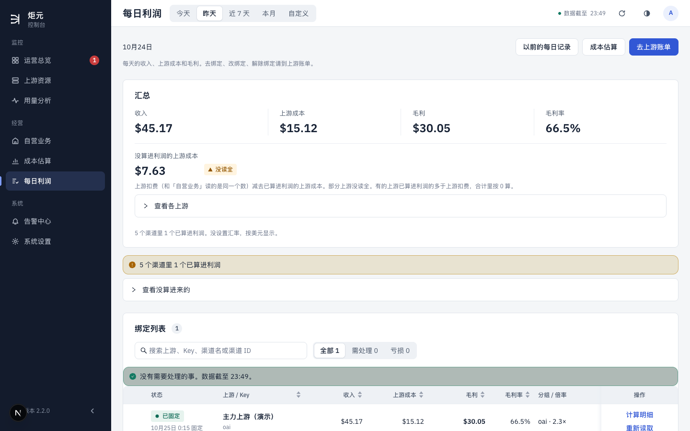
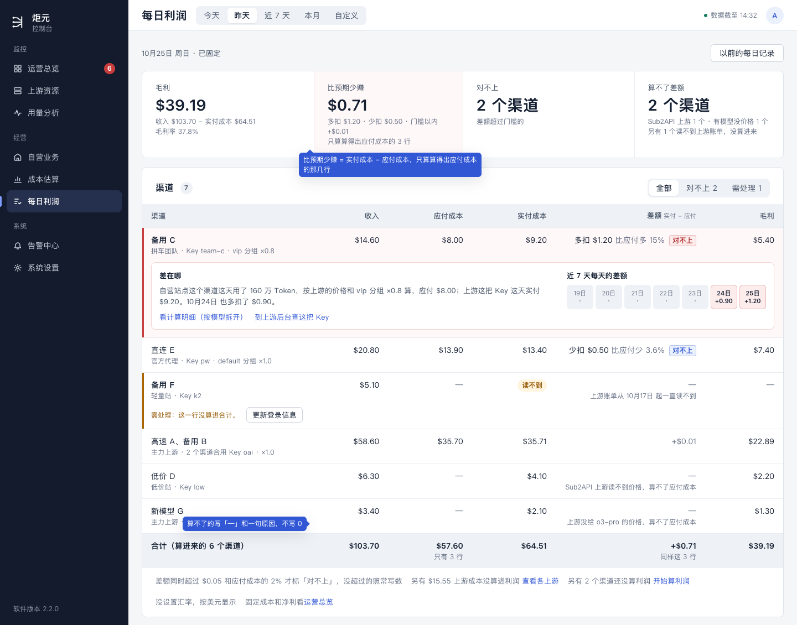
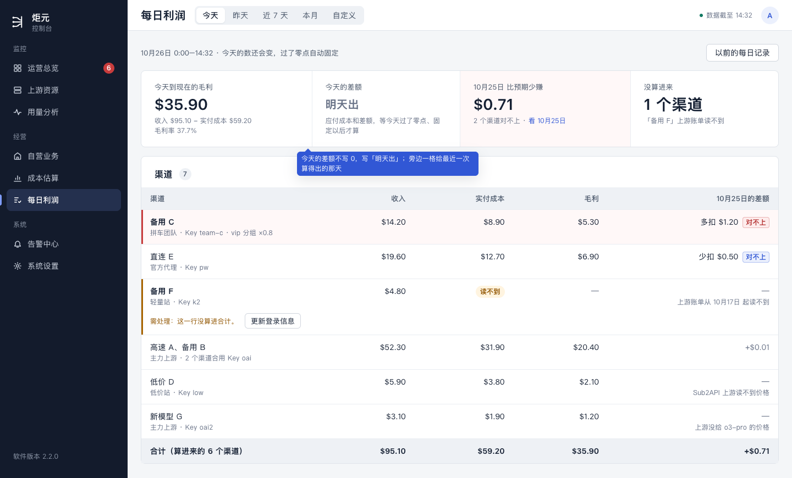
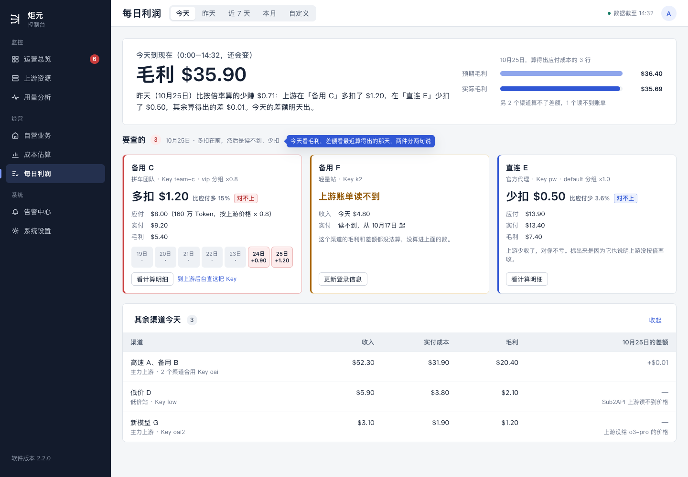
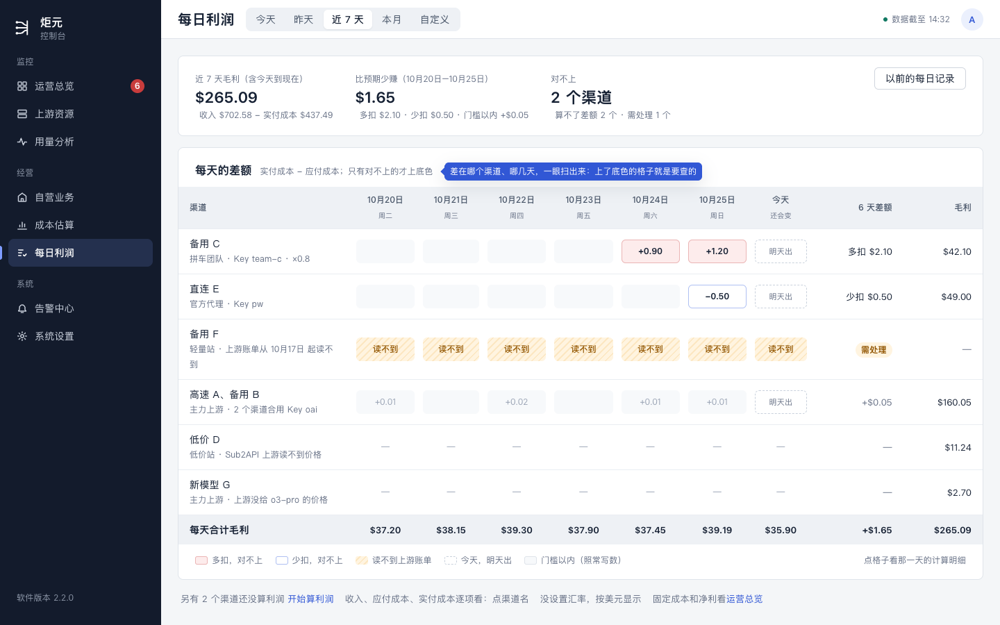

# 每日利润整页重做设计稿（三种样子，等用户挑）

> 现在：草稿，等用户挑一种。2026-10-26，UI/UX 设计会话。
>
> - 挑中以后再补手机、边角情况，第 10 节的说法那时先进规范再做。
> - 样稿：[daily-profit-redesign.html](./daily-profit-redesign.html)，截图在 `screens/dp-*.png`。几张用同一份演示数据。
> - 应付成本怎么算，照总指挥 10-26 转来的调研要点（第 3 节）。

## 0. 这份设计的六项（ui-design-spec §1.3）

| 项 | 写什么 |
|---|---|
| 用户目标 | 加好上游、绑好渠道以后，打开这一页就知道三件事：赚了多少；上游实际扣的钱和按倍率该扣的差多少；差在哪个渠道、哪几天 |
| 流程 | 改前：首屏九块东西（第 2 节），「算进来没有」说了三遍，和上游对账的差额根本没有。改后：打开就是今天，顶上几个数回答「赚了多少」和「最近一天差多少」；下面一张表（或几张卡片、一张格子表）回答「差在哪」。对不上的排最前，点开看是哪几天、怎么算的 |
| 省掉了什么 | 自己拿倍率和价格去算上游该扣多少；在汇总、横条、需处理、绑定列表之间来回找哪个渠道有问题；从「昨天」切到「今天」 |
| 还要用户做的 | 看。对不上时点开看计算明细，自己去上游那边问；读不到账单时照那一行的按钮去处理 |
| 对照原则 | §1.2 第 5 条（同一件事只在一处说）；§1.4 第 1 条（一页回答一个问题）、「少放东西」。违反的有两处：一是样子 A 的总数在顶上和表的合计行各出现一次，违反 §1.4 第 2 条，留合计行是为了让财务一减就对得上；二是和已经定的 E、F、G 有几处冲突。第 8 节逐条写了取舍 |
| 版式 | 三种样子都是整宽单栏，不再是 8 + 4 分栏，见第 4–6 节。手机等用户挑完再画 |

## 1. 用户要什么

- 这一页的核心是**和上游对账**：看我们和上游之间的利润，和按倍率算出来的预期有没有差距。
- 现在这一页东西太多太乱，用户不认可。
- 加一个上游、绑上渠道以后，就应该马上算出今天到现在的利润。

总指挥 10-26 问过用户三件，都照推荐：

1. **「预期」是按倍率算出来的应付成本。**拿自营站点这个渠道卖出去的用量，按上游的价格和那把 Key 的分组倍率，算出「上游应该收多少」，和上游实际扣的钱比。例如应付 $8.00、实付 $9.20，就是多扣了 $1.20，要查的就是这个。这是新东西，现在页面上没有。
2. **「今天到现在」从今天 0 点算起。**绑上以前今天已经产生的用量也算，两边记录读得到就行。
3. **整页重做，先出两三种样子给用户挑。**

## 2. 现在什么样

（演示数据，昨天。左下角的「N」是开发模式的标记，不是页面的一部分。）

首屏从上到下：

1. 页顶一行说明和三个按钮，主按钮是「去上游账单」；
2. 汇总四格；
3. 「没算进利润的上游成本」一大格；
4. 「查看各上游」；
5. 一行说明；
6. 黄横条「5 个渠道里 1 个已算进利润」；
7. 「查看没算进来的」；
8. 绑定列表的搜索框、筛选（全部 / 需处理 / 亏损）和绿横条；
9. 列表本身：八列，操作列三个链接。

E、F、G 三份设计稿定的样子（[G 设计稿](./g-equation.md)第 4 节）比现在整齐，但回答的还是「赚了多少、哪天定下来了」，没有「和预期差多少」。

## 3. 三种样子共同的部分

### 3.1 应付成本、差额（照调研要点）

**第一版只给已经固定的整天算应付成本和差额。**

- 今天还在实时算，应付成本和差额要等这一天过了零点、固定以后才有。所以今天那一格照样有毛利，差额写「明天出」，不写 0。
- 「明天出」的意思是：今天的应付成本和差额，等今天过了零点、固定以后才算。
- 还没固定的过去几天（还在读取）也一样，没有差额。

**第一版只算 New API 上游。**Sub2API 上游读不到价格，差额写「—」，原因写「Sub2API 上游读不到价格，算不了应付成本」。

**差额 = 实付成本 − 应付成本。**正的写「多扣 $1.20」，负的写「少扣 $0.50」，后面写「比应付多 15%」或「比应付少 3.6%」。

**「对不上」的门槛。**正常情况下两边也会差一点：记录的时刻不一样、倍率读得慢、请求重试。所以：

- 差额同时超过 $0.05 和应付成本的 2%，才在后面标「对不上」；
- 没超过的照常写数（灰字），不标；
- 「对不上」只显示，不进需处理清单，不推送。

门槛是初定的，跑一两周再按真实数据定。

**这几种不给差额，写「—」，下面一行小字写原因：**

| 情况 | 原因那一行 |
|---|---|
| 上游是 Sub2API | Sub2API 上游读不到价格，算不了应付成本 |
| 有模型上游没给价格 | 上游没给 o3-pro 的价格，算不了应付成本（几个模型时写「o3-pro 等 3 个模型」；计算明细里列全） |
| 这把 Key 别处也在用 | 这把 Key 别处也在用，上游扣的钱分不出来 |
| 分组是 auto，或者请求在几个分组之间重试过 | 这把 Key 的分组会自动换，算不了应付成本 |
| 任一边这天没读全 | 这一行本来就有自己的状态：头 7 天是「还在读取」，一直读不到才转需处理（用语规范 §4），差额写「—」，不另写原因 |
| 今天、还在读取的日子 | 明天出（今天）；还在读取（过去的日子） |

### 3.2 一行是什么、几个数

**一行是什么。**照 K：一行一个渠道，不说「绑定」。

上游是按 Key 扣钱的，几个渠道合用一把 Key 时，实付成本和差额分不到每个渠道。所以：

- 同一把 Key 的几个渠道合成一行，写「高速 A、备用 B」，下面小字「主力上游 · 2 个渠道合用 Key oai」；
- 每个渠道各自的收入、应付成本在计算明细里看。

这样不用把实付成本按比例分下去，也就不会出现分出来的数。

**每一行的五个数：**

| 数 | 是什么 | 例 |
|---|---|---|
| 收入 | 自营站点这个渠道卖出去收的钱（和现在一样） | $14.60 |
| 应付成本 | 这个渠道的用量，按上游的价格和那把 Key 的分组倍率，算出上游应该收多少 | $8.00 |
| 实付成本 | 上游这把 Key 实际扣的钱，就是现在的「上游成本」 | $9.20 |
| 差额 | 实付成本 − 应付成本（第 3.1 节） | 多扣 $1.20 · 比应付多 15% · 对不上 |
| 毛利 | 收入 − 实付成本（和现在一样） | $5.40 |

**整页顶上的数：**

- **毛利** = 收入 − 实付成本，下面写毛利率。
- **比预期少赚** = 只算算得出应付成本的那几行，实付成本合计 − 应付成本合计。下面写多扣、少扣、门槛以内各多少，三样加起来等于这个数。上游整体少扣时，这一格写「比预期多赚 $0.30」。

**排序：**

1. 对不上、多扣的，差额大的在前；
2. 需处理的；
3. 对不上、少扣的；
4. 其余。

**金额不上色**（ui-design-spec §5.6）。「对不上」靠后面那个小标签和这一行的浅底色：多扣是浅红，少扣是浅蓝。

### 3.3 三种样子都拿掉或挪走的

| 现在有的 | 去哪 |
|---|---|
| 页顶主按钮「去上游账单」、那句「去绑定、改绑定……请到上游账单」、「成本估算」按钮 | 拿掉（E 已经定了拿掉前两样）；「以前的每日记录」留着 |
| 汇总下面「没算进利润的上游成本」一大格、「查看各上游」 | 降成表下面一行小字「另有 $15.55 上游成本没算进利润 [查看各上游]」，F、G 已经定了这样降 |
| 黄横条「5 个渠道里 1 个已算进利润」「查看没算进来的」 | 表下面一行小字「另有 2 个渠道还没算利润 [开始算利润]」 |
| 搜索框、绿横条「没有需要处理的事」 | 拿掉：一页最多二三十行，不用搜；表里没有标色的就是没事 |
| 「亏损」筛选 | 换成「对不上」「需处理」两个筛选 |
| 状态列（实时 / 已固定 / 需处理） | 实时、已固定改成页顶那一句；需处理的那一行自己标橙、写原因、带按钮 |
| 分组 / 倍率列 | 并进渠道名下面那行小字「拼车团队 · Key team-c · vip 分组 ×0.8」 |
| 操作列（计算明细、重新读取、查看详细原因） | 点一行就是计算明细；需处理那一行的按钮放在那一行下面 |

## 4. 样子 A「一张对账表」

看昨天（已经固定的一天）：

看今天：

**顶上四个数排一行。**

看已经固定的日子时：

- 毛利；
- 比预期少赚（浅红底）；
- 对不上几个渠道；
- 算不了差额几个渠道（下面写分别是什么原因，另有几个读不到账单）。

看今天时：

- 今天到现在的毛利；
- 「今天的差额：明天出」；
- 「10月25日 比预期少赚 $0.71」，带「看 10月25日」；
- 没算进来几个渠道。

**下面一张表。**

- 看已经固定的日子时，列是：渠道、收入、应付成本、实付成本、差额、毛利。最后一行合计，只加算进来的渠道；应付成本、差额两格只加算得出的那几行，下面写「只有 3 行」。
- 看今天时，没有应付成本和差额两列，最后一列换成「10月25日的差额」，也就是最近一次算得出的那天。今天也能一眼看出哪个渠道最近对不上。
- 右上角筛选：全部 / 对不上 / 需处理。

**对不上的那一行**浅色底、左边一道线，默认展开一块「差在哪」：

- 一句话写出怎么算的：「自营站点这个渠道这天用了 160 万 Token，按上游的价格和 vip 分组 ×0.8 算，应付 $8.00；上游这把 Key 这天实付 $9.20。10月24日 也多扣了 $0.90。」
- 右边是近 7 天每天的差额，七个小格，对不上的那天上底色、写数。
- 两个链接：「看计算明细（按模型拆开）」「到上游后台查这把 Key」。

**选近 7 天、本月这类多天时：**

- 表照样一行一个渠道，数是整段的；差额只加已经固定的日子，表头写「差额（10月20日–10月25日）」。
- 「差在哪」里的小格跟着这段时间走，一天一格，最多 31 格。

**好处：**

- 一张表，今天、昨天、多天都是这个样子；
- 财务熟悉，五个数在一行里加减得出来，合计对得上；
- 新东西最少，只多了应付成本、差额两列。

**坏处：**

- 差额少的时候，一眼先看到的是一堆数，不是结论；
- 「哪几天」要点开每一行看；
- 看今天时，差额那一列是昨天的。表头写清楚了，但一页里有两天的数。

## 5. 样子 B「先说结论」

（看今天。）

**顶上一句大字：**「毛利 $35.90」，上面写「今天到现在（0:00–14:32，还会变）」。下面一句话说最近一次算得出差额的那天：「昨天（10月25日）比按倍率算的少赚 $0.71：上游在「备用 C」多扣了 $1.20，在「直连 E」少扣了 $0.50，其余算得出的差 $0.01。今天的差额明天出。」右边两根短条比那天的预期毛利和实际毛利（只算算得出应付成本的 3 行）。

**「要查的」一排卡片：**

- 一个渠道一张，按第 3.2 节的顺序排；
- 每张写差额、应付、实付、毛利、近 7 天的小格、按钮；
- 读不到账单的也在这里，按钮是它那一条需处理的按钮；
- 没有要查的时，这一块写一句「10月25日 全部对得上」。

**「其余渠道今天」**收在最下面一张小表：收入、实付成本、毛利，最后一列是那天的差额。可以收起。

**好处：**

- 不用看表，读完一句话就知道三件事的答案；
- 要动手的事最显眼。

**坏处：**

- 那一句话要按情况拼，情况多了就长，要截断；
- 今天的数和昨天的差额在同一屏，要靠字分清；
- 多天时卡片里的小格最多放一周，看一个月不方便。

## 6. 样子 C「渠道 × 天」

（看近 7 天。）

**顶上一行三个数：**

- 近 7 天毛利（含今天到现在）；
- 比预期少赚：只算已经固定的那几天，下面写多扣、少扣、门槛以内；
- 对不上几个渠道。

**下面一张格子表：**

- 行是渠道，同一把 Key 的合成一行；列是天，表头写「10月20日 周二」。
- 格子里写那天的差额：
  - 对不上的上底色，多扣浅红、少扣浅蓝；
  - 门槛以内的照常写数，不上底色；
  - 读不到账单是橙色斜纹；
  - 今天是虚线框，写「明天出」；
  - 还在读取的过去几天写「还在读取」；
  - 还没开始统计的日子空着。
- 算不了差额的渠道整行写「—」，原因写在渠道名下面。
- 右边两列是整段已经固定的日子的差额，和整段的毛利。
- 最后一行是每天合计的毛利。
- 点一格，看那一天那个渠道的计算明细。

**只选今天、昨天时只有一列，**换成 A 那张表。

**好处：**「差在哪个渠道、哪几天」一次全看到，上了底色的格子就是要查的。连着几天多扣、某一天所有渠道都多扣，这类规律一眼看得出。

**坏处：**

- 用户最常看的是今天，这个样子在今天、昨天用不上，等于两套样子；
- 收入、应付成本、实付成本要点进渠道才看得到；
- 31 天时每格很窄，只能看底色，写不下数。

## 7. 比一比，推荐 A

| | A 一张对账表 | B 先说结论 | C 渠道 × 天 |
|---|---|---|---|
| 赚了多少 | 顶上第一个数 | 顶上一句大字 | 顶上第一个数 |
| 和预期差多少 | 顶上第二格 | 同一句话里 | 顶上第二个数 |
| 差在哪个渠道 | 表里排最前、上底色 | 「要查的」卡片 | 上了底色的格子那一行 |
| 差在哪几天 | 点开那一行看 | 卡片里的小格（一周） | 一眼全看到 |
| 只看今天、昨天 | 好 | 最好 | 只有一列，要换成 A |
| 看一个月 | 好（展开看每天） | 不方便 | 格子很窄 |
| 财务逐行核对 | 最好，五个数都在一行 | 对得上的那几行数不全 | 要点进去 |
| 改动大小 | 中 | 中 | 大（新的格子表，今天、昨天还要另一套） |

**推荐 A。**理由：

- 用户最常看的是今天到现在。A 在今天、昨天、多天都是同一个样子，不用学两套。
- 和上游对账，财务要的是「每一行五个数、加起来对得上」，A 是唯一一种每行都完整的。
- 「差在哪几天」靠展开那一行，对不上的行默认展开，不用多点。

B 的那一句话可以借过来，放在 A 顶上四个数的上面，作为一行小结。要不要借，用户挑的时候顺便说。

## 8. 和已经定的规则冲突的地方

| 已定的 | 这次怎么办 | 为什么 | 要用户再定吗 |
|---|---|---|---|
| G（用户 10-25 定 (c)）、设计规范 §1.1 第 1 条（用户 10-24 定）、决定记录第 9 条：每日利润首屏用和运营总览同一道等式，两行，带固定成本和净利；G 验收第 1、4 条，式2、式7 | 三种样子都拿掉这道等式，换成「毛利、比预期少赚」；页尾写「固定成本和净利看运营总览」 | 用户要的三件里没有固定成本和净利。等式两行五个数，再加对账的几个数就又多又乱；两处同一道等式的好处，换成了「这一页只回答对账」 | **要。**代价是「本月净利」「上个月净利」在这一页看不到了，运营总览只能选今天、近 7 天、近 30 天。折中是 G 当时的 (d)：毛利下面多一行小字「扣固定成本 $X 后，净利 $Y」 |
| G 第 4 节：「以前的每日记录」也用同一个等式组件 | 跟着挑中的样子走，和这一页同一个样子 | 同上 | 跟上一条一起定 |
| G：固定成本跟着每天一起固定 | 不变 | 运营总览照样用 | 不用 |
| E：每日利润右边 4 列放「需处理」区块；`/reconciliation#attention` 这个地址，日报的「去处理」链到这里；E 验收第 1、17 条（区块条数 = 日报 = 运营总览利润类条数） | 拿掉区块，整宽单栏。渠道上的事留在表里那一行（标橙、写原因、带按钮）。没有落在某一行上的事（上游登录信息过期、「「上游名」下有 N 个新渠道还没算利润」、「这个上游账号只给你自己的渠道用吗？」）只在运营总览和侧栏的清单里。日报的「去处理」改链到运营总览的需处理 | 区块和表里那一行说的是同一件事，一页说两遍；运营总览和侧栏的清单本来就是全站要做的事 | **要**（顺带确认）；E 的验收第 1、17 条跟着改 |
| E §5.2：「成本估算」留作次要按钮 | 拿掉 | 侧栏就有，这一页不再回答成本的问题 | 不用 |
| F：日条、「4 天已固定，1 天还在读取，今天实时」那一行、「按天看」、日条一格点了只看那一天、「改过」的白点 | A：拿掉日条和按天看，每天的差额放进对不上那一行的「差在哪」，页顶一句写定了几天；「改过」放进计算明细。C：格子表本身就是按天看，点一格看那一天 | 用户要看的「哪几天」是哪几天对不上，不是哪几天定下来了。定没定只要知道「今天的数还会变」就够 | **要**（顺带确认） |
| F 第 2.4 节：还没固定的几天和今天合成一行（开发没有逐日的数） | 不冲突：差额只给已经固定的日子算，还没固定的日子写「还在读取」或「明天出」，不要逐日的数 | 调研要点第 1 条 | 不用 |
| F §2.5、用语规范 §7：底下一行汇率的说法 | 留着，放在表下面那一行小字里 | | 不用 |
| 用语规范 §4：「其中 N 个渠道需处理、1 个还在读取，没算进来」那一句 | 换成顶上「没算进来 1 个渠道」一格，加表的合计行「合计（算进来的 6 个渠道）」；数的仍是渠道 | 少一句话，数放在格子里 | 不用（数法没变） |
| F 和用语规范 §4：每一行有状态标签（实时 / 已固定 / 需处理） | 行里不再写实时、已固定；需处理的行标橙 | 同上；三种状态的说法不变，只是不在每行重复 | 不用（说法没变） |
| 用语规范 §3.2：每个数要说毛利还是净利 | 照办：表和顶上都写「毛利」，页名「每日利润」不变 | | 不用 |
| 逐页版式第 7 节：汇总 8 列 + 需处理 4 列，下面绑定列表 | 整宽单栏 | 见上面 E 那一行 | 跟着挑的样子走 |
| 设计规范 §5.6：金额不上色 | 照办：对不上靠小标签和行的浅底色，数字是黑的 | | 不用 |
| 流程梳理稿：开始算利润「从点的这一刻起」 | 改成从今天 0 点起 | 总指挥 10-26 问过用户，照推荐 | 已定；流程梳理稿以后跟着改，不在本稿 |
| 现在默认打开「昨天」 | 默认打开「今天」 | 用户要的是今天到现在 | 不用 |

## 9. 还没定、要和开发一起定的

1. 门槛：先按 $0.05 和 2% 上线，跑一两周按真实差额再定（调研要点）。界面上的说明句跟着改。
2. 计算明细里怎么拆应付成本：按模型列出用量、价格、倍率，再加没算进的模型。挑完样子再画。
3. 看今天时，A 的最后一列「10月25日的差额」：如果昨天还没固定（刚过零点、还在读取），就往前找最近一个固定了的日子，表头跟着写那一天。
4. 「到上游后台查这把 Key」：上游有没有一个能直接打开的地址，要看各家上游，没有就不放这个链接。

## 10. 用户挑完以后要补的

- 手机（390）。
- 没有在算的渠道（第一次使用）、全部读不到、刷新失败。
- 多天时的细节：31 天的小格、跨月。
- 新说法先进用语规范，再做：
  - 应付成本、实付成本、差额、多扣、少扣、对不上、门槛以内、比预期少赚 / 多赚、预期毛利、明天出，以及第 3.1 节那几句原因。
  - 用语规范 §3.6「不上界面的词」那张表里有一行禁了「参考差额、风险差额」，要改成：「差额」只用来说实付成本 − 应付成本；「参考差额、风险差额」仍然不用。
  - 「实扣」「应收」不用，统一说「实付」「应付」。
  - 格子表、小格里日期的短写法「20日」（表头已经写了月份时），写进用语规范 §6。
- 设计规范 §1.1 第 1 条、§5（每日利润的蓝图）、决定记录第 9 条，逐页版式第 7 节，E、F、G 设计稿里被改掉的那几处，照第 8 节的结果改。
