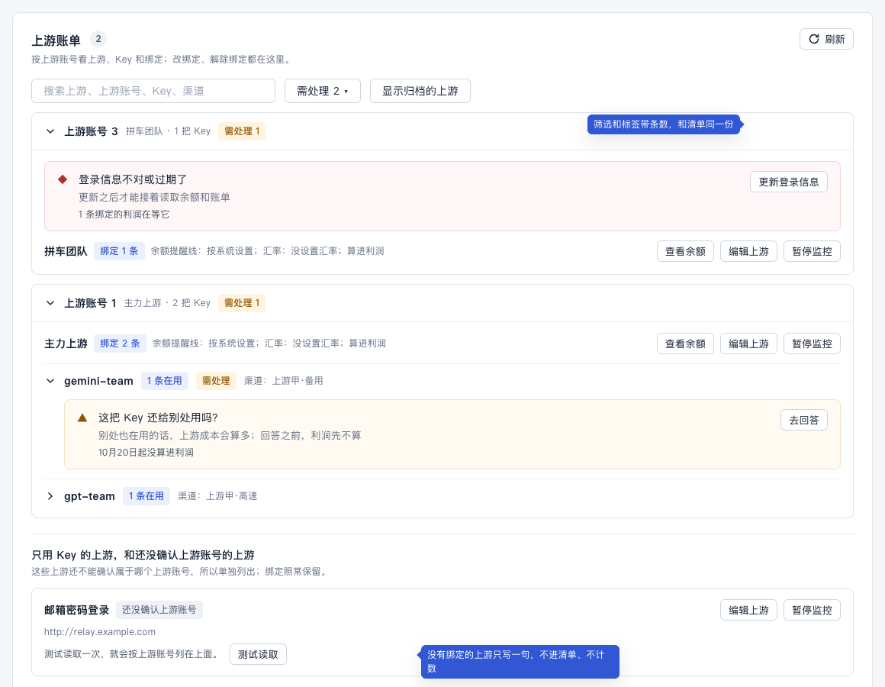
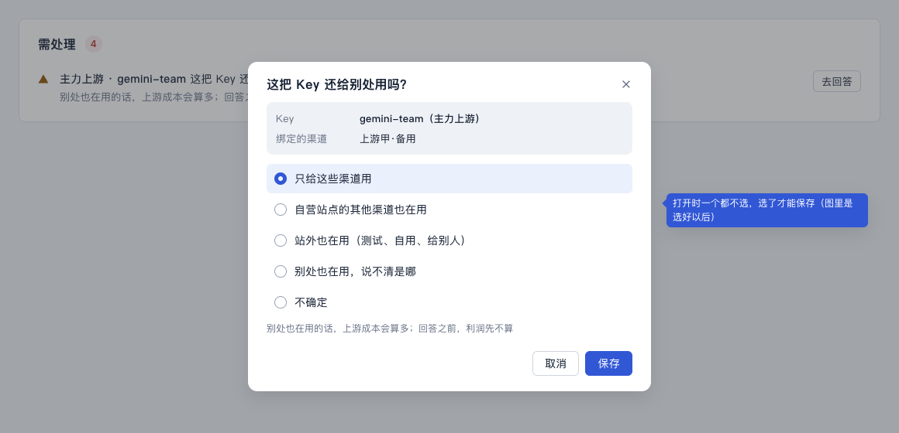

# 需处理清单（计划 E）设计稿

> 状态：草稿，等用户点头。2026-10-24，UI/UX 设计会话。
>
> 依据：
> - 计划「后续 PR 顺序与复用点」的 E 行、D2、D4；
> - [用语规范](../ui-copy-spec.md) §4、§5、§8.1、§10；
> - [体验体检](../ui-audit.md) §7.1、§7.6–§7.8、§7.10、§7.12。
>
> 本文只写流程、版面和状态。
> - 用语一律引用规范的条目；要新加的说法写在第 10 节「拟改条目」，先进规范，再写代码。
> - 视觉沿用 [ui-design-spec.md](../ui-design-spec.md) §4.3 的待处理列表和现有组件（`attention-list`、`panel`、`data-state`、`status`），不另起新组件。
>
> 样稿：[e-attention.html](./e-attention.html)，截图在 `screens/e-*.png`。样稿里的数前后对得上：运营总览 6 条 = 余额 2 条 + 利润 4 条；每日利润和日报都是 4 条。
>
> 文中只写「§」的，指用语规范的章节；体检写成「体检 §7.x」，设计规范写成「ui-design-spec §x」。
>
> 2026-10-24 补：绑定改成「渠道 + 上游账号，按时间记 Key」（[K 设计稿](./k-key-segments.md)）。第 2.1、2.2、6 节和 N1 跟着改了，新加 N11、N12。

## 1. 用户要达到什么

用的人是财务、运营。每天打开控制台，他们要：

1. **知道有几件事要自己动手。**侧栏一个数、运营总览一个数，进哪一页都一样。
2. **一眼看懂每件事。**是哪个上游、哪把 Key、哪几天，对钱有什么影响。
3. **点一个按钮就去处理，处理完它就没了。**四个地方一起消失，数字一起减。
4. **不被不影响钱的事打扰。**只有「不处理就算不准」的才进来（§4）。
5. **不打开控制台也知道。**日报里一行告诉他今天有没有要处理的。

不做的事：
- 不记已经处理过的事（不是历史记录）；
- 不单独推送（计划「推送收敛」：利润的问题只进日报一行）。

## 2. 清单里有什么

### 2.1 一件事 = 一个对象 + 一个问题 + 一个按钮

对象有五种。每种在清单里写成什么名字：

| 对象 | 名字怎么写 |
|---|---|
| 上游 | 上游名，没名字写「未命名上游」（`stationDisplayName`） |
| 上游账号 | 账号下只有一个上游时写上游名；有几个时写「主力上游 等 2 个上游」 |
| 绑定 | 按渠道绑的写「渠道名 · 上游名」，例如「上游甲·高速 · 主力上游」；按 Key 绑的照旧写「上游名 · Key 名」，Key 名按 §3.1（`reconciliationKeyName`） |
| 自营站点 | 站点名，没名字写「自营站点」（`lib/format.js` 的 `OWN_STATION_LABEL`） |
| 某条绑定的某几天 | 写绑定的名字，日期放在附注里（第 3 节） |

### 2.2 进清单的事

标题、说明、按钮全部取现有的表：问题码到文案在 `lib/reconciliation-contract.js`，按钮在 `lib/workflow-actions.js`。清单自己不写字。

| 哪一类 | 什么事 | 对象 | 标题、说明 | 按钮 | 级别 |
|---|---|---|---|---|---|
| 利润 | 登录信息不对或过期（读余额被拒，或者上游拒绝读取这把 Key） | 上游账号 | §5.2「登录信息不对或过期了」；只是绑定那把 Key 被拒时用 §5.2 KEY_INVALID_OR_DENIED。按渠道绑的绑定，旧 Key 删了、停了不算这件事：系统换到新 Key 接着算，认不出时是下面「没认出」那一行 | 更新登录信息 | 紧急 |
| 利润 | 上游账号或自营站点有变化 | 绑定、自营站点 | §5.2 SOURCE_BINDING_UNCONFIRMED | 去确认 | 紧急 |
| 利润 | 一把 Key 绑了两次、一个渠道绑了两把 Key | 绑定 | §5.2 | 处理重复 | 紧急 |
| 利润 | 还没确认 Key 属于哪个上游账号、能不能读到完整账单、按哪个时区算一天 | 绑定 | §5.2 | 测试读取 | 注意 |
| 利润 | 这个上游账号只给你自己的渠道用吗？（没回答，或者答了「不确定」） | 上游账号 | 拟改 N11 | 去回答（K 第 5 节的小窗） | 注意 |
| 利润 | 没认出这个渠道用的是哪把 Key（今天不进，过了这一天还没认出才进） | 绑定 + 日期 | 拟改 N12 | 指定 Key（K 第 7 节的小窗） | 注意 |
| 利润 | 这把 Key 还给别处用吗？（只有按 Key 绑的；没回答，或者答了「不确定」） | 绑定 | §5.2 | 去回答 | 注意 |
| 利润 | 答了「别处也在用」（只有按 Key 绑的） | 绑定 | 拟改 N1、N2 | 改绑定 / 换 Key | 注意 |
| 利润 | 过去某几天一直没读到、没读全（读取类过了 7 天） | 绑定 + 日期 | §5.3「7 天后变成需处理时的标题」，几天合一条时按 N5 写「这几天」 | 重新读取（「一直没有用量记录」那条是改绑定） | 注意 |
| 利润 | 改设置前没能固定的日子（D3，见 [D 设计稿](./d-config-change.md) 第 6 节） | 绑定 + 日期 | 拟改 N3；原设置算不出来时换成 D 的改3 | 重新读取 / 按现在的设置算 | 注意 |
| 利润 | 有渠道还没绑定（不算已停用、已删除的渠道） | 自营站点 | §5.2「有 3 个渠道还没绑定」 | 去绑定 | 注意 |
| 余额 | 余额用完、读不到余额、余额偏低、快用完、固定成本快到期 | 上游 | §3.3，写法和现在一样 | 和现在一样 | 按 §3.3 |

两类事各进哪里：

- **余额类**只进运营总览和侧栏的计数。
- **利润类**四个地方都进：上游账单、每日利润、运营总览和侧栏、日报。
- 「登录信息不对或过期了」看这个上游账号下有没有在用的绑定：有，就算利润类；没有，就只算余额类。

### 2.3 不进清单的事

- **7 天内的读取类问题。**页面上显示「实时」加「还在读取」（§4、D2）。
- **提示类（§5.4）。**倍率变了、从 X 开始统计、渠道「已停用」「已删除」的标签、倍率格「暂时读不到」，都只在原处提示一句。
- **没有绑定的上游，「还没确认上游账号」**（体检 §7.8）。这件事只影响以后绑定时的核对，现在没有哪个数受它影响。只在上游账单那个上游上写一句（样稿 C）。
- **固定成本上游的上游侧问题**（§5.4 最后一行）。
- **「查看余额」这类不是待办的动作。**

### 2.4 「最近 7 天」怎么算（要用户定，见第 11 节第 1 条）

D4 定了：首页和侧栏看最近 7 天。D2 又定了：读取类问题过了 7 天还没读到，才变成需处理。

如果「最近 7 天」按账单日期算，读取类问题刚变成需处理时已经是 7 天前的事了，永远进不了清单。所以建议这样算：

- **不带日期的事**（绑定、上游账号、自营站点上的事）：没处理就一直在。
- **带日期的事**：按它变成需处理的那天算，最近 7 天里变成需处理的才进清单。
  - 7 天没人处理，就从清单里拿掉。那几天在每日利润里照样是「需处理」，选到那几天就能看到。
  - 这样清单不会越积越多，没处理的事也会在日报里提醒满一周。

## 3. 一条长什么样

用现有的 `AttentionList` 一行（ui-design-spec §4.3）：

```
[图标] 对象名  标题（一句话，不超过 20 字，不带句号）            [一个按钮]
       说明：对钱的影响 + 怎么办（§5.1，看得懂时可以不写）
       附注：一行，写日期、从哪天起没算进利润，或「还有 2 个问题」
```

- **图标和级别**沿用现在的：紧急是红菱形，注意是黄三角。哪个算紧急，看 `workflow-actions.js` 里的 `urgent`。
- **对象名**加粗，写在标题前面，名字按第 2.1 节。
- **附注**最多一行，按这个先后取一种：
  1. 带日期的事写日期，写法见拟改条目 N4，例如「10月14日、10月15日」「10月9日–10月13日」「10月9日 等 5 天」。
  2. 绑定上不处理就不算利润的事，知道从哪天起的写「10月20日起没算进利润」（N6）。
  3. 同一个对象还有别的问题，写「还有 1 个问题：还没确认这把 Key 属于哪个上游账号」（§4、§5.1）。现在运营总览写的是「另有 1 项：」，要改成规范的说法。
- **只放一个按钮**（§5.1），名字取 §3.5。余额类现在有「余额趋势」「编辑」两个，这次不动。
- **不写**这些：
  - 「需处理：」前缀，或者把按钮名当原因（上游账单现在写「需处理：去回答」）；
  - 内部编号、英文码。

## 4. 合并和排序

**同一个对象只占一行。**
- 最要紧的问题当标题，其余收进附注「还有 N 个问题」。
- 利润类按 `RECONCILIATION_ISSUE_PRIORITY` 排先后；余额类和账号的事按现在 `compareSeverity` 的规则。

**同一个原因只说一次。**
- 读不到余额、而原因正是登录信息过期时，只写「登录信息不对或过期了」那一条，不再另写「读不到余额」。
- 这个账号下的绑定也因为这个读不到账单时，同样只写这一条，附注写「1 条绑定的利润在等它」（N7）。

**没绑定的渠道合成一条。**
- 每个自营站点一条「有 N 个渠道还没绑定」，不按渠道拆。
- 现在总览里「有 1 个渠道还没绑定」×3 加「有 3 个」，这次合掉。

**带日期的同一件事合成一条。**同一条绑定、同一个问题的几天合在一起，日期写在附注。

**去重在服务端做一次。**两份来源（账号、账单）不再各报一遍，前端拿到的就是去重、合并、排好序的清单。

**排序：**
1. 紧急在前，注意在后。
2. 同级时余额类在前，按可用天数从少到多（现在的规则）。
3. 然后按按钮的先后（`workflow-actions.js` 的 `order`），再按对象名。

**条数 = 合并以后的行数。**侧栏、总览、每日利润、日报说的都是行数。

## 5. 四个地方怎么摆

### 5.1 运营总览和侧栏（样稿 A）


运营总览：

- 「需处理」面板放在原处：桌面在等式下面左栏；手机挪到最前面，见第 8 节。
- 余额类和利润类排在一个列表里，按第 4 节排序。
- 先露 5 条，「展开其余 N 项」，和现在一样。
- 最底下的「其余 3 个上游没有要处理的事」保留。

侧栏：

- 数字 = 总览「需处理」的条数。
- **侧栏自己定时读清单和上游列表，不靠页面先读。**现在直接打开用量分析时侧栏是 2、在总览是 9，这次修掉（体检 §7.1）。
- 0 的时候不显示数字。
- 读不到时显示上次的数字；从来没读到过就不显示。

### 5.2 每日利润（样稿 B）


- **新的「需处理」区块。**放在「汇总」和「绑定列表」之间；§11 已经给了「需处理」这个区块名。
  - 只放利润类，不放余额类。
  - 不跟页面选的日期范围走：它回答的是「现在要做什么」，条数就是日报那一行的条数。
- **绑定列表的「需处理」筛选照旧**，按选的日期数行。两处数字可能不一样：区块是「现在要做的事」，筛选是「这几天的哪几行」。
- **页顶不放主按钮。**去掉「去上游账单」和「去绑定、改绑定、解除绑定请到上游账单」那句（体检 §7.12）；「以前的每日记录」「成本估算」照旧放次要按钮。
- **「5 个渠道里 1 个已算进利润」只留一处**，在汇总底下，去掉单独的黄条。
- **汇总只加算出来的绑定。**旁边写「其中 2 条绑定需处理，没算进来」（体检 §7.3）。这句的写法归 F，这里只占个位置。
- **空的时候**整块收成一行「没有需要处理的事。数据截至 14:32。」，不用绿底的大横条。
- **地址** `/reconciliation#attention` 直接滚到这一块，日报的链接用它。

### 5.3 上游账单（样稿 C）



- **事写在它的对象上，样子和清单一样**：图标 + 标题 + 说明 + 一个按钮，用内嵌的浅底框。
  - 上游账号的事：写在账号展开后的最上面。
  - 绑定的事：写在那把 Key 下面，Key 那一行标「需处理」。
- **折叠时**，账号行右边的标签带条数「需处理 1」；筛选「需处理」也带条数。两个数都来自同一份清单。
- **没确认上游账号、又没有绑定的上游**：卡片上一行灰字「测试读取一次，就会按上游账号列在上面。」加「测试读取」按钮，不叫需处理、不计数。
- **两类事不放这里**：
  - 带日期的事，在每日利润；
  - 没绑定的渠道，在渠道绑定。

### 5.4 日报（样稿 E）


- 那一行怎么写，§10 已经有了。这里只定它放在日报现在的结构（#48 以后）的哪里：
  - **文字版**：写在「■ 经营概览」最后，「利润怎么算」下面，两行：「每日利润：有 4 条需处理」「去处理：链接」。
  - **邮件版**：四个格子和「利润怎么算」下面一个浅底条，左边「每日利润：有 4 条需处理」，右边「去处理」按钮。
- 条数 = 发日报那一刻，每日利润「需处理」区块的条数。
- 链接是「控制台地址/reconciliation#attention」；没配地址、没有要处理的、读不到时，照 §10 那三种写。

## 6. 点了按钮以后

**按钮会去哪里：**

| 按钮 | 去哪里 | 处理完 | 没成 |
|---|---|---|---|
| 更新登录信息 | 现在的更新登录信息窗口 | 「已更新登录信息」，这条消失 | 窗口里报错，清单不变 |
| 测试读取 | **就地读一次**，不用再点一下（体检 §7.10） | 结果一句（`testReadText`），读到了就消失 | 「读不到：原因」，这条留着，原因换成这次的 |
| 去回答 | **就地弹小窗**（样稿 G，体检 §7.6） | 「已保存」。选「只给这些渠道用」就消失；选别的，换成第 2.2 节表里的下一步 | 「保存失败：原因。」 |
| 去绑定 | 渠道绑定的抽屉。这些渠道已经选好，「算利润」默认勾上（体检 §7.7） | 「已绑定」。绑了几个就减几个，都绑完就消失 | 照现在 |
| 重新读取 | **就地重读附注里的那几天** | 「已重新读取」。读到的日子从附注里去掉，都读到了就消失 | 「重新读取没完成，请稍后再试」[查看详细原因]（§8.1），这条留着 |
| 指定 Key | **就地弹小窗**（K 第 7 节） | 「已指定 Key」，这条消失 | 小窗里写原因，清单不变 |
| 去确认、处理重复、改绑定、换 Key | 现在的地方（上游账单、渠道绑定）；按 Key 绑的「换 Key」开 K 第 7 节同一个小窗 | 各自的完成提示（§3.5），回来时这条已经没了 | 照现在 |



**「去回答」的小窗：**

- 标题和问题同一句：「这把 Key 还给别处用吗？」
- 写清是哪把 Key、绑了哪些渠道。
- 选项用 §5.2 那五个（`COVERAGE_ANSWERS`）。
  - 打开时一个都不选，选了才能保存（体检 §7.2）。
  - 选「自营站点的其他渠道也在用」时，下面多一个渠道多选，名字用 `BINDING_COPY.uncoveredChannels`「还在用这把 Key 但没绑定的渠道」。
- 账号的问题（N11）用同一个样子的小窗，问题和选项换成 K 第 5 节那三个。
- 只改回答，不改 Key、不改上游，所以不用再测试读取。
- 保存走 D 的改设置路径（第 12 节），用户只点一次「保存」；选项下面那行「哪几天按这个回答算」见 [D 设计稿](./d-config-change.md) 第 5 节。
- 手机上从底部弹出，选项一行一个。

**处理完以后：**

- **立刻重读一次清单，四处一起变。**大家读的是同一份缓存，不用等 5 分钟。
- **消失时淡出**（160 毫秒，ui-design-spec §3.7），条数同时减一；系统设置了「减少动态效果」时直接消失。
- **系统自己好了**（重读成功、上游恢复了）：下次读清单时消失，不另外提示。
- **点进去发现这条已经变了**：「这条已经变了，刷新后再看。」[刷新]（§8.1，现有的 `DESTINATION_CHANGED`）。
- **地址里的编号不给人看。**定位到某个上游时，不往搜索框里填编号，把那张卡片高亮就行（体检 §7.10）。

## 7. 空、读不到、刷新失败（样稿 D）


| 情况 | 运营总览 | 侧栏 | 每日利润的区块 | 上游账单 | 日报 |
|---|---|---|---|---|---|
| 没有事 | 「没有需要处理的事。数据截至 14:32。」（§8.1） | 不显示数字 | 收成一行，同左 | 不显示 | 「每日利润：没有需处理的」 |
| 第一次读，还没读到 | 骨架 | 不显示数字 | 骨架 | 骨架 | —— |
| 利润类读不到 | 余额类照列，最后一行「读不到每日利润的需处理：原因。」[刷新]（N8） | 只算余额类 | 「读不到每日利润的需处理：原因。」[刷新] | 「读不到上游账单：原因。」（现有） | 「每日利润：没读到（原因）」 |
| 刷新失败，有上次的 | 顶上「刷新失败，数据截至 14:30。」[刷新]（`RefreshFailedBanner`），列表照旧、变淡 | 上次的数字 | 同左 | 同左 | 不涉及 |

## 8. 手机（样稿 F）


- **运营总览**：「需处理」放在利润等式前面（体检 §7.9），先露 3 条，下面「展开其余 N 项」。
- **一条的排法**：图标和字一行，按钮另起一行（现在的手机样式）；按钮高度不小于 44（ui-design-spec §7）。
- **菜单按钮带数字**：手机上侧栏收在抽屉里，顶栏的菜单按钮右上角带同一个数字，读屏写「打开导航，需处理 6 项」。这是外壳的新规则，要先写进 ui-design-spec §2.2。
- **每日利润**：区块在汇总下面，同样先露 3 条。
- **上游账单**：事写在对象下面，按钮占满一行。
- **去回答的小窗**：从底部弹出。

## 9. 样稿

- [e-attention.html](./e-attention.html)：七帧，A 运营总览、B 每日利润、C 上游账单、D 四种状态、E 日报、F 手机、G 去回答。
- 截图：
  - `screens/e-overview.png`、`e-daily.png`、`e-bills.png`、`e-states.png`、`e-report.png`、`e-answer.png`：桌面，1 倍；
  - `e-mobile.png`：手机，390 宽，2 倍。
- 样稿只画到区块这一层，颜色、字号、间距取 `lib/design-tokens.js` 和 `app/styles/jy.css`；实现时用现有组件，不照抄样稿里的类名。

## 10. 拟改条目

写法照规范原来的格式，进规范以后编号作废。没写在这里的，都用规范里现成的说法。

**ui-copy-spec.md**

- **N1（§5.2「去回答」之后）**：回答以后，这条事换成什么。

  | 回答 | 标题 | 说明 | 按钮 |
  |---|---|---|---|
  | 只给这些渠道用 | （这条消失） | | |
  | 自营站点的其他渠道也在用 | 这把 Key 还有渠道没绑上 | 把用这把 Key 的渠道都绑上，利润才会算 | 改绑定 |
  | 站外也在用 / 别处也在用，说不清是哪 | 这把 Key 别处也在用 | 上游成本分不开，利润先不算；给这些渠道换一把单独的 Key 就能算 | 换 Key |
  | 不确定 | 这把 Key 还给别处用吗？（不变） | （不变） | 去回答 |

  现在答了「别处也在用」，那条还是同一句问题，像没答过一样。走查时试过：答「站外也在用」并保存以后，清单里还是「这把 Key 还给别处用吗？」加「去回答」。
  2026-10-24 补：这张表只用在按 Key 绑的绑定上。按渠道绑的不问这把 Key，问的是账号（N11）；「换 Key」也只留给按 Key 绑的，按渠道绑的换 Key 系统自己跟上。
- **N2**：「改绑定」打开时，答案里填的那几个渠道已经选好。只有交互，没有新的字。
- **N11（§5.2，K 的认2）**：标题「这个上游账号只给你自己的渠道用吗？」，说明「回答之前，这个账号下的利润先不算」，按钮「去回答」。对象是上游账号。
- **N12（§5.2，K 的认2）**：标题「没认出这个渠道用的是哪把 Key」，说明「这段时间的上游成本先不算；指定以后就能算」，按钮「指定 Key」。对象是绑定（「渠道名 · 上游名」），附注写日期（N4）。今天的不进清单，只在每日利润写「实时」加「还在读取」；过了这一天还没认出才进（K 第 11 节第 1 条）。
- **N3（§5.2，D 设计稿第 6 节的第一步；第二步见 D 的改3）**：
  - 标题「改设置前这天没能固定」；
  - 说明「这天先不算进汇总；重新读取会按原设置再固定一次」；
  - 按钮「重新读取」。

  码由 D 定。
- **N4（§6，新的一行）**：一条事附注里的日期。
  - 连着的几天写「10月14日–10月16日」；
  - 不连着的，最多写三天「10月9日、10月11日、10月14日」；
  - 再多写「10月9日 等 5 天」。
- **N5（§5.3）**：右列的标题合了几天时，「这天」写成「这几天」，例如「这几天的账单一直没读全」。只有一天时不变。
- **N6（§5.1，附注）**：绑定上不处理就不算利润的事，知道从哪天起时，附注写「10月20日起没算进利润」。
- **N7（§5.1，附注）**：账号的事挡住了几条绑定时，附注写「1 条绑定的利润在等它」。
- **N8（§8.1，新的一行）**：
  - 需处理整块读不到：「读不到每日利润的需处理：原因。」[刷新]；
  - 有上次的数据时，按「刷新失败但有旧数据」那一行写。
- **N9（§10，日报那一段）**：补一句位置。
  - 文字版写在「■ 经营概览」最后、「利润怎么算」下面；
  - 邮件版在「利润怎么算」下面，「去处理」是链接。
- **N10（§12，新的一行）**：

  | 内容 | 唯一位置 | 要合并掉的旧写法 |
  |---|---|---|
  | 需处理清单：哪些事进来、怎么合并、怎么排、几条（第 2–4 节） | 服务端 lib 的 `buildAttentionItems`（计划 E）；运营总览、侧栏、每日利润、上游账单、上游列表的「需处理」筛选、日报都读它 | `buildOverviewActions` 里拼两份来源；侧栏各页各算；上游账单的「需处理：按钮名」；每日利润只按自己的列表数 |
- **对齐，不算新词**：
  - 运营总览的「另有 1 项：」改成 §4、§5.1 的「还有 1 个问题」。
  - 每日利润的「没有需要处理的事」用 §8.1 那句，不用 antd 的成功横条。

**ui-design-spec.md**

- **§4.3 待处理列表**：
  - 「另有 1 项」改成「还有 N 个问题」；
  - 加附注一行（第 3 节）；
  - 加内嵌的样子（上游账单用）；
  - 加处理完淡出 160 毫秒。
- **§2.2 应用外壳**：手机顶栏的菜单按钮带需处理的数字。
- **§5.1 运营总览**：手机上「需处理」在利润等式前面。
- **§5.6 每日利润**：
  - 加「需处理」区块，位置在汇总和绑定列表之间；
  - 页顶不放主按钮。

## 11. 要用户定的

由总指挥去问。每条后面是推荐。

1. **带日期的事在清单里挂多久。**
   - 推荐：最近 7 天里变成需处理的才进清单，挂满 7 天拿掉（第 2.4 节）。
   - 另两种做法：
     - 按账单日期算最近 7 天：读取类永远进不了清单。
     - 一直挂到处理为止：清单会越积越多。
2. **没有绑定的上游，「还没确认上游账号」不进清单。**推荐不进。
3. **已停用、已删除的渠道，不算「还没绑定」。**推荐不算。
   - 另一个问题：真不打算绑的渠道，比如官方直连、测试渠道，要不要给一个「这个渠道不算利润」的选项。推荐先不做，看停用这条规则够不够用。
4. **答了「别处也在用」以后，那条换成下一步（改绑定、换 Key），不再一直问同一句（N1）。**推荐换。
5. **「去回答」「测试读取」「重新读取」三个按钮就地完成，跟 E 一起做。**推荐跟 E 一起做。另一种做法是 E 先只修清单，按钮的去处以后再改。

## 12. 给开发的几点（只说要什么，不定怎么做）

- **清单由服务端出。**一次请求拿到全部利润类事项：已经去重、合并、排好序，带对象名、附注和按钮的去处。
  - 余额类还从上游列表的数据算（`buildOverviewActions`）。
  - 前端只在同一个上游上，把两类合成一行。
- **侧栏自己读清单**，和 `/api/stations` 同一个节奏。
  - 页面处理完一件事，调同一个刷新，四处一起变。
  - 现在的 `use-workflow-actions` 两路缓存，改成读这一份。
- **读清单要便宜。**
  - 不触发重算利润（计划 E：首页不再整套读昨天）。
  - 带日期的事来自 C 的状态表，需人工的和结账失败的都在里面。
- **两条架构意见（总指挥，2026-10-24）：**
  - **「去回答」存答案是改绑定的设置。**回答会改这条绑定的成本覆盖（`coverage`，经 `applyScopePolicy` 记一次改动），所以走 D 的改设置路径：生效时刻、D3「改之前没固定的日子先按原设置固定」都照 D 来。不另开只存答案的接口。页面上怎么写见 [D 设计稿](./d-config-change.md) 第 5 节。
  - **带日期的事来自 C 的状态表；「重新读取」走 C 的手动固定**（`inspectRule(mode: "settle")`）。不另写一套判断哪天该重读、怎么重读的代码。
- **每条带一个稳定的 id**，由对象 + 问题组成。前端用它做淡出，也用它判断「这条已经变了」。
- **地址里的编号不显示在页面上**（搜索框等）。
- **界面测试要新的夹具**：清单接口返回固定数据，覆盖第 13 节的各种情况。

## 13. 验收清单（给审核与测试）

每条写怎么看。用夹具的，在 `tests/reconciliation-ui.test.mjs` 里加。

**条数一致**

1. 同一时刻：总览「需处理」的条数 = 侧栏数字；每日利润区块的条数 = 日报「有 N 条需处理」= 总览里利润类的条数。用一份夹具，五处一起断言。
2. 直接打开用量分析、系统设置、每日利润（整页刷新），侧栏数字和总览一样。

**合并和去重**

3. N 个没绑定的渠道只出现一条「有 N 个渠道还没绑定」，已停用、已删除的渠道不算。
4. 同一个对象有两个问题时只有一行，附注写「还有 1 个问题：…」。
5. 登录信息过期的上游只出现「登录信息不对或过期了」一条，不另出「读不到余额」。
6. 没有绑定、也没确认上游账号的上游，不进清单、不计数；上游账单里只有一行灰字和「测试读取」。

**一条的写法**

7. 标题不超过 20 字、不带句号；只有一个按钮，按钮名在 §3.5 的表里。
8. 上游账单里没有「需处理：」后面跟按钮名的写法。
9. 页面上没有内部编号（`st_` 开头那种）和英文码。

**处理完以后**

10. 「去回答」就地弹小窗，打开时一个都不选。
    - 选「只给这些渠道用」保存后，「已保存」，这条在总览、侧栏、每日利润、上游账单一起消失，条数减一。
    - 选「站外也在用」，换成「这把 Key 别处也在用」加「换 Key」。
11. 「测试读取」点一次就读，读到了这条消失；读不到时这条留着，原因换成这次的。
12. 「重新读取」只读附注里的那几天，读到的日子从附注里去掉。

**状态**

13. 空、利润类读不到、刷新失败三种状态的写法照第 7 节。
14. 日报四种写法：有、没有、读不到、没配控制台地址。链接打开后滚到每日利润的「需处理」区块。

**带日期的事**

15. 读取类问题在 7 天内不进清单（那天显示「实时」加「还在读取」），过了 7 天才进。第 11 节第 1 条定了以后，再加「挂满 7 天拿掉」的断言。

**手机 390**

16. 总览第一屏能看到「需处理」；按钮高度不小于 44；菜单按钮上有同一个数字。

**测试范围**

17. E 动了日报和按天的判断（「最近 7 天」、日期附注），按现在的规矩，界面测试三个时区都要跑；只在一个时区跑，查不出按机器时区而不是业务时区算哪天的错。
