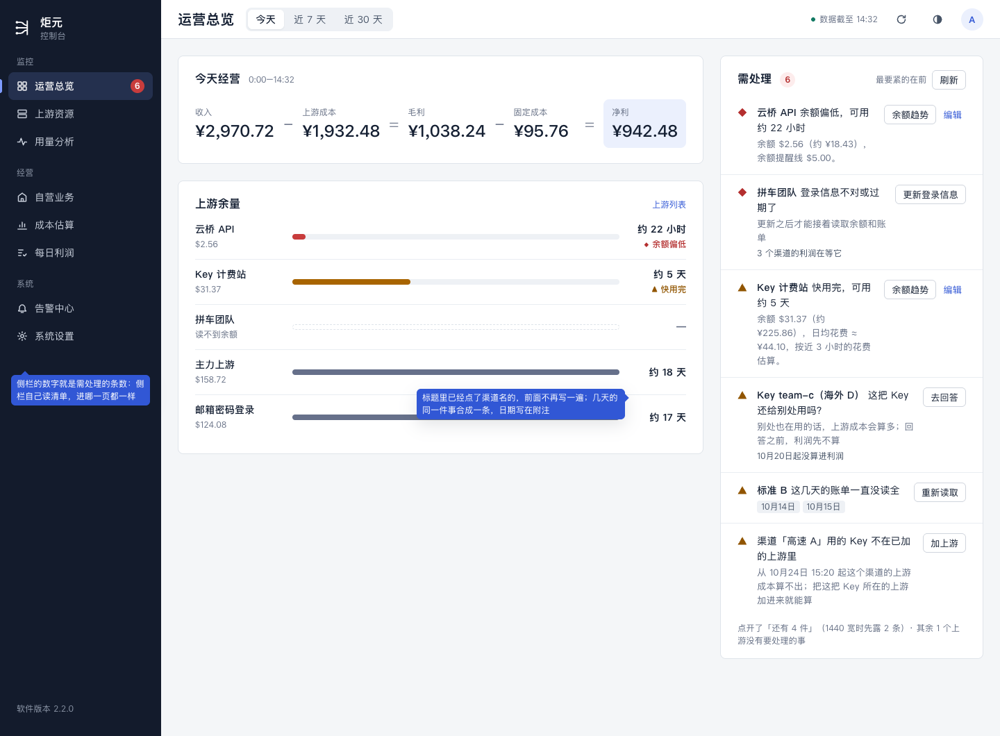
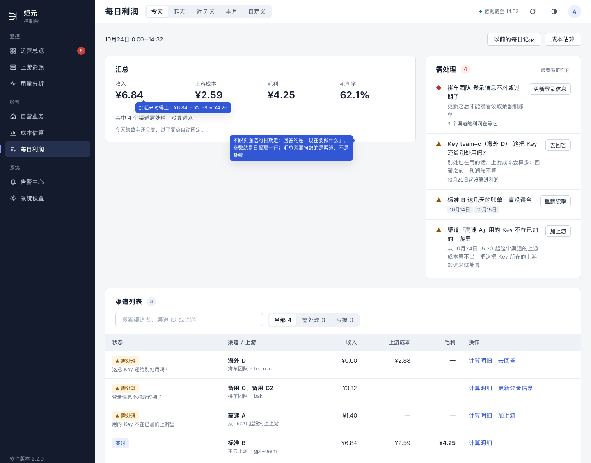
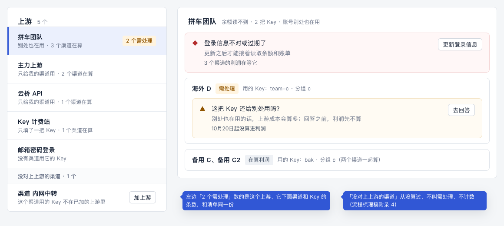
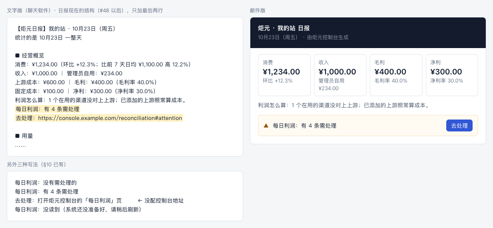
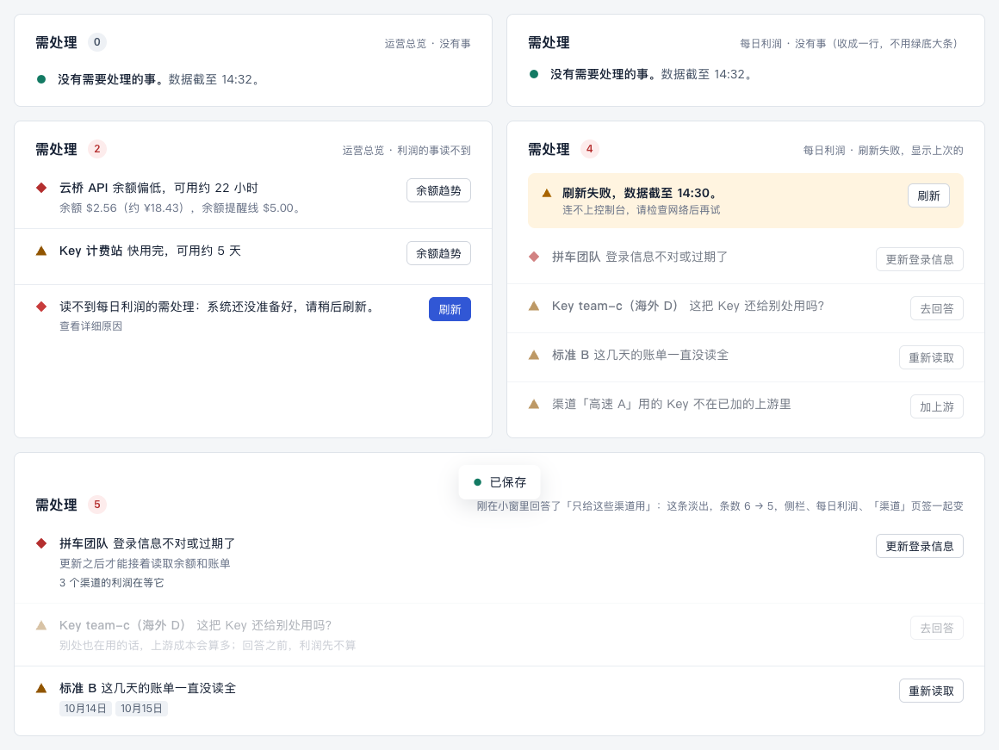
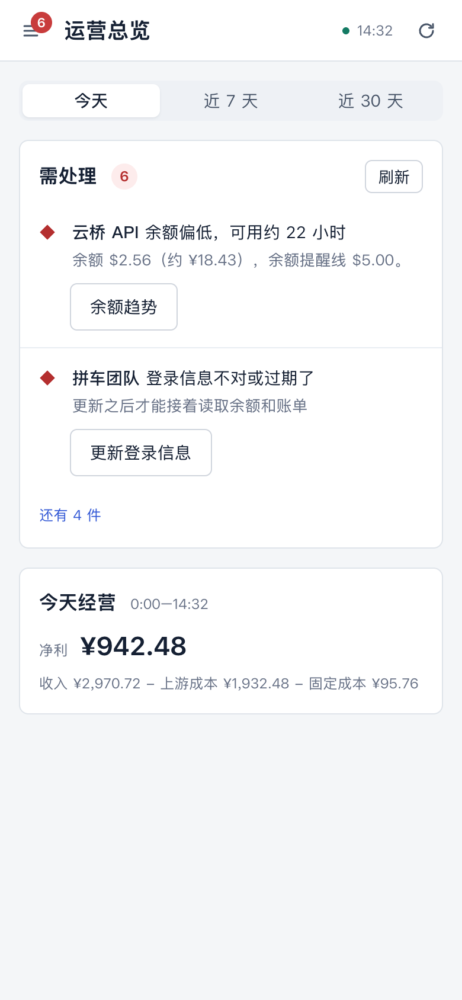

# 需处理清单（计划 E）设计稿

> 讲什么：一份需处理清单四处用（运营总览和侧栏、每日利润、上游资源的「渠道」页签和上游列表、日报）：哪些事进清单、一条怎么写、合并和排序、点了按钮以后。
>
> 现在：已定（用户 10-25 定稿），随 E 做（排在 D 之后）。2026-10-25 按[流程梳理稿](./binding-flow.md)改的稿。10-24 那一版是按「绑定、按渠道绑 / 按 Key 绑、上游账单页签、测试读取、指定 Key」写的，这些在流程梳理稿里都没有了。10-24 用户定的 5 件（第 11 节）按新流程改写；清单的骨架（一件事一行一个按钮、合并、排序、7 天、四处同一个数）不变。第 2.5 节两件用户 10-25 定了（N13、N14）。一把 Key 在两个在算的渠道之间挪过，用户 10-25 定由系统按读到的那一刻切开，不再进需处理（D 第 3.4 节），清单里没有「改时间」了。
>
> 单位：和 [D 设计稿](./d-config-change.md)一样，一个**渠道**（几个渠道填了同一把 Key 时并成一组）在一个**上游**（一个上游就是一个账号）下算利润，用哪把 Key 按时间分段记。界面上不说「绑定」。
>
> 对应规范：用语规范 §4、§5、§8.1、§10，设计规范 §4.3、§5.1、§5.2、§5.6；文中只写「§」的，指用语规范的章节，体检写成「体检 §7.x」，设计规范写成「ui-design-spec §x」。进清单的每一种事，标题、说明、按钮都已经在 §5.2、§5.3 里（多数标着「（新）」），本稿不另写；要新加的说法在第 10 节「拟改条目」，先进规范，再写代码；做到哪见[待改总表](../pending.md)。视觉沿用设计规范 §4.3 的待处理列表和现有组件（`attention-list`、`panel`、`data-state`、`status`），不另起新组件。
>
> 样稿：[e-attention.html](./e-attention.html)，截图在 `screens/e-*.png`。样稿里的数前后对得上：运营总览 6 条 = 余额 2 条 + 利润 4 条；每日利润和日报都是 4 条。

## 0. 这份设计的六项（ui-design-spec §1.3）和改动大小

| 项 | 写什么 |
|---|---|
| 用户目标 | 每天打开控制台，一眼知道有几件事要自己动手、每件对钱有什么影响；点一个按钮就地做完，四处一起少一条 |
| 流程 | 改前（现在的代码）：总览和侧栏各数各的（直接打开用量分析时侧栏是 2、总览是 9）；点「去回答」打开整个绑定抽屉，「测试读取」要再点一次，做完要自己回页面看。改后：清单由服务端出一份，四处读同一份；每条一个按钮，就地做完（小窗或原地读一次），做完这一条淡出、各处条数一起减一；要开抽屉的（加上游、检查连接）做完回到原处 |
| 省掉了什么 | 「测试读取」「去确认」「处理重复」「去绑定」「指定 Key」「改绑定」「换 Key」这几种事整个没有了（系统读得出渠道用哪把 Key，流程梳理稿第 5 节）；同一件事在几处各说一遍；侧栏和总览数字对不上；做完要自己回页面看 |
| 还要用户做的 | 只剩系统做不了的：填只有用户有的东西（令牌、加一个上游）、回答只有用户知道的两个问题、在你站后台打开收费记录、系统 7 天没读到的日子点一次「重新读取」 |
| 对照原则 | §1.2 第 2 条（每条一个按钮，就是更正或确认）、第 4 条（就地做完，做完落回原处）、第 5 条（同一个对象只占一行，同一个原因只说一次）、第 6 条（只有不处理就算不准的才进来；7 天内的读取类、提示类不进）；§1.4 第 2 条（同一件事一页只说一处）、第 3 条（总览、每日利润都是 8 + 4，需处理在 4 列那边） |
| 版式 | 运营总览：等式 8 列 + 需处理 4 列，1440 宽露 2 条；每日利润：汇总 8 列 + 需处理 4 列；「渠道」页签：事写在它的对象上；手机：需处理在最前（第 5、8 节，逐页版式第 1、7 节） |
| 改动大小 | 大。服务端新出一份清单（合并、去重、排序、条数），四处和日报都读它；侧栏自己读；就地做完的按钮几种；「渠道」页签的事写在对象上。排在 D 之后做，要 K2d（「渠道」页签）和 C 的状态表先有 |

## 1. 用户要达到什么

用的人是财务、运营。每天打开控制台，他们要：

1. **知道有几件事要自己动手。**侧栏一个数、运营总览一个数，进哪一页都一样。
2. **一眼看懂每件事。**是哪个上游、哪个渠道、哪几天，对钱有什么影响。
3. **点一个按钮就去处理，处理完它就没了。**四个地方一起消失，数字一起减。
4. **不被不影响钱的事打扰。**只有「不处理就算不准」的才进来（§4）。
5. **不打开控制台也知道。**日报里一行告诉他今天有没有要处理的。

不做的事：
- 不记已经处理过的事（不是历史记录；改过什么看 D 的改动记录）；
- 不单独推送（§10：利润的问题只进日报一行）。

## 2. 清单里有什么

### 2.1 一件事 = 一个对象 + 一个问题 + 一个按钮

对象有五种。每种在清单里写成什么名字：

| 对象 | 名字怎么写 |
|---|---|
| 上游 | 上游名，没名字写「未命名上游」（`stationDisplayName`）。一个上游就是一个账号，不再分「上游账号」 |
| 渠道 | 渠道名；同一把 Key 的几个渠道写「高速 A、高速 B」（和每日利润那一行一样）；读不到名字写「渠道 #12」 |
| Key | 只有某把 Key 的问题用（「这把 Key 还给别处用吗？」和回答以后的下一步 N1）：写「Key team-c（海外 D）」，Key 名按 §3.1，括号里是用它的渠道 |
| 自营站点 | 站点名，没名字写「自营站点」（`lib/format.js` 的 `OWN_STATION_LABEL`） |
| 某个渠道的某几天 | 写渠道的名字，日期放在附注里（第 3 节） |

标题里已经点了对象名的（「渠道「高速 A」用的 Key 不在已加的上游里」「「拼车团队」下有 2 个新渠道还没算利润」），前面不再加粗写一遍对象名。

### 2.2 进清单的事

标题、说明、按钮全部取 §5.2、§5.3 的表：问题码到文案在 `lib/reconciliation-contract.js`，按钮在 `lib/workflow-actions.js`。清单自己不写字。

以流程梳理稿第 4 节「需处理」那一行为准，加上用语规范 §5.2 里另外几种（换了账号、上游删了、版本不支持、只填了一把 Key 的上游 Key 被拒）和 D 的「没能固定」：

| 哪一类 | 什么事（§5.2 的标题） | 对象 | 按钮 | 级别 |
|---|---|---|---|---|
| 利润 | 登录信息不对或过期了 | 上游、自营站点 | 更新登录信息 | 紧急 |
| 利润 | 上游拒绝读取这把 Key（只填了一把 Key 的上游：这把 Key 就是它的登录信息；别的上游上，Key 被删、被停走「渠道「X」用的 Key 不在已加的上游里」，登录过期走上一行） | 上游 | 更新登录信息 | 紧急 |
| 利润 | 访问令牌已经作废了；令牌少了「X」的权限 | 上游、自营站点 | 更新登录信息 | 紧急 |
| 利润 | 上游「X」现在登录的是另一个账号；自营站点现在登录的是另一个账号（固定成本的上游不进，§5.4） | 上游、自营站点 | 更新登录信息 | 紧急 |
| 利润 | 读不到你站的渠道 Key（连续 10 分钟读不到才进） | 自营站点 | 检查连接 | 紧急 |
| 利润 | 自营站点不记收费记录了（只看现在记不记） | 自营站点 | 重新检查 | 紧急 |
| 利润 | 自营站点的令牌读不到设置（N13，用户 10-25 定） | 自营站点 | 更新登录信息 | 注意 |
| 利润 | 渠道「X」用的 Key 不在已加的上游里（在算的渠道；从没算过的不进，附录 4） | 渠道 | 加上游 | 注意 |
| 利润 | 「高速 A」「标准 B」算利润用的上游已经删了（不是从控制台删的） | 渠道 | 加上游 | 注意 |
| 利润 | 上游的令牌少了读完整 Key 的权限（按上游一条） | 上游 | 更新登录信息 | 注意 |
| 利润 | 这个上游账号只给你自己的渠道用吗？（没回答、答了「不确定」） | 上游 | 去回答 | 注意 |
| 利润 | 这把 Key 还给别处用吗？（只在账号答了「别处也在用」的上游上；没回答、答了「不确定」） | Key | 去回答 | 注意 |
| 利润 | 这把 Key 别处也在用，利润先不算（答了「站外也在用」「别处也在用，说不清是哪」；拟改 N1，用户 10-25 定） | Key | 停止算利润（确认框列出这把 Key 下的渠道，一起停） | 注意 |
| 利润 | 「上游名」下有 N 个新渠道还没算利润（只在账号答了「别处也在用」「不确定」或还没回答的上游上，同 §5.2） | 上游 | 开始算利润 | 注意 |
| 利润 | 过去某几天一直没读到、没读全、一直没固定、改了时间没重算成（读取类过了 7 天，§5.3） | 渠道 + 日期 | 重新读取 | 注意 |
| 利润 | 改设置前这天没能固定（D 第 6 节，N3）；原来的设置算不出来时换成 D 的改3 | 渠道 + 日期 | 重新读取 / 按现在的设置算 | 注意 |
| 利润 | 对方的版本不支持这项功能 | 上游 | 查看详细原因 | 注意 |
| 余额 | 余额用完、读不到余额、余额偏低、快用完、固定成本快到期 | 上游 | 和现在一样 | 按 §3.3 |

「渠道「X」用的 Key 不在已加的上游里」「……算利润用的上游已经删了」这两种，不打算接着算的，在「渠道」页签点「停止算利润」，这条也消失（流程梳理稿例外一）；清单里只放一个按钮「加上游」。

级别怎么分：一件事挡住一个上游或整个自营站点下所有渠道的，是紧急（红菱形）；只挡一个渠道、一把 Key 或几天的，是注意（黄三角）。和现在 `workflow-actions.js` 的 `urgent` 同一个意思，只是按新的事重排。

两类事各进哪里：

- **余额类**只进运营总览和侧栏的计数，以及上游列表。
- **利润类**进运营总览和侧栏、每日利润、日报三处，全部都进；上游资源只放写得到对象上的那些（上游、渠道、Key 上的事进「渠道」页签，自营站点的事进上游列表自营站点那一行），带日期的不放（第 5.3 节）。
- 「登录信息不对或过期了」看这个上游下有没有在算的渠道：有，就算利润类；没有，就只算余额类。

### 2.3 不进清单的事

- **7 天内的读取类问题。**页面上显示「实时」加「还在读取」（§4、D2）。
- **提示类（§5.4）。**倍率变了、从 X 开始统计、今天换了 Key、渠道「已停用」「已删除」的标签、倍率格「暂时读不到」，都只在原处提示一句。
- **系统自己跟上的事。**换 Key（换成同一个上游或另一个已加上游的 Key）、只给你自己渠道用的上游下新渠道自己开始算：只在「用过的 Key」和 D 的改动记录里留一行（§1.2 第 6 条）。
- **流程梳理稿附录 4–7 那几种**（从没算过的渠道对不上上游、上游读不到每天的账单、你的站不是 New API、渠道里填的不是一把 Key）：只在原处写一句。
- **自营站点以前没记收费记录的那几天**：需处理，但没有按钮，不进清单，原因写在那几天自己身上（§4 唯一的例外，用户 10-25 定）。清单里只在现在还不记时列那一条「重新检查」。
- **「查看余额」这类不是待办的动作。**

### 2.4 「最近 7 天」怎么算（已定，见第 11 节第 1 条）

D4 定了：首页和侧栏看最近 7 天。D2 又定了：读取类问题过了 7 天还没读到，才变成需处理。

如果「最近 7 天」按账单日期算，读取类问题刚变成需处理时已经是 7 天前的事了，永远进不了清单。所以这样算：

- **不带日期的事**（上游、渠道、Key、自营站点上的事）：没处理就一直在。
- **带日期的事**：按它变成需处理的那天算，最近 7 天里变成需处理的才进清单。
  - 7 天没人处理，就从清单里拿掉。那几天在每日利润里照样是「需处理」，选到那几天就能看到。
  - 这样清单不会越积越多，没处理的事也会在日报里提醒满一周。

### 2.5 问过用户的两件（N13、N14）

1. **自营站点的令牌读不到设置**（不是超级管理员，或者新式令牌少了 option:read；流程梳理稿附录 10）：**用户 10-25 定，进清单**（N13 的 (b)）。按站点一条，标题「自营站点的令牌读不到设置」，按钮「更新登录信息」，注意那一档；各天的状态不变、照常固定。为什么要进：不处理的话，有人关了收费记录时收入会少算、照常固定成假亏损，读设置是唯一能发现的地方；只有用户能修，修一次就好。第 2.2 节表里已经加了这一行。
2. **固定成本上游的 Key 在上游那边被删、被停了**（登录没过期）：**用户 10-25 定，跟着上游走**（没在原来三个选项里选）：
   - 控制台跟着上游把这把 Key 标成停用；不进需处理，也不另外提示；
   - 你站把渠道换成别的 Key 时，系统照流程梳理稿第 3 节自己跟上；
   - 这个上游记的固定成本，照每笔的金额和天数按天摊，和 Key 失效无关。
   - 登录过期、余额也读不到的，不是这一件，照旧是余额类「登录信息不对或过期了」。

## 3. 一条长什么样

用现有的 `AttentionList` 一行（ui-design-spec §4.3）：

```
[图标] 对象名  标题（一句话，不超过 20 字，不带句号）            [一个按钮]
       说明：对钱的影响 + 怎么办（§5.1，看得懂时可以不写）
       附注：一行，写日期、从哪天起没算进利润，或「还有 2 个问题」
```

- **图标和级别**：紧急是红菱形，注意是黄三角（第 2.2 节）。
- **对象名**加粗，写在标题前面，名字按第 2.1 节；标题里已经有对象名的不写。
- **标题超过 20 字的**（§5.2 里有几条，例如「渠道「X」用的 Key 不在已加的上游里」）：照写，放不下的省略、悬停看全。20 字是给新写的标题的上限，不回头改已经进规范的。
- **附注**最多一行，按这个先后取一种：
  1. 带日期的事写日期，写法见拟改条目 N4，例如「10月14日、10月15日」（只有两天时）「10月9日–10月13日」「10月9日 等 5 天」。
  2. 渠道上不处理就不算利润的事，知道从哪天起的写「10月20日起没算进利润」（N6）。
  3. 上游、自营站点上的事挡住了几个渠道时，写「3 个渠道的利润在等它」（N7）。
  4. 同一个对象还有别的问题，写「还有 1 个问题：这个上游账号只给你自己的渠道用吗？」（§4、§5.1）。现在运营总览写的是「另有 1 项：」，要改成规范的说法。
- **只放一个按钮**（§5.1），名字取 §3.5。余额类现在有「余额趋势」「编辑」两个，这次不动。
- **不写**这些：
  - 「需处理：」前缀，或者把按钮名当原因；
  - 内部编号、英文码。

## 4. 合并和排序

**同一个对象只占一行。**
- 最要紧的问题当标题，其余收进附注「还有 N 个问题」。
- 利润类按 `RECONCILIATION_ISSUE_PRIORITY` 排先后；余额类按现在 `compareSeverity` 的规则。

**同一个原因只说一次。**
- 读不到余额、而原因正是登录信息过期时，只写「登录信息不对或过期了」那一条，不再另写「读不到余额」。
- 这个上游下的渠道也因为这个读不到账单时，同样只写这一条，附注写「3 个渠道的利润在等它」（N7）。
- **读不到你站的渠道 Key、你站登录过期、你站不记收费记录**这三件挡住的是所有渠道：在的时候，各渠道上因为它而起的事（例如这段时间没读全的日子）不另出，只出自营站点那一条。
- 「这个上游账号只给你自己的渠道用吗？」没回答、答了「不确定」时，这个上游下「这把 Key 还给别处用吗？」先不出（每把 Key 那一问也先不问，流程梳理稿附录 2）；「N 个新渠道还没算利润」照出（§5.2）。

**新渠道合成一条。**每个上游一条「「上游名」下有 N 个新渠道还没算利润」，不按渠道拆；N 按渠道数，已停用、已删除的渠道不算。

**带日期的同一件事合成一条。**同一个渠道、同一个问题的几天合在一起，日期写在附注。

**去重在服务端做一次。**前端拿到的就是去重、合并、排好序的清单。

**排序：**
1. 紧急在前，注意在后。
2. 同级时余额类在前，按可用天数从少到多（现在的规则）。
3. 然后按按钮的先后（`workflow-actions.js` 的 `order`），再按对象名。

**条数 = 合并以后的行数。**侧栏、总览、每日利润、日报说的都是行数。每日利润汇总旁那句「其中 2 个渠道需处理，没算进来」数的是渠道，和条数不是一回事（一条「登录信息不对或过期了」可能挡住 3 个渠道），两处各说各的，不互相换算。

## 5. 四个地方怎么摆

### 5.1 运营总览和侧栏（样稿 A）



运营总览：

- 「需处理」面板在等式右边 4 列（逐页版式第 1 节）；手机挪到最前面，见第 8 节。
- 余额类和利润类排在一个列表里，按第 4 节排序。
- 露几条按利润等式那块的高度定（ui-design-spec §5.1，版式 PR 3：1440 宽时 2 条），其余收进「还有 N 件」（收起区 `More`）。
- 最底下的「其余 3 个上游没有要处理的事」保留。

侧栏：

- 数字 = 总览「需处理」的条数。
- **侧栏自己定时读清单和上游列表，不靠页面先读。**现在直接打开用量分析时侧栏是 2、在总览是 9，这次修掉（体检 §7.1）。
- 0 的时候不显示数字。
- 读不到时显示上次的数字；从来没读到过就不显示。

### 5.2 每日利润（样稿 B）



- **「需处理」区块**在汇总右边 4 列（逐页版式第 7 节：汇总 8 + 需处理 4）；§11 已经给了「需处理」这个区块名。
  - 只放利润类，不放余额类。
  - 不跟页面选的日期范围走：它回答的是「现在要做什么」，条数就是日报那一行的条数。
  - 露几条按汇总那块的高度定，其余收进「还有 N 件」。
- **渠道列表的「需处理」筛选照旧**，按选的日期数行。两处数字可能不一样：区块是「现在要做的事」，筛选是「这几天的哪几行」。
- **页顶不放主按钮。**去掉「去上游账单」和「去绑定、改绑定、解除绑定请到上游账单」那句（体检 §7.12）；「以前的每日记录」「成本估算」照旧放次要按钮。
- **「5 个渠道里 1 个已算进利润」那条黄横条拿掉**：没算的新渠道已经是区块里的一条（附录 2 那种上游），其余的情况汇总旁那句说了。
- **汇总只加算出来的渠道。**旁边那句已经进了 §4（#66）。
- **空的时候**整块收成一行「没有需要处理的事。数据截至 14:32。」，不用绿底的大横条。
- **地址** `/reconciliation#attention` 直接滚到这一块，日报的链接用它。

### 5.3 上游资源：「渠道」页签和上游列表（样稿 C）



上游账单页签没有了（K2d 合进「渠道」页签）。事写在它的对象上，样子和清单一样：图标 + 标题 + 说明 + 一个按钮，用内嵌的浅底框。

- **左边的上游列表**：有事的上游带标签「1 个需处理」（数的是这个上游和它下面渠道、Key 的条数），排在前面（流程梳理稿第 4 节）。
- **右边这个上游的那一栏**：
  - 上游的事（登录过期、账号的问题、新渠道没算、少了读完整 Key 的权限）：写在上游标题下面、改动记录上面。
  - 渠道的事（Key 不在已加的上游里、上游删了）和 Key 的事：写在那个渠道的卡片里，卡片标「需处理」。
- **最下面「没对上上游的渠道」**那一组照流程梳理稿附录 4，不叫需处理、不计数。
- **两类事不放这里**：
  - 带日期的事，在每日利润；
  - 自营站点的事，在上游列表里自营站点那一行（和设置自营站点的抽屉）。

上游列表（「上游列表」页签）：状态格照 §5.2「上游列表里」那几条（版式 PR 5 已经做了），筛选「需处理」的条数也来自同一份清单。

### 5.4 日报（样稿 E）



- 那一行怎么写，§10 已经有了。这里只定它放在日报现在的结构（#48 以后）的哪里：
  - **文字版**：写在「■ 经营概览」最后，「利润怎么算」下面，两行：「每日利润：有 4 条需处理」「去处理：链接」。
  - **邮件版**：四个格子和「利润怎么算」下面一个浅底条，左边「每日利润：有 4 条需处理」，右边「去处理」。「去处理」是链接（§10），画成按钮的样子。
- 条数 = 发日报那一刻，每日利润「需处理」区块的条数。
- 链接是「控制台地址/reconciliation#attention」；没配地址、没有要处理的、读不到时，照 §10 那三种写。

## 6. 点了按钮以后

**按钮会去哪里：**

| 按钮 | 去哪里 | 处理完 | 没成 |
|---|---|---|---|
| 更新登录信息 | 更新登录信息小窗（只有「令牌」一栏，流程梳理稿例外二） | 「已更新登录信息」，这条消失 | 小窗里报错，清单不变 |
| 去回答 | **就地弹小窗**：账号的问题、某把 Key 的问题各一个，样子和保存照 [D 设计稿](./d-config-change.md)第 5 节 | 「已保存」。答成能算的（「只给我的渠道用」「只给这些渠道用」）就消失；答成别的，换成第 2.2 节表里的下一步（N1） | 「保存失败：原因。」，小窗不关 |
| 加上游 | 加上游的抽屉，地址按渠道里填的预先填好；加完接着是第 3 步，这个渠道勾着（流程梳理稿例外一） | 「已加上游「名字」」，开始算利润以后这条消失 | 抽屉里报错 |
| 检查连接 | 设置自营站点的抽屉，停在「读取服务令牌」那一栏（流程梳理稿例外三） | 「能读到：6 个渠道的 Key」，这条消失 | 那一栏下面写读不到的原因 |
| 重新检查 | **就地读一次**自营站点的设置 | 「已经在记收费记录了」，这条消失 | 「还是没在记：到自营站点后台打开」，这条留着 |
| 开始算利润 | 第 3 步的列表，只列这个上游下还没算的新渠道，默认勾上 | 「已开始算利润」，这条消失 | 照第 3 步 |
| 停止算利润 | 确认框（D 第 3.2 节） | 「已停止算利润，以前的每日记录还在」，这条消失 | 确认框里报错 |
| 重新读取 | **就地重读附注里的那几天** | 「已重新读取」。读到的日子从附注里去掉，都读到了就消失 | 「重新读取没完成，请稍后再试」[查看详细原因]（§8.1），这条留着 |
| 按现在的设置算 | 确认框（D 第 6 节） | 「已按现在的设置算」，这条消失 | 确认框里报错 |
| 查看详细原因 | 展开原文（§8.2） | —— | —— |

**处理完以后：**

- **立刻重读一次清单，四处一起变。**大家读的是同一份缓存，不用等 5 分钟。
- **消失时淡出**（160 毫秒，ui-design-spec §3.7），条数同时减一；系统设置了「减少动态效果」时直接消失。
- **系统自己好了**（重读成功、上游恢复了、读取服务连上了）：下次读清单时消失，不另外提示。
- **点进去发现这条已经变了**：「这条已经变了，刷新后再看。」[刷新]（§8.1，现有的 `DESTINATION_CHANGED`）。
- **地址里的编号不给人看。**定位到某个上游、某个渠道时，不往搜索框里填编号，把那一项高亮就行（体检 §7.10）。

## 7. 空、读不到、刷新失败（样稿 D）



| 情况 | 运营总览 | 侧栏 | 每日利润的区块 | 「渠道」页签 | 日报 |
|---|---|---|---|---|---|
| 没有事 | 「没有需要处理的事。数据截至 14:32。」（§8.1） | 不显示数字 | 收成一行，同左 | 不显示 | 「每日利润：没有需处理的」 |
| 第一次读，还没读到 | 骨架 | 不显示数字 | 骨架 | 骨架 | —— |
| 利润类读不到 | 余额类照列，最后一行「读不到每日利润的需处理：原因。」[刷新]（N8） | 只算余额类 | 「读不到每日利润的需处理：原因。」[刷新] | 页面照 §8.1 读不到的写法 | 「每日利润：没读到（原因）」 |
| 刷新失败，有上次的 | 顶上「刷新失败，数据截至 14:30。」[刷新]（`RefreshFailedBanner`），列表照旧、变淡 | 上次的数字 | 同左 | 同左 | 不涉及 |

## 8. 手机（样稿 F）



- **运营总览**：「需处理」放在利润等式前面（体检 §7.9），先露 2 条，下面「还有 N 件」（版式 PR 3）。
- **一条的排法**：图标和字一行，按钮另起一行（现在的手机样式）；按钮高度不小于 44（ui-design-spec §7）。
- **菜单按钮带数字**：手机上侧栏收在抽屉里，顶栏的菜单按钮右上角带同一个数字，读屏写「打开导航，需处理 6 项」。这是外壳的新规则，要先写进 ui-design-spec §2.2。
- **每日利润**：区块在汇总上面，同样先露 2 条。
- **「渠道」页签**：事写在对象下面，按钮占满一行。
- **去回答的小窗**：从底部弹出（D 第 8 节）。

## 9. 样稿

- [e-attention.html](./e-attention.html)：六帧，A 运营总览、B 每日利润、C「渠道」页签、D 四种状态、E 日报、F 手机。原来的 G「去回答小窗」挪到 D 设计稿（`d-account`、`d-key`）。
- 截图：
  - `screens/e-overview.png`、`e-daily.png`、`e-channels.png`、`e-states.png`、`e-report.png`：桌面，1 倍；
  - `e-mobile.png`：手机，390 宽，2 倍。
- 样稿只画到区块这一层，颜色、字号、间距取 `lib/design-tokens.js` 和 `app/styles/jy.css`；实现时用现有组件，不照抄样稿里的类名。

## 10. 拟改条目

写法照规范原来的格式，进规范以后编号作废。没写在这里的，都用规范里现成的说法。10-24 那一版的 N2（改绑定时预先选好渠道）、N11（账号的问题，已经作为「（新）」进了 §5.2）、N12（指定 Key）去掉，编号空着不再用。

**ui-copy-spec.md**

- **N1（§5.2「去回答」之后；用户 10-25 定）**：某把 Key 的问题回答以后，这条事换成什么。

  | 回答 | 标题 | 说明 | 按钮 |
  |---|---|---|---|
  | 只给这些渠道用 | （这条消失） | | |
  | 站外也在用 / 别处也在用，说不清是哪 | 这把 Key 别处也在用，利润先不算 | 上游成本分不开，用它的渠道利润先不算。在你站给这些渠道换一把只给它们用的 Key，系统会自己跟上，从换的时刻起算；不打算换的，停止算这几个渠道的利润 | 停止算利润 |
  | 不确定 | 这把 Key 还给别处用吗？（不变） | （不变） | 去回答 |

  确认框照 D 第 3.2 节，标题写「停止算利润「海外 D」？」，几个渠道时「停止算利润「海外 D」等 2 个渠道？」，内容列出这把 Key 下在算的渠道，一起停。

  为什么按钮是「停止算利润」：换 Key 要在你站后台做，控制台给不出这个按钮；这条不处理，这几个渠道每天都是需处理、汇总里一直缺它们。真不打算换的，停掉以后汇总不再提它们（§4），这条也消失。换了 Key 的，系统跟上以后这条自己消失。
  10-24 那一版的「这把 Key 还有渠道没绑上」[改绑定] 和「换 Key」不再有（选项「自营站点的其他渠道也在用」新流程不问；换 Key 系统自己跟上）。账号的问题答了「别处也在用」以后，不另出一条，接着问每把 Key（D 第 5.1 节）。
- **N3（§5.2，D 设计稿第 6 节的第一步；第二步见 D 的改3）**：
  - 标题「改设置前这天没能固定」；
  - 说明「这天先不算进汇总；重新读取会按原来的设置再固定一次」；
  - 按钮「重新读取」。

  码由 D 定。
- **N4（§6，新的一行）**：一条事附注里的日期。
  - 连着的三天以上写「10月14日–10月16日」；只有两天写「10月14日、10月15日」；
  - 不连着的，最多写三天「10月9日、10月11日、10月14日」；
  - 再多写「10月9日 等 5 天」。
- **N5（§5.3）**：右列的标题合了几天时，「这天」写成「这几天」，例如「这几天的账单一直没读全」。只有一天时不变。（§5.3 那段说明里已经提了这条，进规范时并成一处。）
- **N6（§5.1，附注）**：渠道上不处理就不算利润的事，知道从哪天起时，附注写「10月20日起没算进利润」。
- **N7（§5.1，附注）**：上游、自营站点的事挡住了几个渠道时，附注写「3 个渠道的利润在等它」。
- **N8（§8.1，新的一行）**：
  - 需处理整块读不到：「读不到每日利润的需处理：原因。」[刷新]；
  - 有上次的数据时，按「刷新失败但有旧数据」那一行写。
- **N9（§10，日报那一段）**：补一句位置。
  - 文字版写在「■ 经营概览」最后、「利润怎么算」下面；
  - 邮件版在「利润怎么算」下面，「去处理」是链接。
- **N10（§12，新的一行）**：

  | 内容 | 唯一位置 | 要合并掉的旧写法 |
  |---|---|---|
  | 需处理清单：哪些事进来、怎么合并、怎么排、几条（第 2–4 节） | 服务端 lib 的 `buildAttentionItems`（计划 E）；运营总览、侧栏、每日利润、「渠道」页签、上游列表的「需处理」筛选、日报都读它 | `buildOverviewActions` 里拼两份来源；侧栏各页各算；上游账单的「需处理：按钮名」；每日利润只按自己的列表数 |
- **N13（用户 10-25 定；§5.2 加一行）**：标题「自营站点的令牌读不到设置」；说明「发现不了自营站点不记收费记录了。给令牌补上「读设置」的权限，或者换超级管理员的访问令牌」（不是超级管理员时只写后半句）；按钮「更新登录信息」；系统码 OWN_OPTION_READ_DENIED。按站点一条，注意那一档；每天的状态不变、照常固定。§5.4「自营站点的令牌读不到设置」那一行的「不进需处理、不推送」改成「也进需处理（§5.2）」，原处那一句留着；[流程梳理稿](./binding-flow.md)附录 10、第 4 节需处理那一行、「一句话说清」里很少见的几种，一起改。推送照 §10：需处理不单独推送，只进日报那一行。
- **N14（用户 10-25 定；§5.4 固定成本上游「上游侧问题不显示」那一行补一句）**：固定成本上游的 Key 在上游那边被删、被停了：控制台跟着上游把这把 Key 标成停用（「用过的 Key」里这把 Key 那一行写「已停用」，K 的「用过的 Key」怎么写随 K2d），不进需处理、不另外提示；这个上游记的固定成本，照每笔的金额和天数按天摊，和 Key 失效无关。§4「已停用」只用在渠道上那一句，补上「用过的 Key」里的 Key。
- **N15（§5.3「有收入，但上游的用量还没到」那一行）**：7 天后的标题去掉「可能绑错了 Key」，写「有收入，但上游一直没有用量记录」；按钮「改绑定」改成「重新读取」。渠道用哪把 Key 是读出来的，不会绑错；剩下的原因只有上游没给用量。
- **N16（§5.2「不是由某个问题引出的事项」那张小表）**：「有 3 个渠道还没绑定」[去绑定] 那一行标（旧），由「「上游名」下有 N 个新渠道还没算利润」[开始算利润] 代替；表头「运营总览、上游账单的「需要处理」」改成「运营总览、「渠道」页签的「需处理」」。
- **对齐，不算新词**：
  - 运营总览的「另有 1 项：」改成 §4、§5.1 的「还有 1 个问题」。
  - 每日利润的「没有需要处理的事」用 §8.1 那句，不用 antd 的成功横条。

**ui-design-spec.md**

- **§4.3 待处理列表**：
  - 「另有 1 项」改成「还有 N 个问题」；
  - 加附注一行（第 3 节）；
  - 加内嵌的样子（「渠道」页签用）；
  - 加处理完淡出 160 毫秒。
- **§2.2 应用外壳**：手机顶栏的菜单按钮带需处理的数字。
- **§5.2 上游资源**：「渠道」页签上，上游的事写在上游标题下面，渠道和 Key 的事写在渠道卡片里；左边上游列表有事的带「N 个需处理」，排在前面。
- **逐页版式第 7 节**（本 PR 里一起改了）：「「5 个渠道还没算利润」也在这里」改成只在账号别处也在用的上游上出的那一条。
- **§5.6 每日利润**：
  - 「需处理」区块在汇总右边 4 列（逐页版式第 7 节）；
  - 页顶不放主按钮；黄横条拿掉。

## 11. 已定的

**用户 10-24 定的 5 件（都照推荐），按新流程改写：**

1. **带日期的事在清单里挂多久**：最近 7 天里变成需处理的才进清单，挂满 7 天拿掉（第 2.4 节）。不变。
2. **原来是「没有绑定的上游，「还没确认上游账号」不进清单」**：新流程里「还没确认上游账号」整个没有了（加上游时令牌读出来的就是这个账号）。同一个意思留下来：从没算过的渠道对不上上游，不进清单（附录 4）。
3. **已停用、已删除的渠道，不算「还没算利润」的新渠道。**不变，只是那一条现在只在账号别处也在用的上游上出。
4. **答了「别处也在用」以后，那条换成下一步，不再一直问同一句（N1）。**下一步原来是「改绑定」「换 Key」，现在是「停止算利润」（换 Key 在你站后台做，系统自己跟上）。
5. **「去回答」「重新读取」就地完成，跟 E 一起做。**「测试读取」那一件新流程里没有了；新加的「重新检查」也就地完成。

**这次改稿定的（10-25）：**

6. （总指挥定）级别按「挡住整个上游或站点的是紧急」重排（第 2.2 节）。
7. （总指挥定）你站的三件（读不到渠道 Key、登录过期、不记收费记录）在的时候，各渠道因为它而起的事不另出（第 4 节）。
8. （用户定）N1 的下一步用「停止算利润」：某把 Key 别处也在用、用它的渠道利润算不出来时，清单里出一条，点「停止算利润」。流程梳理稿和用语规范里还没有这一种，随 N1 进规范。
9. 原来的 G 帧挪到 D。

## 12. 给开发的几点（只说要什么，不定怎么做）

- **清单由服务端出。**一次请求拿到全部利润类事项：已经去重、合并、排好序，带对象名、附注和按钮的去处。
  - 余额类还从上游列表的数据算（`buildOverviewActions`）。
  - 前端只在同一个上游上，把两类合成一行。
- **侧栏自己读清单**，和 `/api/stations` 同一个节奏。
  - 页面处理完一件事，调同一个刷新，四处一起变。
  - 现在的 `use-workflow-actions` 两路缓存，改成读这一份。
- **读清单要便宜。**
  - 不触发重算利润（计划 E：首页不再整套读昨天）。
  - 带日期的事来自 C 的状态表，需人工的和结账失败的都在里面。
  - K 的事（Key 不在已加的上游里、读不到渠道 Key）来自 K 记下的状态，不在读清单时现比对。
- **两条架构意见（总指挥，2026-10-24），不变：**
  - **「去回答」存答案是改设置**，走 D 的改设置路径：生效时刻、「改之前没固定的日子先按原来的设置固定」都照 D 来。不另开只存答案的接口。
  - **带日期的事来自 C 的状态表；「重新读取」走 C 的手动固定**（`inspectRule(mode: "settle")`）。
- **每条带一个稳定的 id**，由对象 + 问题组成（对象是上游、渠道组、Key、自营站点之一）。前端用它做淡出，也用它判断「这条已经变了」。
- **地址里的编号不显示在页面上**（搜索框等）。
- **界面测试要新的夹具**：清单接口返回固定数据，覆盖第 13 节的各种情况。

## 13. 验收清单（给审核与测试）

每条写怎么看。用夹具的，在 `tests/reconciliation-ui.test.mjs` 里加。

**条数一致**

1. 同一时刻：总览「需处理」的条数 = 侧栏数字；每日利润区块的条数 = 日报「有 N 条需处理」= 总览里利润类的条数。用一份夹具，五处一起断言。
2. 直接打开用量分析、系统设置、每日利润（整页刷新），侧栏数字和总览一样。

**合并和去重**

3. 账号别处也在用的上游下 N 个新渠道只出现一条「「上游名」下有 N 个新渠道还没算利润」，已停用、已删除的渠道不算；账号只给你自己的渠道用的上游下没有这一条。
4. 同一个对象有两个问题时只有一行，附注写「还有 1 个问题：…」。
5. 登录信息过期的上游只出现「登录信息不对或过期了」一条，不另出「读不到余额」；附注写「3 个渠道的利润在等它」。
6. 读不到你站的渠道 Key 时，只有自营站点那一条，各渠道不另出。
7. 从没算过的渠道对不上上游：不进清单、不计数，只在「渠道」页签最下面一组。

**一条的写法**

8. 只有一个按钮，按钮名在 §3.5 的表里；标题里有对象名的，前面不再写对象名。
9. 页面上没有「需处理：」后面跟按钮名的写法，没有「绑定」「测试读取」「指定 Key」「去确认」「处理重复」。
10. 页面上没有内部编号（`st_` 开头那种）和英文码。

**处理完以后**

11. 「去回答」就地弹小窗，打开时一个都不选。
    - 选「只给这些渠道用」保存后，「已保存」，这条在总览、侧栏、每日利润、「渠道」页签一起消失，条数减一。
    - 选「站外也在用」，换成「这把 Key 别处也在用，利润先不算」加「停止算利润」；点了确认停止，这条消失。
12. 「重新检查」点一次就读，在记了这条消失；还没记时这条留着。
13. 「重新读取」只读附注里的那几天，读到的日子从附注里去掉。
14. 「加上游」打开的抽屉地址已经填好；加完、开始算利润以后这条消失。
15. 一把 Key 在两个在算的渠道之间挪过：清单里没有这一条，也没有「改时间」（D 第 3.4 节）。

**状态**

16. 空、利润类读不到、刷新失败三种状态的写法照第 7 节。
17. 日报四种写法：有、没有、读不到、没配控制台地址。链接打开后滚到每日利润的「需处理」区块。

**带日期的事**

18. 读取类问题在 7 天内不进清单（那天显示「实时」加「还在读取」），过了 7 天才进。按第 11 节第 1 条，还要断言挂满 7 天拿掉。
19. 自营站点以前没记收费记录的那几天：每日利润里是需处理、没有按钮，清单里没有它们。

**手机 390**

20. 总览第一屏能看到「需处理」；按钮高度不小于 44；菜单按钮上有同一个数字。

**测试范围**

21. E 动了日报和按天的判断（「最近 7 天」、日期附注），按现在的规矩，界面测试三个时区都要跑；只在一个时区跑，查不出按机器时区而不是业务时区算哪天的错。
