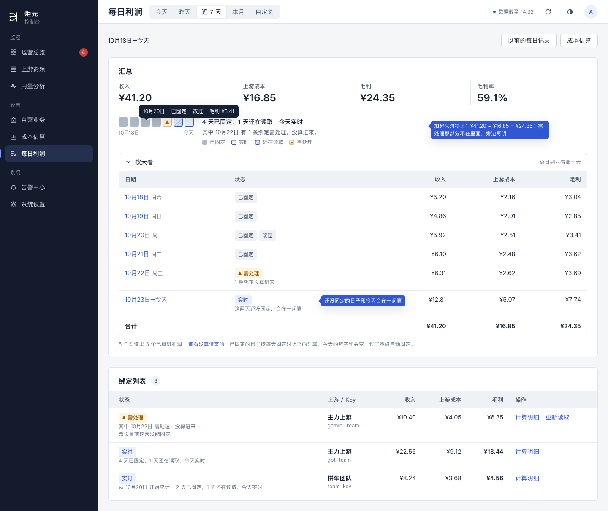
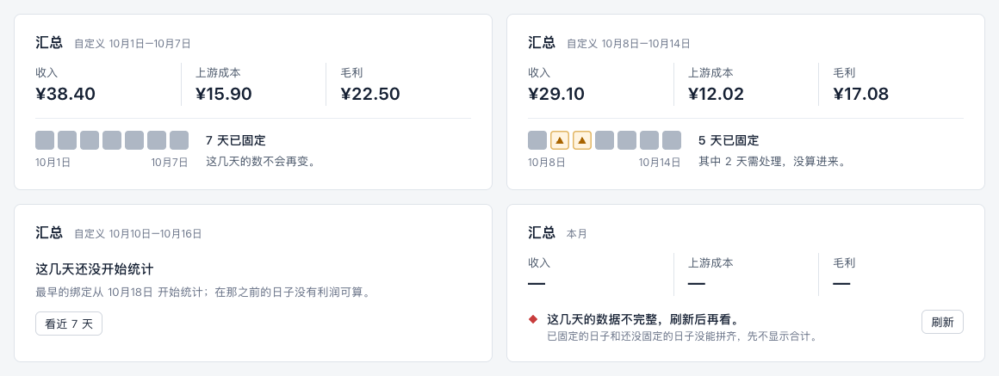
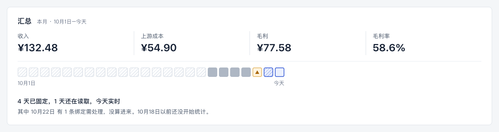
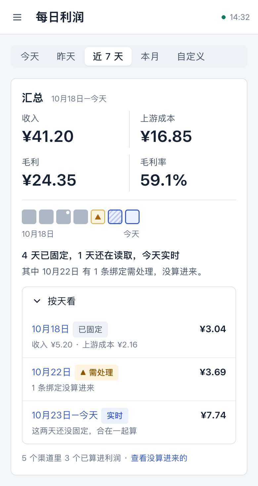

# 多天拼装（计划 F）设计稿

> 状态：草稿，等用户点头。2026-10-24，UI/UX 设计会话。
>
> 依据：
> - 计划第 4 阶段「4b-3：已结账 N 天 + 今天实时」和「后续 PR 顺序与复用点」的 F 行；
> - D2；
> - [用语规范](../ui-copy-spec.md) §4 多天合计、§9 计算明细；
> - [体验体检](../ui-audit.md) §7.3「汇总加不起来」。
>
> 本文只写页面上怎么呈现，取数、拼装、账本怎么读归开发。用语引用规范的条目，新说法写在第 9 节「拟改条目」。
> 文中只写「§」的，指用语规范的章节；体检写成「体检 §7.x」，设计规范写成「ui-design-spec §x」。
>
> 样稿：[f-multiday.html](./f-multiday.html)，截图在 `screens/f-*.png`。样稿里的数前后对得上：汇总 = 按天看的合计 = 绑定列表各行之和。

## 1. 用户要达到什么

财务看「近 7 天」「本月」或自己选的一段时间时，要：

1. **知道这段时间赚了多少，而且数加得起来。**收入 − 上游成本 = 毛利，汇总、按天、按绑定三处一致。
2. **知道哪部分定了、哪部分还会变、哪部分没算进来。**用 §4 的三种状态说，不用懂「账本」「拼装」。
3. **看得到每一天。**页面叫「每日利润」，一段时间里每天赚多少应该能直接看到。
4. **点一下就看某一天的明细。**

## 2. 汇总（样稿 A）

### 2.1 四个数只加算出来的部分

- 收入、上游成本、毛利、毛利率只加两部分：
  - 已固定的日子；
  - 还没固定、正在实时算的部分（今天，加上还在读取的过去几天）。
- 需处理的那部分不加，可能是某条绑定的某几天，也可能是一整条绑定。
- 三个数用同一个范围，所以收入 − 上游成本 = 毛利，财务一减就对得上。
  - 现在不是这样：需处理那条的上游成本算进了「上游成本」，却没算进毛利（体检 §7.3）。
- 需处理那部分的金额，留在绑定列表它自己那一行；汇总旁边用一句话说清没算进来什么（第 2.2 节）。

### 2.2 构成一行

四个数下面一行，左边是日条（第 2.3 节），右边是两行字。

**第一行：定了几天、还有几天在变。**

- 都定下来了：「7 天已固定」（§4 已有）。
- 混合：「4 天已固定，1 天还在读取，今天实时」（F1）。
  - 为 0 的部分不写。
  - 范围里没有今天时，不写「今天实时」。

**第二行：没算进来的，有才写。**

- 需处理的（F2，三种写法）：
  - 「其中 2 天需处理，没算进来。」（§4 已有）
  - 「其中 1 条绑定需处理，没算进来。」
  - 只有一天时点名日期：「其中 10月22日 有 1 条绑定需处理，没算进来。」
- 范围开头有还没开始统计的日子：「10月18日以前还没开始统计。」（F3）

### 2.3 日条：一天一格

日条是新的界面概念，先写进 ui-design-spec（第 8 节）。

- 范围里一天一格，最多 31 格。下面只标第一天和最后一天；最后一天是今天时写「今天」。
- 每格的状态按 §4 判：这天只要有一条绑定需处理，就算需处理。
- 每格的样子：

  | 这天 | 样子 |
  |---|---|
  | 已固定 | 实心灰块（中性色，正常时不标） |
  | 已固定，后来改过 | 灰块右上角一个白点 |
  | 今天（实时） | 钴蓝描边、浅钴蓝底 |
  | 还在读取（过去的日子，实时） | 同上，再加斜纹 |
  | 需处理 | 浅黄底、黄描边，里面一个三角 |
  | 还没开始统计 | 浅灰斜纹，空心 |

- 状态不只靠颜色：实心、描边、斜纹、三角，形状各不相同（ui-design-spec §1 第 2 条）。下面有一行小图例。
- 悬停或键盘聚焦一格，显示「10月20日 · 已固定 · 改过 · 毛利 ¥3.41」；读屏念「10月20日，已固定，毛利 3.41 元」。
- 桌面上点一格，时间范围就换成那一天（自定义的单日），下面的绑定列表跟着变。手机上格子太小不让点，改在「按天看」里点日期。

### 2.4 按天看（默认收起）

| 日期 | 状态 | 收入 | 上游成本 | 毛利 |
|---|---|---|---|---|
| 10月18日 周六 | 已固定 | ¥5.20 | ¥2.16 | ¥3.04 |
| 10月20日 周一 | 已固定 · 改过 | … | … | … |
| 10月22日 周三 | 需处理，下面写「1 条绑定没算进来」 | 只加算出来的绑定 | … | … |
| 10月23日–今天 | 实时，下面写「这两天还没固定，合在一起算」 | … | … | … |
| 合计 | | = 汇总 | = 汇总 | = 汇总 |

- **已固定的日子一天一行**，改过的标「改过」（§4 允许的标签）。
- **还没固定的日子和今天合成一行**，这样写有两个原因：
  - 计划 4b-3 是把连续没固定的日子合成一次实时查询，不逐日去读上游，没有逐日的数；
  - 这几天的数还会变，拆开写反而像是定了。

  只有今天时，这一行写「今天」，不写「这两天还没固定」。
- **需处理的那天**照样一行，金额只加算出来的绑定。
- **日期可以点**，点了只看那一天，和点日条一样。
- **日期写法**：按 §6 写，周几用 `weekdayOfDayKey`。

### 2.5 底下一行

照现在的写法，加一句汇率：

> 5 个渠道里 3 个已算进利润 · 查看没算进来的　已固定的日子按每天固定时记下的汇率；今天的数字还会变，过了零点自动固定。

- 范围里没有今天时，不写「今天的数字还会变」。
- 「5 个渠道里 3 个已算进利润」只在这里说一次，不再另起黄条（E 设计稿 §5.2）。

## 3. 绑定列表（多天时）

- **状态按 §4 的先后，在整段时间上判：**
  - 有一天需处理，就是「需处理」；
  - 天天都固定了，就是「已固定」；
  - 其余是「实时」。
- **标签下面一行写这条绑定自己的构成：**
  - 「4 天已固定，1 天还在读取，今天实时」；
  - 需处理时写「其中 10月22日 需处理，没算进来」，再下一行写最要紧那个问题的标题（§5.1），操作列放它的按钮。
- **金额只加这条绑定算出来的日子。**各行加起来等于汇总。
- **范围中间才开始的绑定**：前面加「从 10月20日 开始统计 · 」（§5.4 已有）。开始以前的日子不算没算进来，不进第二行。
- **「需处理」筛选**：数有一天以上需处理的行。

## 4. 计算明细（§9）

选一段时间时，明细里这几行这样写（F6）：

| 项 | 写法 |
|---|---|
| 时间 | 10月18日–今天 |
| 已固定的 4 天 | 按每天固定时记下的数相加 |
| 10月23日–今天 | 还没固定，按现在读到的数算 |
| 汇率 | 已固定的日子按每天固定时记下的汇率；还没固定的按现在的「1 美元 = 7.20 元」 |
| 改过 | 10月20日 改过一次：倍率变化时间改成 14:30 |
| 上游成本（换过 Key 的） | 按天、按 Key 写：「10月24日：oai（到 14:30）$3.20、oai-2（14:30 起）$1.10」；没换过的日子不拆，只写一个数（K 第 9 节） |
| 用过的 Key | 这段时间里用过几把，写「用过 2 把 Key：oai、oai-2」，详细的去上游账单「用过的 Key」看 |

版本、拼装、账本、段这些词都不出现（§3.6）。

2026-10-24 补：绑定改成「渠道 + 上游账号，按时间记 Key」（[K 设计稿](./k-key-segments.md)）以后，多了上面「换过 Key 的」「用过的 Key」两行。

## 5. 以前的每日记录：那句话要改

抽屉顶上现在写「每天固定后不会再变，也不算进上面的汇总。」F 以后，已固定的日子就算在汇总里，这句话不对了。改成（F5）：

> 每天固定后不会再变；上面选的日期范围里，已固定的日子就按这里的数算。默认看最近 31 天，一次最多查 31 天。

## 6. 其他几种情况（样稿 B、C）

| 情况 | 汇总怎么写 |
|---|---|
| 都固定了（过去的一段） | 构成「7 天已固定」，第二行「这几天的数不会再变。」；不写「今天的数字还会变」 |
| 过去一段有需处理 | 「5 天已固定」，「其中 2 天需处理，没算进来。」 |
| 整段都需处理 | 三个数写「—」，「其中 7 天需处理，没算进来。」 |
| 整段还没开始统计 | 不写数，写「这几天还没开始统计」，下面一句「最早的绑定从 10月18日 开始统计；在那之前的日子没有利润可算。」，按钮「看近 7 天」（F3） |
| 拼不齐（服务端判：拼出来的日期和选的对不上） | 三个数写「—」，「这几天的数据不完整，刷新后再看。」[刷新]（F4） |
| 刷新失败 | 数字照旧，顶上「刷新失败，数据截至 14:30。」[刷新]（现有 `RefreshFailedBanner`） |
| 有的日子没记下汇率（迁移来的旧账） | 整段按美元显示（现有规则：任何一行折算不了，整组按美元），底下写「有的日子没记下汇率，这段按美元显示」（F8） |

**本月**最多 31 格，只标头尾；月初没开始统计的日子画成空格（样稿 C）：

## 7. 手机（样稿 D）

- 四个数两列两行。
- 日条在构成文字上面；31 格时折成两行。
- 格子不能点，按天看里点日期。
- 按天看变成列表，一天一行：
  - 第一行：日期、状态标签，右边是毛利；
  - 第二行：「收入 ¥5.20 · 上游成本 ¥2.16」，或者一句说明。
- 绑定列表照现在的手机卡片，状态下面加构成那一行。

## 8. 设计规范要加的（ui-design-spec）

- **新增 §4.10 日条 `<DayStrip>`**，写第 2.3 节的内容：
  - 每格的样子、格子大小（22，间距 4，圆角 4；图例里 12）、最多 31 格、只标头尾；
  - 悬停和读屏的文字；
  - 桌面能点、手机不能点。
- **§5.6 每日利润**：选一段时间时，汇总是「四个数 + 构成一行（日条 + 两行字）+ 按天看（默认收起）+ 底下一行」。

## 9. 拟改条目（ui-copy-spec）

写法照规范原来的格式，进规范以后编号作废。

- **F1（§4 多天合计）**：加一种「4 天已固定，1 天还在读取，今天实时」。为 0 的部分不写；范围里没有今天时不写「今天实时」。
- **F2（§4）**：需处理没算进来的三种写法：
  - 「其中 2 天需处理，没算进来」（已有）；
  - 「其中 1 条绑定需处理，没算进来」；
  - 只有一天时，「其中 10月22日 有 1 条绑定需处理，没算进来」。
- **F3（§4）**：还没开始统计。
  - 范围开头有这样的日子：「10月18日以前还没开始统计。」
  - 整段都没开始：「这几天还没开始统计」，下面一句「最早的绑定从 10月18日 开始统计；在那之前的日子没有利润可算。」，按钮「看近 7 天」。
- **F4（§8.1，新的一行）**：拼不齐时，「这几天的数据不完整，刷新后再看。」[刷新]，三个数写「—」。
- **F5（§8.1「以前的每日记录」那一行）**：改成第 5 节那句。
- **F6（§9）**：选一段时间时，明细加第 4 节表里的两行，汇率那一行也照那样写。
- **F7（§11 每日利润页的区块）**：加「按天看」。
  - 表头「日期 / 状态 / 收入 / 上游成本 / 毛利」。
  - 合起来的那行写「10月23日–今天」和「这两天还没固定，合在一起算」，只有今天时写「今天」。
  - 需处理的那天写「1 条绑定没算进来」。
- **F8（§7）**：有的日子没记下汇率时，写「有的日子没记下汇率，这段按美元显示」。

## 10. 要用户定的

由总指挥去问。每条后面是推荐。

1. **汇总只加算出来的部分。**收入、上游成本、毛利用同一个范围，需处理的不加，旁边写一句没算进来什么。
   - 推荐这样做，修体检 §7.3。
   - 另一种是照现在：需处理的上游成本加进去、毛利不加，数加不起来。
2. **加「日条」和「按天看」。**推荐加，按天看默认收起。
3. **点日条的一格、按天看的日期，就只看那一天。**推荐。

## 11. 给开发的几点（只说页面要什么）

- **计划 4b-3 已经有的字段**：`composition`（settledDays、liveDays、pendingDays、notEffectiveDays）、`knownProfitUsd`、`parts`。
- **页面另外要四样**：
  - 已固定的每一天的合计（按天看、日条悬停用）；
  - 还没固定那一段的合计；
  - 需处理的「绑定 + 日期」清单；
  - 每天改没改过。
- **三处的数从同一份算。**汇总、按天看、绑定列表都由服务端给的同一份 parts 得出，前端不再自己加。
- **「拼不齐」由服务端判**，前端只按第 6 节显示。
- **日期按业务时区。**日条、按天看都用 `formatDayKey`、`weekdayOfDayKey`，不用浏览器时区。
- **时间范围写进地址栏**（ui-design-spec §2.3）。点日条换成单日以后，「返回」能回到原来的范围；E 的日报链接也要用它。

## 12. 验收清单（给审核与测试）

**数对得上**

1. 任选一段时间：汇总的收入 − 上游成本 = 毛利（按显示的两位小数），毛利率 = 毛利 ÷ 收入。
2. 汇总 = 按天看的合计 = 绑定列表各行之和，三处一致。

**写法**

3. 构成一行的写法照第 2.2 节：
   - 都固定了；
   - 固定 + 还在读取 + 今天；
   - 有需处理（三种写法）；
   - 前面还没开始统计。
4. 还没固定的日子和今天合成一行「10月23日–今天」；只有今天时写「今天」，不写「这两天还没固定」。
5. 改过的那天：按天看有「改过」标签，日条那一格有角标。
6. 范围中间才开始的绑定：那一行写「从 10月20日 开始统计」，前面的日子不算在「没算进来」里。

**日条**

7. 格数 = 选的天数（最多 31）；每格的状态和按天看那一行一致。
8. 悬停文字照第 2.3 节；没有只靠颜色区分的格子。
9. 桌面上点一格，时间范围变成那一天，绑定列表跟着变；手机上格子不能点。

**其他情况**

10. 拼不齐时三个数都是「—」、不显示合计；刷新失败时数字照旧，顶上有横条。
11. 以前的每日记录那句话改了，不再说「不算进上面的汇总」。
12. 已固定的日子按当天记下的汇率算；有的日子没记下汇率时，整段按美元显示并写那一句。
13. 手机 390：四个数两列；日条在构成文字上面；按天看是列表。

**测试范围**

14. F 动了按天的判断：界面测试三个时区都要跑，日条和按天看的日期都按业务时区。
