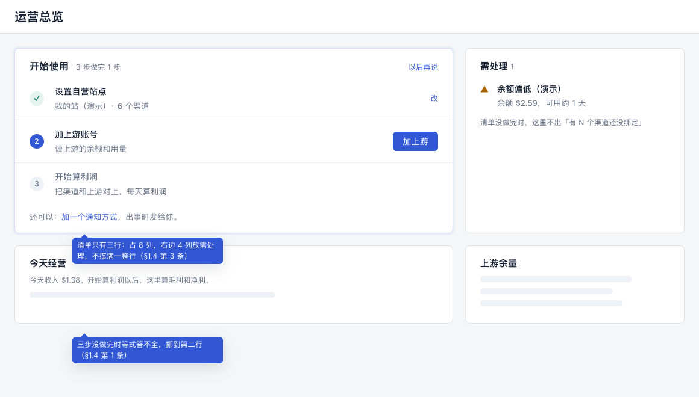
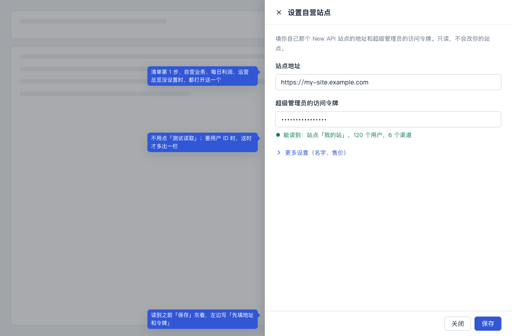
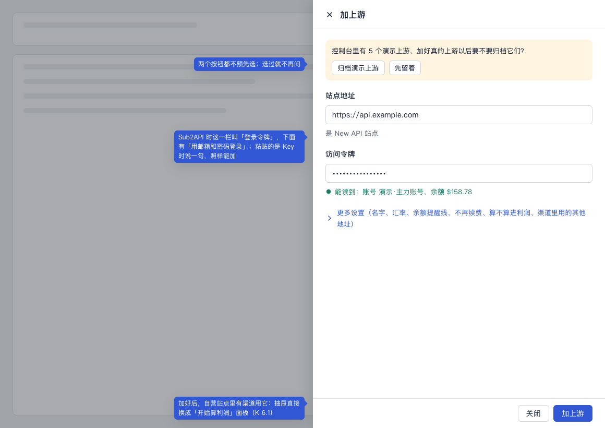
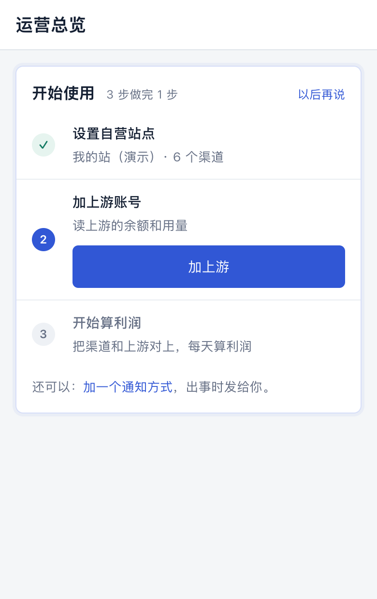

# 第一次使用设计稿

> 讲什么：运营总览顶上的「开始使用」清单（第 2 节）、设置自营站点一个抽屉四处用（第 3 节）、演示上游（4.1）、固定成本从「加上游」里拿出去（第 4 节末）、出错和其他情况（第 6 节）、手机（第 7 节）。来自[体检](../ui-audit.md) §8.1 第 1、3、4 件。
>
> 现在：已定，在 K 之后做。三步的流程以[流程梳理稿](./binding-flow.md)为准：账号的问题在加上游的抽屉里问，第 3 步接在同一个抽屉里。本稿第 1 节、第 4 节的抽屉、第 5 节已经换成指向流程梳理稿；其余几节开工前再按流程梳理稿对一遍。
>
> 对应规范：用语规范 §3.5、§8.1、§11、§12，设计规范 §4.8、§5.1–§5.3。要新加的说法在第 9 节「拟改条目」（编号「始1」起），先进规范，再写代码；做到哪见[待改总表](../pending.md)。
>
> 样稿：[first-run.html](./first-run.html)，截图在 `screens/first-*.png`。

## 0. 这份设计的五项（ui-design-spec §1.3）

| 项 | 写什么 |
|---|---|
| 用户目标 | 第一次打开控制台，最快看到「我的渠道今天赚了多少」 |
| 流程 | 改完密码落到运营总览的「开始使用」，三步按顺序就地做，做完落到每日利润，不换页。现在和改后各几步，以[流程梳理稿](./binding-flow.md)第 6 节为准：现在约 38 步、7 次换页，中间没有一句话告诉下一步；改后一共 9 下 |
| 省掉了什么 | 自己想到「自营站点要当成上游来加」；选类型、填名字、选用途；看一长串用不到的可选项；每一步做完自己找下一步；「去设置」把人扔到上游列表 |
| 还要用户做的 | 填只有用户有的东西：地址和令牌（自营站点一次、每个上游一次；有哪几栏见流程梳理稿第 1 节）；回答一次账号的问题（K）；确认一次「开始算利润」 |
| 对照原则 | §1.2 第 1 条（类型、名字、用户 ID、渠道都自己认）、第 4 条（一条路从头走到尾，每步告诉下一步）、第 3 条（演示上游归不归档只问一次、不预先选）；§1.4 第 1 条（首屏只放清单这一件事和需处理）、第 3 条（清单 8 列 + 需处理 4 列，不撑满一整行）、第 4 条（「更多设置」收起，说明一行）、第 9 条（多字段的事用抽屉，提交吸底） |
| 版式 | 运营总览首屏：清单 8 列 + 需处理 4 列；清单没做完时，等式挪到第二行。两个抽屉 560 宽，只露要填的几栏（见流程梳理稿第 1 节），其余收进「更多设置」。手机：清单在最顶上，一步一行，按钮在步骤名下面 |

## 1. 整条路（样稿 F-A 到 F-D）

见[流程梳理稿](./binding-flow.md)第 1 节：设置自营站点、加上游、开始算利润，一共 9 下，不换页，最后落到每日利润。

- 每一步做完，清单上这一步打勾、下一步变成当前那一步；用户不用自己找。

## 2. 「开始使用」清单（样稿 F-A、F-D）

**放在哪**：运营总览第一行的 8 列，右边 4 列是需处理（和逐页版式里运营总览的 8 + 4 同一个格子，样稿 F-A）。三步没做完时才有；没做完时利润等式挪到第二行。

- 为什么不撑满一整行：清单只有三行，撑满 1160 宽，右边一大片空（§1.4 第 3 条）。
- 为什么等式往下挪：三步没做完时，等式里毛利、净利算不出来（没设置自营站点时收入也没有），首屏给它也回答不了问题；这时只写一行已有的数和「开始算利润以后，这里算毛利和净利」（§1.4 第 1 条）。

**长什么样**（用现有的 `panel`，不另起组件）：
- 标题「开始使用」，旁边「3 步做完 1 步」。
- 三行，一行一步：

| 状态 | 左边 | 中间 | 右边 |
|---|---|---|---|
| 做完了 | 绿勾 | 步骤名 + 结果一句，例如「我的站（演示）· 6 个渠道」 | 「改」（文字链接，打开同一个抽屉） |
| 现在这一步 | 序号（蓝） | 步骤名 + 为什么一句 | 主按钮 |
| 还没到 | 序号（灰） | 步骤名 + 为什么一句（灰） | 不放按钮 |

- 三步的写法：

| 步 | 步骤名 | 为什么（没做时） | 按钮 | 做完以后那一句 |
|---|---|---|---|---|
| ① | 设置自营站点 | 读你站里的用户、渠道和收入 | 设置自营站点 | 我的站（演示）· 6 个渠道 |
| ② | 加上游账号 | 读上游的余额和用量 | 加上游 | 已加 1 个上游，余额 $158.78 |
| ③ | 开始算利润 | 把渠道和上游对上，每天算利润 | 开始算利润 | 6 个渠道在算利润 |

- 清单下面一行灰字：「还可以：加一个通知方式，出事时发给你。」「加通知方式」是链接，就地打开告警中心那个添加窗口。不算在三步里。
- 右上角「以后再说」：清单收起成页顶一个小标签「开始使用 1/3」，点开恢复。三步都做完以后，清单和小标签都不再出现。

**为什么第 3 步是「开始算利润」，不是「加通知方式」**：ui-audit §8.1 写的是「设好自营站点 → 加上游账号 → 加通知方式」。总指挥排的时候把「开始算利润」接成第 3 步：用户要的是利润，加完上游就该接着算；通知方式不影响数，放成「还可以」那一行（第 10 节第 1 条）。

**和需处理的关系**：清单没做完时，需处理里不出「有 N 个渠道还没绑定」这一条，清单第 3 步说的就是它，不重复（§1.4 第 2 条、§1.2 第 6 条）。这个去重在 E 的需处理清单里做（第 11 节），不在页面上过滤。

## 3. 设置自营站点：一个组件四处用（样稿 F-B）

**四处入口打开同一个抽屉**：清单第 1 步；自营业务、每日利润、运营总览没设置时的「去设置」。不再跳到上游列表。

**抽屉里有什么**：标题「设置自营站点」（已经设过的叫「自营站点设置」）。有哪几栏、填完怎么自动读、「更多设置」里放什么、什么时候「保存」灰着，见[流程梳理稿](./binding-flow.md)第 1 节第 1 步。流程梳理稿没写到的两处照本稿：要用户 ID 时，读的时候才出「用户 ID」一栏（「这个站点要填用户 ID：在站点后台「个人设置」里」）；名字默认用读到的站点名。

**保存以后**：
- 留在原来的页面，不跳走；
- 提示「已设置自营站点」；
- 从清单打开的：清单第 1 步打勾，第 2 步变成当前；
- 从自营业务、每日利润打开的：页面直接出数字。

**以后去哪改**：
- 自营业务页顶的「自营站点设置」；
- 清单还在时，第 1 步的「改」。

上游列表里不再列自营站点（ui-audit §8.4 第 2 件）。

## 4. 加上游：只填地址和令牌（样稿 F-C）

**入口、抽屉里有什么、加好以后接什么**：见[流程梳理稿](./binding-flow.md)第 1 节第 2 步、第 3 步；入口另见流程梳理稿第 4 节。流程梳理稿没写到的照本稿：要用户 ID 时，读的时候才出那一栏（同第 3 节）；现在表单里的可选项都收进「更多设置」（默认收起）：名字（默认用读到的账号名，读不到用站点域名）、汇率、余额提醒线、不再续费、算不算进利润。原来这里还有「渠道里用的其他地址」，流程梳理稿第 5.1 节把它去掉了。

**固定成本**不是登录上游，从「加上游」里拿出去：上游列表的「加上游」旁边另一个按钮「记固定成本」，抽屉里只有名字、金额、天数、开始日期。

### 4.1 演示上游

刚装好时库里有 5 个演示上游（标「演示」）。用户第一次加真的上游时，抽屉顶上一条：

- 「控制台里有 5 个演示上游，加好真的上游以后要不要归档它们？」
- 两个按钮「归档演示上游」「先留着」，**一个都不预先选**（§1.2 第 3 条）。选了就记下，这条不再出现。
- 「先留着」以后，想归档去上游列表一个个归档（现有）。

## 5. 开始算利润

见[流程梳理稿](./binding-flow.md)第 1 节第 3 步：接在加上游的同一个抽屉里，完成以后落到每日利润「今天」。清单第 3 步跟着打勾；三步都做完，清单不再出现。

## 6. 出错和其他情况

| 情况 | 怎么办 |
|---|---|
| 自营站点或上游读不到 | 抽屉里按 §8.2 写原因，「保存」「加上游」灰着；不关抽屉 |
| 地址填的是自营站点自己（加上游时） | 「这是你的自营站点，不用当上游加」，按钮灰着 |
| 加的上游已经加过 | 照现在「用已保存的」那一套：「这个上游已经加过了」[用已保存的] |
| 清单做到一半，某一步后来坏了（比如令牌过期） | 清单不回来；这件事按需处理走（E） |
| 老用户（升级上来，三步早就有了） | 清单从来不出现：判断「做完没有」看现在的数据，不看有没有走过清单 |
| 不是第一次登录、但清单没做完 | 清单照样在，直到做完或「以后再说」 |

## 7. 手机（样稿 F-E）

- 清单在运营总览最顶上，一步一行，按钮在步骤名下面，44 高。
- 抽屉从底部升起占满，「保存」「加上游」吸底。

## 8. 设计规范要加的（ui-design-spec）

- **§5.1 运营总览**：页顶加「开始使用」清单（第 2 节），三步做完前一直在；「以后再说」收成页顶小标签。
- **§5.2 上游资源**：上游列表不列自营站点；「加上游」只填地址和令牌，其余收进「更多设置」；「记固定成本」单独一个按钮。
- **§5.3 自营业务**：页顶「自营站点设置」打开同一个抽屉；没设置时的引导直接打开它。
- **§4.8 表单**：「填完离开输入框就自动读一次」的写法——读的时候「正在读…」，结果一句写在输入框下面，读到之前提交按钮灰着并说还差什么。

## 9. 拟改条目（ui-copy-spec）

- **始1（§11 区块名，加一行）**：「开始使用」（运营总览顶上的清单）、「自营站点设置」（自营业务页顶的入口和抽屉标题，第一次叫「设置自营站点」）。
- **始2（§3.5 动作，加几行、改一行）**：

  | 按钮 | 用在哪 | 完成提示 | 不再用 |
  |---|---|---|---|
  | 设置自营站点 | 清单第 1 步、各页没设置时（原来的「去设置」在这件事上改叫这个，按钮直接打开抽屉） | 已设置自营站点 | 去设置（用在自营站点时） |
  | 加上游 | 上游列表、清单第 2 步 | 已加上游「X」 | 新增上游 |
  | 记固定成本 | 上游列表 | 已记下固定成本「X」 | 新增上游（类型选固定成本） |
  | 以后再说 | 收起「开始使用」清单 | —— | 跳过、关闭引导 |
  | 归档演示上游 / 先留着 | 第一次加真的上游时 | 已归档 5 个演示上游 / —— | —— |

  「去设置」只留给「没设置汇率」去填汇率（§3.5 原来那一行的后半）。
- **始3（§8.1 页面状态，改一行）**：「还没设置自营站点」改成「还没设置自营站点：填你自己那个 New API 站点的地址和超级管理员的访问令牌，这里就有数了。」[设置自营站点]，不再写「在上游资源里编辑……打开「这是我的自营站点」」。
- **始4（新加一小节「填写时自动读」，放在 §8.1 后）**：
  - 读的时候：「正在读…」
  - 自营站点读到：「能读到：站点「我的站」，120 个用户，6 个渠道」
  - 上游读到：「能读到：账号 演示·主力账号，余额 $158.78」
  - 认出类型：「是 New API 站点」「是 Sub2API 站点」「没认出是什么上游，先按 New API 读」
  - 粘贴的是 Key：「这是一把 Key，只能读这把 Key 的余额」
  - 要用户 ID：「这个站点要填用户 ID：在站点后台「个人设置」里」
  - 提交按钮旁：「先填地址和令牌」
  - 加的是自营站点自己：「这是你的自营站点，不用当上游加」
- **始5（运营总览，清单的字）**：第 2 节两张表里的步骤名、为什么、做完那一句；「3 步做完 1 步」；「还可以：加一个通知方式，出事时发给你。」；收起后的小标签「开始使用 1/3」。
- **始6（演示上游）**：「控制台里有 5 个演示上游，加好真的上游以后要不要归档它们？」
- **始7（§12）**：自营站点设置抽屉是一个组件，清单、自营业务、每日利润、运营总览四处用；「加上游」抽屉一个组件，清单、上游列表、K 面板三处用。

## 10. 已定的（用户 10-24 定，都照推荐）

1. **清单三步是「设置自营站点 → 加上游账号 → 开始算利润」**，「加通知方式」放在清单下面「还可以」那一行（和 ui-audit §8.1 原来写的不同）：用户要的是利润，通知方式不影响数。
2. **「以后再说」收起以后**，页顶留一个小标签「开始使用 1/3」，三步做完才消失：不留的话，收起后就再也找不到这条路。收起记在服务器上（换电脑也一样），不记在浏览器里。
3. **自营站点以后在自营业务页顶「自营站点设置」里改**，上游列表不再列它（#60 第 2 件定了「拿出来」，这里定落在哪）。
4. **演示上游**：第一次加真的上游时问一次「要不要归档」，两个按钮不预先选：用户可能还想看演示。
5. **粘贴的是一把 Key 时，自动按「只用 Key」的上游加**，不让用户先选类型：K 定过只用一把 Key 的上游很少、不做特殊处理，这里只是让它不挡路。

## 11. 给开发的几点（只说页面要什么，不定怎么做）

- **需处理去重**：清单没做完时，「有 N 个渠道还没绑定」不进需处理。这一条在 E 的 `attention()` 里做，判断「清单做完没有」和清单进度用同一个来源。这样运营总览、侧栏、上游账单、日报四处一样，页面上不各自过滤。
- **清单进度**：一次读拿到四样，都按现在的数据判断，不记「走过没有」：
  - 有没有自营站点；
  - 有没有不是演示的上游；
  - 有没有在算利润的渠道；
  - 收没收起。

  前三样决定打勾，做完的给结果那一句要的数（站点名和渠道数、上游数和余额、在算的渠道数）。收起存在服务器的设置里。
- **认上游类型**：只读、不写；一次填地址只认一次，超时短（几秒）；认的结果只用来换令牌那一栏的叫法和读法，用户可以改。
  - 粘贴的是 Key 还是访问令牌，按上游的规矩认（例如 New API 的 Key 能直接调 `/v1` 接口，访问令牌不行）。
  - 摸底发现 New API rc.41 起访问令牌换成带权限范围的新令牌（`nap_` 开头），两种都要认得。
- **自动读**：离开输入框时读，同一组值只读一次；读的结果和现在「测试读取」是同一个，保存时不再要求另点一次。
- **名字**：New API 用读到的账号显示名；读不到用站点域名。自营站点用站点名。
- **自营站点抽屉**：存法和现在一样（还是一个 `isOwn` 的站点），只是入口和表单换了。
- **加上游加好以后接 K 面板**：加上游的结果里带「自营站点里地址对得上的渠道数」，大于 0 就换成面板。
- **演示上游**：问过一次就记下来；「归档演示上游」走现有的归档。
- **「记固定成本」**：用现在固定成本那一套，只是从「加上游」里拿出来。
- **界面测试的夹具**：
  - 空库（三步都没做）、做了 1 步、做了 2 步、都做完、收起了；
  - 自营站点读到、读不到、要用户 ID；
  - 加上游认出 New API、Sub2API、认不出、粘贴了 Key；
  - 加好后有渠道（接 K 面板）、没渠道；
  - 有演示上游、没有。

## 12. 验收清单（给审核与测试）

1. 空库第一次登录改完密码，运营总览最顶上是「开始使用」，「3 步做完 0 步」，第 1 步是当前那一步。
2. 点「设置自营站点」就地开抽屉，不跳页；有哪几栏照流程梳理稿第 1 节第 1 步；填完离开输入框自动读，写「能读到：站点「…」，… 个用户，… 个渠道」。
3. 没读到之前「保存」灰着，左边写「先填地址和令牌」；读不到时按 §8.2 说原因。
4. 保存后留在运营总览，清单第 1 步打勾并写结果，第 2 步变成当前。
5. 自营业务、每日利润没设置时的按钮叫「设置自营站点」，打开同一个抽屉，保存后页面直接出数字。
6. 「加上游」只有地址和令牌；地址离开输入框后写「是 New API 站点」或「是 Sub2API 站点」；Sub2API 时令牌叫「登录令牌」，有「用邮箱和密码登录」。
7. 粘贴的是一把 Key：写「这是一把 Key，只能读这把 Key 的余额」，照样能加。
8. 汇率、余额提醒线等收在「更多设置」里，默认收起；名字默认是读到的账号名。
9. 有演示上游时，抽屉顶上问一次要不要归档，两个按钮都没预先选；选过以后不再问。
10. 加好上游、自营站点里有渠道用它：抽屉直接换成「开始算利润」面板；完成后落到每日利润今天，清单三步都打勾后不再出现。
11. 加好上游但没有对得上的渠道：提示「已加上游「…」」，清单第 2 步打勾，第 3 步变成当前。
12. 「以后再说」：清单收起成「开始使用 1/3」小标签，点开恢复；换浏览器打开还是收起的。
13. 清单没做完时，需处理里没有「有 N 个渠道还没绑定」。
14. 老数据（三样都有）：清单不出现。
15. 上游列表里没有自营站点那一行；「记固定成本」是单独的按钮。
16. 手机 390 宽：清单一步一行、按钮 44 高；抽屉从底部升起、提交按钮吸底。
17. 页面上没有「新增上游」「这是我的自营站点」「去设置」（用在自营站点时）这些旧说法。
