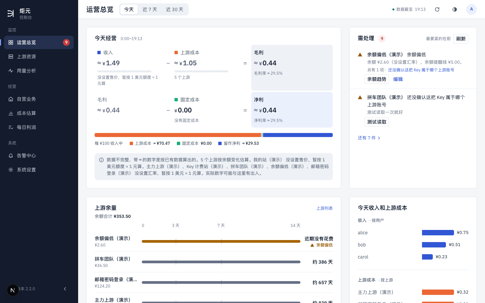
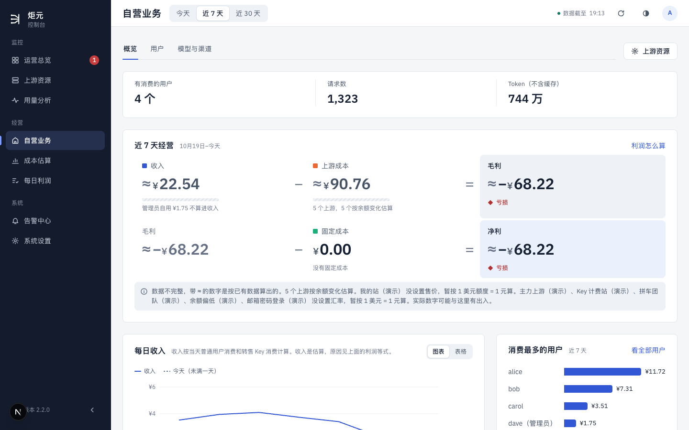
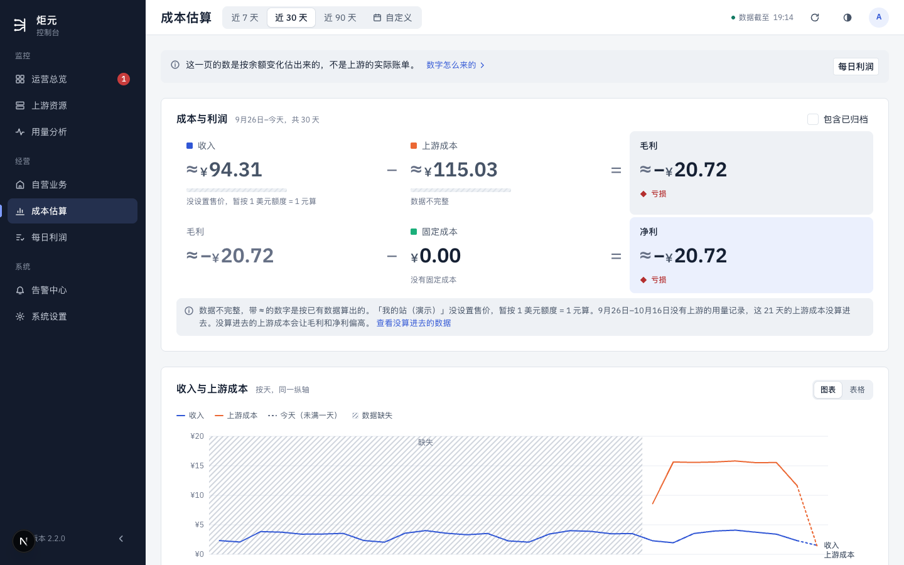
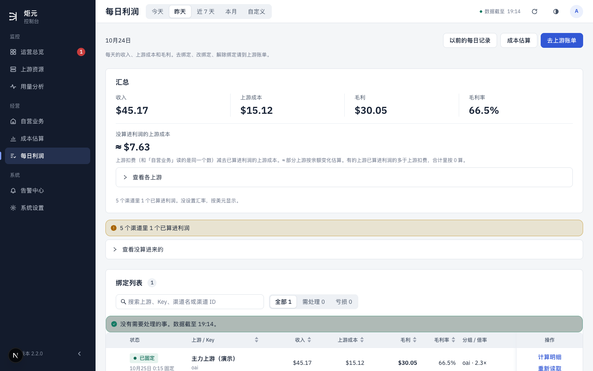
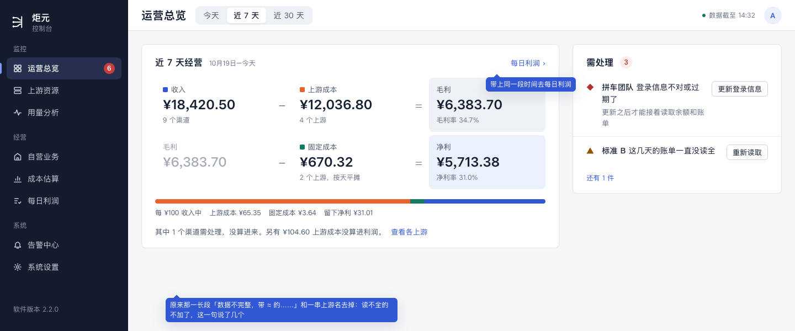
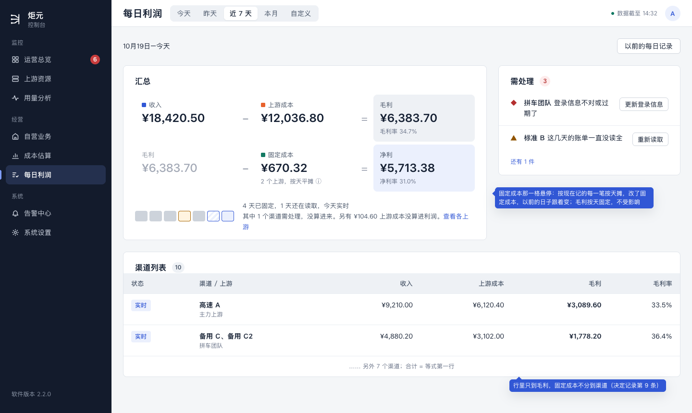
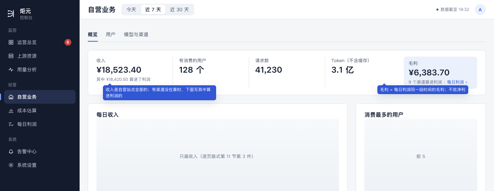
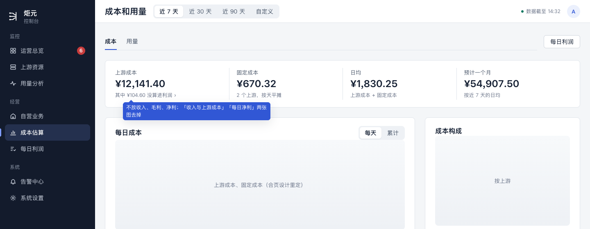

# 等式只放两处（计划 G）设计稿

> 讲什么：利润等式（`收入 − 上游成本 = 毛利`，`毛利 − 固定成本 = 净利`）以后只放运营总览、每日利润两处的首屏，两处用同一份数；自营业务、成本估算拿掉等式以后各放什么；每日利润首屏要不要出整段时间的净利（要用户定，第 7 节）。
>
> 现在：草稿，等用户定第 7 节。2026-10-25，UI/UX 设计会话。随 G 做；成本估算、用量分析合页的版面在合页的设计里，这里只定合页以后「成本」页签第一行放什么。
>
> 依据：
> - [体检](../ui-audit.md) §8.4 第 3 件（用户 10-24 定）：利润只在运营总览（今天）、每日利润（按天按渠道）两处完整地算，自营业务、成本估算只放各自那一半；
> - 设计规范 §1.1 第 1 条：每日利润每行只算毛利，首屏等式带不带整段时间的净利 G 时定（待改总表第五节）；
> - [逐页版式](./page-layouts.md)第 1、5、6、7 节：每页的回答、第一行放什么；
> - [G 清单](./g-currency.md)：一块一种币种，固定成本按元记，没设置汇率时净利写「—」；
> - [F 设计稿](./f-multiday.md)第 2 节：每日利润的汇总只加算出来的部分，构成一行、日条；
> - [决定记录](../decisions.md)第 9 条：每日利润只算毛利，固定成本不分到渠道。
>
> 对应规范：用语规范 §3.2、§4、§9、§12，设计规范 §1.1、§5.1、§5.3、§5.5、§5.6。要新加的说法在第 8 节「拟改条目」（编号「式1」起），先进规范，再写代码。
>
> 样稿：[g-equation.html](./g-equation.html)，截图在 `screens/g-*.png`；「现在」的截图 `screens/g-now-*.png` 是在自己的预览（3200、演示数据）里截的。

## 0. 这份设计的六项（ui-design-spec §1.3）和改动大小

| 项 | 写什么 |
|---|---|
| 用户目标 | 想知道「赚了多少」时只有一个地方的数，在哪页看到的都一样；看今天去运营总览，看任意一段、按渠道去每日利润 |
| 流程 | 改前：运营总览、自营业务、成本估算三页各有一道完整的等式，每日利润是四格汇总；四处各算各的，同一天的数对不上（第 1 节截图），用户不知道信哪个。改后：只有运营总览、每日利润两处首屏有等式，读同一份数；从运营总览点等式，落到每日利润的同一段时间，看到同样的数；自营业务、成本估算的第一行只放各自那一半，各有一个链接到每日利润 |
| 省掉了什么 | 在四页之间比对哪个数对；自营业务、成本估算上和总览重复的等式；成本估算的「收入与上游成本」图和「每日净利」图（利润按天看在每日利润） |
| 还要用户做的 | 不多：只是看。要定的一件在第 7 节（每日利润首屏出不出整段的净利） |
| 对照原则 | §1.1 第 1 条（等式只放两处）；§1.2 第 5 条（同一件事只在一处说）；§1.4 第 1 条（一页回答一个问题）、第 2 条（同一个数一页只出现一次）；体检 §8.4 第 3 件 |
| 版式 | 运营总览：等式 8 列 + 需处理 4 列（不变）。每日利润：汇总 8 列（推荐换成同一道等式）+ 需处理 4 列。自营业务：第一行五格指标，最后一格是毛利。成本页签：第一行四格成本。手机：等式两行一格（第 6 节） |
| 改动大小 | 中。页面：自营业务、成本估算去掉等式，换指标行；每日利润的汇总换组件（推荐那一种）。服务端：运营总览、自营业务的毛利格、日报的经营概览改读每日利润同一份汇总，不再自己算一遍（第 9 节）。排在 E、F 之后，和 G 的币种一起做 |

## 1. 用户要达到什么、现在什么样

财务、运营要回答「这段时间赚了多少」。现在有四个地方能看到，各算各的：

| 页 | 回答 | 数从哪来 |
|---|---|---|
| 运营总览 | 今天 / 近 7 天 / 近 30 天 | 自营站点全部收入，减所有算进利润的上游的花费（按余额变化估的也算），再减固定成本 |
| 自营业务 | 同上，默认近 7 天 | 同上，另一份接口 |
| 成本估算 | 近 7 / 30 / 90 天、自定义 | 自己的统计 |
| 每日利润 | 今天、昨天、近 7 天、本月、自定义 | 按渠道（现在是按绑定）一条一条算，每天固定 |

运营总览、自营业务、成本估算、每日利润，依次：

演示数据里能看到：同是「赚了多少」，前三页写的是带「≈」的 ¥ 和亏损，每日利润写的是 $ 和赚钱；三页的等式下面各有一长段「数据不完整」的说明。用户问「哪个对」时，答案是每日利润：只有它按渠道把收入和那个渠道用的 Key 的花费对上，读不全的不算进来，过了零点固定。

所以这次只做一件事：**利润只算一份，就是每日利润那一份；两处首屏放等式，其余页只放各自那一半，链过去。**

## 2. 一份数，两处首屏

### 2.1 数从哪来

| 数 | 怎么算 | 和每日利润的关系 |
|---|---|---|
| 收入、上游成本、毛利 | 这段时间里，在算利润的渠道算出来的部分加起来（F 第 2.1 节：已固定的日子，加上实时、毛利已经算出来的部分；需处理、还在读取的不加） | 就是每日利润的汇总 |
| 固定成本 | 算进利润的上游记的固定成本，每笔照金额和天数按天摊，这段时间的合计（决定记录第 9 条，和现在一样） | 每日利润的行里不扣，只在等式里扣 |
| 净利 | 毛利 − 固定成本 | —— |
| 没算进来的 | 一句话，照 §4 汇总那句和 §3.2「没算进利润的上游成本」：「其中 1 个渠道需处理、2 个还在读取，没算进来。另有 $15.55 上游成本没算进利润。」[查看各上游] | 和每日利润汇总下面那句同一句 |

- **币种**照 G：一块一种币种；固定成本按元记，没设置汇率时净利写「—」加原因（G 第 2 节第 1 条）。
- **「≈」**只留给按余额变化估算的数（G 币4）。K 以后上游成本都从账单读，「≈」基本不会出现。
- **两处读同一个接口、同一个函数**（式7），运营总览不再自己算。

### 2.2 两处各回答什么

| | 运营总览 | 每日利润 |
|---|---|---|
| 回答 | 今天怎么样（也能切近 7 天、近 30 天） | 任意一段时间、每个渠道赚了多少，哪天定下来了 |
| 等式 | 有，带净利（不变） | 推荐也有，和运营总览同一个组件（第 7 节，要用户定） |
| 等式下面 | 「每 100 元收入的去向」一条（写 $ 时不画，G）；没算进来的那一句 | F 的构成一行（日条、定了几天、没算进来的那一句） |
| 行 | 没有 | 每个渠道一行，只到毛利（不变） |

## 3. 运营总览首屏（样稿 g-home）

- 第一行照逐页版式第 1 节：等式 8 列 + 需处理 4 列。
- **等式的数换成每日利润那一份**（第 2.1 节）。时间范围照旧是今天、近 7 天、近 30 天。
- **标题旁加一个链接「每日利润」**，带上同一段时间：今天、近 7 天直接对应每日利润的同名范围；近 30 天落成每日利润的自定义范围（30 天）。点等式里的收入、上游成本、固定成本，照旧去自营业务、成本页、上游列表（现在就是这样）。
- **等式下面一行**：
  - 「每 100 元收入的去向」照旧，写 $ 时不画（G 第 2 节第 1 条）；
  - 有没算进来的，写第 2.1 节那一句；都算进来了不写。
  - 原来那一长段「数据不完整，带 ≈ 的数字是……」和一串没设置汇率的上游名去掉：读不全的已经不加了（那一句说了几个），没设置汇率换成 G 的币2「3 个上游没设置汇率，金额按美元显示。」[去设置]。
- **第二行「今天收入和上游成本」不变**：它列的是按用户、按上游的前 3，回答「钱从谁来、花到哪」，不是合计，和等式不重复。收入那一段是自营站点全部用户的消费，可能比等式里的收入多（有渠道没在算时），这一段只列前 3、不写合计，所以不会出现两个对不上的合计。
- **没有在算利润的渠道时**（第一次使用还没做完）：等式那块照[第一次使用设计稿](./first-run.md)，不出空的等式。

## 4. 每日利润首屏（样稿 g-daily，按第 7 节推荐的那一种画）

- 第一行：汇总 8 列 + 需处理 4 列（逐页版式第 7 节、E）。
- **汇总换成和运营总览同一个等式组件**（推荐，第 7 节 (c)）：
  - 第一行 `收入 − 上游成本 = 毛利`，毛利下面写毛利率；
  - 第二行 `毛利 − 固定成本 = 净利`，净利下面写净利率；固定成本下面写「3 个上游，按天平摊」，悬停写「固定成本按现在记的每一笔按天摊，改了固定成本，以前的日子跟着变；毛利按天固定，不受影响」（式4）。
  - 不画「每 100 元收入的去向」：这一页有 F 的构成一行，不要两条「构成」。
- **等式下面照 F**：日条、「4 天已固定，1 天还在读取，今天实时」、没算进来的那一句，以及「另有 $15.55 上游成本没算进利润 [查看各上游]」（F 第 2.5 节、逐页版式第 7 节）。
- **渠道列表的每一行照旧只到毛利**，固定成本不分到渠道（决定记录第 9 条）。所以列表合计 = 等式第一行，财务一减就对得上。
- 「以前的每日记录」那一页也一样，用同一个组件。

## 5. 别的页拿掉等式以后放什么

### 5.1 自营业务（样稿 g-my）

回答「钱从哪些用户、模型、渠道来」（逐页版式第 5 节）。

- **第一行五格**：收入、有消费的用户、请求数、Token、毛利。前四格现在就有（版式 PR 4 放了三格），G 补「收入」和「毛利」两格，等式整块拿掉。
- **收入**：自营站点这段时间全部的收入（钱从哪来，就看全部）。有渠道没在算利润、和每日利润的收入不一样时，下面一行灰字「其中 ¥98.40 算进了利润」（式1）。一样时不写。
- **毛利**：每日利润同一段时间的毛利，下面一行「9 个渠道算进利润」，整格点去每日利润（同一段时间）。不放净利：净利要扣固定成本，固定成本是上游的事，在成本页和两处等式里。
- 收入图只画收入（逐页版式第 11 节第 3 件，已定）。
- 「利润怎么算」收起在最下面（逐页版式第 5 节）。里面讲的是哪些 Key 算转卖收入，是收入的口径，留在这一页。

### 5.2 成本估算，合页以后的「成本」页签（样稿 g-cost）

回答「钱花在哪些上游、还能用几天」（逐页版式第 6 节）。

- **第一行四格**：上游成本、固定成本、日均、预计一个月。不放收入、毛利、净利。
- **上游成本**是这段时间所有算进利润的上游实际扣的钱（钱花在哪，就看全部），下面一行灰字「其中 $15.55 没算进利润」（§3.2 的说法，式6），点它展开各上游；都算进去了不写。
- 去掉「收入与上游成本」图、「每日净利」图：按天看利润在每日利润。剩下的图都是成本（每日成本图，右上角切每天 / 累计，合页那份设计里定）。
- 右上角「每日利润」按钮照旧，是去看利润的路。
- 合页以前（G 先做时），成本估算这一页先照这一节换掉等式，页签留给合页。

### 5.3 日报的「经营概览」

- 收入、上游成本、毛利、固定成本、净利几行，读每日利润昨天那一份（第 2.1 节），和每日利润选「昨天」时一样。
- 「利润怎么算」那一行照 G 第 4 节；需处理那一行照 E。
- 消费、预收、模型和用户前 5 这几行是「钱从哪来」，照旧读自营站点全部的数，和自营业务一致。

## 6. 手机

- 运营总览：需处理在前；等式两行一格（逐页版式第 1 节，不变）。
- 每日利润：需处理在前；等式两行一格，和运营总览同一个样子；日条横滑（F）。
- 自营业务、成本页签：第一行指标两列小格，毛利那一格占满一行（它是这一页的去处）。

## 7. 要用户定：每日利润首屏要不要出整段时间的净利

每日利润的每一行只到毛利（决定记录第 9 条，不变）。问的是首屏汇总那一块：选一段时间（例如本月）时，要不要扣掉这段时间的固定成本，给出净利。

| | 怎么放 | 好处 | 坏处 |
|---|---|---|---|
| (a) 不出 | 汇总照现在四格：收入、上游成本、毛利、毛利率 | 改动最小；汇总 = 行的合计，一眼对得上 | 净利只在运营总览，只能看今天、近 7 天、近 30 天；想看「本月净利」「上个月净利」没地方看。等式只在一处完整，和 §1.1 第 1 条说的两处对不上 |
| (b) 多一格 | 汇总五格：收入、上游成本、毛利、固定成本、净利（毛利率写在毛利下面） | 有了整段的净利；还是格子的样子 | 和运营总览长得不一样，从总览点过来时要重新找数；五格里看不出谁减谁 |
| **(c) 推荐：同一道等式** | 汇总换成和运营总览同一个等式组件，两行（第 4 节） | 有整段的净利；从运营总览点过来，看到的是同一个样子、同一组数；只有一个组件，一处改两处跟着变（§12 一处一份）；第一行仍是 收入 − 上游成本 = 毛利，和渠道列表的合计对得上 | 汇总那块高一行；固定成本按现在记的每一笔算，改了固定成本，已固定的日子的净利跟着变（毛利不变）——悬停里写明（式4） |

推荐 (c)。理由：用户 10-24 定的是「完整的利润只在两处算」，(c) 让这两处真的是同一道等式、同一份数；行里仍只到毛利，财务对账的那一层不动。

## 8. 拟改条目

写法照规范原来的格式，进规范以后编号作废。没写在这里的，都用规范里现成的说法（§4 汇总那句、§3.2「没算进利润的上游成本」、G 的币2、币3）。

**ui-copy-spec.md**

- **式1（§3.2「收入」那一行补一句）**：利润等式里的收入只算在算利润的渠道（和每日利润同一个范围）；自营业务第一行的收入是自营站点全部的收入。两者不一样时，自营业务那一格下面写「其中 ¥98.40 算进了利润」。
- **式2（§4「汇总怎么加」后面补一句）**：运营总览的等式和每日利润的汇总是同一份数，下面那句没算进来的也一样写。
- **式3（§3.5 加一行）**：

  | 按钮 | 用在哪 | 完成提示 | 不再用 |
  |---|---|---|---|
  | 每日利润（链接） | 运营总览等式标题旁、自营业务的毛利格、成本页右上角：去每日利润，带上同一段时间 | —— | 去对账、查看利润明细 |

- **式4（§9 计算明细或等式的悬停，固定成本那一项；只在 (b)(c) 时要）**：「固定成本按现在记的每一笔按天摊，改了固定成本，以前的日子跟着变；毛利按天固定，不受影响。」
- **式5（§3.2 或自营业务那一节）**：自营业务的毛利格下面写「9 个渠道算进利润」；没有在算的渠道时写「还没有渠道在算利润」，整格去每日利润。
- **式6（§3.2「没算进利润的上游成本」那一行补用在哪）**：成本页「上游成本」那一格下面写「其中 $15.55 没算进利润」，点开列各上游。
- **式7（§12 加一行）**：

  | 内容 | 唯一位置 | 要合并掉的旧写法 |
  |---|---|---|
  | 利润等式的数（收入、上游成本、毛利、固定成本、净利，一段时间） | 每日利润汇总的那一个函数和接口；运营总览、每日利润、自营业务的毛利格、日报的经营概览都读它 | 运营总览读 `/api/own/analytics` 的 `profit`（`computeProfit`）、没设置自营站点时退回 `/api/analytics`；自营业务的等式；成本估算的等式和「每日净利」图 |
  | 利润等式的样子 | `app/components/profit-equation.tsx` 一个组件，运营总览、每日利润（选 (c) 时）用 | 每日利润的四格汇总 |

- 删掉（随 G）：`EQ_TEXT` 里只给自营业务、成本估算用的几句（「数据不完整……实际数字可能与这里有出入」那一套），运营总览、每日利润不再用「数据不完整」这句，读不全的已经不加。

**ui-design-spec.md**

- **§1.1 第 1 条**：最后一句「首屏这道等式要不要带整段时间的净利，G 实现时定」换成用户定的结果。
- **§5.1 运营总览**：等式的数和每日利润同一份；标题旁「每日利润」链接带同一段时间。
- **§5.3 自营业务**：第一行五格，最后一格毛利；没有等式。
- **§5.5 成本估算**：第一行四格成本；没有等式、收入与上游成本图、每日净利图。
- **§5.6 每日利润**：汇总照用户定的那一种。

**待改总表**：第五节「每日利润首屏的等式带不带净利」那一行，用户定了以后删掉，结果写进设计规范 §1.1。

## 9. 给开发的几点（只说页面要什么，不定怎么做）

- **一份数**：一段时间（今天、近 7 天、近 30 天、本月、自定义）的收入、上游成本、毛利、固定成本、净利和「没算进来」，由每日利润汇总那一个函数给。运营总览、自营业务的毛利格、日报都调它，不再自己算（式7）。
  - 运营总览的「近 30 天」，每日利润现在没有这个预设：用自定义范围，或者给接口加一个，开发定。
  - 每日利润按渠道算，所以 G 要在 K 之后做，现在的顺序就是这样。
- **组件**：`ProfitEquation` 加一个开关，不画「每 100 元收入的去向」（每日利润用）。
- **自营业务的「收入」**：照旧读自营站点全部的收入；「其中 ¥X 算进了利润」要每日利润同一段时间的收入。
- **成本页的「上游成本」**：照旧是所有算进利润的上游实际扣的钱；「其中 $X 没算进利润」就是每日利润的「没算进利润的上游成本」，同一个数。
- **性能**：运营总览首屏的数据读法变了（从 `/api/own/analytics` 换成每日利润的汇总），照规矩要量首屏：今天每 30 秒、近 7 天和近 30 天每 5 分钟重读（和每日利润一样，服务端缓存里复用），首屏不比现在慢，接口 p95 不过基线 +20%。自营业务少读一份利润，成本页少画两张图，只会变快。
- **界面测试要新的夹具**：同一组数，运营总览等式、每日利润汇总、自营业务毛利格、日报经营概览四处断言相等；有没算进来的渠道；没设置汇率（净利「—」）；有固定成本。

## 10. 验收清单（给审核与测试）

1. 同一段时间（今天、近 7 天），运营总览等式的收入、上游成本、毛利、固定成本、净利，和每日利润的汇总一模一样。
2. 运营总览点「每日利润」：落到每日利润的同一段时间；近 30 天落成自定义的 30 天。
3. 运营总览等式下面没有「数据不完整……」那一长段，也没有一串上游名；有没算进来的渠道时，只有一句「其中 … 没算进来。另有 $… 上游成本没算进利润。」[查看各上游]。
4. 每日利润（按第 7 节定的那一种）：汇总的毛利 = 渠道列表毛利的合计；选 (c) 时等式两行，固定成本悬停有那句说明，没有「每 100 元收入的去向」。
5. 自营业务没有等式；第一行五格，毛利那一格的数 = 每日利润同一段时间的毛利，点了落到每日利润同一段时间；收入和每日利润不一样时，下面有「其中 ¥… 算进了利润」。
6. 成本估算（或成本页签）没有等式、没有「收入与上游成本」图和「每日净利」图；第一行四格；上游成本下面有「其中 $… 没算进利润」时，那个数 = 每日利润的「没算进利润的上游成本」。
7. 日报经营概览的收入、上游成本、毛利、固定成本、净利 = 每日利润选「昨天」的数。
8. 没设置汇率、有固定成本：两处等式的净利都写「—」并说原因（G）；自营业务、成本页没有净利。
9. 手机 390：两处等式样子一样，两行一格；自营业务、成本页指标两列，毛利那一格占满一行。
