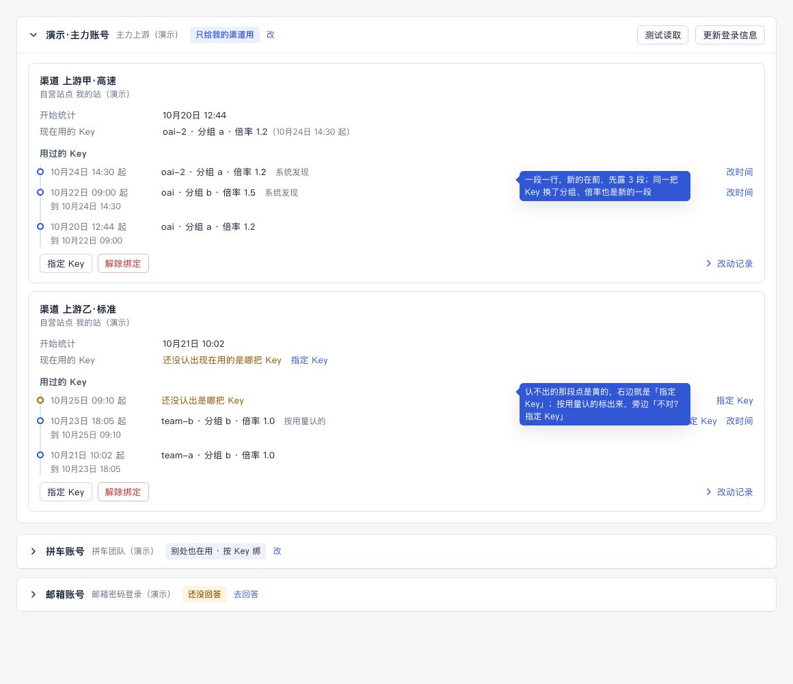
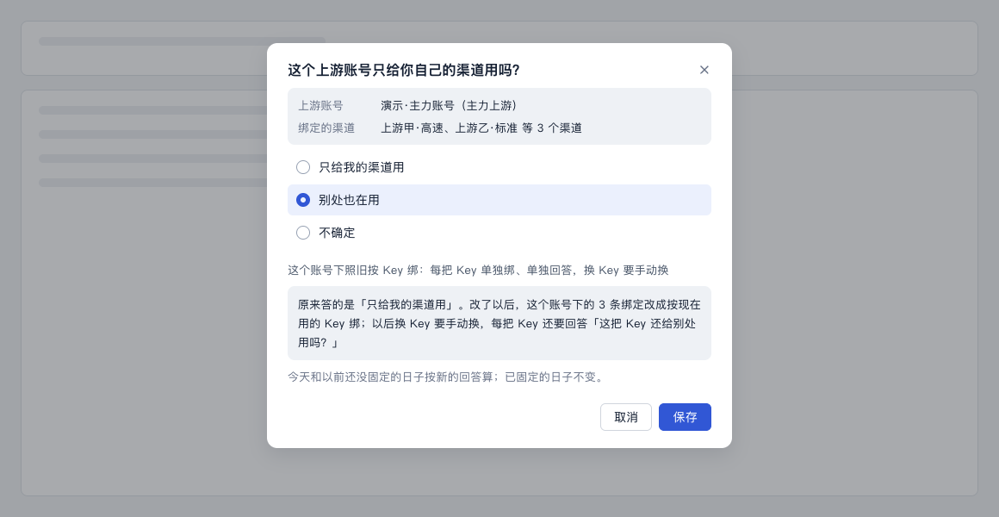
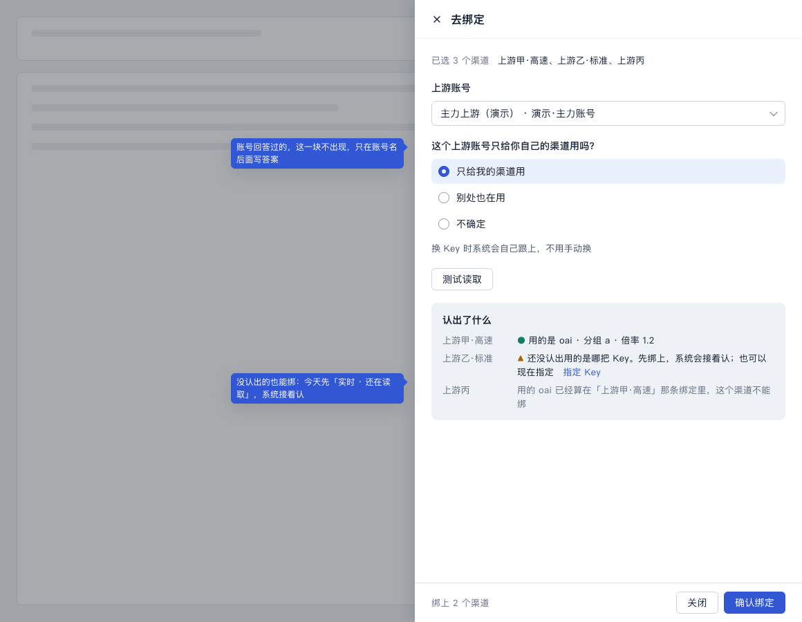
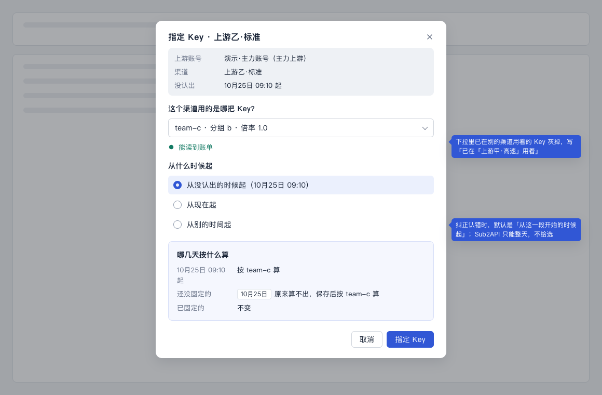
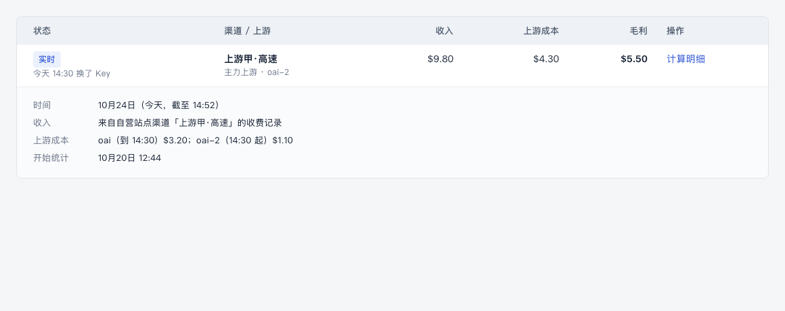

# 绑定跟着 Key 走（计划 K）设计稿

> 状态：草稿，等用户点头。2026-10-24，UI/UX 设计会话。取代原来的 6b 换 Key 设计稿。
>
> **2026-10-25 起，「怎么让渠道算利润」的流程以[流程梳理稿](./binding-flow.md)为准。**用户 10-25 又定了认 Key 的办法：渠道用哪把 Key 由装在你站旁边的「渠道 Key 读取服务」读出来，和上游的 Key 精确比对，不要任何猜测的办法。所以本稿第 1–3 节（上游账单页签）、第 4.1 节（三档认 Key）、第 5 节（账号的问题，挪到了加上游的抽屉里）、第 6 节（开始算利润面板、渠道绑定页签）、第 7 节（「指定 Key」，已去掉）都不再用；第 8 节「改时间」只留在读不到渠道 Key 的那段时间里、一把 Key 在两个在算的渠道之间挪过时（流程梳理稿例外三）；第 10 节的认1–认11 不再用，用语以 ui-copy-spec 标「（新）」的行为准。本稿只留版面细节：「用过的 Key」一行怎么写（4.2、4.3，去掉「按用量认的」「不对？指定 Key」）、每日利润和计算明细（第 9 节）。
>
> 依据：
> - 用户 2026-10-24 定：「绑定按「渠道 + 上游账号，按时间记 Key」这个方向改，先做摸底，顺序照你建议的。」
> - 计划新加的一节「绑定改为「自营渠道 + 上游账号，按时间记 Key」」；
> - 总指挥的评估 `~/.cache/relay-monitor-copy/binding-unit-fit.md`；
> - [用语规范](../ui-copy-spec.md) §3.5、§4、§5.2、§5.4、§9；
> - [D 设计稿](./d-config-change.md)（「哪几天按什么算」、保存、改动记录）、[E 设计稿](./e-attention.md)、[F 设计稿](./f-multiday.md)。
>
> 摸底（K0，`~/.cache/relay-monitor-copy/k0-probe.md`）的结论已经写进第 4、7 节和 6.1：自营站点读不到渠道里的 Key，所以按「对请求号 → 按用量对 → 看用量起落」三档认，认不出的退路是「指定 Key」。各站的版本、请求号有没有值，还要在用户的服务器上核实；三档已经覆盖了核实出来的各种情况。
>
> 本文只写流程、版面和状态。要新加的说法写在第 10 节「拟改条目」（编号「认1」起，进规范后作废）。
>
> 样稿：[d-k.html](./d-k.html) 的 K-A 到 K-G，截图在 `screens/k-*.png`。

## 0. 这份设计的五项（ui-design-spec §1.3）

| 项 | 写什么 |
|---|---|
| 用户目标 | 让自营站点的渠道算利润，Key 换了也不用管；想知道某天成本为什么变了时查得到 |
| 流程 | 开始算利润：现在约 11 步、2 次换页（ui-audit §8.2 流程三）；改成 3 步、不换页（第 6 节）。换 Key：现在跳页签、先解除再从头绑一遍；改成 0 步，系统自己跟上（第 4 节） |
| 省掉了什么 | 选渠道、选上游、选 Key、按 Key 分组、点「测试读取」、每次换 Key 手动处理、绑完自己去每日利润找结果；每把 Key、每条绑定反复问「这把 Key 还给别处用吗？」 |
| 还要用户做的 | 确认一次（「开始算利润」）；每个账号回答一次「这个上游账号只给你自己的渠道用吗？」；系统认不出或认错时更正（「指定 Key」「改时间」） |
| 对照原则 | §1.2 第 1 条（Key、分组、倍率系统自己认）、第 2 条（只有确认和两种更正，入口就在结果旁边）、第 3 条（按账号问一次）、第 4 条（加账号就接着开始算利润，完成落到每日利润）、第 6 条（换 Key 不打扰，只记在「用过的 Key」） |

## 1. 用户要达到什么

用户的实际用法：
- 上游账号只给自己用；
- 一个分组一把 Key，填进自营站点的一个渠道；
- Key 经常换，分组也会废弃重建，新 Key 填进同一个渠道。

所以：

- **换 Key 不用来控制台点任何东西**，利润照算。
- **想知道某天为什么成本变了**，能看到这个渠道那天用的是哪把 Key、哪个分组、什么倍率，从几点开始。
- **系统认不出时**，告诉用户一句、给一个按钮，指定一下就好。

## 2. 新的样子，一句话

**绑定 = 自营站点的一个渠道 + 一个上游账号。**这个渠道用过哪些 Key，系统按时间一段一段记下来（「用过的 Key」）。

| 以前 | 现在 |
|---|---|
| 绑定拴在一把 Key 上，一把 Key 可以对几个渠道 | 绑定拴在一个渠道上，渠道用哪把 Key 由系统跟着 |
| 换 Key 要点「换 Key」，不点就算不出利润 | 系统发现换了就接着算；认不出才要「指定 Key」 |
| 每条绑定问「这把 Key 还给别处用吗？」 | 每个上游账号问一次「这个上游账号只给你自己的渠道用吗？」 |
| 渠道绑定要选渠道、选上游、选 Key、测试读取 | 加上游账号时系统自己找出用它的 Key 的渠道，确认一次就开始算 |

**上游账号答了「别处也在用」**（不专用）时，系统不能放心地自动认 Key，这种账号下照旧按 Key 绑：选 Key、问「这把 Key 还给别处用吗？」、换 Key 手动换（第 7 节）。

## 3. 上游账单（样稿 K-A）

改成「上游账号 → 绑定（渠道）→ 用过的 Key」三层。

**账号这一层：**
- 标题行：账号名、下面几个上游，加一个标签说明这个账号怎么绑：
  - 「只给我的渠道用」（蓝）：按渠道绑，系统跟 Key；
  - 「别处也在用 · 按 Key 绑」（灰）：照旧按 Key 绑；
  - 「还没回答」（黄）：后面跟「去回答」（第 5 节）。
- 动作照旧：测试读取、更新登录信息、查看余额。

**绑定这一层（一张卡片一个渠道）：**
- 标题「渠道 上游甲·高速」，下面一行灰字「自营站点 我的站」。
- 事实三行：
  - 开始统计 10月20日 12:44；
  - 现在用的 Key：oai-2 · 分组 a · 倍率 1.2（10月24日 14:30 起）；
  - 认不出时这一行写「还没认出现在用的是哪把 Key」，黄字，后面跟「指定 Key」。
- 按钮：指定 Key、解除绑定。没有「改绑定」「换 Key」（第 11 节第 3 条）。
- **用过的 Key**：一段一行，新的在前，先露 3 行，再多写「再看 2 段」。
- **改动记录**：默认收起，只放用户做的事（D 第 7 节），Key 的事不重复写在这里。

**用过的 Key，一行怎么写：**

| 情况 | 写法 | 右边 |
|---|---|---|
| 系统发现换了 | 10月24日 14:30 起　oai-2 · 分组 a · 倍率 1.2　<灰>系统发现</灰> | 改时间 |
| 同一把 Key 换了分组或倍率 | 10月22日 09:00 起　oai · 分组 b · 倍率 1.5　<灰>系统发现</灰> | 改时间 |
| 按用量认的 | 10月23日 18:05 起　team-b · 分组 b · 倍率 1.0　<灰>按用量认的</灰> | 不对？指定 Key　改时间 |
| 用户指定的 | 10月25日 09:10 起　oai-3 · 分组 a · 倍率 1.2　<灰>你指定的</灰> | 改时间 |
| 绑定时就在用的 | 10月20日 12:44 起　oai · 分组 a · 倍率 1.2 | —— |
| 认不出 | 10月25日 09:10 起　<黄>还没认出是哪把 Key</黄> | 指定 Key |
| 已经结束的一段 | 起始时间后面加「到 10月24日 14:30」 | |

- Key 名同名分不开时，名字后面跟打码「oai（AbC1…9f0c）」，前 4 位…后 4 位，不补「sk-」。完整 Key 不存、不显示。
- 倍率读不到时写「倍率暂时读不到」（§5.4 现有写法）。
- 不写段号、不写 token_id、不写「指纹」。

## 4. 系统怎么认 Key，认出了怎么显示

### 4.1 怎么认

**渠道属于哪个上游**：按渠道地址认。渠道里填的地址等于上游地址（或者上游的「渠道里用的其他地址」），就是它，这一步是准的。同一个上游站上有两个账号时，地址分不出是哪个账号，要靠下面第 1、2 档。

**渠道当时用的是哪把 Key**：自营站点读不到渠道里填的 Key（渠道接口把 Key 去掉了，专门取 Key 的接口要两步验证），所以从用量记录上认。按准确度分三档：

| 档 | 什么时候能用 | 认出以后 |
|---|---|---|
| 1. 对请求号 | 自营站点 New API 不低于 v1.0.0-rc.6（日志里记了上游回的请求号），而且上游是 New API、不低于 v0.10.8（能按请求号查到账号、Key、分组） | 直接用，不问。换 Key 也能认到第一条用新 Key 的请求，时刻准 |
| 2. 按时间和用量逐条对 | 上游是 Sub2API，或者版本不够 | 只有一个候选、而且对得上：直接用，原处标「按用量认的」，旁边给「不对？指定 Key」。两个以上候选或对不上：算认不出（第 7 节） |
| 3. 看用量起落 | 前两档都用不上时 | 旧 Key 没了用量、渠道还有收入，同时刚好有一把新 Key 开始有用量：同第 2 档，标「按用量认的」 |

- 用户看不到「档」，只看到结果和来源：第 1 档写「系统发现」，第 2、3 档写「按用量认的」，用户指定的写「你指定的」（第 3 节「用过的 Key」）。
- 「按用量认的」后面一律跟「不对？指定 Key」，点开就是第 7 节的小窗，默认「从这一段开始的时候起」。

### 4.2 认出来以后：不打扰

- 认出来就开新的一段，**不弹提示、不推送、不进需处理**，第 2、3 档也一样（只是多标一句「按用量认的」）。
- 只在三处看得到：
  - 上游账单「用过的 Key」多一行，标来源；
  - 每日利润那一天，这条绑定加一句提示「今天 14:30 换了 Key」，状态不变（§4「不影响结果的事」）；
  - 那天的计算明细里，上游成本按 Key 分开写（第 9 节，F §4）。
- 换的时刻：第 1 档是第一条用新 Key 的请求；第 2、3 档是估的，可能差几分钟到几小时。不准时用「改时间」更正（第 8 节）。

### 4.3 要重算的时候

- 指定 Key、改时间以后，被改到的那几天要重算。
- 一般重算很快：New API 按秒取，Sub2API 按整天取（换 Key 那天两把 Key 全天相加，见第 9 节）。
- 只有一种情况慢：上游是 Sub2API、指定的是已删除的 Key。上游按已删除的 Key 查会报错，只能翻用量明细，或者用账号总量减去其他 Key。算好之前，那几天写「还在读取」（§4 现有的提示），不另起说法；第 7 节小窗里选已删除的 Key 时那句「这把 Key 已删除，用量要从明细里算」说的就是这件。

## 5. 账号的问题：「这个上游账号只给你自己的渠道用吗？」（样稿 K-E）

**选项**（打开时一个都不选，同 §5.2 的规矩）：

| 选项 | 选了以后，选项下面写 |
|---|---|
| 只给我的渠道用 | 换 Key 时系统会自己跟上，不用手动换 |
| 别处也在用 | 这个账号下照旧按 Key 绑：每把 Key 单独绑、单独回答，换 Key 要手动换 |
| 不确定 | 选「不确定」的话，这个账号下的利润先不算 |

**问在哪：**
1. **开始算利润面板**：账号还没回答过的，就在面板里问（第 6.1 节，样稿 K-B）。不回答不能开始，提示「请回答「这个上游账号只给你自己的渠道用吗？」」。
2. **上游账单**：账号标题上的标签「还没回答」后面跟「去回答」；回答过的，点标签旁的「改」。都打开同一个小窗（样稿 K-E），和 E 的「去回答」小窗同一个样子。
3. **需处理**：没回答、或答了「不确定」的账号，进清单，标题就是这个问题，按钮「去回答」（E 的拟改 N11）。

**小窗：**
- 标题就是问题。
- 写清是哪个账号、下面有几条绑定（「上游甲·高速、上游乙·标准 等 3 个渠道」）。
- 三个选项，选了以后下面写后果。
- 再一行灰字，说哪几天按什么算（D 第 5 节同一句）。
- 改答案时（第 11 节第 2 条）多一行说明绑定会怎么变：
  - 从「只给我的渠道用」改成「别处也在用」：「这个账号下的 3 条绑定改成按现在用的 Key 绑；以后换 Key 要手动换，每把 Key 还要回答「这把 Key 还给别处用吗？」」；
  - 反过来：「这个账号下按 Key 绑的绑定，改成每个渠道一条，系统跟着 Key 走」。

## 6. 开始算利润：加上游账号，系统自己找渠道（样稿 K-B）

2026-10-24 按用户定的设计理念重做（ui-design-spec §1.2）：「渠道里面能拿到 Key 的时候，能不能自动去匹配……而不是要自己去选」。

**用户目标**：让自营站点的渠道开始算利润。

**流程**：
- 现在：约 11 步、2 次换页（ui-audit §8.2 流程三）。
- 改成 3 步、不换页：
  1. 加一个上游账号（或在已有账号上点「找渠道」）；
  2. 看系统找到的渠道，回答一次账号的问题；
  3. 「开始算利润」。

**省掉了**：选渠道、选上游、选 Key、按 Key 分组、点「测试读取」、绑完自己去每日利润找。

**还要用户做的**：
- 确认一次（第 3 步）；
- 回答一次账号的问题（只有系统不可能知道的那件，§1.2 第 3 条）；
- 认不出的渠道，更正（「指定 Key」）。

**对照原则**：§1.2 第 1、2、3、4 条。

### 6.1 「开始算利润」面板

从哪几处打开，都是同一个面板（抽屉，手机上从底部升起）：

| 入口 | 什么时候出现 |
|---|---|
| 加上游账号刚加完（ui-audit §8.2 流程一第 5 步） | 有自营站点、而且这个账号的 Key 用在了自营站点的渠道里 |
| 上游账单 → 账号标题旁「找渠道」 | 账号下还有没算利润的渠道时，标题下写一行「自营站点里还有 2 个渠道用这个账号的 Key，没算利润」[开始算利润] |
| 需处理「有 N 个渠道还没算利润」 | 打开时按账号分好；渠道的 Key 不在任何已加的账号里时，那一行写「这个渠道用的 Key 不在已加的上游账号里」[加上游] |
| 渠道绑定页签上没算利润的那一行 | 同上 |

面板从上到下：

1. **标题**「开始算利润 · 演示·主力账号」。
2. **一打开就自己找**，不用点「测试读取」。找的时候写「正在找用这个账号 Key 的渠道…」。
3. **找到的渠道**，一个渠道一行，默认都勾上：

   | 情况 | 这一行写 | 勾选 |
   |---|---|---|
   | 认出了（对请求号） | 上游甲·高速　用的是 oai · 分组 a · 倍率 1.2 | 勾上 |
   | 认出了（按用量） | 上游乙·标准　用的是 team-b · 分组 b · 倍率 1.0（按用量认的）　不对？指定 Key | 勾上 |
   | 有两把以上都像 | 上游戊　有 2 把 Key 都像，没法确定；先开始算，也可以现在「指定 Key」 | 勾上 |
   | 渠道地址是这个上游，但没认出用的是哪把 Key | 上游丁　没认出用的是哪把 Key；先开始算，系统接着认，也可以现在「指定 Key」 | 勾上 |
   | 还没有请求 | 上游己　还没有请求，有了以后系统接着认 | 勾上 |
   | 认出的 Key 已经算在别的绑定里 | 上游丙　用的 oai 已经算在「上游甲·高速」那条绑定里 | 灰着，不能勾 |
   | 已经在算 | 不列 | |

   渠道属于这个上游，是按渠道地址认的（第 4.1 节）；同一个上游站有两个账号时，只列请求号或用量对得上这个账号的渠道，对不上的列在「还没认出」那几行，面板上方加一句「这个上游站上还有别的账号，有的渠道分不清是哪个账号的」。

   - 一个都没找到时写「自营站点里没有渠道用这个账号的 Key」。
   - 下面一句「渠道里填的 Key 换成这个账号的以后，再点「找渠道」」。
4. **账号的问题**：账号还没回答过的，就在这里问（第 5 节），一个都不选。回答过的不问，标题下写一行答案，旁边「改」。
5. **底部吸底**：「开始算利润（2 个渠道）」。
   - 没回答账号的问题时灰着，左边写「请回答「这个上游账号只给你自己的渠道用吗？」」；
   - 一个都没勾时灰着。
6. **完成**：
   - 提示「已开始算 2 个渠道的利润」；
   - 落到每日利润的「今天」，这 2 个渠道的行高亮 2 秒；
   - 今天的数已经在（实时）。

**没认出 Key 的渠道也能开始算**：今天先「实时 · 还在读取」，系统接着认，认不出照第 7 节。

### 6.2 按 Key 绑的账号

账号答了「别处也在用」时，面板照样自己找、照样一行一个渠道，多两样：
- 渠道按认出的 Key 分组，每组问一次「这把 Key 还给别处用吗？」（D 的回答控件，一个都不选）；
- 认不出 Key 的渠道不能勾，要先「指定 Key」（按 Key 绑的绑定必须有一把 Key）。

能认出的 Key 系统照样填好，不让用户在下拉里选（§1.2 第 1 条）。

### 6.3 渠道绑定页签

改成只读的一张表：「自营站点的渠道算没算利润」。
- 每个渠道一行：渠道名、上游账号、现在用的 Key、状态（在算 / 没算 / 没认出 Key）。
- 没算的那一行给「开始算利润」（打开 6.1，已按它的账号找好）。
- 不再在这里勾渠道、选上游、选 Key。

## 7. 认不出时：「指定 Key」（样稿 K-C、K-D）

**什么时候算认不出：**
- 渠道有用量，第 4.1 节三档都认不出；
- 或者有两把以上的 Key 都像，没法确定。

**没有用量的渠道不用认**，也不进需处理：新渠道还没有请求、停着没人用的渠道，都只在原处写「还没有请求，有了以后系统接着认」。

| 这天 | 怎么显示 |
|---|---|
| 今天 | 「实时」加提示「还在读取」（§4，读取类，不进需处理） |
| 过了这一天还没认出 | 需处理：标题「没认出这个渠道用的是哪把 Key」，说明「这段时间的上游成本先不算；指定以后就能算」，按钮「指定 Key」（拟改认2） |
| 后来系统自己认出了 | 这条消失，照第 4 节，不提示 |

- 进需处理的时点：那一天过完还认不出就进，不等 7 天（第 11 节第 1 条）。理由：这类情况等下去一般也认不出来，而这天的成本一直算不出；读取类问题等 7 天是因为上游恢复了就能读到，这个不是。
- 附注写日期（E 的 N4），对象是「渠道 · 上游账号」（E 的拟改 N12）。

**「指定 Key」小窗：**
- 标题「指定 Key · 上游甲·高速」。
- 写清：上游账号、渠道；认不出时加一行「10月25日 09:10 起没认出」。
- **这个渠道用的是哪把 Key？**
  - 下拉分三组：
    - **可能是这几把**（有候选时才有，放最上面）：系统按用量觉得像的那几把；
    - **在用的 Key**：取自上游的 Key 列表；
    - **已删除的 Key**：上游列表里已经没有了，从控制台自己记下的名单里列，每把标「已删除」，后面写「最后看到 10月23日」。
  - 一把 Key 的写法「oai-3（AbC1…9f0c）· 分组 a · 倍率 1.2」：名字、打码（前 4 位…后 4 位）、分组、倍率。完整 Key 不存、不显示。
  - 打码怎么来：New API 用上游给的打码（Key 本身的前 4 位加后 4 位，不带「sk-」，页面也不补）；Sub2API 上游给的是完整 Key，由控制台按前 4 位…后 4 位打码，只存打码，不存完整 Key。
  - 灰掉不能选的，写原因：「已在「上游乙·标准」用着」（那一刻归别的绑定）。Sub2API 按整天算，所以按天判断：同一天里这把 Key 归过别的绑定就灰掉，不然那一天会算两次。
  - 选了就自动测试读取，写「能读到账单」或「读不到：原因」。选已删除的 Key 时写「这把 Key 已删除，用量要从明细里算，算好以前这几天写「还在读取」」。
- **从什么时候起**（单选）：
  - 「从没认出的时候起（10月25日 09:10）」：认不出时默认选这个；
  - 「从这一段开始的时候起（10月24日 14:30）」：纠正系统认错时默认选这个；
  - 「从现在起」；
  - 「从别的时间起」：出一个日期时间框。
  - Sub2API 只能按整天：不给选，写「从 10月25日 0:00 起；这个上游只能按整天读账单」。
- **哪几天按什么算**：用 D 第 3.2 节同一块：
  - 「10月25日 09:10 起按 oai-3 算」；
  - 认不出的那几天本来算不出，「保存后按新指定的 Key 算」；
  - 已固定的日子被覆盖到时：「10月24日 已固定，会按新的 Key 重算，标「改过」」（走 C 的重算请求，同「改时间」）。
- 底部「指定 Key」，完成提示「已指定 Key」。

## 8. 换的时刻不准：「改时间」

- 「用过的 Key」每段（绑定时的第一段除外）右边有「改时间」，打开 C 的改时间小窗，不另起一套。
- 能改到的范围：前一段开始之后、这一段下一次变化之前（§8.2 现有的「改的时间要在前后两次倍率变化之间」改成「前后两次变化之间」）。
- 已固定的日子被改到时，照 C：重算，标「改过」。

## 9. 每日利润和计算明细（样稿 K-F）

- 绑定的名字改成「渠道 · 上游账号」，例如「上游甲·高速 · 主力上游」。上游 / Key 那一列改成「渠道 / 上游」，Key 写在下面一行灰字（当天最后用的那把）。
- 换了 Key 那天：提示「今天 14:30 换了 Key」，状态不变。
- 计算明细里「上游成本」按段写：「oai（到 14:30）$3.20；oai-2（14:30 起）$1.10」。同一把 Key 换了倍率的，照 §9 现有的「倍率在 14:30 从 1.0 变成 1.2，分两段算」。
- Sub2API 换 Key 那天两把 Key 全天相加，提示「今天换了 Key，两把 Key 的用量都算」，明细不拆时间。
- 选一段时间时（F），明细按天、按段，见 F §4 的补充。

## 10. 拟改条目

**ui-copy-spec.md**

- **认1（§3.1 东西叫什么，加两行）**：

  | 用这个词 | 意思 | 不再用 |
  |---|---|---|
  | 绑定 | 自营站点的一个渠道和一个上游账号拴在一起，算这个渠道的利润。按 Key 绑的账号，一条绑定是一把 Key 和它的渠道 | 核算关联 |
  | 用过的 Key | 一条绑定的渠道在不同时间用过的 Key，连同分组和倍率，一段一行 | 段、Key 段、分段、版本、Key 历史 |

- **认2（§5.2 加一行）**：

  | 标题 | 说明 | 按钮 | 系统码（开发用） |
  |---|---|---|---|
  | 没认出这个渠道用的是哪把 Key | 这段时间的上游成本先不算；指定以后就能算 | 指定 Key | （K 定） |
  | 这个上游账号只给你自己的渠道用吗？ | 回答之前，这个账号下的利润先不算 | 去回答 | （K 定） |

- **认3（§5.2「去回答」那段后面）**：账号的问题三个选项和选了以后那句，见第 5 节表。改答案时那两句，见第 5 节「小窗」。

- **认4（§3.5 加一行，改一行）**：

  | 按钮 | 用在哪 | 完成提示 | 不再用 |
  |---|---|---|---|
  | 指定 Key | 告诉系统一个渠道从什么时候起用的是哪把 Key；系统认不出、或者认错时用 | 已指定 Key | 手动关联、选择 Key |
  | 改时间 | 修改倍率变化或换 Key 的时间（原来只说倍率） | 不变 | 不变 |
  | 换 Key | 只用在按 Key 绑的账号上（原来是所有绑定） | 不变 | 不变 |

- **认5（§4「不影响结果的事」）**：换 Key 那天提示「今天 14:30 换了 Key」；Sub2API 写「今天换了 Key，两把 Key 的用量都算」。今天认不出时的提示用现有的「还在读取」。

- **认6（§9 计算明细）**：上游成本按段写「oai（到 14:30）$3.20；oai-2（14:30 起）$1.10」。

- **认7（上游账单的写法，§11 区块名加一行）**：「用过的 Key」一行的写法见第 3 节表，来源只写「系统发现」「按用量认的」「你指定的」三种，绑定时就在用的不写；「按用量认的」后面跟「不对？指定 Key」。

- **认8（§8.2「能说清具体原因的」表）**：

  | 什么时候 | 界面上写 | 下一步按钮 |
  |---|---|---|
  | 绑定时没回答账号的问题 | 请回答「这个上游账号只给你自己的渠道用吗？」 | —— |
  | 绑定时，渠道用的 Key 已经算在别的绑定里 | 用的 oai 已经算在「上游甲·高速」那条绑定里 | —— |
  | 指定 Key 时选到别的绑定那一刻在用的 Key | 已在「上游乙·标准」用着 | —— |
  | 改时间时选到了范围外 | 改的时间要在前后两次变化之间（原来写「两次倍率变化」） | —— |

- **认9（§12）**：「用过的 Key」一行的写法、来源两个字，只在一处（lib）写；上游账单、每日利润明细、开始算利润面板的认出结果都用它。
- **认10（§3.5，改名一行、加一行；§5.2 改一行标题）**：

  | 按钮 | 用在哪 | 完成提示 | 不再用 |
  |---|---|---|---|
  | 开始算利润 | 让自营站点的渠道开始算利润（原来叫「去绑定」，最后一步叫「确认绑定」）；面板标题、按钮同名 | 已开始算 2 个渠道的利润 | 去绑定、确认绑定、接入这些渠道 |
  | 找渠道 | 上游账单的账号上，找自营站点里用这个账号 Key 的渠道，打开「开始算利润」面板 | —— | 测试读取（用在这里时） |

  §5.2「有 3 个渠道还没绑定」改成「有 3 个渠道还没算利润」，按钮「开始算利润」。面板里的几句：「正在找用这个账号 Key 的渠道…」「自营站点里没有渠道用这个账号的 Key」「渠道里填的 Key 换成这个账号的以后，再点「找渠道」」「这个渠道用的 Key 不在已加的上游账号里」「自营站点里还有 2 个渠道用这个账号的 Key，没算利润」。

- **认11（§5.4 提示类、§8.2，摸底以后加的几句）**：
  - 来源「按用量认的」，后面跟链接「不对？指定 Key」；
  - 「还没有请求，有了以后系统接着认」（没有用量的渠道，不进需处理）；
  - 「有 2 把 Key 都像，没法确定」（开始算利润面板）；
  - 「指定 Key」下拉的分组名「可能是这几把」「在用的 Key」「已删除的 Key」，已删除的标「已删除」、后面写「最后看到 10月23日」；
  - 选已删除的 Key 时「这把 Key 已删除，用量要从明细里算，算好以前这几天写「还在读取」」；
  - 同一个上游站有两个账号时「这个上游站上还有别的账号，有的渠道分不清是哪个账号的」。
  - Key 的打码写成「AbC1…9f0c」，Key 本身的前 4 位…后 4 位，不补「sk-」（§3.1 原来写的是「sk-…abcd」，跟着改）。New API 用上游给的打码；Sub2API 由控制台打码，不存完整 Key。

**ui-design-spec.md**

- **§5.2 上游资源 · 上游账单**：三层；绑定卡片里「用过的 Key」是一列时间线（左边细竖线、每段一个点，认不出的点是黄色），先露 3 段。
- **§5.2 渠道绑定**：改成只读的表（6.3）；「开始算利润」面板一打开就找，每个渠道一行认出结果、默认勾上，没认出的一行带「指定 Key」；完成落到每日利润，新的几行高亮 2 秒。

## 11. 要用户定的

由总指挥去问。每条后面是推荐。

1. **认不出 Key 的规矩**（第 7 节，摸底以后定下的写法）：
   - 渠道有用量、三档都认不出，或者有两把以上都像，就算认不出；
   - 当天只写「实时 · 还在读取」；
   - 那一天过完还认不出，就进需处理「指定 Key」，不等 7 天；
   - 没有用量的渠道不用认，也不进需处理。
   - 推荐：这样。这类情况等下去一般也认不出来，等 7 天，财务会看到 7 天的「还在读取」和缺的成本。认出来了这条自己消失。
   - 另一种：当读取类，7 天后才进（D2 的规矩）。
2. **账号的问题改答案时，下面的绑定跟着改绑法**（第 5 节）。
   - 推荐：跟着改，小窗里写清会怎么变。
   - 另一种：答过以后不让改，要改就解除绑定重绑。账号很少改答案，但真改时重绑太麻烦。
3. **按渠道绑的绑定，没有「改绑定」。**渠道和上游账号就是这条绑定本身；渠道换到别的上游账号，就解除再绑。
   - 推荐：这样。换账号很少见，做「改绑定」要多一套「哪几天按哪个账号算」。
4. **已固定的日子，「指定 Key」覆盖到时重算、标「改过」**（同「改时间」）。
   - 推荐：重算。认错 Key 的那几天成本本来就是错的。
   - 另一种：只改还没固定的日子，已固定的不动（D3 的「已固定的不变」）。
5. **按用量认出来的 Key（第 4.1 节第 2、3 档），只有一个候选又对得上时，直接用，不问。**
   - 推荐：直接用，原处标「按用量认的」，旁边「不对？指定 Key」。一个候选认错的机会小，每次都问就回到了「每换一次 Key 都要来点一下」。
   - 另一种：按用量认出来的都先问一句「是不是这把」，确认了才算。

## 12. 给开发的几点（只说页面要什么，不定怎么做）

- **怎么认**（第 4.1 节）：渠道属于哪个上游按地址；用的哪把 Key 按三档：对请求号（自营站点 ≥ v1.0.0-rc.6、上游 New API ≥ v0.10.8）→ 按时间和用量逐条对 → 看用量起落。每一段记下是哪一档认出的，页面据此写「系统发现」或「按用量认的」。
- **Key 名单**：K1 把看到过的每把 Key 记下来（id、名字、打码、分组、第一次和最后一次看到的时间），「指定 Key」的「已删除」那组从这里出。完整 Key 不存。
- **打码**：New API 用上游给的打码，不补「sk-」；Sub2API 给的是完整 Key，控制台按前 4 位…后 4 位打码后只存打码。
- **Key 已归别的绑定**：New API 按时刻判断；Sub2API 按整天算，按天判断，同一天里归过别的绑定就不能再指定，免得那一天算两次。
- **同名 Key**：New API 按名字取用量会把同名的混在一起；页面用打码区分，成本要按 Key 的 id 分开算（摸底第 5 节）。
- **上游账单接口**按「账号 → 绑定 → 用过的 Key」给，每段带：开始、结束、Key 名、打码、分组、倍率、来源（系统发现 / 按用量认的 / 你指定的 / 绑定时）、能不能改时间。认不出的那段也是一段。
- **找渠道**（6.1）：给一个上游账号，返回自营站点里地址对得上的渠道和认出结果（认出的 Key 和是哪一档、几把都像、没认出、还没有请求、Key 已归别的绑定并带那条绑定的名字），打开面板就调，不要用户点「测试读取」。也要能反过来：给一个渠道，找它的 Key 在哪个已加的账号里。
- **开始算利润**：一次建几条绑定，一个事务；完成后返回每日利润要高亮的行。
- **指定 Key 的预览**给：账号下可选的 Key（按「可能是这几把 / 在用的 / 已删除的」分组）和不能选的原因、「从什么时候起」各选项的时间、哪几天按什么算（D 共用的那块），包括会重算的已固定日子。
- **认不出的需处理**：新码；从状态表出（E §12），对象是「渠道 · 上游账号」，带日期。
- **账号的问题**：存在上游账号上；没回答的账号下的绑定，利润不算。改答案走 D 的改设置路径，同时把下面的绑定换绑法，一个事务。
- **按 Key 绑的账号**：沿用现在的数据和流程，「换 Key」用第 7 节同一个小窗，多一个「这把 Key 还给别处用吗？」（D 的回答控件）。
- **删掉**：6b 原来设计的换 Key 抽屉不做；`stopForNewKey`（先解除再重绑）删掉。
- **界面测试的夹具**：三档各认出一次、几把都像、没认出、还没有请求、Key 已归别处、选已删除的 Key、一天两段（New API）、换 Key 那天（Sub2API）、账号三种答案、改答案换绑法。

## 13. 验收清单（给审核与测试）

1. 上游账单是「账号 → 绑定（渠道）→ 用过的 Key」三层；账号标题上有绑法标签。
2. 绑定卡片写「现在用的 Key：… （… 起）」，下面「用过的 Key」新的在前、先露 3 段；没有段号、token_id。
3. 系统换了 Key：不弹提示、不推送、不进需处理；「用过的 Key」多一行带「系统发现」；每日利润那天有「今天 14:30 换了 Key」，状态不变。
4. 计算明细的上游成本按段写；Sub2API 那天写「两把 Key 的用量都算」。
4a. 按用量认出的一段标「按用量认的」，旁边有「不对？指定 Key」，点开默认「从这一段开始的时候起」；没有弹窗、不进需处理。
5. 今天认不出：「实时」加「还在读取」，不进需处理；第二天还认不出：需处理「没认出这个渠道用的是哪把 Key」+「指定 Key」，附注有日期。
6. 后来系统自己认出了：需处理那条消失，不提示。
6a. 没有用量的渠道（新渠道还没有请求）：写「还没有请求，有了以后系统接着认」，过了一天也不进需处理。
7. 「指定 Key」小窗：Key 下拉分「可能是这几把 / 在用的 Key / 已删除的 Key」三组，每把写名字、打码、分组、倍率，没有完整 Key；已删除的标「已删除」和最后看到的日子；灰掉已在别处用着的并写原因；选了自动测试读取；「从什么时候起」认不出时默认「从没认出的时候起」；Sub2API 只能整天。
8. 指定覆盖到已固定的日子：小窗里写「会按新的 Key 重算，标「改过」」；保存后那天标「改过」。
9. 「改时间」从「用过的 Key」那一行打开，是 C 的同一个小窗；范围外时写「改的时间要在前后两次变化之间」。
10. 加完上游账号（有自营站点时）直接出「开始算利润」面板：一打开就自己找，不用点测试读取；找到的渠道默认勾上，没认出的也能勾，Key 已归别的绑定的灰着；点「开始算利润」后落到每日利润今天，这几个渠道高亮。
10a. 渠道绑定页签是只读的表，没算的渠道一行一个「开始算利润」；页面上没有 Key 下拉。
11. 账号没回答过：开始算利润面板里就地问，没选不能确认，提示「请回答「这个上游账号只给你自己的渠道用吗？」」；上游账单标签「还没回答」+「去回答」；需处理里有这一条。
12. 账号的问题三个选项一开始都不选；选了以后下面写后果。
13. 改答案：小窗里写清绑定会怎么变；保存后上游账单的绑法跟着变。
14. 答了「别处也在用」的账号：面板里渠道按认出的 Key 分组，每组问「这把 Key 还给别处用吗？」；认不出 Key 的不能勾；绑定上有「换 Key」。
15. 按渠道绑的绑定没有「改绑定」「换 Key」按钮。
16. 页面上没有「段」「版本」「指纹」「token」「核算关联」这些字。
17. 手机 390 宽：用过的 Key 一段两行（时间一行、Key 一行），指定 Key 小窗从底部弹出。
