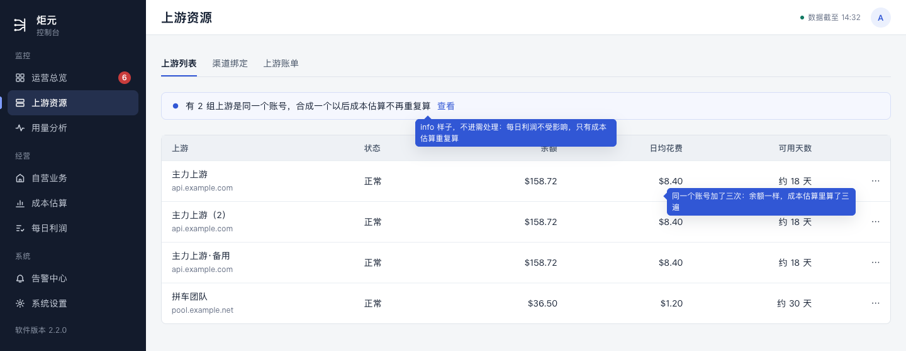
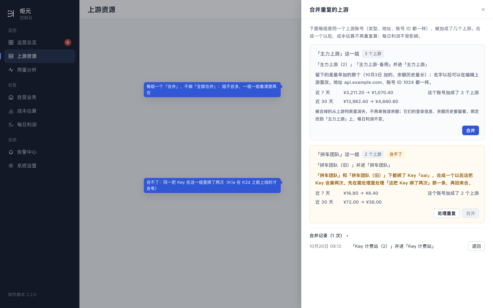
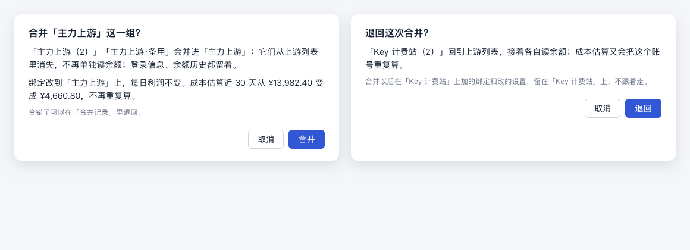

# 合并重复的上游（K1a）设计稿

> 讲什么：同一个上游账号被加成了几个上游（类型、地址、账号 ID 都一样）时，成本估算会把它重复算。K1a 上线只算不改，在上游列表给一张「合并重复的上游」清单，用户看过、确认一组合一组；合错了可以在控制台里退回，不用上服务器。
>
> 现在：已定（用户 10-25 定稿），随 K1a 做。第 7 节的说法（并1–并5）已作为「（新）」进了用语规范 §3.5、§5.4、§8.2、§11。
>
> 依据：
> - 用户 10-25 定：「合并重复上游前先列出受影响的给我看」；也不想上服务器跑脚本。
> - 开发的 K 方案（工作文件，不在仓库里）第八节的事实：按「类型、规范化后的站点地址、账号 ID」分组，一组里不止一个的要合；留创建最早的那个；被合掉的记 `mergedInto`，不轮询、不在列表和成本估算里出现，凭据和余额历史不删；每一步写进 `upstream_merge_log`，能照日志改回；合并前后的成本估算由同一份只读计算给出。
> - [流程梳理稿](./binding-flow.md)第 7.2 节、第 8 节第 3 件：一个上游就是一个账号，已有的数据合并。
>
> 对应规范：用语规范 §3.5、§5.4、§8.1。要新加的说法在第 7 节「拟改条目」（编号「并1」起），用户点头以后先进规范、标「（新）」，再写代码。
>
> 样稿：[k1a-merge.html](./k1a-merge.html)，截图 `screens/merge-up-*.png`。

## 0. 这份设计的六项（ui-design-spec §1.3）和改动大小

| 项 | 写什么 |
|---|---|
| 用户目标 | 同一个账号加重了，成本估算不该算两遍；合之前先看清楚合哪几个、数会怎么变，合错了能退回 |
| 流程 | 上游列表顶上一条「有 2 组上游是同一个账号……」[查看] → 抽屉里一组一行，写清合成哪个、近 7 天和近 30 天的成本估算前后 → 点这一组的「合并」→ 确认框 → 合好，这一组从清单里消失，列表少几行。退回：抽屉最下面「合并记录」里那一行点「退回」→ 确认框。全程不换页、不上服务器 |
| 省掉了什么 | 上服务器跑脚本；自己去比哪几个上游是同一个账号；合了以后自己去对成本估算 |
| 还要用户做的 | 每一组确认一次（§1.2 第 2 条：确认）；合不了的那组先处理掉撞了的那条绑定 |
| 对照原则 | §1.2 第 1 条（哪几个是同一个账号系统认出来，不让人挑）、第 2 条（只确认）、第 3 条（不预先替用户合：用户定的「先列出来给我看」）、第 4 条（就地做完）、第 6 条（不进需处理：每日利润的数不受影响，只是成本估算多算，见第 1 节）；§1.4 第 2 条（同一个数只出现一次：合并前后的数只在清单里写） |
| 版式 | 上游列表顶上一条提示（有要合的才出现）；点开是右边的抽屉（560 宽），一组一张卡片；手机上抽屉从底部升起占满 |
| 改动大小 | 小。页面：一条提示、一个抽屉、两个确认框；服务端 K1a 已经有的只读计算、合并、按日志退回三样，接成三个接口 |

## 1. 为什么不进需处理

- 重复的上游影响的是**成本估算**（同一个账号的花费被几个上游各算一遍），不影响**每日利润**：每日利润按绑定算，一把 Key 的钱只算一次。
- 需处理只放「不处理就算不准」的（§1.2 第 6 条），成本估算多算是「不准」，但它是一次性的清理、不是每天会冒出来的事；放进需处理会一直挂着一条「去合并」。所以只在上游列表和成本估算这两处提一句，不进清单、不推送、不进日报。

## 2. 在哪里出现（样稿 merge-up-list）

- **上游列表页签顶上一条提示**（info 样子，不是警示），有要合的组才出现：「有 2 组上游是同一个账号，合成一个以后成本估算不再重复算」[查看]。
- **成本估算页**：总成本下面一行灰字「其中 1 个账号加成了 2 个上游，这里算了两遍」[去合并]，点了打开同一个抽屉（不跳到上游列表）。这是用户最可能发现「数不对」的地方。
- 只有合不了的组时，提示换成「有 1 组上游是同一个账号，现在还合不了」[查看]。
- 没有要合的、合并记录里也没有东西时，两处都不出现。合过以后，上游列表「⋯」里留一项「合并记录」，打开同一个抽屉（只剩记录那一块）。

## 3. 清单（样稿 merge-up-drawer）

抽屉标题「合并重复的上游」，顶上一句：「下面每组是同一个上游账号（类型、地址、账号 ID 都一样），被加成了几个上游。合成一个以后，成本估算不再重复算；每日利润不受影响。」

一组一张卡片：

| 那一块 | 写什么 |
|---|---|
| 标题 | 「主力上游」这一组 · 3 个上游 |
| 合成哪个 | 「主力上游（2）」「主力上游·备用」并进「主力上游」。留下的是最早加的那个（10月3日 加的，余额历史最长）；名字以后可以在编辑上游里改 |
| 为什么是同一个 | 地址 api.example.com、账号 ID 1024 都一样 |
| 成本估算前后 | 两行：「近 7 天　¥3,211.20 → ¥1,070.40」「近 30 天　¥13,982.40 → ¥4,660.80」。右边一句「同一个账号原来算了 3 遍」 |
| 合了以后 | 一行灰字：「被合掉的从上游列表里消失，不再单独读余额；它们的登录信息、余额历史都留着。绑定改到「主力上游」上，每日利润不变。」 |
| 按钮 | 「合并」（每组一个；不做「全部合并」：组不会多，一组一组看清楚再合） |

- **合不了的组**（同一把 Key 在这一组里绑了两次，合了会撞）：卡片标「合不了」，「合并」按钮灰着，下面写原因和怎么办：「「主力上游」和「主力上游（2）」下都绑了 Key「oai」，合成一个以后这把 Key 会算两次。先在需处理里处理「这把 Key 绑了两次」那一条，再回来合。」按钮「处理重复」（§3.5 现成的，打开它现在打开的地方；K1a 在 K2d 之前上线，那时这个按钮还在。K2d 以后同一把 Key 的几个渠道合成一组，不会再撞，这一种合不了也就没有了）。处理完回到这个抽屉，这一组变成能合。
- **另外几种合不了的**（新，开发 2 在服务端挡下，总指挥 10-25 定照挡）：两个上游设置不一样，合成一个以后不知道该按哪个。卡片同样标「合不了」、「合并」灰着，写清是哪一项不一样、去哪里改；改成一样以后回来就能合。一组有几项都不一样时，一项一行，按钮放第一项的。

  | 哪一项不一样 | 卡片上写 | 按钮 |
  |---|---|---|
  | 两个上游一个在读余额、一个暂停了监控（新） | 「主力上游」在读余额，「主力上游（2）」暂停了监控，合成一个以后不知道该不该接着读。先把两个改成一样（都恢复监控，或者都暂停），再回来合。 | 恢复监控（恢复被暂停的那一个；想都暂停的，在上游列表那一行的「⋯」里暂停另一个） |
  | 一个算进利润、一个不算（新） | 「主力上游」算进利润，「主力上游（2）」不算进利润，合成一个以后不知道该按哪个算。先在编辑上游里把两个改成一样，再回来合。 | 编辑上游（打开不一样的那一个） |
  | 被合掉的那个记了固定成本（新） | 「主力上游（2）」记了固定成本，合掉以后这几笔就不算了。先在「主力上游」上记上同样的固定成本、再从「主力上游（2）」上删掉，再回来合。 | 编辑上游（打开「主力上游（2）」） |
  | 被合掉的那个标了转售 Key（新，很少见：它以前被设成过自营站点） | 「主力上游（2）」上还标着转售 Key，合掉以后这些标记就不算了。先把它上面的转售标记取消，再回来合。 | 没有按钮（这种上游以前被设成过自营站点，标记要在它还是自营站点时取消；说明里写到这里为止，真碰到了请技术同事处理） |
- **成本估算前后的数**：用 K1a 的同一份只读计算，打开抽屉时算一次；算不出来时那两行写「—」，下面一句「成本估算暂时算不出，合并照样能做」，不挡合并。
- **币种**照 G：这一组的上游设了汇率写 ¥，没设写 $。

## 4. 合并（样稿 merge-up-confirm）

点「合并」先弹确认框：

- 标题「合并「主力上游」这一组？」
- 内容：
  - 「「主力上游（2）」「主力上游·备用」会并进「主力上游」：它们从上游列表里消失，不再单独读余额；登录信息、余额历史都留着。」
  - 「绑定改到「主力上游」上，每日利润不变。成本估算近 30 天从 ¥13,982.40 变成 ¥4,660.80，不再重复算。」
  - 「合错了可以在「合并记录」里退回。」
- 按钮「取消」「合并」。
- 合好：提示「已合并，上游列表少了 2 个」；这一组从清单里消失，「合并记录」多一行；上游列表、成本估算跟着刷新。清单空了，抽屉里写「没有要合的上游了。」，上游列表顶上那条提示消失。
- 合并没成（开发方案里是一个事务，要么全做要么不做）：确认框里写「合并没成：原因。什么都没改。」[再试一次]。

## 5. 合并记录和退回

**值不值得做成按钮：值得。**
- 用户不想上服务器；只有脚本能退回的话，「合错了」就只能找人，合之前心里就不踏实，越不踏实越不敢点（§1.2 第 3 条那种「不知道自己做了什么」的反面）。
- 合并本来就逐条写了日志，退回是照日志改回，和服务器上那个脚本是同一段代码，多的只是一个接口和一个确认框。
- 用的人少：一般只在 K1a 上线那一次合，退回更少。所以只放在抽屉最下面，默认收起，不另占地方。

**长什么样**：抽屉最下面一个收起区「合并记录（1 次）」，点开一行一次：

- 「10月25日 14:30　「主力上游（2）」「主力上游·备用」并进「主力上游」」[退回]
- 点「退回」弹确认框：
  - 标题「退回这次合并？」
  - 内容：「「主力上游（2）」「主力上游·备用」回到上游列表，接着各自读余额；成本估算又会把这个账号算两遍。合并以后在「主力上游」上加的绑定和改的设置，留在「主力上游」上，不跟着走。」
  - 按钮「取消」「退回」。
- 退回好：提示「已退回」；那一行写「已退回（10月25日 15:10）」，不再有按钮；这一组回到上面的清单里。
- 退回不了时（例如被合掉的上游后来又被删了）：按钮灰着，悬停写原因，例如「「主力上游（2）」已经删了，退回不了」。

## 6. 和「渠道」页签那个合并的分工

一个功能只做一处：

- **这里**：类型、地址、账号 ID 都一样，系统认得出的重复，在上游列表的这个清单里合。
- **K2d「渠道」页签**：只留「换过域名、自动合不了」那种手动合（同一个面板用了两个地址，系统认不出是同一个），在那里由人指认。那边的确认框和合并记录用这里同一个组件、同一套说法，记录也记在同一个「合并记录」里。

## 7. 拟改条目

用户 10-25 点头，已经进了用语规范，标「（新）」；编号作废。下面留着备查。

**ui-copy-spec.md**

- **并1（§3.5 加三行）**：

  | 按钮 | 用在哪 | 完成提示 | 不再用 |
  |---|---|---|---|
  | 查看 / 去合并 | 上游列表顶上「有 2 组上游是同一个账号……」、成本估算总成本下面那一行，打开「合并重复的上游」抽屉 | —— | 去处理重复上游 |
  | 合并 | 抽屉里每一组一个，先弹确认框 | 已合并，上游列表少了 2 个 | 合并账号、去重 |
  | 退回 | 「合并记录」里每一次一个，先弹确认框 | 已退回 | 撤销合并、回滚 |

- **并2（§5.4 提示类加两行）**：

  | 提示 | 按钮 | 系统码（开发用） |
  |---|---|---|
  | 上游列表顶上「有 2 组上游是同一个账号，合成一个以后成本估算不再重复算」；只有合不了的组时「有 1 组上游是同一个账号，现在还合不了」 | 查看 | 开发定（K1a） |
  | 成本估算总成本下面「其中 1 个账号加成了 2 个上游，这里算了两遍」 | 去合并 | 同上 |

- **并3（§11 区块名）**：抽屉标题「合并重复的上游」；收起区「合并记录（N 次）」；上游列表「⋯」里那一项「合并记录」。
- **并4（抽屉里的字，放在 §5.4 那两行下面）**：抽屉顶上那句、一组卡片里的几块（第 3 节的表）、合不了的原因、两个确认框（第 4、5 节）、清单空了时「没有要合的上游了。」、成本估算算不出时那句、退回不了时的原因。
- **并5（§8.2 报错）**：「合并没成：原因。什么都没改。」[再试一次]；「退回没成：原因。什么都没改。」[再试一次]。

**ui-design-spec.md**

- **§5.2 上游资源 · 上游列表**：顶上一条提示（有要合的才出现）和「合并重复的上游」抽屉；「⋯」里「合并记录」。
- **§5.5 成本估算**：总成本下面那一行。

## 8. 给开发的几点（只说页面要什么，不定怎么做）

- **三个接口**，都用 K1a 已经有的东西：
  - 读清单：要合的组（每组留哪个、合掉哪几个、为什么是同一个、能不能合和原因、近 7 天和近 30 天成本估算的前后），加上合并记录。只读，打开抽屉时读一次；上游列表和成本估算只要「有几组、能不能合」两个数，跟着现有的读法带回来，不另起轮询。
  - 合并一组：一个事务；只合这一组，带上读清单时这一组的成员（成员变了就拒绝，报「这条已经变了，刷新后再看」，§8.2 现成的）。
  - 退回一次：照 `upstream_merge_log` 改回，和 `db/k-unmerge.js --apply` 同一段代码；先检查退得回（被合掉的上游还在等），退不回给原因。
- **合不了**：这一组里有两个上游下绑了同一把 Key（`canonical_key` 撞）时不让合，给出是哪把 Key、在哪两个上游下。
- **成本估算前后的数**：K1a 那份只读计算；算得慢时（上游多）先出清单，数后到，那两行先显示加载。
- **权限**：合并、退回都写库，走现有的登录和 CSRF，和编辑上游一样。
- **界面测试的夹具**：没有要合的；两组能合；一组合不了（Key 撞）；合并以后有一条记录、退回；退回不了；成本估算算不出。

## 9. 验收清单（给审核与测试）

1. 没有重复的上游：上游列表、成本估算都没有那条提示，「⋯」里没有「合并记录」。
2. 有两组能合：上游列表顶上「有 2 组上游是同一个账号……」[查看]；成本估算总成本下面那一行 [去合并]；两处打开同一个抽屉。
3. 抽屉里每组写清留哪个（最早加的）、合掉哪几个、为什么是同一个、近 7 天和近 30 天成本估算前后；没有「全部合并」。
4. 合不了的组：标「合不了」，「合并」灰着，写清是哪把 Key 在哪两个上游下撞了，有「处理重复」。另外几种（监控状态、算不算进利润、固定成本、转售 Key 不一样）照第 3 节那张表写，改成一样以后回来能合。
5. 点「合并」：确认框照第 4 节；合好以后提示「已合并，上游列表少了 2 个」，被合掉的从上游列表、成本估算里消失；每日利润的数一模一样；成本估算近 30 天等于清单里写的「后」那个数。
6. 合并记录里有这一次；点「退回」，确认框照第 5 节；退回以后被合掉的回到上游列表、接着读余额，这一组回到清单里。
7. 被合掉的上游后来删了：「退回」灰着，悬停写原因。
8. 合并、退回都不用上服务器。
9. 手机 390：抽屉从底部升起占满；每组一张卡片；按钮 44 高。
