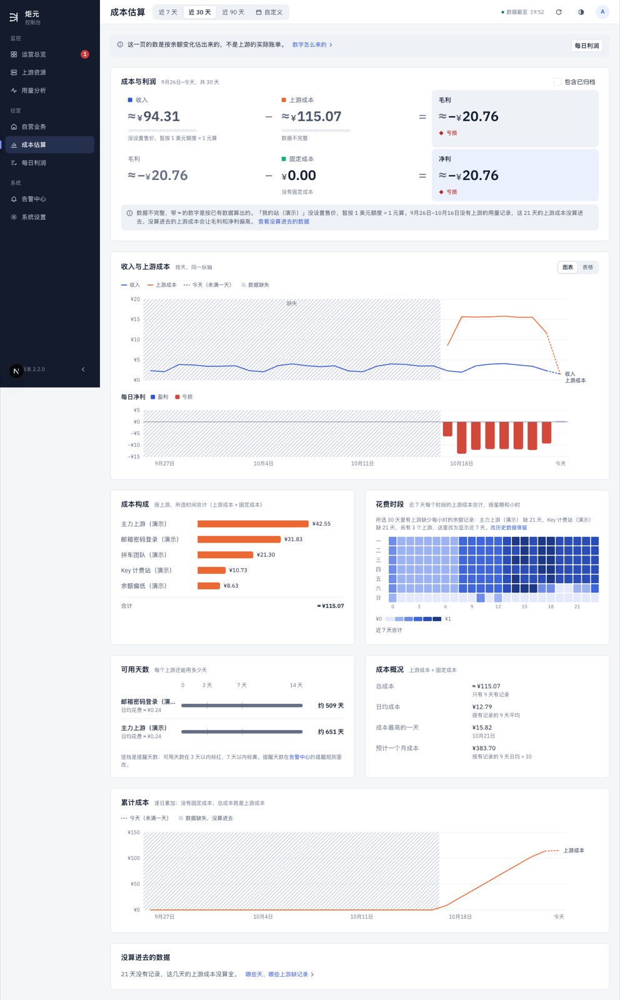
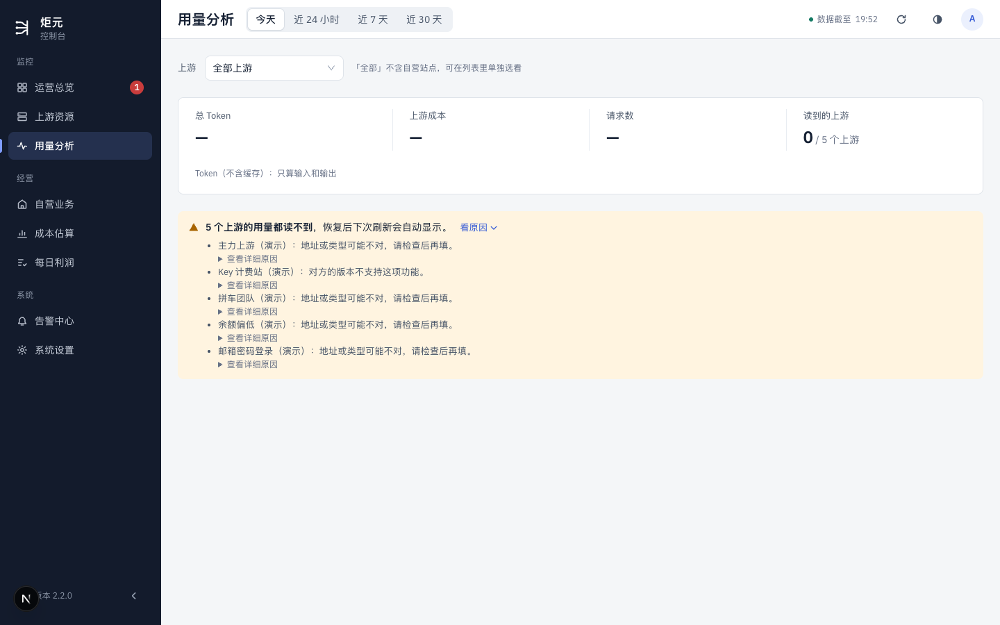
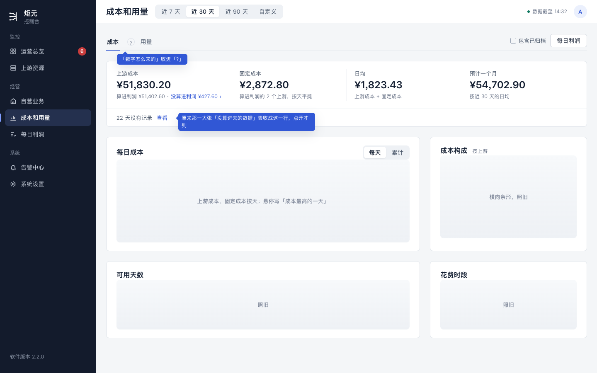
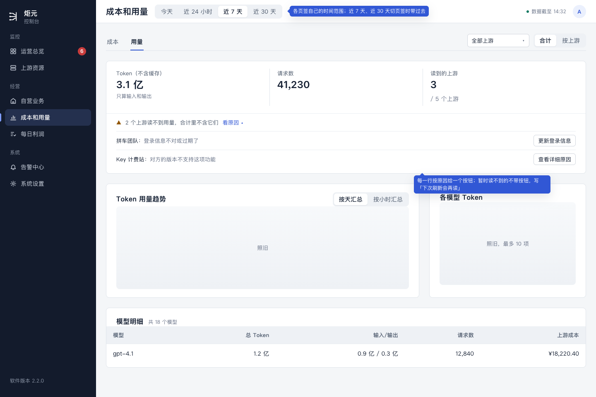

# 成本和用量合页设计稿

> 讲什么：用量分析并进成本估算，变成一页「成本和用量」、两个页签「成本」「用量」：两个页签各回答什么、现在的每一块去哪、从哪里点进来落在哪个页签、地址怎么改、旧地址跳到哪。
>
> 现在：草稿，等用户看。2026-10-25，UI/UX 设计会话。随「合页」做，排在 G 之后。
>
> 依据：
> - [体检](../ui-audit.md) §8.4 第 4 件（用户 10-24 定）：用量分析并进成本估算，做成两个页签；§8.3 用量分析、成本估算两节；
> - [逐页版式](./page-layouts.md)第 6 节：合页以后两个页签各放什么；
> - [G 等式只放两处](./g-equation.md)第 5.2 节（用户 10-25 定）：「成本」页签第一行四格、上游成本拆成两半、去掉等式和两张利润图。
>
> 对应规范：用语规范 §3.4、§8.1、§8.4、§11，设计规范 §2.2（侧栏）、§5.4、§5.5。要新加的说法在第 9 节「拟改条目」（编号「合1」起）。
>
> 样稿：[merge-cost-usage.html](./merge-cost-usage.html)，截图在 `screens/merge-*.png`；「现在」的截图 `screens/merge-now-*.png` 是在自己的预览（3200、演示数据）里截的。演示上游读不到用量（演示数据的限制，不是产品问题），所以用量那张是「都读不到」的样子。

## 0. 这份设计的六项（ui-design-spec §1.3）和改动大小

| 项 | 写什么 |
|---|---|
| 用户目标 | 想知道「钱和量花在哪些上游、模型上，还能用几天」时，只去一个地方 |
| 流程 | 改前：成本在「经营」组的成本估算，Token 在「监控」组的用量分析，两页各有一套时间范围；用量分析的「上游成本」一格和成本估算重；用量分析读不到时只有一句话、没有按钮，哪里也去不了。改后：侧栏一项「成本和用量」，一页两个页签，点进来是「成本」，切到「用量」不换页、时间范围能带过去的就带过去；读不到的每一行有一个去处按钮 |
| 省掉了什么 | 侧栏少一项；在两页之间来回跳；用量页那一格重复的上游成本；成本页那一长段「数字怎么来的」和一大张「没算进去的数据」表（收成一行） |
| 还要用户做的 | 只是看；读不到用量时点那一行的按钮去处理 |
| 对照原则 | §1.2 第 4 条（一个目标一条路：「花在哪」一个入口）、第 5 条（先结论，说明收起）；§1.4 第 1 条（一页回答一个问题，两个页签是同一个问题的两面）、第 2 条（同一个数一页只出现一次：上游成本只在「成本」页签）、第 3 条（8 + 4 分栏） |
| 版式 | 页顶：页名、时间范围、刷新；下面一排页签「成本」「用量」。每个页签：第一行指标，第二、三行 8 + 4。手机：页签在顶，指标两列小格，图一张一屏 |
| 改动大小 | 中。一个路由装两个页签，旧地址跳转；侧栏、页面名改；用量页签的内容基本照搬，成本页签照 G 第 5.2 节。服务端不改，两个页签各读各的接口 |

## 1. 用户要达到什么、现在什么样

财务、运营问「钱和量花在哪」，现在要看两页：

- **成本估算**（`/analytics`，侧栏「经营」组）：一页 2300 多高，从上到下是数字怎么来的、利润等式、收入与上游成本图、每日净利图、成本构成、花费时段、可用天数、成本概况、累计成本图、没算进去的数据。G 已经定了去掉等式和两张利润图。
- **用量分析**（`/usage`，侧栏「监控」组）：上游筛选、四格合计（总 Token、上游成本、请求数、读到的上游）、读不到的上游、Token 用量趋势、各模型 Token、模型明细。





问题：

1. 同一个问题分在两页、两个侧栏分组里，时间范围也不一样（成本：近 7 / 30 / 90 天、自定义；用量：今天、近 24 小时、近 7 / 30 天）。
2. 用量页的「上游成本」一格和成本页重，两边的数还不一定一样。
3. 用量页读不到时只写「地址或类型可能不对，请检查后再填」，没有按钮（体检 §8.3）。
4. 成本页说明太多：顶上一段、等式下面一段、最下面一张表。

## 2. 一页两个页签

| 页签 | 回答 | 第一行 |
|---|---|---|
| **成本**（默认） | 钱花在哪些上游，还能用几天 | 上游成本、固定成本、日均、预计一个月（G 第 5.2 节） |
| **用量** | Token 和请求用在哪些上游、模型上 | Token、请求数、读到的上游 |

- 两个页签是同一个问题的两面（钱、量），所以放在一页，不各占侧栏一项。
- **金额只在「成本」页签。**「用量」页签的第一行不再有「上游成本」那一格（§1.4 第 2 条）；模型明细表里每个模型的上游成本那一列留着，那是按模型拆开的，成本页签没有。
- 页名「成本和用量」（逐页版式第 6 节已经这样叫），侧栏一项，放在「经营」组，原来「成本估算」的位置；「监控」组的「用量分析」去掉。

## 3. 页顶（样稿 merge-cost、merge-usage）

```
成本和用量   [近 7 天 | 近 30 天 | 近 90 天 | 自定义]          数据截至 14:32  ⟳
─────────────────────────────────────────────────────────────
成本  用量                                          ☐ 包含已归档   [每日利润]
```

- 顶栏：页名、这个页签的时间范围、数据截至、刷新（和别的页一样）。
- 顶栏下面一排页签，右边放这个页签自己的东西：
  - 成本：「包含已归档」、「每日利润」按钮（G 第 5.2 节：去看利润的路）；
  - 用量：上游筛选、「合计 / 按上游」（现在就有，照搬）。
- **两个页签各有自己的时间范围**，不硬合成一套：
  - 成本：近 7 天、近 30 天（默认）、近 90 天、自定义。按天算，没有「今天」「近 24 小时」。
  - 用量：今天（默认）、近 24 小时、近 7 天、近 30 天。要读上游的逐条用量，90 天和自定义太重（第 10 节），不加。
  - **切页签时能带过去的就带过去**：两边都有的是近 7 天、近 30 天，选着这两个切页签，范围不变；选着别的，切过去用那个页签的默认。顶栏的选项跟着页签换，不会出现选不了的。
- 「数字怎么来的」收进页签名旁的「?」，点开才看（逐页版式第 6 节；体检 §7.16）。

## 4. 「成本」页签（样稿 merge-cost）



照 G 第 5.2 节和逐页版式第 6 节，现在的每一块去哪：

| 现在（成本估算） | 合页以后 |
|---|---|
| 顶上「这一页的数是按余额变化估出来的……」「数字怎么来的」 | 收进页签名旁「?」 |
| 利润等式 | 去掉（G） |
| 收入与上游成本图、每日净利图 | 去掉（G：按天看利润在每日利润） |
| 成本概况（总成本、日均、最高一天、预计一个月） | 挪上来当第一行四格：上游成本、固定成本、日均、预计一个月。「成本最高的一天」放进每日成本图的悬停里 |
| 累计成本图 | 并进每日成本图，右上角切「每天 / 累计」 |
| 成本构成 | 第二行右边 4 列，照旧 |
| 可用天数 | 第三行左边 8 列，照旧 |
| 花费时段 | 第三行右边 4 列，照旧 |
| 没算进去的数据（一大张表） | 收成第一行下面一行「22 天没有记录 [查看]」，点开才列表 |
| 包含已归档 | 页签那一排右边 |

第一行四格的说法照 G 第 5.2 节（上游成本拆成「算进利润 · 没算进利润」两半写，固定成本「算进利润的 2 个上游，按天平摊」，日均和预计一个月没设置汇率时写「—」）。

## 5. 「用量」页签（样稿 merge-usage）



| 现在（用量分析） | 合页以后 |
|---|---|
| 上游筛选、「合计 / 按上游」 | 页签那一排右边，照旧（「全部」不含自营站点那句放进筛选的下拉里） |
| 四格合计：总 Token、上游成本、请求数、读到的上游 | 三格：Token、请求数、读到的上游。上游成本去掉（在成本页签） |
| 读不到的上游（一整块黄底，按上游列原因） | 收成第一行下面一行「5 个上游读不到用量 [看原因]」（逐页版式第 6 节）；展开以后**每一行带一个去处按钮**（合2，体检 §8.3 建议 1） |
| Token 用量趋势（按小时 / 按天，图表 / 表格） | 第二行左边 8 列，照旧 |
| 各模型 Token | 第二行右边 4 列，照旧 |
| 模型明细 | 第三行 12 列，照旧（每个模型的上游成本那一列留着；单独看自营站点时那一列叫「消费」，照旧） |

读不到的每一行给什么按钮（按 §8.2 的原因，取 §3.5 现成的按钮）：

| 原因 | 按钮 |
|---|---|
| 登录信息不对或过期了；令牌作废、少了权限 | 更新登录信息 |
| 地址或类型可能不对 | 编辑上游 |
| 对方的版本不支持这项功能 | 查看详细原因（没有能做的事，§5.2 现成的那一行） |
| 暂时读不到（网络、超时） | 没有按钮，写「下次刷新会再读」 |

## 6. 从哪里点进来、落在哪

| 从哪 | 现在去 | 合页以后落在 |
|---|---|---|
| 侧栏「成本和用量」 | —— | 成本页签，近 30 天 |
| 运营总览等式里的「上游成本」 | 成本估算 | 成本页签，带上总览的时间范围：近 7 天、近 30 天照搬；「今天」成本页签没有，落近 7 天 |
| 自营业务 · 每日收入图下面那句「……去成本估算看上游成本」里的链接 | 成本估算，带范围 | 成本页签，带范围（同上）；链接名跟着改成「成本和用量」 |
| 每日利润页顶「成本估算」按钮 | 成本估算 | 按钮名改「成本和用量」，落成本页签（E 以后这个按钮还在页顶次要按钮里） |
| 旧地址 `/usage`（书签、日报以外的旧链接） | 用量分析 | 跳到用量页签，带上原来的 range、station、group |
| 旧地址 `/analytics` | 成本估算 | 不变，就是成本页签 |

日报、推送里没有链到这两页的地方（查过 `server/`），不用改。

## 7. 地址

- 页面还是 `/analytics`，页签用 `tab` 参数：`/analytics`（成本）、`/analytics?tab=usage`（用量）。沿用现有地址，书签和总览的链接都不用改；页签用参数而不是新路径，是因为两个页签共用一个页顶和一套刷新。
- 时间范围照旧用 `range`（成本页签还有 `start`、`archived`；用量页签还有 `station`、`group`）。同一个 `range` 在两个页签里的取值不一样，按 `tab` 解读；切页签时照第 3 节带过去或换成默认。
- `/usage` 永久跳到 `/analytics?tab=usage`，原来的参数原样带上。
- 页面标题：「成本和用量 · 炬元」，两个页签一样。

## 8. 手机

- 顶栏：页名、时间范围（横滑）、刷新。
- 页签在顶栏下面一排，「包含已归档」「每日利润」、上游筛选和「合计 / 按上游」收进页签右边的「筛选」里。
- 指标两列小格；图一张一屏；表格转列表（逐页版式第 6 节）。

## 9. 拟改条目

写法照规范原来的格式，进规范以后编号作废。

**ui-copy-spec.md**

- **合1（§11 页面名那张表）**：「用量 · 用量分析 · 不改」「估算 · 监控估算 · 成本估算」两行合成一行「成本和用量 · 用量分析、成本估算 · 成本和用量（两个页签：成本、用量）」。标签页那张表：「用量分析」「成本估算」两行合成「成本和用量」一行：页签「成本」「用量」；区块名照原来两行（各模型 Token、花费时段、没算进去的数据、数字怎么来的……）。每日利润页顶那个按钮的名字跟着改成「成本和用量」。
- **合2（§8.4 读不到的上游那一条后面）**：展开的每一行带一个去处按钮，按原因取：「更新登录信息」「编辑上游」「查看详细原因」；暂时读不到的不带按钮，写「下次刷新会再读」。
- **合3（§8.4）**：「没算进去的数据」收成一行「22 天没有记录 [查看]」；「读不到的上游」收成一行「5 个上游读不到用量 [看原因]」。（逐页版式第 6 节说过，这里定字。）

**ui-design-spec.md**

- **§2.2 侧栏**：「监控」组去掉「用量分析」；「经营」组「成本估算」改成「成本和用量」。
- **§5.4、§5.5**：合成一节「成本和用量 `/analytics`」，写两个页签各放什么（第 4、5 节）、页签那一排右边放什么、切页签带不带时间范围（第 3 节）。

**lib/brand.js 的 `NAV_LABELS`**（不是规范，随合页的 PR 改）：`analytics` 改「成本和用量」，`usage` 删掉。

## 10. 给开发的几点（只说页面要什么，不定怎么做）

- **只读当前页签的数据。**打开成本页签不读用量接口，切到用量页签才读；切回来用已经读过的（各自现在就有缓存）。
- **打包**：两页合成一个路由，首屏不能把两个页签的代码都带上。用量页签的组件按需加载，首屏（成本页签）的大小不比现在的成本估算大 30 KB 以上（性能门槛）。
- **跳转**：`/usage` 在服务端永久跳转（带参数），不在页面里先渲染再跳。
- **侧栏**：`lib/nav.js` 去掉 `usage` 一项；`analytics` 的标签改名。侧栏「需处理」的数字和这一页无关，不动。
- **不改接口**：成本页签照 G 读它要的，用量页签读 `/api/usage`。
- **性能**：用量页签的时间范围不加 90 天和自定义：逐条用量的读法按小时、按天聚合，范围越长越重，现在最长 30 天。这次不改接口，也就不加。
- **界面测试**：原来两页的用例并到一处；加三条：切页签时近 7 天带过去、今天切到成本变近 30 天；`/usage?range=7d&station=…` 跳到用量页签并保留参数；读不到的每一行按钮对。

## 11. 验收清单（给审核与测试）

1. 侧栏只有一项「成本和用量」，在「经营」组；「监控」组没有「用量分析」。
2. 点侧栏落在成本页签、近 30 天；页面标题「成本和用量 · 炬元」。
3. 成本页签：第一行四格（照 G）；没有等式、收入与上游成本图、每日净利图、累计成本图（并进每日成本图的「累计」）、成本概况块；「没算进去的数据」只有一行，点开才列；「数字怎么来的」在「?」里。
4. 用量页签：第一行三格，没有「上游成本」；读不到的上游一行，展开后每一行的按钮照第 5 节的表；趋势、各模型、模型明细和现在一样。
5. 成本页签选近 7 天切到用量：还是近 7 天。用量页签选今天切到成本：变成近 30 天。
6. 打开 `/usage?range=7d&group=upstream`：落在用量页签，近 7 天、按上游。
7. 运营总览点「上游成本」：落成本页签，带上总览的范围（今天落近 7 天）。每日利润页顶的按钮叫「成本和用量」。
8. 只打开成本页签时，网络里没有 `/api/usage` 的请求；切到用量才有。
9. 手机 390：页签在顶；筛选收进「筛选」；指标两列。
