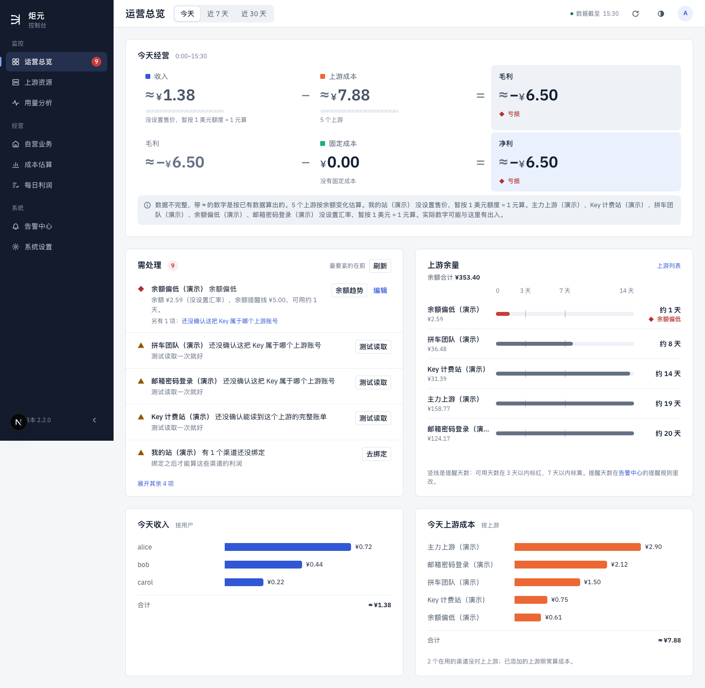
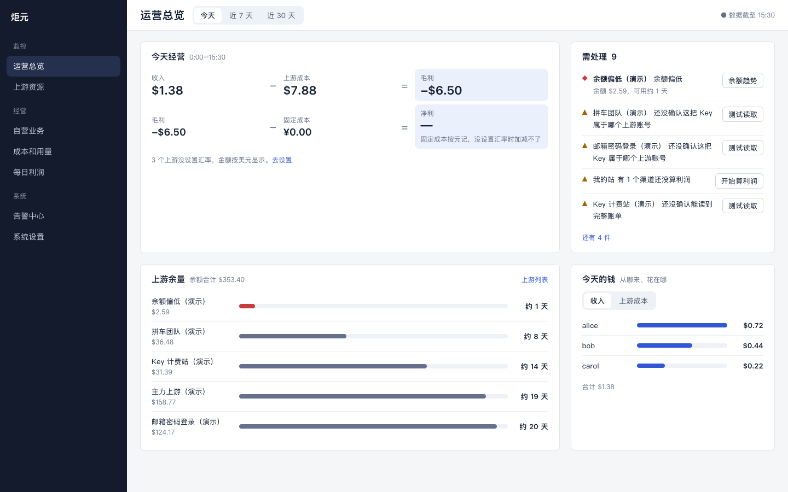
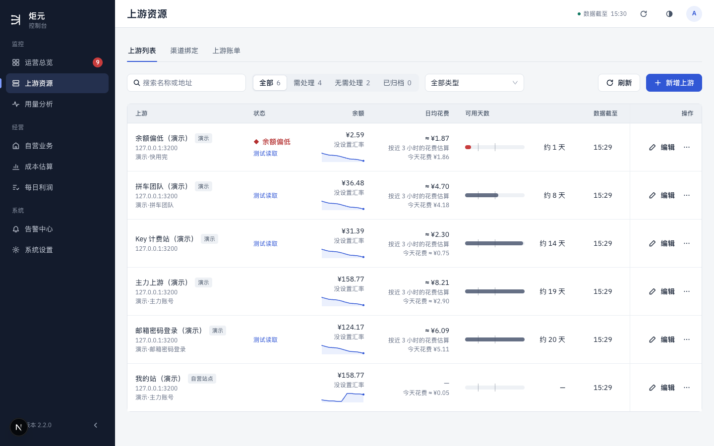
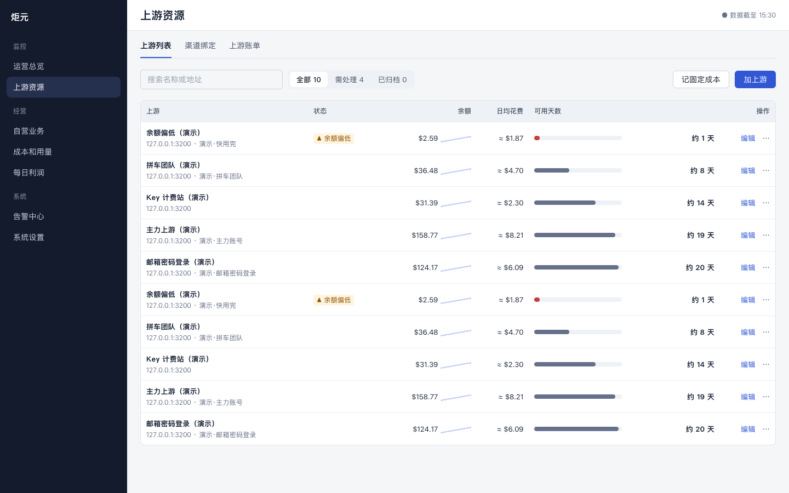
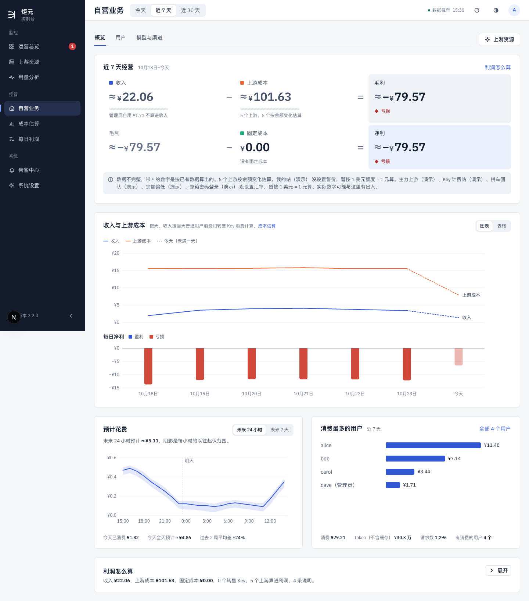
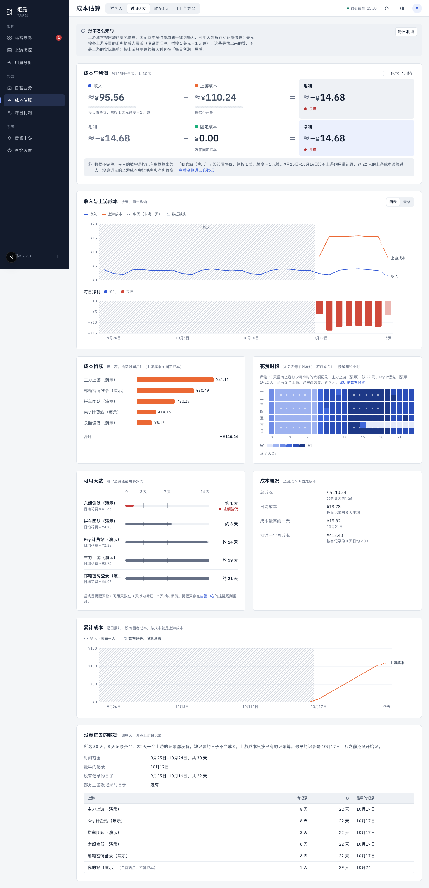
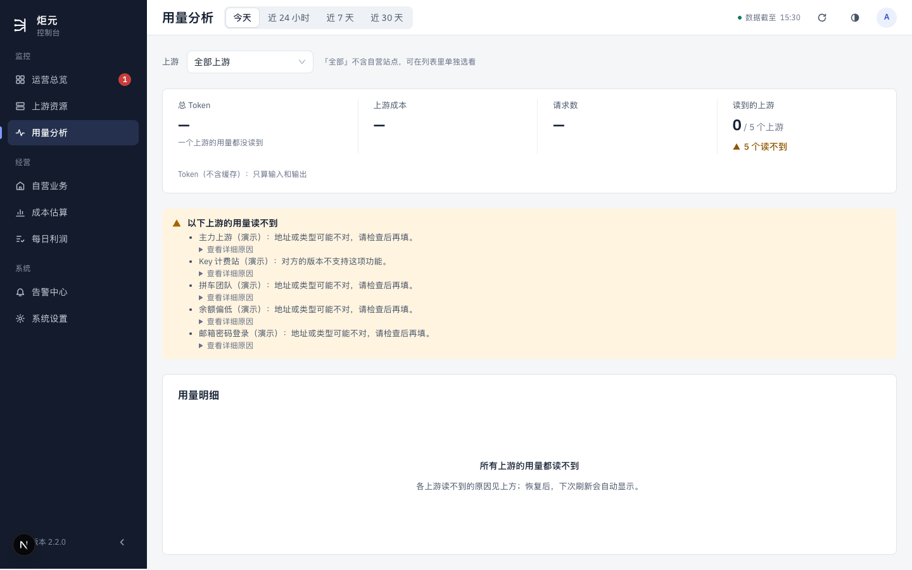
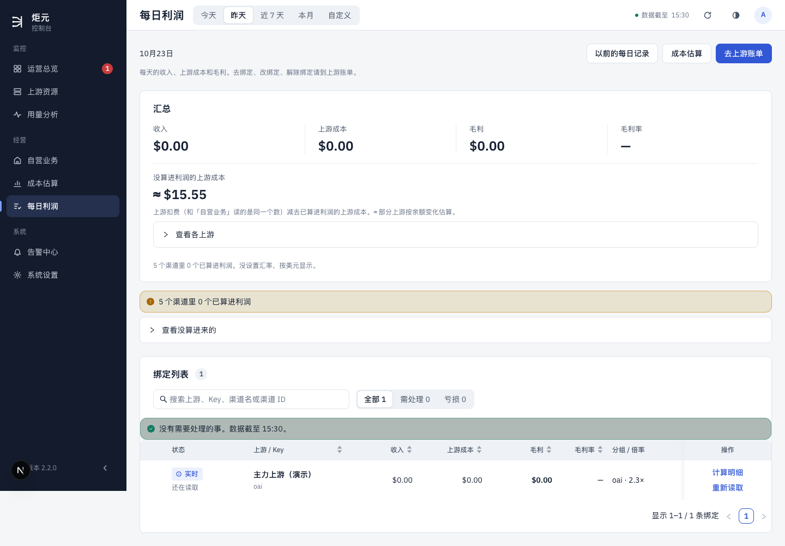
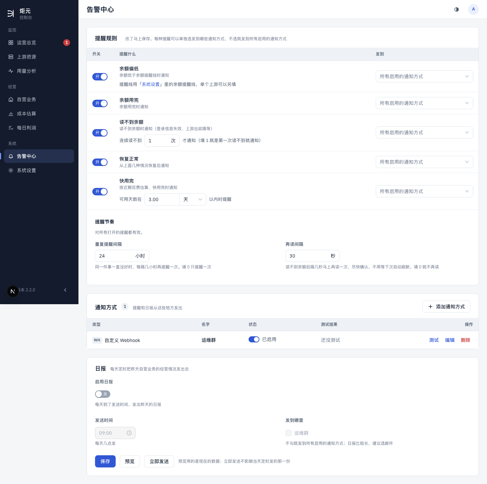
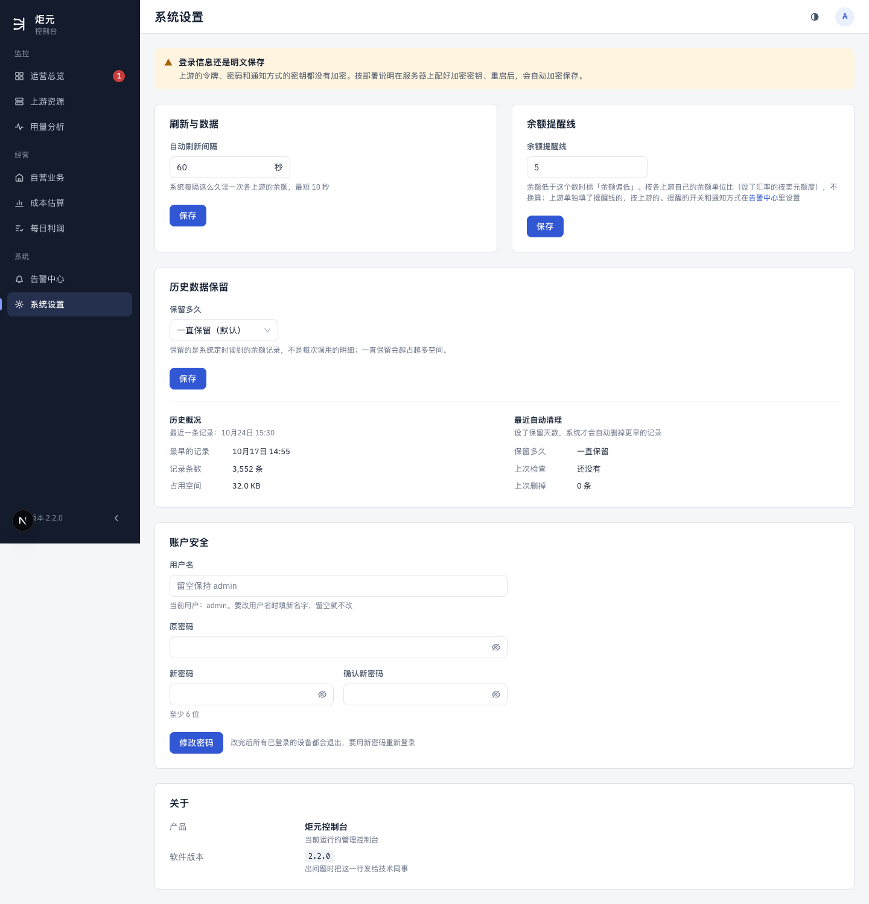

# 逐页版式设计

> 讲什么：每一页的版式还要怎么改、随哪个 PR（第 0–10 节），已经做了哪些版式 PR（第 12 节）。
>
> 现在：已定，随 K、E、F、G、第一次使用、合页各自的 PR 做；版式 PR 1–5 已经全部做完（第 12 节）。第 3、4 节已经被[流程梳理稿](./binding-flow.md)取代。
>
> 对应规范：[设计规范](../ui-design-spec.md) §1.2、§1.3、§1.4、§5 各页；来自[体检](../ui-audit.md) §8（用户定的 5 件：开始使用清单、自营站点就地设置、等式只放两处、成本和用量合页、告警一处设完）。
>
> 每页写清：这页回答什么问题；首屏放什么，收起或挪走什么；桌面 1440 怎么分栏，手机 390 怎么排；对照了 §1.4 哪几条；每条改动的大小，和随哪个 PR 做。
>
> 改动大小三档：**只改样式**（间距、字号、颜色、收起）；**改版式**（分栏、挪位置、合并块）；**改结构**（合页、拿掉整块、换组件）。
>
> 截图：现状在 `screens/layout-now-{d|m}-*.png`（d 是桌面 1440，m 是手机 390，都是自己的预览、演示数据，1 条绑定）；改后在 `screens/layout-*.png`，样稿 [page-layouts.html](./page-layouts.html)。
>
> 「随哪个 PR」的代号：K 绑定跟着 Key 走；E 需处理清单；F 多天拼装；G 金额币种和成本口径；第一次使用；合页：成本和用量合成一页；版式 PR：只动页面的小 PR。

## 0. 全站一起改的

| 改动 | 为什么（§1.4） | 大小 | 随哪个 PR |
|---|---|---|---|
| 内容区按 12 列栅格排：主角 8 列、旁边 4 列；两块一样重要时各 6 列 | 第 3 条：用好空间 | 改版式 | 版式 PR（各页分开做） |
| 面板标题旁的说明一行；多的收进标题旁的「?」 | 第 4 条 | 只改样式 | 版式 PR |
| 「≈」那段长说明，各页都改成一行：「3 个上游没设置汇率，金额按美元显示。」[去设置] | 第 2、4 条；G 的币2 | 只改样式 | G |
| 表格行紧凑到两行字（行高 56 以内）、数字对齐 | 第 5 条 | 只改样式 | 版式 PR |
| 空状态、还没设置：在原位一句话一个按钮 | 第 8 条 | 只改样式 | 第一次使用 |

桌面 1440 宽时，侧栏 232，内容区约 1160 宽。12 列每列约 76，间距 24。

## 1. 运营总览 `/`

**回答**：今天怎么样，有什么要我处理。

**现在**：
- 等式占满一整行。下面那段 ≈ 说明有两行，把所有没设置汇率的上游名字连在一起，比等式还长。
- 需处理、余量各占半行。
- 今天收入、今天上游成本两块各占半行，排在最下面；收入那块只有 3 行，下面一大片空白。

**改后**（样稿 L-A）：

- 第一行：
  - 没做完「开始使用」时，清单在最上面（第一次使用）；
  - 下面是等式 8 列 + 需处理 4 列并排。需处理按等式那块的高度露前几条（版式 PR 3 定：1440 宽时 2 条），其余写「还有 7 件」，两块底边对齐（§1.4 第 3 条「同一行的两块高度要接近」）。
- 第二行：上游余量 8 列 + 「今天收入和上游成本」4 列（版式 PR 3 定名，草稿叫「今天的钱」）。收入、上游成本合成一块，上下两小段，各列前 3，和余量的五行差不多高（不用页签：页签会让一半的数藏起来，块又矮一截）。
- ≈ 说明一行（G）。

**手机**（样稿 L-A 手机）：
- 需处理在前（#56 已做）；
- 等式两行一格；
- 余量；
- 收入 / 上游成本合成一块，默认收起。

| 改动 | 原则 | 大小 | 随哪个 PR |
|---|---|---|---|
| 等式 8 + 需处理 4 并排 | 1、2、3 | 改版式 | 版式 PR |
| 收入、上游成本合成一块，上下两小段各前 3 | 2、3 | 改版式 | 版式 PR |
| ≈ 说明一行 | 4 | 只改样式 | G |
| 开始使用清单 | §1.2 第 4 条 | 改结构 | 第一次使用 |
| 需处理就地做完、数字处处一样 | §1.2 第 4、6 条 | 改结构 | E |

## 2. 上游资源 · 上游列表 `/stations`

**回答**：每个上游还剩多少钱、能用几天。

**现在**：
- 一行三行字、近 100 高，一屏只看得到 6 行。
- 「状态」一列放的是「测试读取」链接。
- 「数据截至」一列每行都是同一个时刻（顶栏已经有了）。
- 「没设置汇率」每行重复一次。
- 自营站点也在列表里。

**改后**（样稿 L-B）：

- 一行两行字（名字 + 地址；余额 + 迷你趋势同一行），行高 56，一屏 10 行以上。
- 列：上游、状态、余额、日均花费、可用天数（条 + 天数）、操作。
  - 去掉「数据截至」一列：和顶栏重复，只在某个上游读得比别的旧时，在那一行标一个小钟和时刻。
- 「状态」只放状态标签；「测试读取」这类要处理的事放到行末，做成看得见的按钮，「编辑」挪进「⋯」（版式 PR 2 审核定：「⋯」里的事要先猜到才会去点）；以后照 E 进需处理。
- 「按近 3 小时的花费估算」挪进日均花费的悬停。
- 自营站点不在这里（第一次使用）。
- 「加上游」主按钮；「记固定成本」次按钮（第一次使用）。

**手机**：一个上游一张卡片两行（名字 + 状态；余额 · 可用天数），点开看详情（§4.7 现有规则）。

| 改动 | 原则 | 大小 | 随哪个 PR |
|---|---|---|---|
| 行高 56、两行字 | 5 | 只改样式 | 版式 PR |
| 去掉「数据截至」列 | 2、3 | 改版式 | 版式 PR |
| 状态列只放状态 | 2 | 只改样式 | 版式 PR |
| 「没设置汇率」不每行写 | 2 | 只改样式 | G |
| 自营站点拿出去；加上游、记固定成本 | §1.2 第 1、4 条 | 改结构 | 第一次使用 |

## 3. 上游资源 · 渠道绑定 `?view=onboarding`

见[流程梳理稿](./binding-flow.md)第 4 节「落在哪几个页面」：这个页签以后和「上游账单」合成「渠道」一个页签，随 K2d 做。

## 4. 上游资源 · 上游账单 `?view=bills`

见[流程梳理稿](./binding-flow.md)第 4 节「落在哪几个页面」：以后和「渠道绑定」合成「渠道」一个页签，随 K2d 做。

## 5. 自营业务 `/my`

**回答**：钱从哪些用户、模型、渠道来。

**现在**：
- 首屏是完整的利润等式加两行 ≈ 说明（和运营总览、成本估算重复）。
- 「收入与上游成本」图占满一行。
- 预计花费、消费最多的用户各半行；用户那块下面空着三分之一。
- 右上角一个「上游资源」按钮，和这页的问题无关。

**改后**（样稿 L-E）：
- **第一行指标**：收入、消费的用户、请求数、Token。最后一格写「这段时间毛利 $X」，点去每日利润（等式只放两处，G）。
  - 分两步做（总指挥 10-25 定）：版式 PR 4 先放等式里没有的三格（有消费的用户、请求数、Token），等式照旧在下面；G 把 /my 的等式拿掉、让毛利和每日利润同源时，再补「收入」和「这段时间毛利」两格。
- **第二行**：每天的收入 8 列（只画收入和用户数；上游成本在每日利润、成本页看）+ 消费最多的用户 4 列。
- **第三行**：预计花费 8 列 + 模型前 5 4 列。
- 「利润怎么算」收起留在最下面。
- 右上角改成「自营站点设置」（第一次使用）。

**手机**：
- 指标两列小格；
- 收入图；
- 用户前 5；
- 预计花费；
- 「利润怎么算」收起。

| 改动 | 原则 | 大小 | 随哪个 PR |
|---|---|---|---|
| 等式换成指标行 + 一句毛利 | 1、2 | 改结构 | G |
| 收入图 8 + 用户 4、预计花费 8 + 模型 4 | 3 | 改版式 | 版式 PR |
| 右上角「自营站点设置」 | §1.2 第 4 条 | 只改样式 | 第一次使用 |

## 6. 成本和用量（成本估算、用量分析合页）`/analytics`

**回答**：钱和量花在哪些上游、还能用几天。

**现在**：
- 成本估算：
  - 顶上一段三行「数字怎么来的」；
  - 一个完整等式（重复）；
  - 收入与上游成本图、每日净利图；
  - 成本构成、花费时段、可用天数、成本概况；
  - 累计成本图（和每日图说的是同一件事）；
  - 最下面一张「没算进去的数据」大表。
  
  整页 3000 高。
- 用量分析：一整块黄底列着 5 个上游读不到的原因，把用量表挤到第二屏；「上游成本」和成本估算重复。

**改后**（样稿 L-F）：一页两个页签「成本」「用量」（合页）。
- **成本**页签：
  - **第一行指标**：上游成本、固定成本、日均、预计一个月。原来的「成本概况」挪上来；不放收入、毛利（等式只放两处）。
  - **第二行**：每日成本图 8 列（右上角切「每天 / 累计」，累计成本图并进来）+ 成本构成 4 列。
  - **第三行**：可用天数 8 列 + 花费时段 4 列。
  - 「数字怎么来的」收进标题旁「?」；「没算进去的数据」收成一行「22 天没有记录 [查看]」。
- **用量**页签：
  - 第一行指标：Token、请求数、读到的上游；
  - 第二行：Token 用量趋势 8 列 + 各模型 Token 4 列；第三行：模型明细 12 列（[合页设计稿](./merge-cost-usage.md)第 5 节）；
  - 读不到的上游收成一行「5 个上游读不到用量 [查看]」，展开才列原因。

**手机**：指标两列小格；图一张一屏；表格转列表。

| 改动 | 原则 | 大小 | 随哪个 PR |
|---|---|---|---|
| 两页合成一页两个页签；侧栏「用量分析」「成本估算」合成「成本和用量」 | 1、2 | 改结构 | 合页（G 之后） |
| 等式拿掉，指标行放成本 | 2 | 改结构 | G |
| 累计成本并进每日图 | 2 | 改版式 | 合页 |
| 「数字怎么来的」「没算进去的数据」「读不到的上游」收起 | 1、4 | 只改样式 | 版式 PR（可以先做） |

## 7. 每日利润 `/reconciliation`

**回答**：每天、每个渠道赚了多少，哪天定下来了。

**现在**：
- 页顶一行说明 + 三个按钮，主按钮是「去上游账单」。
- 汇总四个数下面又是「没算进利润的上游成本」一大格、「查看各上游」、一行说明。
- 一条黄横条「5 个渠道里 0 个已算进利润」+「查看没算进来的」。
- 绑定列表里还有一条绿横条「没有需要处理的事」。

  同一件事（算进来没有）说了三遍。

**改后**（样稿 L-G，和 E、F 设计稿对齐）：
- **页顶**：时间范围（顶栏）+ 右边「以前的每日记录」次按钮，不放主按钮（E）。
- **第一行**：
  - 汇总 8 列：收入、上游成本、毛利、毛利率；构成一行；日条（F）。
  - 需处理 4 列：E 的区块，横条拿掉；没算的新渠道只在账号别处也在用（或没回答、答了「不确定」）的上游上出一条「「上游名」下有 N 个新渠道还没算利润」，也在这里（E 第 2.2 节）。
- **第二行**：绑定列表 12 列；绿横条拿掉（需处理那块没事时写一句）。
- 「没算进利润的上游成本」降成汇总下面一行小字「另有 $15.55 上游成本没算进利润 [查看各上游]」。

**手机**：需处理在前；汇总四格两行；日条横滑；绑定列表转卡片。

| 改动 | 原则 | 大小 | 随哪个 PR |
|---|---|---|---|
| 汇总 8 + 需处理 4 | 2、3 | 改版式 | E |
| 横条拿掉，并进需处理 | 2 | 改结构 | E |
| 没算进利润的上游成本降成一行 | 2 | 只改样式 | F |
| 页顶不放主按钮 | 2 | 只改样式 | E |
| 日条、构成一行 | 1 | 改结构 | F |

## 8. 告警中心 `/notifications`

**回答**：出事时发给谁、什么事发。

**现在**（#61 之前）：
- 提醒规则表占满一行，「提醒什么」一列很宽、右边一大片空，「发到」挤在最右；
- 通知方式、日报各占满一行，日报只有三个设置却撑满宽度。

**改后**（样稿 L-H，在 #61 之上）：
- **左 8 列**：提醒规则（表，「余额偏低」一行带提醒线，#61）+ 提醒节奏。
- **右 4 列**：通知方式（一行一个：名字、类型、测试结果、⋯）+ 日报（开关、时间、发到哪里，一列排下来）。
- 还没有通知方式时整页只放一件事（#61）。

**手机**：通知方式在前，然后提醒规则、日报。

| 改动 | 原则 | 大小 | 随哪个 PR |
|---|---|---|---|
| 规则 8 + 通知方式和日报 4 | 3 | 改版式 | 版式 PR（#61 之后） |
| 提醒节奏收成一行，点「改」展开 | 1、4 | 只改样式 | 版式 PR（#61 之后） |

## 9. 系统设置 `/settings`

**回答**：控制台本身怎么运行。

**现在**：
- 刷新与数据、余额提醒线两块各只有一个输入框和一个保存按钮；
- 历史数据保留占满一行；
- 账户安全、关于各占满一行。

**改后**（样稿 L-I，在 #61 之上）：
- **两栏各 6 列**：
  - 左：刷新与数据、历史数据保留；
  - 右：账户安全、关于。
- 「历史概况」「最近自动清理」收起，只露一行「10 条记录，最早 10月24日」。

**手机**：单栏，顺序不变。

| 改动 | 原则 | 大小 | 随哪个 PR |
|---|---|---|---|
| 两栏 | 3 | 改版式 | 版式 PR（#61 之后） |
| 历史概况收起 | 1 | 只改样式 | 版式 PR |

## 10. 登录

登录页现在桌面左右两区、手机单列，符合 §1.4，不改。

## 11. 已定的（用户 10-24 定，都照推荐）

1. **上游账单改成左右两栏**：左边账号列表，右边选中的账号（现在落在流程梳理稿第 4 节的「渠道」页签：左 4 列上游列表、右 8 列它下面的渠道）。账号多了以后，现在的一长串卡片要一直滚。
2. **运营总览的收入、上游成本合成一块，上下两小段各前 3**（第 1 节）：各半行时，3 个用户那块下面空一大片。
3. **自营业务的收入图只画收入**，上游成本挪到成本页、每日利润看（第 5 节）：这一页回答「钱从哪来」，等式只放两处以后，这张图也跟着只说收入。
4. **上游列表去掉「数据截至」一列**，只在读得比别的旧的上游那一行标出来（第 2 节）。

## 12. 版式 PR 的进度

1–5 全部做完：

1. 成本估算、用量分析把长说明和读不到的列表收起来（#65）；
2. 上游列表行高、状态列、去掉「数据截至」列（#67）；
3. 运营总览等式 8 + 需处理 4、收入成本合一块（#69）；
4. 自营业务两行 8 + 4（#73）；
5. 告警中心、系统设置两栏（#78）。

其余跟着 K、E、F、G、第一次使用、合页各自的 PR 做。
